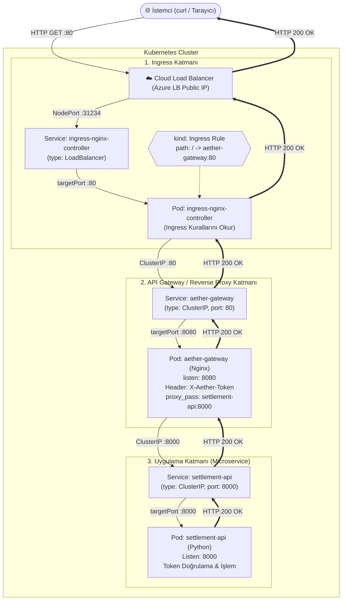

# 🌐 Kubernetes L4/L7 Ağ Trafiği ve Ingress Mimarisi Rehberi

Bu belge, Kubernetes ortamlarında dış dünyadan (İnternet) gelen bir isteğin pod'lara ulaşma sürecini, **İdeal Ingress Controller Mimarisi** ile **Doğrudan LoadBalancer Mimarisi** arasındaki farkları ve paketin hem **gidiş** hem de **geri dönüş (response)** yolculuğunu detaylandırır.

---

## 📌 İçindekiler
1. [İdeal Enterprise Ingress Mimarisi (Uçtan Uca Akış)](#1-ideal-enterprise-ingress-mimarisi)
2. [Mermaid Ağ Diyagramı](#2-mermaid-ağ-diyagramı)
3. [Adım Adım Paketin Gidiş Yolculuğu](#3-adım-adım-paketin-gidiş-yolculuğu)
4. [Geri Dönüş Yolu (Yanıt / Response Akışı)](#4-geri-dönüş-yolu-yanıt--response-akışı)
5. [Port Eşleştirme ve Kavram Sözlüğü](#5-port-eşleştirme-ve-kavram-sözlüğü)
6. [Lab 17 Karşılaştırması: Fiili Durum vs İdeal Durum](#6-lab-17-karşılaştırması)

---

## 1. İdeal Enterprise Ingress Mimarisi

Prodüksiyon ortamlarında her mikroservis veya gateway için ayrı ayrı ücretli Cloud LoadBalancer açılmaz. Bunun yerine cluster'a **tek bir Ingress Controller** (örn: `ingress-nginx` veya `traefik`) kurulur.

Dış dünya tek bir IP'ye gelir; Ingress Controller gelen trafiği URL Path (`/api/v1/...`) veya Hostname (`api.sirket.com`) kurallarına göre içerideki **ClusterIP** servislerine dağıtır.

```
[İSTEMCİ / TARAYICI]
       │  1. İstek: GET http://api.sirket.com/api/v1/settlements
       ▼
┌─────────────────────────────────────────────────────────────┐
│ 1. CLOUD LOAD BALANCER (Azure LB / AWS NLB / GCP LB)        │
│    • Public IP: 20.50.60.70 : 80                             │
│    • Görevi: Trafiği K8s Node'larının NodePort'una iletmek  │
└─────────────────────────────────────────────────────────────┘
       │  2. Bulut LB, trafiği 31234 nolu NodePort'a yollar
       ▼
┌─────────────────────────────────────────────────────────────┐
│ 2. INGRESS CONTROLLER SERVİSİ (type: LoadBalancer)          │
│    • port: 80  ──(NodePort: 31234)──> targetPort: 80/443    │
│    • kube-proxy paketi yakalar ve DNAT ile Ingress Pod'una  │
│      yönlendirir.                                           │
└─────────────────────────────────────────────────────────────┘
       │  3. Paket Ingress Pod'una girer
       ▼
┌─────────────────────────────────────────────────────────────┐
│ 3. INGRESS CONTROLLER POD'U (Nginx Ingress / Traefik Pod'u) │
│    • Kendi içinde çalışan bir Nginx / Envoy motorudur.      │
│    • 'kind: Ingress' kurallarını belleğinde tutar:          │
│      "Eğer path == '/api/v1/settlements' ise                 │
│       hedef -> aether-gateway:80"                           │
│    • Paketi çözer, header ve URL'e göre upstream'e yönlendirir.│
└─────────────────────────────────────────────────────────────┘
       │  4. Cluster ağı üzerinden iç HTTP isteği başlatılır
       ▼
┌─────────────────────────────────────────────────────────────┐
│ 4. AETHER-GATEWAY SERVİSİ (type: ClusterIP)                 │
│    • port: 80  ──(targetPort)──>  8080                      │
│    • Dışarıya kapalıdır (yalnızca cluster içinden erişilir) │
└─────────────────────────────────────────────────────────────┘
       │  5. Paket Gateway Reverse Proxy Pod'una teslim edilir
       ▼
┌─────────────────────────────────────────────────────────────┐
│ 5. AETHER-GATEWAY POD'U (Nginx Reverse Proxy / API Gateway) │
│    • listen: 8080                                           │
│    • Güvenlik adımı: 'X-Aether-Token' header'ını enjekte eder│
│    • proxy_pass http://settlement-api:8000;                 │
└─────────────────────────────────────────────────────────────┘
       │  6. Paket asıl uygulama servisine fırlatılır
       ▼
┌─────────────────────────────────────────────────────────────┐
│ 6. SETTLEMENT-API SERVİSİ (type: ClusterIP: 8000)           │
│    • port: 8000 -> targetPort: 8000                         │
│    • CoreDNS ile çözülür, arkadaki sağlıklı pod'a yönlenir  │
└─────────────────────────────────────────────────────────────┘
       │  7. Backend Pod'una ulaşır
       ▼
┌─────────────────────────────────────────────────────────────┐
│ 7. SETTLEMENT-API POD'U (Python Backend / FastAPI / Flask)  │
│    • App Listen: 8000                                       │
│    • Token'ı doğrular ve isteği işler                       │
│    • Yanıt: HTTP 200 OK {"status": "UPSTREAM_OK"}           │
└─────────────────────────────────────────────────────────────┘
```

---

## 2. Mermaid Ağ Diyagramı



---

## 3. Adım Adım Paketin Gidiş Yolculuğu

1. **Dış Kapı (Cloud LB):**
   * Kullanıcı `http://api.sirket.com/api/v1/settlements` adresine istek attığında DNS isteği Cloud LB'nin Public IP'sine çözer.
   * Cloud LB 80 portunu dinler ve isteği rastgele/sağlıklı bir Kubernetes Node'unun **NodePort** (`31234`) portuna yönlendirir.

2. **Kube-Proxy ve DNAT:**
   * Paket sunucunun fiziksel/sanal ağ kartına (`eth0:31234`) çarpar.
   * `kube-proxy` (iptables / IPVS kuralları) paketi yakalar ve DNAT (Destination NAT) yaparak hedef IP'yi Ingress Controller Pod IP'sine ve portunu `targetPort: 80`'e çevirir.

3. **Ingress Controller İncelemesi (L7 Routing):**
   * Ingress Controller Pod'u HTTP paketini L7 seviyesinde açar.
   * `Host` ve `URI Path` değerlerine bakar.
   * `kind: Ingress` dosyasındaki kurala bakar: *"Bu path `aether-gateway` servisinin 80 portuna ait."*

4. **Cluster İçi İletişim (Gateway Katmanı):**
   * Ingress Controller, paketi doğrudan `aether-gateway` Servisine (port 80) paslar.
   * `aether-gateway` Servisi paketi Nginx Gateway Pod'unun `8080` portuna iletir.

5. **Güvenlik ve Token Enjeksiyonu (Reverse Proxy):**
   * Gateway Pod'u `listen 8080` ile paketi karşılar.
   * `nginx.conf` içindeki kural devreye girer:
     `proxy_set_header X-Aether-Token "aether-prod-access-2026";`
   * Ardından paketi `proxy_pass http://settlement-api:8000/api/v1/settlements;` adresine yönlendirir.

6. **Hedefe Varış (Uygulama Pod'u):**
   * `settlement-api` Servisi (ClusterIP 8000) paketi arkasındaki Python Pod'una iletir.
   * Python FastAPI/Flask uygulaması `X-Aether-Token`'ı doğrular ve `HTTP 200 OK` cevabını üretir.

---

## 4. Geri Dönüş Yolu (Yanıt / Response Akışı)

Kubernetes'te HTTP istek-yanıt döngüsü açılmış olan **TCP soket oturumu** üzerinden geriye doğru akar:

```
[Settlement API Pod] 
       │  HTTP 200 OK {"status": "UPSTREAM_OK"}
       ▼
[aether-gateway Pod] 
       │  HTTP 200 OK
       ▼
[Ingress Controller Pod] 
       │  HTTP 200 OK
       ▼
[Cloud Load Balancer] 
       │  HTTP 200 OK
       ▼
[İstemci / Tarayıcı]
```

* Yanıt dönerken servislerin veya NodePort'ların tekrar isim/IP çözümlemesi yapmasına gerek yoktur; açık TCP oturumu üzerinden tersine doğru akar.

---

## 5. Port Eşleştirme ve Kavram Sözlüğü

| Port Adı | Nerede Tanımlanır? | Anlamı ve Görevi |
| :--- | :--- | :--- |
| **`port`** | `Service` tanımında | Servisin cluster içinde dışarıya sunduğu port. Diğer servisler bu portu arar (Örn: 80 veya 8000). |
| **`targetPort`** | `Service` tanımında | Servisin arkasındaki Pod konteynerının dinlediği gerçek port (Örn: Nginx'in 8080'i). |
| **`nodePort`** | `Service` (LoadBalancer / NodePort) | Cluster düğümünün (VM) dışarıya açtığı 30000-32767 arasındaki kapı numarası. |
| **`listen`** | Pod içindeki Config / Kod | Pod konteynerının prosesinin dinlediği port (Örn: `listen 8080;` veya `uvicorn --port 8000`). |
| **`upstream`** | Nginx ConfigMap / Proxy | Reverse Proxy'nin arkasında yönlendireceği hedef servisin adı ve portu (`settlement-api:8000`). |

---

## 6. Lab 17 Karşılaştırması: Fiili Durum vs İdeal Durum

| Özellik | Lab 17'deki Fiili Durum | İdeal Enterprise Düzen |
| :--- | :--- | :--- |
| **Dış Kapı (Cloud LB)** | Doğrudan `aether-gateway` servisine bağlıdır. | Yalnızca `Ingress Controller` servisine bağlıdır. |
| **Gateway Servis Tipi** | `type: LoadBalancer` (Doğrudan Public IP aldı) | `type: ClusterIP` (Dışarıya kapalı, sadece Ingress görür) |
| **Ingress Controller** | Kurulu değil (Kaynak tasarrufu için kurulmadı) | Kurulu (`ingress-nginx` veya `traefik`) |
| **`60-ingress.yaml` Rolü** | Bilet/Teori sorusu olarak hazırlandı, pratikte pasif kaldı | Aktif yönlendirme kuralı olarak çalışır |
