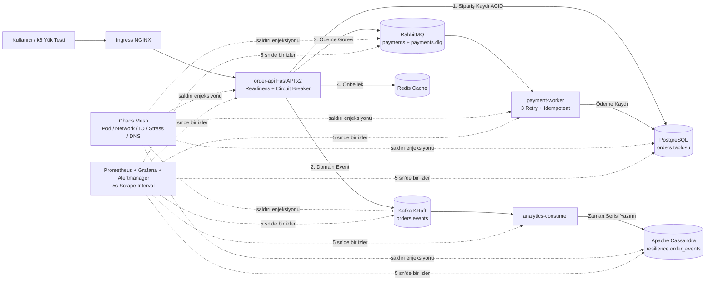

# Proje 5: ResilienceStream — Kafka + RabbitMQ + Cassandra ile Prod Seviyesi Kaos Mühendisliği ve SRE Platformu

> [!IMPORTANT]
> **Bu Projenin Felsefesi:** Bir sistemi sadece "çalışır halde" ayağa kaldırmak (`Hello World`) kolaydır; gerçek DevOps ve Site Reliability Engineering (SRE) mühendisliği ise **veritabanı yavaşladığında, mesaj kuyruğu ağdan koptuğunda, pod'lar aniden öldürüldüğünde veya disk darboğaza girdiğinde sistemin nasıl davrandığını kanıtlamaktır**.  
> `ResilienceStream`, Proje 4'te bizzat yaşayıp çözdüğümüz **12 gerçek altyapı hatasının tamamını baştan kurulum dosyalarına işleyerek** tek komutta hatasız ayağa kalkar ve **Chaos Mesh + Prometheus SLO Alarmları + k6 Yük Testleri** ile gerçek üretim (production) dayanıklılığını test etmenizi sağlar.

---

## 📑 İçindekiler

1. [Mimari Genel Bakış ve Sunucu Topolojisi](#1-mimari-genel-bakış-ve-sunucu-topolojisi)
2. [Neden Bu Teknolojiler? (Prod'da Neden ve Nasıl Kullanılır?)](#2-neden-bu-teknolojiler-prodda-neden-ve-nasıl-kullanılır)
3. [Uygulama Dayanıklılık Desenleri (Resilience Patterns)](#3-uygulama-dayanıklılık-desenleri-resilience-patterns)
4. [Proje Dizin Yapısı](#4-proje-dizin-yapısı)
5. [Sıfır Hatalı Kurulum Rehberi (Adım Adım + Ön-Kontrol & Doğrulama)](#5-sıfır-hatalı-kurulum-rehberi-adım-adım--ön-kontrol--doğrulama)
6. [Web Arayüzleri, Erişim Bilgileri ve Servis DNS Haritası](#6-web-arayüzleri-erişim-bilgileri-ve-servis-dns-haritası)
7. [Kaos Mühendisliği (Chaos Engineering) — 9 Game Day Müfredatı](#7-kaos-mühendisliği-chaos-engineering--9-game-day-müfredatı)
8. [Gözlemlenebilirlik: Grafana Dashboard'ları ve Prometheus SLO Alarmları](#8-gözlemlenebilirlik-grafana-dashboardları-ve-prometheus-slo-alarmları)
9. [Derinlemesine Mühendislik Dokümanları ve Sorun Çözme Rehberi](#9-derinlemesine-mühendislik-dokümanları-ve-sorun-çözme-rehberi)
10. [Altyapıyı Güvenle Silme (Cleanup)](#10-altyapıyı-güvenle-silme-cleanup)

---

## 1. Mimari Genel Bakış ve Sunucu Topolojisi



### Azure Kota Optimizasyonu (Seçenek A: 3 Sunucu, Toplam 6 vCPU)

Azure for Students aboneliğindeki **6 vCPU ve 3 Public IP** sınırını en yüksek kararlılıkla kullanmak için 3 katmanlı (Tiered) mimari uygulanmıştır:

| Sunucu Adı | Boyut (vCPU / RAM) | Özel IP | Public IP | Kubernetes Taint & Label | Üzerinde Çalışan İş Yükleri |
| :--- | :--- | :--- | :--- | :--- | :--- |
| **`vm-master`** | `Standard_B2s_v2` (2 vCPU / **8 GB RAM**) | `10.30.1.4` | Public IP #1 | `CriticalAddonsOnly=true:NoSchedule` `tier=platform` | RKE2 Control Plane + etcd, Ingress NGINX, Rancher, ArgoCD, Prometheus, Grafana, Alertmanager, Chaos Mesh |
| **`vm-worker-data`** | `Standard_B2s` (2 vCPU / **4 GB RAM**) | `10.30.1.5` | Yok (NAT GW Public IP #3 ile internete çıkar) | `dedicated=data:NoSchedule` `tier=data` | **Apache Kafka (KRaft)**, **Apache Cassandra** (`768M` Heap), **PostgreSQL** (`namespace: data`) |
| **`vm-worker-app`** | `Standard_B2s` (2 vCPU / **4 GB RAM**) | `10.30.1.6` | Public IP #2 | Taint yok, `tier=app` | `order-api` (×2), `analytics-consumer`, `payment-worker` (`ns: app`), **RabbitMQ**, **Redis** (`ns: messaging`), **GitLab Runner** |

> [!WARNING]
> **Neden `vm-worker-data`'nın Doğrudan Public IP'si Yok?**  
> Gerçek üretim ortamlarında veritabanları (PostgreSQL, Cassandra, Kafka) **asla** internete açık bir Public IP'ye sahip olmaz! Dış dünyadan paket alamazlar; sadece küme içinden erişilebilirler ve dışarıdan imaj çekmek için tek yönlü **Azure NAT Gateway (Public IP #3)** kullanırlar.

---

## 2. Neden Bu Teknolojiler? (Prod'da Neden ve Nasıl Kullanılır?)

Bu projede her bileşen endüstrideki gerçek bir problemi çözmek için seçilmiştir:

| Teknoloji | Bu Mimarideki Görevi | Neden Prod'da Vazgeçilmezdir? |
| :--- | :--- | :--- |
| **Apache Kafka (KRaft)** | `order-api`'den çıkan `orders.events` olaylarını kalıcı diske yazar ve `analytics-consumer`'a akıtır. | **Yüksek Hacimli Olay Akışı & Tamponlama:** Mesajlar okunsa bile silinmez (`append-only log`). Cassandra yavaşladığında (Game Day 02) şok emici tampon görevi görür ve geçmiş olayların tekrar oynatılmasını (**Event Replay**) sağlar. ZooKeeper'sız **KRaft** moduyla çalışır. |
| **RabbitMQ + DLQ** | `payments` kuyruğundaki ödeme görevlerini `payment-worker`'a dağıtır; 3 kez başarısız olanları `payments.dlq` kuyruğuna ayırır. | **Görev Kuyruğu & Bireysel Retry/DLQ:** Kafka'nın aksine mesaj bazlı onay (`basic_ack` / `basic_nack`) ve **Dead-Letter Exchange (DLX)** desteği sunar. Bozuk bir ödeme mesajı diğer müşterilerin ödemelerini bloklamaz. |
| **Apache Cassandra** | `resilience.order_events` tablosunda müşteri bazlı (`PRIMARY KEY ((customer_id), created_at, order_id)`) olay geçmişini tutar. | **Masterless LSM-Tree Yazma Hızı:** Yazma sırasında diskten okuma yapmaz (`CommitLog` + `Memtable`), böylece saniyede yüz binlerce olayı darboğaz olmadan kaydeder. (Detay: [`docs/05-cassandra-data-modeling.md`](docs/05-cassandra-data-modeling.md)). |
| **PostgreSQL** | `orders` ve `payments` tablolarını tutar. | **ACID Garantisi & Finansal Kayıt Sistemi (System of Record):** Sipariş ve ödeme kayıtlarında veri bütünlüğü ve `ON CONFLICT (order_id) DO NOTHING` ile **idempotency** sağlar. |
| **Redis** | Sipariş sorgularını önbelleğe alır (`cache-aside`). | **Mikrosaniye Okuma & Graceful Degradation:** Veritabanı üzerindeki okuma yükünü azaltır. Çöktüğünde ise sistem durmaz; doğrudan PostgreSQL'e düşer (Game Day 07). |
| **Chaos Mesh** | Kubernetes CRD'leri ile pod, ağ, disk, CPU/RAM ve DNS arızaları enjekte eder. | **Bildirimli (Declarative) Kaos Mühendisliği:** Dağıtık sistemin zayıf noktalarını üretimde müşteri yaşamadan önce kontrollü deneylerle kanıtlar. |

---

## 3. Uygulama Dayanıklılık Desenleri (Resilience Patterns)

Tek bir Docker imajı (`yusufk00/resiliencestream`) `APP_ROLE` ortam değişkenine göre 3 farklı rolde (`api`, `analytics`, `payment`) çalışır ve aşağıdaki prod pratiklerini içerir:

1. **Readiness ≠ Liveness Ayrımı (`/readyz` vs `/healthz`):**
   - `/healthz` (Liveness Probe): Yalnızca Python/Uvicorn sürecinin hayatta olduğunu kontrol eder. **Hiçbir dış veritabanına bakmaz!** Böylece Kafka veya RabbitMQ çöktüğünde Kubernetes `order-api` pod'larını boş yere yeniden başlatıp kaskad çöküş (cascading failure) yaratmaz.
   - `/readyz` (Readiness Probe): Yalnızca kritik bağımlılık olan **PostgreSQL** bağlantısını kontrol eder.
2. **Arka Plan Sağlık Kontrol İş Parçacığı (`BackgroundHealthProber`):**
   - Proje 4'ten aldığımız en önemli derslerden biri: `/metrics` uç noktası çağrıldığında ağa çıkıp veritabanlarına ping **atılmaz**. Arka planda çalışan bir daemon thread **her 5 saniyede bir** 5 bağımlılığı (`postgres`, `kafka`, `rabbitmq`, `cassandra`, `redis`) yoklar ve `rs_dependency_up` ile `rs_dependency_latency_seconds` metriklerini bellekte günceller. Böylece `/metrics` her zaman <2ms içinde yanıt verir!
3. **Circuit Breaker (Devre Kesici — `CLOSED (0)` → `OPEN (2)` → `HALF-OPEN (1)`):**
   - Bir bağımlılık ardışık olarak hata verdiğinde devre kesici `OPEN (2)` durumuna geçer (`rs_circuit_breaker_state == 2`) ve çağrıları TCP timeout beklemeden anında keser (Fail-Fast).
4. **Timeout + Exponential Backoff + Jitter + Idempotent Consumer:**
   - Geçici ağ hatalarında üssel artan bekleme süresiyle (exponential backoff) 3 kez deneme yapılır; `payment-worker` ödemeleri PostgreSQL'e idempotent olarak yazar, kalıcı hataları ise `payments.dlq` kuyruğuna yönlendirir.

---

## 4. Proje Dizin Yapısı

```text
devops-capstone-project-5/
├── terraform/                  # Azure altyapısı (3 VM, VNet, NSG, NAT Gateway, hosts.ini üretimi)
├── ansible/                    # 01..06 tam otomatik kurulum playbook'ları (preflight + smoke test dahil)
│   ├── site.yml                # Tek komutla uçtan uca kurulum orkestrasyonu
│   └── playbooks/              # 01-os-prep, 02-rke2, 03-platform, 04-data, 05-app-gitops, 06-chaos
├── helm-values/                # Bitnami (kafka, cassandra, postgres, rabbitmq, redis), monitoring, chaos-mesh
├── app/                        # FastAPI order-api + analytics-consumer + payment-worker + Helm chart
│   ├── src/                    # config.py, metrics.py, resilience.py, main.py, workers
│   └── chart/                  # Deployment (x2), PDB (minAvailable:1), HPA, ServiceMonitor, Ingress
├── gitops/                     # ArgoCD Application manifesti
├── observability/              # Prometheus告警 kuralları (prometheus-rules.yaml) ve 3 Grafana Dashboard JSON
├── chaos/
│   ├── experiments/            # 01..09 Chaos Mesh YAML manifestleri
│   ├── game-days/              # 00 Postmortem şablonu + 01..09 adım adım Game Day uygulama rehberleri
│   └── load/k6-black-friday.js # k6 Black Friday yük testi senaryosu
├── docs/                       # 01..05 derinlemesine mühendislik ve sorun çözme dokümanları
└── .gitlab-ci.yml              # 4 aşamalı CI/CD + GitOps Promote (GitLab & GitHub çift push)
```

---

## 5. Sıfır Hatalı Kurulum Rehberi (Adım Adım + Ön-Kontrol & Doğrulama)

> [!CAUTION]
> **Ön Koşul — Proje 4'ü Silin!**  
> Azure for Students aboneliğinde bölgesel **6 vCPU ve 3 Public IP** sınırı vardır. Eğer Proje 4 hâlâ çalışıyorsa Proje 5 için VM oluştururken `QuotaExceeded` hatası alırsınız. Başlamadan önce Proje 4 dizininde `terraform destroy -auto-approve` çalıştırdığınızdan veya `az group delete -n rg-streamforge-4 --yes` ile sildiğinizden emin olun.

### Adım 0: Kurulum Öncesi Ön-Kontrol (Pre-Flight Check)

Yerel makinenizde gerekli araçların, SSH anahtarının ve Azure oturumunun hazır olduğunu doğrulayın:

```bash
# 1) Azure CLI oturumunu ve aktif aboneliği kontrol et
az account show --output table

# 2) Bölgede (denmarkeast) boş vCPU kotası olduğunu doğrula (CurrentValue == 0 olmalı)
az vm list-usage --location denmarkeast --output table | grep -E "Total Regional vCPUs|Standard BS Family|Standard Bv2 Family"

# 3) SSH açık anahtarının (~/.ssh/id_rsa.pub) mevcut olduğunu kontrol et
ls -la ~/.ssh/id_rsa.pub

# 4) Terraform ve Ansible sürümlerini doğrula
terraform version
ansible --version
```

---

### Adım 1: Terraform ile Azure Altyapısını Oluşturma (~3-4 Dakika)

Terraform; Resource Group (`rg-resiliencestream-5`), VNet (`10.30.0.0/16`), NSG, NAT Gateway, 3 adet Ubuntu VM (`vm-master`, `vm-worker-data`, `vm-worker-app`) oluşturur ve Ansible için `ansible/inventory/hosts.ini` dosyasını **otomatik üretir**.

```bash
cd /home/ysf/k8sfundamentals/Projects/devops-capstone-project-5/terraform

# 1) Terraform eklentilerini başlat ve doğrula
terraform init
terraform validate

# 2) Altyapıyı oluştur
terraform apply -auto-approve
```

#### ✅ Adım 1 Doğrulama Komutu:
```bash
# Üretilen IP adreslerini ve otomatik oluşturulan Ansible envanterini kontrol et:
terraform output
cat ../ansible/inventory/hosts.ini
```

---

### Adım 2: Ansible ile RKE2, Veri Katmanı, GitOps ve Chaos Mesh Kurulumu (~15-20 Dakika)

`site.yml` sırasıyla 6 playbook'u çalıştırır ve **her playbook sonunda otomatik duman testi (smoke test)** yapar:
1. `01-os-prep.yml`: Swap kapatma, kernel modülleri (`br_netfilter`, `overlay`, `sch_netem` — Chaos Mesh ağ gecikmesi için şart!), sysctl ayarları.
2. `02-rke2-cluster.yml`: RKE2 Server & Agent kurulumu, Taint/Label atamaları, `local-path-provisioner` toleration yaması, Ingress NGINX webhook hazırlık beklemesi.
3. `03-platform-tools.yml`: Helm kurulumu, Rancher, ArgoCD, `kube-prometheus-stack` (5s scrape interval, 3 hazır Grafana dashboard'u ve SLO alarmları), GitLab Runner.
4. `04-data-layer.yml`: Bitnami Kafka KRaft, Apache Cassandra (`768M` heap), PostgreSQL, RabbitMQ ve Redis kurulumları + hazırlık kontrolleri.
5. `05-app-gitops.yml`: Uygulama namespace/secret hazırlığı ve ArgoCD `resiliencestream` Application tanımı.
6. `06-chaos-platform.yml`: Chaos Mesh (`/run/k3s/containerd/containerd.sock` ile) ve DNSChaos sunucusu kurulumu.

```bash
cd /home/ysf/k8sfundamentals/Projects/devops-capstone-project-5/ansible

# Önce tüm sunuculara SSH erişimini test et (hepsi SUCCESS / pong dönmeli):
ansible all -m ping

# Tüm platformu tek komutla kur:
ansible-playbook site.yml
```

*(İpucu: Eğer GitLab Runner'ı kendi GitLab deponuza otomatik kaydetmek isterseniz `-e "gitlab_runner_token=glrt-XXXX"` parametresini ekleyebilirsiniz.)*

#### ✅ Adım 2 Doğrulama Komutları (Master Sunucuda veya Yerel Kubeconfig ile):
```bash
# Master sunucuya bağlanın (veya kubeconfig dosyasını yerelinize çekin):
MASTER_IP=$(cd ../terraform && terraform output -raw master_public_ip)
APP_IP=$(cd ../terraform && terraform output -raw app_worker_public_ip)
ssh ysf@$MASTER_IP

# 1) 3 Node'un da Ready olduğunu doğrula:
kubectl get nodes -o wide

# 2) Tüm namespace'lerdeki podların Running / Completed olduğunu doğrula:
kubectl get pods -A

# 3) ArgoCD uygulamasının Synced ve Healthy olduğunu doğrula:
kubectl get applications -n argocd

# 4) Sipariş API'sine gerçek bir POST isteği göndererek uçtan uca akışı doğrula:
curl -i -X POST "http://app.${APP_IP}.nip.io/api/orders" \
  -H "Content-Type: application/json" \
  -d '{"customer_id":"verify-01","product_id":"sku-100","quantity":1,"amount":99.90}'
```

Beklenen çıktı: **`HTTP/1.1 200 OK` (veya `201 Created`)** ve JSON yanıtında sipariş kimliği (`order_id`)!

---

## 6. Web Arayüzleri, Erişim Bilgileri ve Servis DNS Haritası

### 6.1. Dış Web Arayüzleri (Ingress)

| Arayüz | URL Şablonu | Kullanıcı Adı | Şifre |
| :--- | :--- | :--- | :--- |
| **ResilienceStream API & UI** | `http://app.<APP_IP>.nip.io` | — (Açık API) | — |
| **Swagger / OpenAPI Docs** | `http://app.<APP_IP>.nip.io/docs` | — | — |
| **Grafana (3 Dashboard Hazır)** | `http://grafana.<MASTER_IP>.nip.io` | `admin` | `AdminPassword2026!` |
| **ArgoCD UI** | `https://argocd.<MASTER_IP>.nip.io` | `admin` | `AdminPassword2026!` |
| **Rancher UI** | `https://rancher.<MASTER_IP>.nip.io` | `admin` | `AdminPassword2026!` |
| **Chaos Mesh Dashboard** | `http://chaos.<MASTER_IP>.nip.io` | — (Cluster-scoped) | — |
| **RabbitMQ Management UI** | `http://rabbitmq.<APP_IP>.nip.io` | `resilience` | `AdminPassword2026!` |

### 6.2. Küme İçi (In-Cluster) Servis DNS Haritası

| Bileşen | Namespace | Küme İçi Tam DNS Adı (FQDN) | Port | Kimlik Bilgileri |
| :--- | :--- | :--- | :--- | :--- |
| **Kafka (KRaft)** | `data` | `kafka.data.svc.cluster.local` | `9092` | PLAINTEXT (Küme içi) |
| **Cassandra** | `data` | `cassandra.data.svc.cluster.local` | `9042` | `resilience` / `AdminPassword2026!` (Keyspace: `resilience`) |
| **PostgreSQL** | `data` | `postgres-postgresql.data.svc.cluster.local` | `5432` | `resilience` / `AdminPassword2026!` (DB: `resilience`) |
| **RabbitMQ** | `messaging` | `rabbitmq.messaging.svc.cluster.local` | `5672` / `15672` | `resilience` / `AdminPassword2026!` |
| **Redis** | `messaging` | `redis-master.messaging.svc.cluster.local` | `6379` | Şifre: `AdminPassword2026!` |

---

## 7. Kaos Mühendisliği (Chaos Engineering) — 9 Game Day Müfredatı

Sistem tamamen ayağa kalktıktan sonra projenin asıl kalbi olan **9 Kaos Deneyini** çalıştırabilirsiniz. Her deneyin içinde **Hipotez, Steady State PromQL sorguları, Blast Radius, Abort koşulu, adım adım komutlar ve Prod notu** hazır olarak yazılmıştır:

| # | Game Day Rehberi | Çalıştırma Komutu | Kanıtlanan Prod Özelliği |
| :--- | :--- | :--- | :--- |
| **00** | [`00-postmortem-template.md`](chaos/game-days/00-postmortem-template.md) | *(Şablon)* | Blameless Postmortem (5 Whys, TTD/TTR, Aksiyon Takibi) |
| **01** | [`01-pod-kill-order-api.md`](chaos/game-days/01-pod-kill-order-api.md) | `kubectl apply -f chaos/experiments/01-pod-kill-order-api.yaml` | 2 Replica + Readiness Probe ile `SIGKILL` altında sıfır kesinti |
| **02** | [`02-network-latency-cassandra.md`](chaos/game-days/02-network-latency-cassandra.md) | `kubectl apply -f chaos/experiments/02-network-latency-cassandra.yaml` | Cassandra 300ms yavaşlasa bile Kafka izolasyonu sayesinde API p99 bozulmaz |
| **03** | [`03-network-partition-rabbitmq.md`](chaos/game-days/03-network-partition-rabbitmq.md) | `kubectl apply -f chaos/experiments/03-network-partition-rabbitmq.yaml` | Ağ bölünmesinde Circuit Breaker (`OPEN`) ve DLQ (`payments.dlq`) koruması |
| **04** | [`04-kafka-broker-kill.md`](chaos/game-days/04-kafka-broker-kill.md) | `kubectl apply -f chaos/experiments/04-kafka-broker-kill.yaml` | Broker çöküşünde StatefulSet kalıcılığı ve otomatik consumer lag erimesi |
| **05** | [`05-stress-payment-worker.md`](chaos/game-days/05-stress-payment-worker.md) | `kubectl apply -f chaos/experiments/05-stress-payment-worker.yaml` | CPU/RAM baskısı altında Noisy Neighbor izolasyonu, HPA ve Manual Ack |
| **06** | [`06-io-latency-postgres.md`](chaos/game-days/06-io-latency-postgres.md) | `kubectl apply -f chaos/experiments/06-io-latency-postgres.yaml` | Disk (`write`/`fsync`) gri arızasının `RSHighLatencyP99` alarmıyla yakalanması |
| **07** | [`07-dns-chaos.md`](chaos/game-days/07-dns-chaos.md) | `kubectl apply -f chaos/experiments/07-dns-chaos.yaml` | Redis DNS hatasında önbelleği atlayıp DB'ye gitme (**Graceful Degradation**) |
| **08** | [`08-node-drain.md`](chaos/game-days/08-node-drain.md) | `kubectl drain vm-worker-app --ignore-daemonsets ...` | Bakım sırasında `PodDisruptionBudget (minAvailable: 1)` tahliye koruması |
| **09** | [`09-black-friday-gameday.md`](chaos/game-days/09-black-friday-gameday.md) | `k6 run ...` + `kubectl apply -f chaos/experiments/09-black-friday-workflow.yaml` | **Büyük Final:** Black Friday `k6` yükü altında çoklu paralel/seri kaos akışı |

---

## 8. Gözlemlenebilirlik: Grafana Dashboard'ları ve Prometheus SLO Alarmları

Prometheus her **5 saniyede bir** (`scrapeInterval: 5s`, `evaluationInterval: 5s`) metrikleri toplar ve değerlendirir. Bir kaos deneyi başlattığınızda alarmların **10–15 saniye içinde** ateşlendiğini (`Firing`) görebilirsiniz.

### 8.1. Hazır Grafana Dashboard'ları (`observability/dashboards/`)
1. **`01-slo-overview.json` (SLO Overview):** İstek hızı (RPS), HTTP 2xx vs 5xx başarı oranı, Error Budget Burn Rate, p50 / p95 / p99 gecikme eğrileri ve oluşturulan sipariş sayaçları.
2. **`02-messaging-kafka-vs-rabbitmq.json` (Messaging):** Kafka tüketilen event hızı ve `rs_kafka_consumer_lag` grafiği ile RabbitMQ `success` / `retry` / `dlq` mesaj işleme oranlarının yan yana karşılaştırması.
3. **`03-chaos-gameday.json` (Chaos Game Day):** 5 altyapı bağımlılığının canlı durumu (`rs_dependency_up`), bağımlılık gecikmeleri (`rs_dependency_latency_seconds`), devre kesici durumları (`0=CLOSED, 1=HALF-OPEN, 2=OPEN`) ve aktif Chaos Mesh deneyleri.

### 8.2. Prometheus Alarmları ve Runbook Bağlantıları (`observability/prometheus-rules.yaml`)

| Alarm Adı | Koşul (Özet) | Önem | Runbook Bağlantısı |
| :--- | :--- | :--- | :--- |
| **`RSDependencyDown`** | `rs_dependency_up == 0` (10s) | `critical` | [`#dependency-down`](docs/02-troubleshooting-playbook.md#dependency-down) |
| **`RSHighErrorRate`** | HTTP 5xx oranı `> %1` (1m) | `critical` | [`#slo-burn`](docs/02-troubleshooting-playbook.md#slo-burn) |
| **`RSHighLatencyP99`** | HTTP p99 gecikmesi `> 1.0s` (1m) | `warning` | [`#high-latency`](docs/02-troubleshooting-playbook.md#high-latency) |
| **`RSCircuitBreakerOpen`** | `rs_circuit_breaker_state == 2` | `warning` | [`#circuit-open`](docs/02-troubleshooting-playbook.md#circuit-open) |
| **`RSKafkaConsumerLagHigh`** | `rs_kafka_consumer_lag > 100` (1m) | `warning` | [`#consumer-lag`](docs/02-troubleshooting-playbook.md#consumer-lag) |
| **`RSDlqMessagesGrowing`** | `increase(rs_rabbitmq_messages_processed_total{result="dlq"}[5m]) > 0` | `critical` | [`#dlq-growth`](docs/02-troubleshooting-playbook.md#dlq-growth) |
| **`RSPodCrashLooping`** | 10 dakikada `> 3` konteyner restart | `warning` | [`#pod-restarts`](docs/02-troubleshooting-playbook.md#pod-restarts) |
| **`RSNodeMemoryHigh`** | Node RAM kullanımı `> %85` (2m) | `warning` | [`#node-memory`](docs/02-troubleshooting-playbook.md#node-memory) |

---

## 9. Derinlemesine Mühendislik Dokümanları ve Sorun Çözme Rehberi

Bu depodaki `docs/` klasörü, mülakatlarda ve gerçek üretim ortamlarında karşınıza çıkacak mimari soruları yanıtlayan bir başucu kitabı olarak hazırlanmıştır:

- 📘 **[`docs/01-prod-vs-lab.md`](docs/01-prod-vs-lab.md):** Gerçek üretim ortamında Multi-AZ, Cassandra `RF=3` / `LOCAL_QUORUM` (`R+W>RF`), Kafka 3 Broker + `min.insync.replicas=2`, RabbitMQ Quorum Queues ve PostgreSQL Patroni/CNPG HA nasıl kurulur vs Lab ödünleri.
-  🛠️ **[`docs/02-troubleshooting-playbook.md`](docs/02-troubleshooting-playbook.md):** 6 Adımlı Sistematik Sorun Çözme Rehberi + 8 Alarmın Runbook'u + **Proje 4'te Gerçekten Yaşadığımız 12 Vakanın Kök Neden Analizi (RCA)**.
- 🔥 **[`docs/03-chaos-engineering-guide.md`](docs/03-chaos-engineering-guide.md):** Kaos Mühendisliği prensipleri, RKE2 containerd mimarisi ve Game Day yönetim rolleri.
- ⚖️ **[`docs/04-kafka-vs-rabbitmq.md`](docs/04-kafka-vs-rabbitmq.md):** Apache Kafka (Event Log) ile RabbitMQ (Task Queue + DLQ) arasındaki mimari farklar ve neden ikisini birlikte kullandığımız.
- 🗄️ **[`docs/05-cassandra-data-modeling.md`](docs/05-cassandra-data-modeling.md):** Apache Cassandra LSM-Tree yazma yolu, Partition Key vs Clustering Column tasarımı ve `ALLOW FILTERING` / Tombstone tuzakları.

---

## 10. Altyapıyı Güvenle Silme (Cleanup)

Çalışmanız ve Game Day deneyleriniz bittiğinde Azure kredinizi korumak için tüm bulut kaynaklarını tek komutla temizleyebilirsiniz:

```bash
cd /home/ysf/k8sfundamentals/Projects/devops-capstone-project-5/terraform
terraform destroy -auto-approve
```
