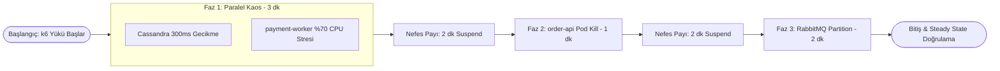

# Game Day 09 — "Black Friday" Büyük Final: k6 Yükü Altında Çoklu Kaos Workflow'u

**Manifestler:**  
- Kaos Akışı: [`chaos/experiments/09-black-friday-workflow.yaml`](../experiments/09-black-friday-workflow.yaml)  
- Yük Testi: [`chaos/load/k6-black-friday.js`](../load/k6-black-friday.js)  
**Kapsam:** Tüm Sistem (`order-api`, `payment-worker`, `analytics-consumer`, `cassandra`, `rabbitmq`)  
**Kaos Türü:** Chaos Mesh `Workflow` (Paralel + Seri Çoklu Arıza) + Eşzamanlı `k6` Yük Testi (20 Eşzamanlı Kullanıcı / ~16 Dakika)

---

## 1. Hipotez (Neyi Kanıtlıyoruz?)

> **Hipotez:** Yılın en yoğun alışveriş günü ("Black Friday") trafiği (`k6` ile 20 sanal kullanıcı sürekli sipariş oluştururken) altında, ardışık ve eşzamanlı altyapı arızaları yaşandığında:
> - **Faz 1 (Paralel):** Cassandra'da 300ms ağ gecikmesi **VE** `payment-worker` üzerinde %70 CPU stresi aynı anda yaşanırken,
> - **Faz 2:** Yük altında `order-api` pod'larından biri aniden (`SIGKILL`) çökerken,
> - **Faz 3:** `order-api` ile RabbitMQ arasında 2 dakikalık ağ bölünmesi (`partition`) yaşanırken;
>
> Sistem genelinde **k6 HTTP hata oranı `< %1` (`http_req_failed < 0.01`)**, **p99 yanıt süresi `< 1000ms` (`p(99) < 1000`)** SLO sınırları içinde kalır ve Workflow tamamlandıktan sonra **5 dakika içinde** tüm metrikler (Consumer Lag, Circuit Breaker, Pod Ready) insan müdahalesi olmadan Steady State'e döner!

**Neden Prod'da Önemli?**  
Gerçek felaketler asla tek başına ve sistem boşken gelmez. Trafiğin zirve yaptığı anda hem bir veritabanı yavaşlar, hem bir worker CPU darboğazına girer, hem de bir pod çöker (bileşik arıza / compound failure). Bir sistemin gerçekten "Production-Ready" (Üretime Hazır) olduğunun nihai kanıtı bu testtir.

---

## 2. Workflow Zaman Çizelgesi (Mimari Akış)



---

## 3. Steady State (Normal Durum) Kontrolü — PromQL

Game Day başlamadan önce tüm kontrol listesi **yeşil** olmalıdır:

```promql
# 1) Tüm bağımlılıklar ayakta (1)
min(rs_dependency_up) == 1

# 2) Tüm devre kesiciler kapalı (0 = CLOSED)
max(rs_circuit_breaker_state) == 0

# 3) Kafka consumer lag == 0
max(rs_kafka_consumer_lag) == 0

# 4) Aktif başka bir Chaos deneyi yok
count(kube_pod_info{namespace="chaos-mesh"}) > 0
```

---

## 4. Blast Radius (Etki Yarıçapı) ve Güvenlik Korkulukları

- **Toplam Emniyet Süresi (`deadline: 20m`):** Workflow ne olursa olsun en fazla 20 dakika içinde tüm kaos kurallarını kaldırır.
- **Yük Sınırı:** Lab ortamımız `6 vCPU` olduğu için `k6` sanal kullanıcı sayısı `20 VU` olarak kalibre edilmiştir (amaç sunucunun ağ kartını DDoS'lamak değil, uygulama dayanıklılık desenlerini test etmektir).

---

## 5. Abort (Acil Durdurma) Koşulları

1. `order-api` HTTP 5xx oranı 2 dakikadan uzun süre **%10'un üzerinde** kilitlenirse (`RSHighErrorRate` kritik seviye).
2. `vm-worker-data` veya `vm-worker-app` sunucularından biri `NotReady` durumuna düşerse.

**Acil Durdurma Komutu:**
```bash
# Tüm workflow'u ve altındaki aktif kaos deneylerini anında durdurur:
kubectl delete -f chaos/experiments/09-black-friday-workflow.yaml
```

---

## 6. Adım Adım Çalıştırma Komutları

### Adım 1: Ön Temizlik (Önceki Deneylerden Kalan Nesne Olmadığından Emin Olun)
```bash
kubectl delete podchaos,networkchaos,stresschaos,iochaos,dnschaos,workflow --all -n chaos-mesh
```

### Adım 2: Grafana Dashboard'larını Açın
Tarayıcıda `http://grafana.<MASTER_IP>.nip.io` adresine gidin ve şu 3 dashboard'u yan yana sekmelerde açın (yenileme hızı `5s` olarak ayarlıdır):
1. **ResilienceStream — SLO Overview**
2. **ResilienceStream — Messaging (Kafka vs RabbitMQ)**
3. **ResilienceStream — Chaos Game Day**

### Adım 3: `k6` Black Friday Yük Testini Başlatın (Terminal 1)
```bash
# Makinenizde k6 kuruluysa doğrudan, değilse Docker ile çalıştırabilirsiniz:
k6 run -e BASE_URL="http://app.<APP_IP>.nip.io" chaos/load/k6-black-friday.js
```
*(Alternatif: `k6` ikili dosyası yoksa Docker ile: `docker run --rm -i grafana/k6 run -e BASE_URL="http://app.<APP_IP>.nip.io" - < chaos/load/k6-black-friday.js`)*

### Adım 4: Isınma (1. Dakika) Sonrası Kaos Workflow'unu Başlatın (Terminal 2)
```bash
kubectl apply -f chaos/experiments/09-black-friday-workflow.yaml
```

### Adım 5: Workflow İlerleyişini Canlı İzleyin (Terminal 2)
```bash
kubectl get workflow -n chaos-mesh black-friday -w
# Ayrıca her fazda oluşan alt kaos nesnelerini görmek için:
watch -n 5 "kubectl get workflow,podchaos,networkchaos,stresschaos -n chaos-mesh"
```

---

## 7. Beklenen Gözlem (Faz Faz Grafana & Alarm Analizi)

| Faz | Süre | Grafana'da Ne Göreceksiniz? | Tetiklenen Alarmlar |
| :--- | :--- | :--- | :--- |
| **Faz 1: Paralel** (`latency-cassandra` + `stress-payment`) | 0–3. dk | Cassandra latency ~300ms'ye çıkar, `rs_kafka_consumer_lag` yükselir. `payment-worker` CPU kullanımı %70+'a vurur. Ancak `order-api` p99 gecikmesi **<300ms** kalır! | `RSKafkaConsumerLagHigh` (lag > 100 olursa) |
| **Nefes Payı 1** (`pause-1`) | 3–5. dk | Cassandra gecikmesi kalkar, `analytics-consumer` biriken Kafka kuyruğunu hızla eritir ve lag 0'a yaklaşır. | Alarmlar `Resolved` olur |
| **Faz 2: Pod Kill** (`kill-order-api`) | 5–6. dk | `order-api` pod'larından biri ölür, diğeri tüm yükü (20 VU) sırtlar. 5–10 saniyeliğine p99 hafif yükselir ama 5xx oranı <%1 kalır. | Alarm beklenmez (PDB + 2 replica korur) |
| **Nefes Payı 2** (`pause-2`) | 6–8. dk | Yeni `order-api` pod'u `Ready` olur ve yük tekrar iki pod'a dengelenir. | Steady state |
| **Faz 3: Partition** (`partition-rabbitmq`) | 8–10. dk | Bir `order-api` pod'unda `rs_dependency_up{dependency="rabbitmq"}` 0'a düşer, `rs_circuit_breaker_state` `2 (OPEN)` olur. Devre kesici sayesinde istekler takılmaz! | `RSDependencyDown`, `RSCircuitBreakerOpen` |
| **Soğuma & Bitiş** | 10–16. dk | Tüm kaos biter, devre kesiciler `CLOSED (0)` olur, `k6` testi yeşil tik (`✓ status 2xx`, `✓ http_req_failed < 0.01`) ile tamamlanır! | Tüm alarmlar `Resolved` |

---

## 8. Toparlanma (Recovery) ve Postmortem

Workflow tamamlandıktan sonra temizlik yapın ve öğrendiklerinizi belgeleyin:

```bash
# Workflow nesnesini silin
kubectl delete -f chaos/experiments/09-black-friday-workflow.yaml

# Tüm podların sağlıklı ve tüm kuyrukların erimiş olduğunu doğrulayın
kubectl get pods -n app
kubectl get pods -n data
kubectl get pods -n messaging
```

> [!TIP]
> **Postmortem Alıştırması:** Eğer `k6` çıktısında eşiklerden (`thresholds`) herhangi biri kırmızı yandıysa veya beklenmeyen bir alarm tetiklendiyse, [`00-postmortem-template.md`](./00-postmortem-template.md) dosyasını kopyalayarak gerçek bir **Blameless Postmortem** raporu doldurun!
