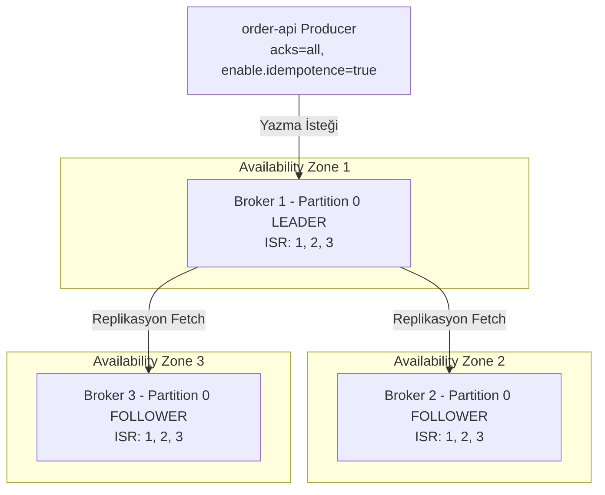

# 01 — Gerçek Üretim Ortamı (Production) vs Lab Mimarisi Karşılaştırması

> [!IMPORTANT]
> **Bu Dokümanın Amacı:** Azure for Students aboneliğinin **6 vCPU ve 3 Public IP** kotasına sığabilmek için bu laboratuvarda bilinçli mühendislik ödünleri (trade-offs) verdik. Ancak iyi bir DevOps/SRE mühendisi, lab ortamında yaptığı kısaltmaların gerçek üretimde (Production) **neden asla kullanılamayacağını** ve prod ortamında bunların doğrusunun nasıl kurulduğunu ezbere bilmelidir.

---

## 1. Büyük Resim: Mimari Karşılaştırma Tablosu

| Katman / Bileşen | Bu Lab (`ResilienceStream` - 6 vCPU Kota) | Gerçek Üretim Ortamı (Production - Enterprise) | Neden Prod'da Böyle? (Kök Neden) |
| :--- | :--- | :--- | :--- |
| **Bulut & Ağ Topolojisi** | Tek Region (`denmarkeast`), Tek Availability Zone, 1× Subnet (`10.30.1.0/24`) | **Multi-AZ (3 Availability Zone)**, Public / Private App / Isolated Data Subnet'leri | Bir veri merkezi binasında yangın/elektrik kesintisi olduğunda diğer 2 AZ kesintisiz hizmete devam etsin diye. |
| **Kubernetes Control Plane** | 1× `vm-master` (`B2s_v2`, 2 vCPU / 8 GB RAM), RKE2 Server + gömülü etcd | **3 veya 5 Control Plane Node** (3 farklı AZ'ye dağılmış) veya Managed K8s (AKS/EKS/GKE) | `etcd` Raft konsensüs algoritması kullanır; `(N/2)+1` çoğunluk için en az 3 node şarttır. Tek master çökerse API Server durur. |
| **Worker Node Havuzları** | 1× `vm-worker-data` (`B2s`, 4 GB) + 1× `vm-worker-app` (`B2s`, 4 GB) | Her tier için **en az 3 Node** (AZ-1, AZ-2, AZ-3) + **Cluster Autoscaler / Karpenter** | Bir sunucu bakıma alındığında (`kubectl drain`) veya çöktüğünde pod'ların taşınabileceği yedek kapasite (`N+1`) bulunması için. |
| **Apache Cassandra** | **1 Node**, `RF=1`, Consistency `ONE`, `MAX_HEAP_SIZE=768M` | **En az 3 Node per DC** (genelde 6+ node, Multi-DC), **`RF=3`**, Consistency **`LOCAL_QUORUM`**, 16–32 GB RAM | `R + W > RF` (`2 + 2 > 3`) formülüyle hem güçlü tutarlılık (strong consistency) hem de 1 node çökse bile sıfır kesinti sağlamak için. |
| **Apache Kafka (KRaft)** | **1 Broker/Controller**, `replication.factor=1`, `min.insync.replicas=1` | **3+ Broker + 3 KRaft Controller**, **`replication.factor=3`**, **`min.insync.replicas=2`**, `acks=all` | Tek broker'da disk bozulursa tüm mesajlar silinir. Prod'da 1 broker ölse bile kalan 2 ISR (In-Sync Replica) veri kaybı olmadan yazmaya devam eder. |
| **RabbitMQ** | **1 Node**, Classic / Tekil Kuyruk + DLQ (`payments.dlq`) | **3 Node Küme**, **Quorum Queues (Raft)** + `pause_minority` bölünme koruması | Klasik kuyruklar node belleğine/diskine bağlıdır. Quorum kuyruklar mesajı 3 node'dan en az 2'sine diske yazmadan `publisher confirm` dönmez. |
| **PostgreSQL** | **1 Primary Pod** (`StatefulSet`), `local-path` PVC | **Patroni / CloudNativePG (1 Primary + 2 Sync/Async Standby)** + **PgBouncer** + **WAL-G Point-in-Time Recovery (PITR)** | Primary sunucu çöktüğünde 10 saniye içinde otomatik failover (RTO < 15s, RPO = 0) yapmak ve binlerce uygulama bağlantısını havuzlamak için. |
| **Redis** | **1 Master Pod** (`standalone`), önbellek amaçlı | **Redis Sentinel (3 Node)** veya **Redis Cluster (6+ Node: 3 Master / 3 Replica)** | Master çöktüğünde önbelleğin tamamen boşalıp veritabanına ani yük bindirmesini (Cache Stampede / Thundering Herd) önlemek için. |
| **Depolama (Storage)** | Rancher `local-path-provisioner` (VM'in yerel OS diski üzerinde klasör) | **CSI Sürücüsü** (Azure Disk CSI Premium SSD v2 / AWS EBS gp3-io2 / Ceph Rook) + VolumeSnapshot | `local-path` kullanılan VM silinirse veri de silinir ve pod başka bir VM'e taşınamaz (`NodeAffinity` kilitlenir). Ağ diskleri (CSI) yeni VM'e otomatik bağlanır. |
| **Sırlar (Secrets) & TLS** | Ansible değişkenleri (`AdminPassword2026!`) + HTTP (`nip.io`) | **External Secrets Operator (HashiCorp Vault / Azure Key Vault)** + **cert-manager (Let's Encrypt TLS)** | Şifrelerin Git deposunda düz metin durmasını engellemek, otomatik rotasyon yapmak ve tüm trafiği mTLS/HTTPS ile şifrelemek için. |

---

## 2. Derinlemesine İnceleme: Veri Katmanı Neden Prod'da Farklı Kurulur?

### 2.1. Apache Cassandra: Neden `RF=3` ve `LOCAL_QUORUM`?

Lab ortamımızda `vm-worker-data` sunucusunun toplam 4 GB RAM'i olduğu ve üzerinde aynı anda Kafka + PostgreSQL + Cassandra çalıştığı için Cassandra JVM Heap belleğini `MAX_HEAP_SIZE=768M` ve `HEAP_NEWSIZE=128M` olarak sınırlandırdık ve **1 Node (`Replication Factor = 1`)** çalıştırdık.

**Gerçek Üretimde (Production):**
1. **Halka (Token Ring) ve `RF=3`:**
   - Cassandra'da "Master/Slave" yoktur; tüm düğümler eşittir (**Masterless Ring**).
   - Bir `keyspace` oluşturulurken `NetworkTopologyStrategy` ve `replication_factor = 3` seçilir.
   - Her bir satırın `Partition Key` değeri (`Murmur3Partitioner` ile) hash'lenir ve halka üzerinde 3 farklı fiziksel sunucuya (ve 3 farklı Availability Zone'daki rafa - `rack`) kopyalanır.
2. **Ayarlanabilir Tutarlılık (`Tunable Consistency` — `R + W > RF`):**
   - Yazma (`Write Consistency = LOCAL_QUORUM`): İstemci bir veriyi yazdığında, 3 kopyadan **en az 2'si** (`floor(3/2) + 1 = 2`) kendi CommitLog ve Memtable'ına yazıp onay dönene kadar işlem başarılı sayılmaz.
   - Okuma (`Read Consistency = LOCAL_QUORUM`): İstemci okuma yaptığında 3 kopyadan **en az 2'sinden** yanıt alır, zaman damgası (`timestamp`) en güncel olanı seçer (ve eski kalan kopyayı arka planda `Read Repair` ile onarır).
   - **Matematiksel Kanıt:** $\text{Read (2)} + \text{Write (2)} = 4 > \text{RF (3)}$. Güvercin yuvası prensibi (Pigeonhole Principle) gereği, okuma kümesi ile yazma kümesi **en az 1 güncel düğümde kesişmek zorundadır!** Böylece hem 1 sunucu tamamen yanıp kül olsa bile sistem kesintisiz okuma/yazma yapar, hem de asla eski veri (stale data) okunmaz.
3. **JVM ve Donanım:**
   - Prod'da Cassandra sunucuları en az **8 vCPU, 32 GB RAM** (16 GB JVM Heap / G1GC veya ZGC, kalan 16 GB Linux Page Cache için) ve yerel **NVMe SSD** disklerle çalışır.

---

### 2.2. Apache Kafka (KRaft): Neden 3 Broker ve `min.insync.replicas=2`?

Lab'da tek bir Kafka pod'u (`kafka-controller-0`) hem `controller` hem `broker` rolünü üstlenir ve `offsets.topic.replication.factor=1` ile çalışır.

**Gerçek Üretimde (Production):**

1. **Altın Üçlü (`RF=3`, `min.insync.replicas=2`, `acks=all`):**
   - Eğer `acks=1` kullanırsanız, mesaj sadece Leader broker'ın RAM/diskine yazılır; Leader 1 milisaniye sonra çökerse ve henüz Follower'lar mesajı çekmemişse **veri sonsuza dek kaybolur**.
   - Eğer `acks=all` yapıp `min.insync.replicas=3` (RF=3 iken) yaparsanız, 1 broker bile yeniden başlasa tüm yazmalar durur (yüksek erişilebilirlik kaybolur).
   - Bu yüzden prod standardı **`replication.factor=3` + `min.insync.replicas=2` + `acks=all`**'dur: 1 broker çökse bile kalan 2 broker ISR'da olduğu için yazmalar durmaz; 2 broker birden çökmedikçe veri kaybolmaz.
2. **Idempotent Producer (`enable.idempotence=true`):**
   - Producer mesajı gönderdi, Broker 1 ve 2 diske yazdı ama tam `ACK` paketi dönerken ağ koptu. Producer mesaj gitmedi sanıp tekrar gönderir!
   - `enable.idempotence=true` açık olduğunda Kafka her mesaja `(ProducerID, SequenceNumber)` damgası vurur ve mükerrer (duplicate) gelen mesajı diske ikinci kez yazmaz (**Exactly-Once Semantics** temeli).

---

### 2.3. RabbitMQ: Classic Queues vs Quorum Queues

Lab'da tek pod üzerinde standart dayanıklı kuyruk (`durable: true`) ve Dead-Letter Exchange (`payments.dlx` → `payments.dlq`) kullanıyoruz.

**Gerçek Üretimde (Production):**
- Eskiden RabbitMQ'da kullanılan "Classic Mirrored Queues" mimari kusurları nedeniyle **kaldırılmıştır (deprecated)**.
- Prod ortamında **3 veya 5 düğümlü RabbitMQ kümesi** üzerinde **Quorum Queues (`x-queue-type: quorum`)** kullanılır.
- Her Quorum kuyruğu, Raft konsensüs protokolüyle yönetilen çoğaltılmış bir işlem günlüğüdür (replicated log).
- Ağ bölünmesi (split-brain) durumunda `cluster_partition_handling = pause_minority` ayarı kullanılır: 3 düğümlü kümede 1 düğüm ağdan koparsa, kendisinin azınlıkta (1/3) olduğunu anlar ve çift yazmayı (split-brain) önlemek için AMQP bağlantılarını duraklatır; kalan 2 düğüm (2/3 çoğunluk) kesintisiz çalışır.

---

### 2.4. PostgreSQL: Tekil StatefulSet vs Patroni / CloudNativePG HA

Lab'da Bitnami PostgreSQL tek bir `StatefulSet` (`postgres-postgresql-0`) olarak çalışır. Pod ölürse Kubernetes aynı pod'u yeniden başlatır (~15-30 sn kesinti). Ancak `vm-worker-data` sunucusu tamamen çökerse veritabanı erişilemez olur.

**Gerçek Üretimde (Production):**
1. **CloudNativePG (CNPG) veya Patroni:**
   - En az **1 Primary + 2 Standby (Replica)** pod, 3 farklı Availability Zone'da çalışır.
   - Streaming Replication (`synchronous_commit = on` veya `remote_write`) ile her `COMMIT` en az bir yedek sunucunun WAL diskine senkron kopyalanır (**Sıfır Veri Kaybı / RPO = 0**).
   - Primary pod veya bulunduğu sunucu çökerse, operatör (CNPG/Patroni) Kubernetes Lease/etcd kilidi üzerinden **10–15 saniye içinde** en güncel Standby sunucuyu yeni `Primary` ilan eder (`promote`) ve `rw` (Read-Write) Kubernetes Service etiketini yeni Primary'e yönlendirir.
2. **PgBouncer (Bağlantı Havuzlayıcı):**
   - PostgreSQL'de her istemci bağlantısı ayrı bir işletim sistemi süreci (`fork()`) açar ve ~10 MB RAM tüketir. 50 mikroservis pod'unun her biri 20 bağlantı açarsa 1000 bağlantı veritabanını çökertir.
   - Prod'da uygulamanın önünde **PgBouncer** (`transaction pooling` modunda) durur ve binlerce uygulama bağlantısını 50–100 gerçek PostgreSQL bağlantısı üzerinden çoklar (multiplexing).
3. **Sürekli Yedekleme (Continuous Archiving & PITR):**
   - WAL segmentleri anlık olarak nesne depolamaya (Azure Blob Storage / AWS S3) şifreli olarak gönderilir. Bir geliştirici yanlışlıkla `DROP TABLE orders;` çalıştırsa bile veritabanı olaydan **1 saniye öncesine** (`2026-10-27 14:32:09 UTC`) geri sarılabilir (**Point-in-Time Recovery**).

---

## 3. Uygulama ve Kubernetes Katmanında Lab'da Zaten "Prod Seviyesi" Yaptıklarımız

Sunucu sayımız kotadan dolayı kısıtlı olsa da, **yazılım ve Kubernetes yapılandırmamızda** hiçbir kısaltma yapmadık ve gerçek prod standartlarını birebir uyguladık:

1. **Readiness vs Liveness Ayrımı (`/readyz` ≠ `/healthz`):**
   - `/healthz` (Liveness): Sadece Python/FastAPI sürecinin kilitlenip kilitlenmediğine (deadlock) bakar. Bağımlılık çöktü diye pod **asla yeniden başlatılmaz**.
   - `/readyz` (Readiness): Sadece kritik bağımlılığa (PostgreSQL) bakar.
2. **Arka Plan Sağlık Kontrolü (Background Health-Probe Thread):**
   - Prometheus `/metrics` uç noktasını her 5 saniyede bir okuduğunda ağa çıkıp 5 veritabanına ping **atılmaz**; ayrı bir daemon thread her 5 saniyede bir bağımlılıkları yoklayıp bellek içi Prometheus Gauge (`rs_dependency_up`) metriklerini günceller.
3. **Circuit Breaker, Timeout ve Exponential Backoff + Jitter:**
   - Hiçbir ağ çağrısı sınırsız timeout ile yapılmaz; bozuk bağımlılık devre kesici ile izole edilir.
4. **PodDisruptionBudget (PDB) ve Taint/Toleration İzolasyonu:**
   - Veri katmanı (`dedicated=data:NoSchedule`), kontrol düzlemi (`CriticalAddonsOnly=true:NoSchedule`) ve uygulama katmanı birbirinden fiziksel olarak ayrılmıştır.
