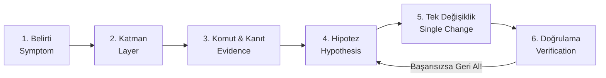

# 02 — Sistematik Sorun Çözme Rehberi (Troubleshooting Playbook), Alert Runbook ve 12 Gerçek Vaka RCA'sı

> [!IMPORTANT]
> **Kıdemli Mühendis Kuralı:** Bir sistemde hata çıktığında rastgele pod silmek, sunucuyu yeniden başlatmak veya aynı anda 5 dosyayı değiştirmek ("Shotgun Debugging") sorunu çözmez; sadece kanıtları yok eder. Profesyonel SRE ve DevOps mühendisleri **bilimsel yöntemi** kullanır:  
> **Belirti → Katman Tespiti → Teşhis Komutu → Hipotez → Tek Değişiklik → Doğrulama.**

---

## Bölüm 1: 6 Adımlı Sistematik Sorun Çözme Metodolojisi



### Adım 1: Belirtiyi (Symptom) Netleştir
"Sistem çalışmıyor" bir belirti değildir. Belirti ölçülebilir olmalıdır:
- *Örnek 1:* "`app.<APP_IP>.nip.io/api/orders` adresine yapılan POST istekleri 502 Bad Gateway dönüyor."
- *Örnek 2:* "`cassandra-0` pod'u 8 dakikadır `Pending` durumunda bekliyor."
- *Örnek 3:* "Prometheus'ta `RSDependencyDown{dependency="kafka"}` alarmı 2 dakikadır `Firing` durumunda."

### Adım 2: Hatanın Hangi Katmanda Olduğunu İzole Et (Yukarıdan Aşağıya veya Aşağıdan Yukarıya)
Bir isteğin yaşam döngüsündeki 6 katmandan hangisi kırık?

| Katman | Neyi Kontrol Edersin? | İlk Bakılacak Komut |
| :--- | :--- | :--- |
| **1. Altyapı & Node (VM/OS)** | Sunucu açık mı? Disk/RAM/CPU dolu mu? Kubelet çalışıyor mu? | `kubectl get nodes -o wide` ve `kubectl top nodes` |
| **2. Zamanlama (Scheduling & Storage)** | Pod bir sunucuya yerleşebildi mi (`Pending`)? PVC bağlandı mı (`Bound`)? | `kubectl describe pod <pod> -n <ns>` (Events bölümü!) |
| **3. Konteyner Yaşam Döngüsü** | İmaj çekilebildi mi (`ImagePullBackOff`)? Süreç çöküyor mu (`CrashLoopBackOff` / `OOMKilled`)? | `kubectl logs <pod> -n <ns> --previous` |
| **4. Servis & Ağ (DNS / CNI / Endpoint)** | Pod `Ready` mi? Service'in `Endpoints` listesinde IP var mı? DNS çözümlüyor mu? | `kubectl get endpoints -n <ns>` |
| **5. Giriş Kapısı (Ingress NGINX)** | Ingress kuralı doğru host'a ve doğru servise mi bakıyor? | `kubectl get ingress -A` ve Ingress controller logları |
| **6. Uygulama İçi Mantık & Bağımlılıklar** | DB şifresi mi yanlış? Circuit breaker mı açık? Timeout mu oluyor? | `kubectl logs <pod> -n app` ve `/metrics` uç noktası |

### Adım 3: Kanıt Topla (Asla Tahmin Etme, Log ve Event Oku!)
Kubernetes'te hataların %90'ı şu üç komuttan birinin çıktısında açıkça yazar:
```bash
# 1) Pod neden Pending / ImagePullBackOff / Unready? -> En alttaki Events tablosunu oku!
kubectl describe pod <pod-adi> -n <namespace>

# 2) Uygulama neden çöktü? -> Şu anki ve bir önceki (çöken) konteynerin logunu oku!
kubectl logs <pod-adi> -n <namespace> --tail=100
kubectl logs <pod-adi> -n <namespace> --previous --tail=100

# 3) Küme genelinde son 20 dakikada neler oldu?
kubectl get events -A --sort-by='.lastTimestamp' | tail -n 30
```

### Adım 4: Tek Bir Hipotez Kur
Topladığın kanıta dayanarak yanlışlanabilir bir cümle kur:
- *"Events çıktısında `0/3 nodes are available: 1 Insufficient cpu` yazıyor. Hipotezim: `vm-master` üzerindeki platform pod'larının toplam CPU `requests` değeri 2000m'yi (2 vCPU) aştığı için yeni pod schedule edilemiyor."*

### Adım 5: Sadece TEK Değişiklik Yap
Aynı anda hem Helm values dosyasını, hem NetworkPolicy'yi, hem de uygulama kodunu değiştirirsen ve sorun çözülürse (veya daha kötü olursa) **hangisinin işe yaradığını asla bilemezsin**.
- Tek bir parametreyi değiştir.
- Eğer hipotezin yanlış çıktıysa, ikinci bir şey denemeden önce **yaptığın değişikliği geri al (`git checkout` / `helm rollback`)**!

### Adım 6: Doğrulama (Verification)
Sadece pod'un `Running` olması yetmez (`1/1 Ready` olmalı, `/metrics` ve uçtan uca `curl` testi geçmeli, ilgili Prometheus alarmı `Resolved` durumuna dönmelidir).

---

## Bölüm 2: Prometheus Alert Runbook (Alarm Müdahale Kılavuzu)

`observability/prometheus-rules.yaml` içindeki her bir alarm, `annotations.runbook_url` alanında doğrudan aşağıdaki alt başlıklara (`#...`) bağlantı verir. Bir alarm çaldığında ilgili başlığı açıp adımları sırasıyla uygulayın.

---

<a id="dependency-down"></a>
### 🚨 `#dependency-down` — Alarm: `RSDependencyDown`

- **PromQL İfadesi:** `rs_dependency_up == 0` (10 saniye boyunca)
- **Anlamı:** `order-api`, `analytics-consumer` veya `payment-worker` içindeki arka plan sağlık kontrol thread'i (`resilience.py`), `dependency` etiketinde belirtilen altyapı bileşenine (`postgres`, `kafka`, `rabbitmq`, `cassandra` veya `redis`) son kontrollerde bağlanamadı.

#### Teşhis Adımları (Komutlar)
```bash
# 1) Hangi bağımlılığın 0 olduğunu tespit et:
kubectl exec -n app deploy/order-api -- curl -s localhost:8000/metrics | grep "^rs_dependency_up"

# 2) Veri ve mesajlaşma katmanındaki podların ve servislerin durumuna bak:
kubectl get pods,svc,endpoints -n data -n messaging -o wide

# 3) Aktif bir Chaos Mesh deneyi (NetworkChaos / DNSChaos / PodChaos) olup olmadığını kontrol et:
kubectl get podchaos,networkchaos,dnschaos,iochaos,stresschaos -n chaos-mesh
```

#### Çözüm (Remediation)
1. Eğer bir Game Day deneyi (`network-partition-rabbitmq`, `dns-chaos-redis`, `kafka-broker-kill`) çalışıyorsa ve testi bitirmek istiyorsanız ilgili kaos nesnesini silin.
2. Eğer ilgili veritabanı pod'u (`kafka-controller-0`, `cassandra-0`, `rabbitmq-0`, `postgres-postgresql-0`) `CrashLoopBackOff` veya `Pending` durumundaysa `kubectl describe pod -n data <pod>` ile disk/bellek hatasını inceleyin.
3. Servis `Endpoints` listesi boşsa (`<none>`), pod'un `Readiness` probe'unun neden başarısız olduğunu `kubectl logs -n data <pod>` ile kontrol edin.

---

<a id="slo-burn"></a>
### 🚨 `#slo-burn` — Alarm: `RSHighErrorRate` (SLO Error Budget Burn)

- **PromQL İfadesi:** `sum(rate(rs_http_requests_total{status=~"5.."}[1m])) / clamp_min(sum(rate(rs_http_requests_total[1m])), 1) > 0.01` (1 dakika boyunca)
- **Anlamı:** `order-api` servisine gelen HTTP isteklerinin **%1'inden fazlası `5xx` (Sunucu Hatası)** ile sonuçlanıyor. %99.0 başarı SLO'muz hızla yanıyor!

#### Teşhis Adımları (Komutlar)
```bash
# 1) order-api podlarının loglarında oluşan Python Traceback / Exception mesajlarını oku:
kubectl logs -n app -l app.kubernetes.io/component=order-api --tail=100

# 2) Kritik bağımlılık olan PostgreSQL'in ayakta ve kabul edilebilir gecikmede olduğunu doğrula:
kubectl get pods -n data -l app.kubernetes.io/name=postgresql
kubectl logs -n data statefulset/postgres-postgresql --tail=50

# 3) order-api podlarından biri Unready mi?
kubectl get pods -n app -l app.kubernetes.io/component=order-api
```

#### Çözüm (Remediation)
1. Loglarda `psycopg2.OperationalError` varsa PostgreSQL pod'unun çalışıp çalışmadığını ve `orders` tablosunun şemasını kontrol edin.
2. Eğer yeni bir uygulama versiyonu dağıtıldıktan (`gitops_promote`) hemen sonra başladıysa ArgoCD üzerinden veya Git revert ile bir önceki imaj etiketine geri dönün (`rollback`).

---

<a id="high-latency"></a>
### 🚨 `#high-latency` — Alarm: `RSHighLatencyP99`

- **PromQL İfadesi:** `histogram_quantile(0.99, sum by (le, endpoint) (rate(rs_http_request_duration_seconds_bucket[1m]))) > 1.0`
- **Anlamı:** İsteklerin en yavaş %1'lik dilimi (`p99`) **1 saniyenin (1000ms)** üzerinde sürüyor.

#### Teşhis Adımları (Komutlar)
```bash
# 1) Hangi altyapı bağımlılığının yavaşladığını (latency histogramını) kontrol et:
kubectl exec -n app deploy/order-api -- curl -s localhost:8000/metrics | grep "rs_dependency_latency_seconds_sum"

# 2) Aktif bir IOChaos (disk gecikmesi) veya NetworkChaos (ağ gecikmesi) var mı?
kubectl get iochaos,networkchaos -n chaos-mesh

# 3) Sunucularda CPU kısıtlaması (throttling) veya yüksek I/O wait var mı?
kubectl top pods -n app
kubectl top pods -n data
```

#### Çözüm (Remediation)
1. `io-latency-postgres` veya `network-latency-cassandra` deneyi aktifse `kubectl delete -f ...` ile kaldırın.
2. PostgreSQL üzerinde kilitlenmiş (locked) uzun süren sorgular varsa `pg_stat_activity` tablosunu kontrol edin.
3. `order-api` CPU limitine dayanmışsa (`kubectl top pods` çıktısı limit değerine eşitse) HPA veya Deployment replica sayısını artırın.

---

<a id="circuit-open"></a>
### 🚨 `#circuit-open` — Alarm: `RSCircuitBreakerOpen`

- **PromQL İfadesi:** `rs_circuit_breaker_state == 2` (`0=CLOSED`, `1=HALF-OPEN`, `2=OPEN`)
- **Anlamı:** Bir bağımlılık (`kafka`, `rabbitmq`, `cassandra`, `redis` veya `postgres`) arka arkaya hata verdiği için uygulama kendini ve thread havuzunu korumak amacıyla o bağımlılığa giden **devre kesiciyi açtı (`OPEN`)**. Çağrılar ağa çıkmadan anında reddediliyor (fail-fast).

#### Teşhis Adımları (Komutlar)
```bash
# 1) Hangi podda hangi bağımlılığın devre kesicisi açık?
for pod in $(kubectl get pods -n app -l app.kubernetes.io/component=order-api -o name); do
  echo "=== $pod ==="
  kubectl exec -n app "$pod" -- curl -s localhost:8000/metrics | grep "rs_circuit_breaker_state"
done

# 2) İlgili bağımlılığa ağ erişimini test et:
kubectl get networkchaos -n chaos-mesh
```

#### Çözüm (Remediation)
1. Devre kesicinin açılması **bir hata değil, bir savunma mekanizmasıdır**. Devre kesiciyi kapatmak için hedef servisin (`dependency`) ağ/sağlık sorununu çözün (`#dependency-down` adımlarını izleyin).
2. Hedef servis düzeldiğinde devre kesici `recovery_timeout` süresi sonunda otomatik olarak `HALF-OPEN (1)` → `CLOSED (0)` durumuna geçecektir; pod'ları yeniden başlatmanıza gerek yoktur.

---

<a id="consumer-lag"></a>
### 🚨 `#consumer-lag` — Alarm: `RSKafkaConsumerLagHigh`

- **PromQL İfadesi:** `rs_kafka_consumer_lag > 100` (1 dakika boyunca)
- **Anlamı:** Kafka `orders.events` topic'ine giren mesaj sayısı ile `analytics-consumer` tarafından okunup Cassandra'ya yazılan mesaj sayısı arasındaki fark (geride kalma / lag) **100 mesajı aştı**.

#### Teşhis Adımları (Komutlar)
```bash
# 1) analytics-consumer podu çalışıyor mu?
kubectl get pods -n app -l app.kubernetes.io/component=analytics-consumer

# 2) analytics-consumer loglarında Cassandra yazım yavaşlığı veya hata var mı?
kubectl logs -n app -l app.kubernetes.io/component=analytics-consumer --tail=50

# 3) Cassandra podunun durumu ve gecikmesi nedir?
kubectl get pods -n data -l app.kubernetes.io/name=cassandra
kubectl get networkchaos -n chaos-mesh
```

#### Çözüm (Remediation)
1. Eğer Cassandra üzerinde `network-latency-cassandra` (300ms gecikme) deneyi aktifse, deney bittiğinde consumer lag kendiliğinden sıfıra inecektir.
2. Eğer `analytics-consumer` pod'u çökmüşse veya Cassandra `DOWN` ise önce Cassandra'nın `1/1 Ready` olmasını sağlayın.
3. Prod ortamında lag sürekli artıyorsa topic partition sayısı kadar `analytics-consumer` replikası ölçeklenir (`kubectl scale deploy analytics-consumer -n app --replicas=2`).

---

<a id="dlq-growth"></a>
### 🚨 `#dlq-growth` — Alarm: `RSDlqMessagesGrowing`

- **PromQL İfadesi:** `increase(rs_rabbitmq_messages_processed_total{result="dlq"}[5m]) > 0`
- **Anlamı:** `payment-worker`, RabbitMQ `payments` kuyruğundan aldığı en az bir mesajı **3 kez denemesine rağmen işleyemedi** ve mesaj veri kaybını önlemek için **`payments.dlq` (Dead-Letter Queue)** kuyruğuna atıldı!

#### Teşhis Adımları (Komutlar)
```bash
# 1) payment-worker loglarında mesajın neden reddedildiğini (nack) bul:
kubectl logs -n app -l app.kubernetes.io/component=payment-worker --tail=100

# 2) RabbitMQ içindeki kuyrukların (payments ve payments.dlq) mesaj sayılarını listele:
kubectl exec -n messaging statefulset/rabbitmq -- rabbitmqctl list_queues name messages messages_unacknowledged
```

#### Çözüm (Remediation)
1. Sorunun kök nedenini (örneğin PostgreSQL bağlantı kesintisi veya bozuk JSON şeması) giderin.
2. Kök neden çözüldükten sonra `payments.dlq` içindeki mesajları incelemek veya ana kuyruğa geri taşımak (shovel / requeue) için RabbitMQ Management UI (`http://rabbitmq.<APP_IP>.nip.io`) üzerinden `Queues -> payments.dlq -> Get Messages / Move Messages` aracını kullanın.

---

<a id="pod-restarts"></a>
### 🚨 `#pod-restarts` — Alarm: `RSPodCrashLooping`

- **PromQL İfadesi:** `increase(kube_pod_container_status_restarts_total{namespace=~"app|data|messaging"}[10m]) > 3`
- **Anlamı:** `app`, `data` veya `messaging` namespace'lerindeki bir konteyner son 10 dakika içinde **3'ten fazla kez çöktü ve yeniden başladı**.

#### Teşhis Adımları (Komutlar)
```bash
# 1) Hangi podun restart sayısının arttığını gör:
kubectl get pods -A | awk '$5 > 2 {print $0}'

# 2) Podun son kapanma nedenini (Exit Code ve Reason: Error / OOMKilled) kontrol et:
kubectl describe pod <pod-adi> -n <namespace> | grep -A 12 "Last State:"

# 3) Çöken konteynerin ölmeden hemen önceki son sözlerini (loglarını) oku:
kubectl logs <pod-adi> -n <namespace> --previous --tail=100
```

#### Çözüm (Remediation)
- **`Reason: OOMKilled (Exit Code 137)` ise:** Konteyner tanımlanan `resources.limits.memory` sınırını aşmıştır (veya üzerinde `StressChaos` bellek testi çalışmaktadır). Stres testini durdurun veya meşru bir bellek ihtiyacıysa Helm values içinde bellek limitini artırın.
- **`Reason: Error (Exit Code 1)` ise:** Uygulama başlangıçta bir yapılandırma hatası veya yakalanmamış istisna (exception) alıyordur; `--previous` logundaki hatayı düzeltin.

---

<a id="node-memory"></a>
### 🚨 `#node-memory` — Alarm: `RSNodeMemoryHigh`

- **PromQL İfadesi:** `(1 - (node_memory_MemAvailable_bytes / node_memory_MemTotal_bytes)) > 0.85` (2 dakika boyunca)
- **Anlamı:** Kümedeki sunuculardan (`vm-master`, `vm-worker-data`, `vm-worker-app`) birinde kullanılabilir RAM **%15'in altına düştü** (kullanım > %85). Linux Kernel OOM Killer veya Kubelet Eviction devreye girmek üzere!

#### Teşhis Adımları (Komutlar)
```bash
# 1) Hangi node'da bellek sıkışıklığı var?
kubectl top nodes

# 2) En çok bellek tüketen ilk 15 podu sırala:
kubectl top pods -A --sort-by=memory | head -n 16
```

#### Çözüm (Remediation)
1. Aktif bir `StressChaos` deneyi varsa derhal silin: `kubectl delete stresschaos --all -n chaos-mesh`.
2. `vm-worker-data` üzerinde Cassandra belleği domine ediyorsa `MAX_HEAP_SIZE=768M` ortam değişkeninin pod içinde aktif olduğunu doğrulayın (`kubectl describe pod -n data cassandra-0`).

---

## Bölüm 3: Proje 4'te Gerçekten Yaşadığımız 12 Vakanın Kök Neden Analizi (RCA)

> [!NOTE]
> **Deneyimden Öğrenmek:** Proje 5'in tek seferde (`terraform apply` + `ansible-playbook site.yml`) sıfır hatayla ayağa kalkmasının sırrı, Proje 4'ü kurarken canlı ortamda bizzat yaşadığımız, teşhis ettiğimiz ve çözdüğümüz **12 gerçek üretim vakasını** baştan mimariye işlemiş olmamızdır. Aşağıda her vakanın **Belirti → Kök Neden → Proje 5'teki Kalıcı Çözümü** yer almaktadır.

---

### Vaka 1: `0/5 nodes are available: 1 Insufficient cpu` (Master CPU Bütçesi Tükenmesi)
- **Belirti:** `monitoring`, `argocd` ve `chaos-mesh` pod'larından bazıları `Pending` durumunda asılı kaldı. `kubectl describe pod` çıktısında `Insufficient cpu` ve `node(s) had untolerated taint` yazıyordu.
- **Kök Neden:** Kubernetes zamanlayıcısı (Scheduler), pod'ları yerleştirirken sunucunun anlık boş CPU'suna **bakmaz**; sunucudaki tüm pod'ların `resources.requests.cpu` toplamına bakar! `vm-master` 2 vCPU (`2000m`) kapasiteye sahipti ancak RKE2 sistem pod'ları + Rancher + ArgoCD + Prometheus + Grafana varsayılan Helm `requests` değerleri (her biri 100m–250m) toplandığında `2000m` sınırını aşıyordu.
- **Proje 5 Kalıcı Çözümü:** Tüm platform Helm values dosyalarında (`monitoring-values.yaml`, `chaos-mesh-values.yaml`, ArgoCD yamaları) `resources.requests.cpu` değerleri **10m – 25m** seviyesine çekildi, `limits` değerleri ise esnek bırakıldı. Böylece pod'lar garanti olarak schedule edilirken boş CPU'yu paylaşabiliyor.

---

### Vaka 2: Bitnami `ImagePullBackOff` (`MANIFEST_UNKNOWN` / Katalog Göçü)
- **Belirti:** PostgreSQL, Redis ve Kafka pod'ları `ErrImagePull` / `ImagePullBackOff` hatasıyla başlayamadı; Docker Hub `docker.io/bitnami/postgresql:...` imajının bulunamadığını döndü.
- **Kök Neden:** Bitnami, 2025/2026 itibarıyla ücretsiz geçmiş imaj etiketlerini `docker.io/bitnami/*` deposundan kaldırıp `docker.io/bitnamilegacy/*` deposuna taşıdı. Ayrıca yeni Bitnami chart'ları imaj adı değiştirildiğinde güvenlik kilidi nedeniyle kurulumu reddediyor.
- **Proje 5 Kalıcı Çözümü:** Tüm veri ve mesajlaşma Helm values dosyalarına (`kafka`, `cassandra`, `postgres`, `rabbitmq`, `redis`) baştan `image.repository: bitnamilegacy/<servis>` ve `global.security.allowInsecureImages: true` eklendi.

---

### Vaka 3: Ingress NGINX Admission Webhook `connection refused`
- **Belirti:** Ansible playbook'ta RKE2 kurulduktan hemen sonra Rancher veya ArgoCD Ingress kaynağı oluşturulurken `Internal error occurred: failed calling webhook "validate.nginx.ingress.kubernetes.io": connect: connection refused` hatası alındı.
- **Kök Neden:** RKE2, `rke2-ingress-nginx-controller` pod'unu HelmChartJob ile arka planda kurar. `kubectl get nodes` Ready dönse bile Ingress webhook pod'unun TLS sertifikasını üretip `8443` portunu dinlemesi 30–60 saniye daha sürer.
- **Proje 5 Kalıcı Çözümü:** Ansible playbook'larına Ingress oluşturan herhangi bir adımdan önce `rke2-ingress-nginx-controller` pod'unun `condition=Ready` olmasını ve `ingress-nginx-controller-admission` servis endpoint'inin dolmasını bekleyen ön-kontrol (wait) görevi eklendi.

---

### Vaka 4: `local-path-provisioner` Helper Pod'unun Taint Yüzünden `Pending` Kalması
- **Belirti:** `vm-worker-data` üzerindeki PostgreSQL ve Kafka PVC'leri `Pending` durumunda kaldı, veri klasörü oluşturulamadı.
- **Kök Neden:** `local-path-provisioner`, bir sunucuda disk klasörü açmak için o sunucuya geçici bir `helper-pod` gönderir. Ancak `vm-worker-data` sunucumuzda `dedicated=data:NoSchedule` taint'i vardı ve varsayılan `helperPod` şablonunda `tolerations` tanımlı olmadığı için yardımcı pod o sunucuya giremiyordu!
- **Proje 5 Kalıcı Çözümü:** `02-rke2-cluster.yml` içinde `local-path-config` ConfigMap'indeki `helperPod.yaml` şablonuna `operator: Exists` (tüm taint'leri tolere et) kuralı baştan işlendi.

---

### Vaka 5: Grafana `k8s-sidecar` OOM / CPU Kilidi ve Açılmayan Dashboard'lar
- **Belirti:** Grafana arayüzü `504 Gateway Timeout` veriyor, pod sürekli CPU throttling yaşıyor ve eklenen yeni dashboard ConfigMap'leri ekrana gelmiyordu.
- **Kök Neden:** `kube-prometheus-stack` içindeki `grafana-sc-dashboard` sidecar konteyneri kümedeki tüm ConfigMap'leri izlerken düşük kaynak limitlerinde (`50m`) kilitleniyor ve çok sayıda büyük JSON ConfigMap yüklendiğinde Grafana veritabanını kilitliyordu.
- **Proje 5 Kalıcı Çözümü:** `sidecar.dashboards.enabled: false` yapılarak sidecar tamamen kapatıldı! Bunun yerine Grafana'nın yerleşik `dashboardProviders` ve `dashboards` özelliği kullanılarak 3 dashboard (`SLO Overview`, `Messaging`, `Chaos Game Day`) doğrudan Helm values üzerinden temiz ve sıfır ek yükle bağlandı. Grafana limitleri `800m CPU / 1Gi RAM` olarak ayarlandı.

---

### Vaka 6: Prometheus `/metrics` Scrape Sırasında Senkron Sağlık Kontrolü Tuzağı
- **Belirti:** Veritabanlarından biri (örn. RabbitMQ) ağdan koptuğunda `/metrics` uç noktası 10+ saniye yanıt vermiyor, Prometheus tüm uygulamayı `DOWN` (`up == 0`) sanıyor ve hangi bağımlılığın çöktüğünü gösteren `rs_dependency_up` metriği hiç okunamıyordu!
- **Kök Neden:** Sağlık kontrolleri `/metrics` HTTP handler fonksiyonunun içinde senkron olarak yapılıyordu. Bir bağımlılık TCP timeout'a düştüğünde `/metrics` yanıtı da timeout oluyordu (Observability Anti-Pattern).
- **Proje 5 Kalıcı Çözümü:** `app/src/resilience.py` içinde bağımlılık kontrolleri **arka planda çalışan bağımsız bir daemon thread'e (`BackgroundHealthProber`, her 5 saniyede bir)** taşındı. `/metrics` uç noktası hiçbir ağ çağrısı yapmaz; sadece bellekteki son Gauge değerlerini <2ms içinde Prometheus'a döner!

---

### Vaka 7: ArgoCD Application Ingress Host'unda Büyük Harf / Placeholder Hatası
- **Belirti:** ArgoCD uygulamayı `OutOfSync` veya `Degraded` gösteriyor; Ingress NGINX `spec.rules[0].host: Invalid value: "app.<APP_IP>.nip.io"` hatası veriyordu.
- **Kök Neden:** RFC 1123 standardına göre Kubernetes Ingress `host` alanı `<` veya `>` karakterleri ya da büyük harf içeremez. Git deposundaki şablon dosyada placeholder unutulduğunda senkronizasyon kırılıyordu.
- **Proje 5 Kalıcı Çözümü:** Ansible GitOps kurulum adımında Terraform'dan gelen gerçek küçük harfli IP adresi (`app.{{ app_ip }}.nip.io`) Helm/Application manifestine otomatik işleniyor ve geçerli bir varsayılan (`app.127.0.0.1.nip.io`) kullanılıyor.

---

### Vaka 8: `.gitlab-ci.yml` İçinde `: ` (İki Nokta + Boşluk) YAML Sözdizimi Hatası
- **Belirti:** GitLab CI pipeline'ı daha başlamadan `jobs:gitops_promote:script config should be a string or a nested array of strings` YAML parse hatasıyla reddedildi.
- **Kök Neden:** YAML'da tırnaksız bir satırın içinde `: ` (iki nokta üst üste ve boşluk, örn. `git commit -m "chore: update image"` veya `curl -H "Authorization: Bearer ..."`) geçerse YAML ayrıştırıcısı bunu yeni bir key-value çifti (mapping) sanır!
- **Proje 5 Kalıcı Çözümü:** `.gitlab-ci.yml` içindeki tüm karmaşık kabuk komutları çok satırlı blok skaler (`- |`) içine alındı.

---

### Vaka 9: `[skip ci]` Sonsuz Döngü vs Pipeline Çalışmama Tuzağı
- **Belirti:** Geliştirici kendi commit mesajına `[skip ci]` yazdığında uygulama hiç derlenmiyor; hiç yazmadığında ise `gitops_promote` aşamasının aynı depoya yaptığı commit yeni bir pipeline tetikleyerek **sonsuz CI döngüsüne (infinite loop)** giriyordu.
- **Kök Neden:** Tek depoda (monorepo) hem kaynak kod hem de `gitops/`/Helm chart bulunduğunda, CI botunun imaj etiketini güncelleyen commit'i ile geliştirici commit'i ayrıştırılmamıştı.
- **Proje 5 Kalıcı Çözümü:** `[skip ci]` **yalnızca** `gitops_promote` aşamasında CI botunun oluşturduğu otomatik commit mesajına (`chore(gitops): promote image tag ... [skip ci]`) eklendi ve `workflow: rules` ile korundu.

---

### Vaka 10: Git `non-fast-forward` Reddi ve Çift Uzak Depo (GitLab + GitHub) Senkronizasyonu
- **Belirti:** `gitops_promote` işi `git push` yaparken `! [rejected] main -> main (fetch first / non-fast-forward)` hatasıyla patlıyor veya GitLab güncellenirken GitHub üzerindeki ayna (mirror) depo eski kalıyordu.
- **Kök Neden:** Pipeline çalışırken depoya başka bir commit geldiğinde yerel dal geride kalıyordu; ayrıca erişim jetonu değişken adları (`GITLAB_ACCESS_TOKEN` vs `GIT_PUSH_TOKEN`) farklı ortamlarda uyuşmuyordu.
- **Proje 5 Kalıcı Çözümü:** Push öncesi `git pull --rebase origin $CI_COMMIT_REF_NAME` zorunlu kılındı, token için `${GITLAB_ACCESS_TOKEN:-$GIT_PUSH_TOKEN}` fallback yapısı kuruldu ve `GITHUB_ACCESS_TOKEN` tanımlıysa aynı anda GitHub deposuna da push yapılması sağlandı.

---

### Vaka 11: Self-Hosted GitLab Runner Kaynak Sıkışması (`concurrent` ve Job CPU Requests)
- **Belirti:** CI pipeline çalışmaya başladığı anda `vm-worker-app` üzerindeki uygulama pod'ları yavaşlıyor veya CI job pod'u dakikalarca `Pending` bekliyordu.
- **Kök Neden:** GitLab Runner varsayılan olarak yüksek `concurrent` değeriyle birden fazla job pod'unu aynı anda açıyor ve her job pod'u yüksek CPU request istiyordu.
- **Proje 5 Kalıcı Çözümü:** `helm-values/gitlab-runner-values.yaml` içinde `concurrent: 1` olarak sınırlandı ve job pod CPU request değeri `100m` olarak sabitlendi.

---

### Vaka 12: RKE2 Üzerinde Chaos Mesh `containerd.sock` Yolu Hatası
- **Belirti:** Chaos Mesh pod'ları `Running` görünmesine rağmen `PodChaos` veya `NetworkChaos` başlatıldığında `rpc error: code = Unavailable desc = connection error: desc = "transport: Error while dialing dial unix /run/containerd/containerd.sock: connect: no such file or directory"` hatası veriyordu!
- **Kök Neden:** Chaos Mesh varsayılan olarak Docker veya standart `/run/containerd/containerd.sock` yolunu arar. Oysa **RKE2 (ve K3s)** kendi containerd soketini `/run/k3s/containerd/containerd.sock` altında tutar!
- **Proje 5 Kalıcı Çözümü:** `helm-values/chaos-mesh-values.yaml` ve `06-chaos-platform.yml` içinde baştan `chaosDaemon.runtime: containerd` ve `chaosDaemon.socketPath: /run/k3s/containerd/containerd.sock` tanımlandı.
