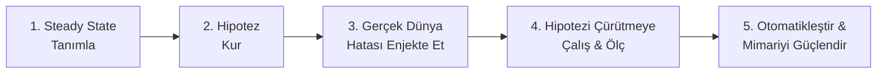

# 03 — Kaos Mühendisliği (Chaos Engineering) Rehberi: Prensipler, Güvenlik Korkulukları ve Game Day Yönetimi

> [!NOTE]
> *"Umut bir strateji değildir (Hope is not a strategy)."* — Geleneksel testler (Unit Test, Integration Test) **bildiğiniz** senaryoların çalışıp çalışmadığını doğrular. Kaos Mühendisliği ise dağıtık bir sistemde **bilmediğiniz** zayıflıkları, müşterilerinizden önce kontrollü deneylerle ortaya çıkarma disiplinidir.

---

## 1. Kaos Mühendisliği Nedir, Ne Değildir?

| Yanlış Bilinen (Mit) | Gerçek Mühendislik Prensibi |
| :--- | :--- |
| "Rastgele sunucuların fişini çekip ne olacağına bakmaktır." | **Hayır.** Kaos mühendisliği bilimsel bir deneydir: Önce ölçülebilir bir **Hipotez** ve **Steady State** belirlenir, minimum **Blast Radius** ile başlanır ve **Abort** koşulu hazır tutulur. |
| "Sadece Netflix veya Amazon ölçeğindeki şirketler içindir." | **Hayır.** 3 sunuculu bir Kubernetes kümesinde bile tek bir yanlış timeout veya eksik `PodDisruptionBudget` tüm sistemi çökertir. |
| "Zaten testlerimiz yeşil geçiyor, kaos testine gerek yok." | Birim testlerinde veritabanı 0.1ms'de yanıt verir ve ağ hiç kopmaz. Gerçek dünyada ise ağ paketleri kaybolur (`NetworkChaos`), diskler yavaşlar (`IOChaos`) ve DNS hata döner (`DNSChaos`). |

---

## 2. Kaos Mühendisliğinin 5 Temel Prensibi (Principles of Chaos)

`ResilienceStream` projesindeki 9 deneyin tamamı aşağıdaki 5 adımlı döngü üzerine kurulmuştur:

### 1. Steady State'i (Kararlı Durumu) İş Metrikleriyle Tanımla
Sistemin "sağlıklı" olduğunu CPU'nun %20 olmasıyla değil, **kullanıcının işini yapabilmesiyle** ölçeriz:
- Saniyede oluşan başarılı sipariş sayısı (`rate(rs_orders_created_total{result="success"}[1m])`)
- HTTP 5xx hata oranının `< %1` olması
- Sipariş uç noktası `p99` gecikmesinin `< 500ms` olması

### 2. Hipotez Kur ("Eğer X olursa, Y bozulmaz çünkü Z")
Her deney şu kalıpla başlar:
- *"Eğer `cassandra` pod'una **300ms ağ gecikmesi** enjekte edersek (`X`), `order-api` p99 gecikmesi **500ms altında kalmaya devam eder** (`Y`), çünkü analitik yazımlar Kafka üzerinden asenkron ayrıştırılmıştır ve consumer'da timeout/circuit-breaker vardır (`Z`)."*

### 3. Gerçek Dünya Olaylarını Simüle Et
Chaos Mesh kullanarak 5 farklı arıza sınıfını kapsıyoruz:
- **Süreç/Donanım Kaybı:** `PodChaos` (`pod-kill`, `pod-failure`) ve `kubectl drain`
- **Ağ Bozulmaları:** `NetworkChaos` (`delay`, `partition`, `loss`, `corrupt`)
- **Kaynak Tükenmesi (Noisy Neighbor):** `StressChaos` (`stress-ng` ile CPU ve RAM baskısı)
- **Disk Darboğazları (Gri Arıza):** `IOChaos` (FUSE katmanında `write`/`fsync` gecikmesi)
- **Servis Keşfi Hatası:** `DNSChaos` (`NXDOMAIN` / `SERVFAIL`)

### 4. Blast Radius'u (Etki Yarıçapını) Küçük Tut ve Abort Koşulu Belirle
- Deneylere her zaman `mode: one` (tek pod) ve kısa `duration` (`60s` – `3m`) ile başlanır.
- Deney sırasında SLO bütçesi belirlenen acil durdurma sınırını aşarsa deney **anında (`kubectl delete -f ...`) iptal edilir**.

### 5. Sürekli Hale Getir (Continuous Chaos)
Bir kere yapılan deney sadece o günkü kodu doğrular. İdeal olgunluk seviyesinde bu deneyler (`09-black-friday-workflow.yaml`) her büyük sürüm öncesinde veya haftalık zamanlanmış işlerle otomatik koşulur.

---

## 3. RKE2 Üzerinde Chaos Mesh Mimarisi Nasıl Çalışır?

Chaos Mesh üç ana bileşenden oluşur:

1. **`chaos-controller-manager`:** Kubernetes API'sini dinler; `PodChaos`, `NetworkChaos`, `Workflow` gibi CRD'leri (Custom Resource Definitions) yönetir.
2. **`chaos-daemon` (DaemonSet):** Her sunucuda (`vm-worker-app`, `vm-worker-data`) ayrıcalıklı (`privileged`) olarak çalışır.
   - **Kritik RKE2 Detayı:** `chaos-daemon`, hedef pod'un Linux `network namespace` (netns), `pid namespace` ve `cgroup` alanlarına girebilmek için sunucudaki container runtime soketiyle konuşur. RKE2'de bu soket `/run/k3s/containerd/containerd.sock` yolundadır!
   - Ağ gecikmesini hedef pod'un sanal ethernet arayüzüne (`veth`) **Linux `tc` (Traffic Control / `netem`)** kuralları yazarak; ağ bölünmesini ise **`iptables` / `ipset`** kuralları ekleyerek uygular.
3. **`chaos-dashboard`:** Deneyleri görsel olarak izlemek, duraklatmak ve zaman çizelgesini incelemek için kullanılan web arayüzü (`http://chaos.<MASTER_IP>.nip.io`).

---

## 4. Bir "Game Day" (Kaos Tatbikat Günü) Nasıl Yürütülür?

Gerçek şirketlerde Game Day tek bir kişinin gizlice komut çalıştırmasıyla yapılmaz; **4 net rol** ile yürütülür:

| Rol | Sorumluluğu |
| :--- | :--- |
| **1. Game Master (Deney Yöneticisi)** | Senaryoyu seçer, `kubectl apply -f chaos/experiments/...` komutunu çalıştırır ve zamanlayıcıyı tutar. |
| **2. Incident Commander (Olay Komutanı)** | Sanki gerçek bir üretim arızasıymış gibi ekibi koordine eder, kararları alır ve gerekirse **Abort** emrini verir. |
| **3. Scribe (Kayıtçı / Gözlemci)** | Grafana ekran görüntülerini, alarmın kaçıncı saniyede çaldığını (`TTD`) ve çalıştırılan komutları [`00-postmortem-template.md`](../chaos/game-days/00-postmortem-template.md) dosyasına dakika dakika not eder. |
| **4. On-Call Engineer (Nöbetçi Mühendis)** | Hangi deneyin başlatıldığını **bilmeden** sadece çalan Prometheus alarmına ve [`02-troubleshooting-playbook.md`](./02-troubleshooting-playbook.md) içindeki runbook'a bakarak sorunu teşhis etmeye çalışır. |

---

## 5. ResilienceStream 9 Adımlı Game Day Müfredatı

Deneyleri aşağıdaki sırayla, basitten karmaşığa doğru uygulamanız önerilir:

| Sıra | Game Day Rehberi | Kaos Manifesti | Öğretilen Dayanıklılık Deseni (Resilience Pattern) |
| :--- | :--- | :--- | :--- |
| **01** | [`01-pod-kill-order-api.md`](../chaos/game-days/01-pod-kill-order-api.md) | `01-pod-kill-order-api.yaml` | Çoklu Replika + Readiness Probe + Load Balancing |
| **02** | [`02-network-latency-cassandra.md`](../chaos/game-days/02-network-latency-cassandra.md) | `02-network-latency-cassandra.yaml` | Asenkron Event Ayrıştırma (Decoupling) + Kafka Tamponlama |
| **03** | [`03-network-partition-rabbitmq.md`](../chaos/game-days/03-network-partition-rabbitmq.md) | `03-network-partition-rabbitmq.yaml` | Circuit Breaker (Devre Kesici) + Outbox/Fallback |
| **04** | [`04-kafka-broker-kill.md`](../chaos/game-days/04-kafka-broker-kill.md) | `04-kafka-broker-kill.yaml` | StatefulSet PVC Kalıcılığı + Otomatik Consumer Yeniden Bağlanma |
| **05** | [`05-stress-payment-worker.md`](../chaos/game-days/05-stress-payment-worker.md) | `05-stress-payment-worker.yaml` | cgroup Kaynak İzolasyonu + Manual Ack + Idempotent Consumer |
| **06** | [`06-io-latency-postgres.md`](../chaos/game-days/06-io-latency-postgres.md) | `06-io-latency-postgres.yaml` | Gri Arıza (Gray Failure) Tespiti + p99 Latency Histogram Alarmı |
| **07** | [`07-dns-chaos.md`](../chaos/game-days/07-dns-chaos.md) | `07-dns-chaos.yaml` | Kritik vs Opsiyonel Bağımlılık + Graceful Degradation (Cache Bypass) |
| **08** | [`08-node-drain.md`](../chaos/game-days/08-node-drain.md) | `08-node-drain.md` | `PodDisruptionBudget (PDB)` + N+1 Kapasite Planlaması |
| **09** | [`09-black-friday-gameday.md`](../chaos/game-days/09-black-friday-gameday.md) | `09-black-friday-workflow.yaml` | **Büyük Final:** `k6` Yükü Altında Bileşik Kaos (Chaos Workflow) |
