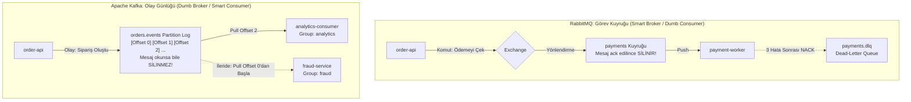

# 04 — Apache Kafka vs RabbitMQ: Mimari Farklar ve Neden İkisini Birlikte Kullandık?

> [!IMPORTANT]
> **Mülakatların Klasik Sorusu:** *"Sisteminizde zaten Kafka var, neden bir de RabbitMQ kurdunuz? İkisi de mesaj kuyruğu değil mi?"*  
> **Kısa Cevap:** Hayır! **RabbitMQ** geleneksel bir **Mesaj Kuyruğu (Message Broker / Görev Dağıtıcı)** iken, **Apache Kafka** dağıtık bir **Olay Akış Günlüğüdür (Distributed Event Streaming Log)**. İkisi tamamen farklı problemleri çözer ve `ResilienceStream` mimarisinde her ikisi de kendi en güçlü olduğu yerde kullanılmıştır.

---

## 1. Temel Felsefe: "Akıllı Broker / Aptal Consumer" vs "Aptal Broker / Akıllı Consumer"

### RabbitMQ (Smart Broker, Dumb Consumer)
- **Mesajın Yaşam Döngüsü:** Mesaj kuyruğa girer, RabbitMQ mesajı uygun bir `payment-worker`'a **iter (push)**, worker işi bitirip `basic_ack` gönderdiği anda **mesaj RabbitMQ'dan kalıcı olarak silinir**.
- **Amacı:** "Şu işi (komutu) birisi yapsın, yapamazsa 3 kez tekrar denesin, yine olmazsa `payments.dlq` (Dead-Letter Queue) kenara ayırsın."

### Apache Kafka (Dumb Broker, Smart Consumer)
- **Mesajın Yaşam Döngüsü:** Mesajlar diske sadece sona eklenen (**append-only, immutable**) bir günlük (log) dosyası olarak yazılır. Bir consumer mesajı okuduğunda **mesaj Kafka'dan silinmez!** (`retention.ms` süresi, örn. 7 gün boyunca diskte kalır).
- **Amacı:** "Sistemde şöyle bir gerçek (olay / fact) yaşandı: `OrderCreated`. İsteyen her servis kendi hızında, kendi `offset` numarasını takip ederek bu olayı okuyabilir, hatta geçmişe dönüp (**replay**) baştan okuyabilir!"

---

## 2. Teknik Karşılaştırma Tablosu

| Özellik | Apache Kafka (KRaft) | RabbitMQ (AMQP 0-9-1) |
| :--- | :--- | :--- |
| **Veri Yapısı** | Değiştirilemez Dağıtık Günlük (`Append-Only Commit Log`) | Bellek/Disk Kuyruğu (`FIFO Queue`) + Exchange Yönlendirici |
| **İletişim Modeli** | **Pull (Çekme):** Consumer hazır olduğunda broker'dan batch halinde veri çeker. | **Push (İtme):** Broker, consumer'a (`prefetch_count` sınırına kadar) mesaj iter. |
| **Mesaj Kalıcılığı** | Okunsa bile silinmez (`retention.ms=7d` veya `retention.bytes` kadar saklanır). | Tüketici `ACK` gönderdiği anda kuyruktan **silinir**. |
| **Geçmişi Tekrar Oynatma (Replay)** | **Mükemmel:** Offset'i `0`'a sıfırlayıp geçen haftanın tüm olaylarını yeniden işleyebilirsiniz. | **İmkansız:** İşlenip `ACK` edilen mesaj yok olmuştur. |
| **Yönlendirme (Routing)** | Topic ve Partition Key bazlı basit dağılım. | Direct, Topic, Fanout, Headers Exchange ile çok karmaşık yönlendirme kuralları. |
| **Mesaj Başına Retry & DLQ** | Doğal DLQ yoktur; bir mesaj takılırsa tüm partition offset'i bloklanır (uygulama seviyesinde ayrı retry topic gerekir). | **Yerleşik (Native):** Tek bir mesaj `nack` edilebilir, diğer mesajlar akmaya devam eder; hatalı mesaj otomatik `DLX -> DLQ`'ya düşer. |
| **Mesaj Sıralaması (Ordering)** | **Partition bazında kesin sıra garantisi** (aynı `customer_id` her zaman aynı partition'a gider ve sırayla okunur). | Birden fazla worker (`competing consumers`) varsa ve bir mesaj retry edilirse sıra değişebilir. |
| **Saniyedeki Kapasite (Throughput)** | Çok Yüksek (Zero-Copy `sendfile` ve ardışık disk yazımı ile **100.000+ – 1.000.000+ mesaj/sn**). | Orta-Yüksek (**10.000 – 50.000 mesaj/sn**). |

---

## 3. ResilienceStream'de Neden Hangi İş İçin Hangisini Seçtik?

### Senaryo A: Ödeme İşleme (`order-api` → **RabbitMQ** → `payment-worker`)
Ödeme çekme işlemi bir **Komuttur (Command / Task Queue)**:
1. Her siparişin ödemesi **yalnızca bir kez** işlenmelidir.
2. Eğer #42 numaralı siparişin kredi kartı provizyonu banka API'sinde geçici bir hata verirse, #43 ve #44 numaralı müşterilerin ödemeleri **#42 yüzünden beklememelidir**!
3. #42 numaralı ödeme 3 deneme sonunda hâlâ başarısız oluyorsa, otomatik olarak **`payments.dlq` (Dead-Letter Queue)** kuyruğuna düşmeli ve Prometheus `RSDlqMessagesGrowing` alarmını çalmalıdır.
- **Sonuç:** Mesaj bazlı `ack/nack`, bireysel yeniden deneme ve yerleşik DLQ yetenekleri nedeniyle bu iş için **RabbitMQ** biçilmiş kaftandır.

### Senaryo B: Olay Akışı ve Analitik (`order-api` → **Kafka** → `analytics-consumer` → Cassandra)
Siparişin oluşması bir **Olaydır (Domain Event — `orders.events`)**:
1. Bugün bu olayı sadece `analytics-consumer` okuyup Cassandra'ya yazıyor. Yarın şirkete yeni bir **Fraud (Dolandırıcılık Tespiti)** servisi veya **Öneri Motoru (Recommendation Engine)** eklendiğinde, `order-api` koduna **tek satır bile dokunmadan** yeni servis kendi `consumer_group_id`'si ile Kafka'ya bağlanıp son 7 günün tüm siparişlerini baştan okuyabilir (**Event Replay**).
2. Analitik veritabanımız (Cassandra) bakıma girdiğinde veya yavaşladığında (bkz. [Game Day 02](../chaos/game-days/02-network-latency-cassandra.md)), Kafka milyonlarca olayı diskte yüksek hızda tamponlar (`rs_kafka_consumer_lag`) ve Cassandra düzeldiğinde toplu (batch) olarak akıtır.
- **Sonuç:** Çoklu tüketici (pub/sub fan-out), yüksek hacimli disk tamponlama ve geçmişi yeniden oynatma yeteneği nedeniyle bu iş için **Apache Kafka** endüstri standardıdır.

---

## 4. ZooKeeper'sız Kafka: KRaft (Kafka Raft) Nedir?

Proje 5'te Kafka'yı eski ZooKeeper bağımlılığıyla değil, modern **KRaft (KIP-500)** mimarisiyle kurduk:
- Eskiden Kafka kümesi metadata bilgilerini (hangi broker ayakta, hangi partition'ın lideri kim) tutmak için ayrı bir **Apache ZooKeeper** kümesine (en az 3 ekstra JVM pod'u!) ihtiyaç duyardı. Bu hem RAM maliyetini ikiye katlar hem de iki farklı dağıtık sistemi yönetme zorluğu yaratırdı.
- **KRaft modunda** Kafka, Raft konsensüs protokolünü doğrudan kendi içine (`__cluster_metadata` topic'ine) gömmüştür. Böylece ZooKeeper tamamen ortadan kalkmış, lider seçimi (failover) süresi saniyelerden milisaniyelere inmiş ve lab ortamımızda yüzlerce megabayt RAM tasarrufu sağlanmıştır.
