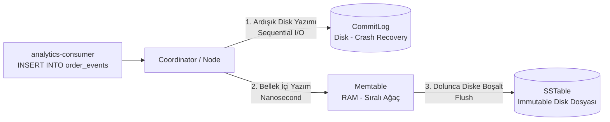

# 05 — Apache Cassandra Veri Modelleme ve Mimari Rehberi (`resilience.order_events`)

> [!IMPORTANT]
> **Altın Kural:** İlişkisel veritabanlarında (PostgreSQL) önce **Veriyi (Varlıkları / Норmalizasyonu)** modellersiniz, sorguları sonra yazarsınız. Apache Cassandra'da ise **önce Sorguları (Uygulamanın Erişim Desenini) modellersiniz**, tabloyu o sorguya göre tasarlarsınız (**Query-Driven Data Modeling**)! Cassandra'da `JOIN` yoktur, `GROUP BY` yoktur ve `ALLOW FILTERING` üretim ortamında yasaktır!

---

## 1. Neden Analitik Olaylar İçin PostgreSQL Değil de Cassandra Seçtik?

`ResilienceStream` içinde iki farklı veritabanı kullanıyoruz:
1. **PostgreSQL (`orders` ve `payments` tabloları):** Güçlü ACID transaction garantisi, `UNIQUE` kısıtları ve ilişkisel bütünlük gerektiren **finansal/operasyonel kayıtlar (System of Record)** için.
2. **Apache Cassandra (`resilience.order_events` tablosu):** Saniyede binlerce kez akan zaman serisi / olay günlüğü (event stream) verisini **ultra hızlı yazmak (High Write Throughput)** ve yatayda sınırsız ölçeklemek için.

### Cassandra Yazma İşleminde Neden Bu Kadar Hızlıdır? (LSM-Tree Mimarisi)
PostgreSQL gibi B-Tree tabanlı veritabanları bir satır yazarken diskteki ilgili veri sayfasını bulup yerinde güncellemek (`Random I/O`) zorundadır. Cassandra ise **LSM-Tree (Log-Structured Merge-Tree)** kullanır ve yazma sırasında **diskten hiçbir şey okumaz**:



1. Gelen yazma isteği önce diske **sadece sona eklenen (append-only)** `CommitLog` dosyasına ardışık (`Sequential I/O`) olarak yazılır.
2. Aynı anda RAM'deki **`Memtable`** yapısına yazılır ve istemciye anında `OK` dönülür (<1ms)!
3. `Memtable` dolduğunda arka planda diske değiştirilemez (**immutable**) bir **`SSTable` (Sorted String Table)** dosyası olarak boşaltılır.

---

## 2. `resilience.order_events` Tablo Şeması ve Anahtar Tasarımı

`analytics-consumer` servisimiz başlangıçta aşağıdaki CQL (Cassandra Query Language) şemasını oluşturur:

```sql
CREATE KEYSPACE IF NOT EXISTS resilience
WITH replication = {
  'class': 'SimpleStrategy',          -- Prod'da: 'NetworkTopologyStrategy' (her DC için RF=3)
  'replication_factor': 1             -- Lab kısıtı: 1 node (Prod'da: 3)
};

CREATE TABLE IF NOT EXISTS resilience.order_events (
  customer_id text,
  created_at timestamp,
  order_id text,
  product_id text,
  quantity int,
  amount decimal,
  event_type text,
  PRIMARY KEY ((customer_id), created_at, order_id)
) WITH CLUSTERING ORDER BY (created_at DESC, order_id ASC);
```

### `PRIMARY KEY ((customer_id), created_at, order_id)` Neden Böyle Tasarlandı?

Cassandra'da Primary Key iki farklı bileşenden oluşur ve her ikisinin görevi tamamen farklıdır:

| Bileşen | Tablomuzdaki Alan | Görevi Nedir? |
| :--- | :--- | :--- |
| **1. Partition Key (Bölümleme Anahtarı)** | `(customer_id)` | **Verinin hangi fiziksel sunucuda (node) duracağını belirler.** Cassandra `Murmur3Hash(customer_id)` değerini hesaplar ve aynı müşteriye ait tüm sipariş olaylarını aynı disk bölümünde (partition) yan yana saklar. |
| **2. Clustering Columns (Sıralama Sütunları)** | `created_at, order_id` | **Aynı Partition içindeki satırların diskte hangi sırayla dizileceğini belirler.** `CLUSTERING ORDER BY (created_at DESC)` sayesinde bir müşterinin son 20 siparişini çekmek istediğimizde Cassandra sıralama (`SORT`) yapmaz; diskten baştan 20 satırı olduğu gibi okur! |

> [!TIP]
> **Neden `order_id` de Clustering Column'a Eklendi?**  
> Eğer bir müşteri aynı milisaniye içinde (`created_at` aynı) iki farklı sipariş oluşturursa, Clustering Key sadece `created_at` olsaydı ikinci satır birincinin **üzerine yazardı (upsert)**! `order_id` eklenerek her olayın benzersiz (unique) olması garanti altına alınmıştır.

---

## 3. Doğru ve Yanlış Sorgu Örnekleri (Kendini Test Et)

Pod içinden `cqlsh` açarak verileri sorgulayabilirsiniz:
```bash
kubectl exec -it -n data statefulset/cassandra -- cqlsh -u resilience -p 'AdminPassword2026!'
```

### ✅ DOĞRU SORGU (Tek Partition Okuması — <2ms)
Partition Key (`customer_id`) verilerek yapılan sorgu doğrudan ilgili düğüme gider ve sıralı diskten okur:
```sql
SELECT customer_id, created_at, order_id, amount
FROM resilience.order_events
WHERE customer_id = 'cust-42'
  AND created_at >= '2026-10-27 00:00:00'
LIMIT 20;
```

### ❌ YANLIŞ SORGU (Full Cluster Scan — Prod'da Felaket!)
Partition Key vermeden sadece `product_id` veya `amount` ile sorgu atmaya çalışırsanız Cassandra sizi şu hatayla durdurur:
```sql
SELECT * FROM resilience.order_events WHERE product_id = 'sku-10';
-- HATA: Cannot execute this query as it might involve data filtering and thus may have unpredictable performance.
```
- **Sakın `ALLOW FILTERING` eklemeyin!** `ALLOW FILTERING`, Cassandra kümesindeki tüm sunuculardaki milyonlarca satırı baştan sona belleğe okuyup filtrelemeye çalışır ve koordinatör düğümü `OOMKilled` ile çökertir.
- **Prod Çözümü:** Eğer ürün bazlı (`product_id`) sorgu da gerekiyorsa, Cassandra'da **ikinci bir tablo (`order_events_by_product`)** oluşturulur ve uygulama/consumer her olayı her iki tabloya da yazar (Disk ucuzdur, CPU ve gecikme pahalıdır — **Denormalization**).

---

## 4. Üretim Ortamı (Prod) İçin Kritik Cassandra Tuzakları

1. **Geniş Bölüm (Wide Partition / Unbounded Partition) Tuzağı:**
   - Bir Cassandra partition'ında 100 MB'tan veya 100.000 hücreden fazla veri birikirse performans düşer. Eğer bir kurumsal müşteri yılda 10 milyon sipariş veriyorsa, Partition Key sadece `(customer_id)` yapılmaz; **`((customer_id, year_month), created_at, order_id)`** şeklinde zaman kovası (**Time Bucketing**, örn. `'2026-10'`) eklenerek partition boyutu sınırlandırılır.
2. **Mezar Taşları (Tombstones):**
   - Cassandra'da `DELETE` komutu veriyi diskten hemen silmez (çünkü SSTable dosyaları değiştirilemezdir!). Bunun yerine "bu kayıt silindi" anlamına gelen bir **Tombstone (Mezar Taşı)** yazar ve kayıt `gc_grace_seconds` (varsayılan 10 gün) sonraki **Compaction** işleminde gerçekten silinir.
   - Çok fazla `DELETE` yapmak veya tablo hücrelerine sürekli `null` yazmak binlerce tombstone üretir ve okuma sorgularını (`ReadTimeoutException`) kilitler. Süreli veriler için `DELETE` yerine **`USING TTL 2592000`** tercih edilir.
3. **Lab JVM Bellek Ayarı (`768M` vs Prod `16G`):**
   - `helm-values/cassandra-values.yaml` dosyamızda `MAX_HEAP_SIZE: "768M"` ve `HEAP_NEWSIZE: "128M"` ayarlıdır. Eğer bu iki değişkeni vermeseydik, Cassandra başlangıç betiği sunucunun 4 GB RAM'ine bakıp 1–2 GB Heap ayıracak ve aynı sunucudaki Kafka ve PostgreSQL ile birlikte `vm-worker-data` sunucusunu `OOM` durumuna sokacaktı.
