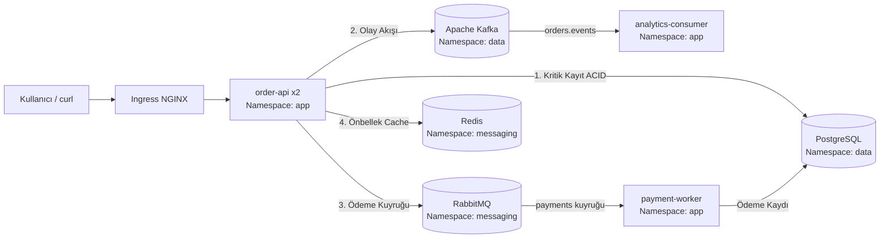

# K8s Chaos Engineering & Troubleshooting Lab (Helm + Kafka + RabbitMQ + PostgreSQL + Redis)

> [!IMPORTANT]
> **Bu Laboratuvarın Amacı Nedir?**  
> Çalışan bir Kubernetes mikroservis mimarisinde (FastAPI + PostgreSQL + Redis + Apache Kafka + RabbitMQ):
> 1. **Hangi sisteme hangi kaos testini neden yapmalıyım?** sorusunun mantığını kavramak,
> 2. **🟢 Kontrol Testleri (Deney 1, 2, 3)** ile doğru tasarlanmış bileşenlerin arızayı nasıl absorbe ettiğini (**patlamadan** nasıl ayakta kaldığını) gözlemlemek,
> 3. **🔴 Troubleshooting Testleri (Deney 4, 5, 6)** ile Helm `values.yaml` içine gizlenmiş **3 gerçek üretim hatasını** kaos testiyle **patlatmak**, CLI komutlarıyla kök nedenini teşhis etmek ve `helm upgrade` ile kalıcı olarak çözmek,
> 4. Tüm testleri **Chaos Mesh Web Arayüzünden (Tarayıcıdan)** adım adım uygulamak ve en sonda **Chaos Workflow** ile tüm sistemi tek akışta doğrulamaktır.

---

## 📑 İçindekiler

1. [Mimari ve "Hangi Sisteme Hangi Test Yapılır?" Matrisi](#1-mimari-ve-hangi-sisteme-hangi-test-yapılır-matrisi)
2. [Erişim Adresleri ve Hızlı Başlangıç (Tek Komutla Kurulum)](#2-erişim-adresleri-ve-hızlı-başlangıç-tek-komutla-kurulum)
3. [BÖLÜM A: 🟢 Kontrol Testleri (Sistemin Patlamadığı, Dayanıklılık Doğrulama Senaryoları)](#3-bölüm-a--kontrol-testleri-sistemin-patlamadığı-dayanıklılık-doğrulama-senaryoları)
   - [Deney 1: Kubernetes `order-api` Pod Kill & Yük Dengeleme Kontrolü](#deney-1-kubernetes-order-api-pod-kill--yük-dengeleme-kontrolü)
   - [Deney 2: Redis DNS Kesintisi & Cache Bypass (Graceful Degradation) Kontrolü](#deney-2-redis-dns-kesintisi--cache-bypass-graceful-degradation-kontrolü)
   - [Deney 3: Apache Kafka Ağ Gecikmesi (300ms) & Consumer Lag Kontrolü](#deney-3-apache-kafka-ağ-gecikmesi-300ms--consumer-lag-kontrolü)
4. [BÖLÜM B: 🔴 Troubleshooting Testleri (Patlayan Yerleri Teşhis Et ve Helm ile Çöz!)](#4-bölüm-b--troubleshooting-testleri-patlayan-yerleri-teşhis-et-ve-helm-ile-çöz)
   - [Deney 4 (PATLAR #1): PostgreSQL Yavaşlamasında Yanlış Liveness Probe Yüzünden API Çöküşü](#deney-4-patlar-1-postgresql-yavaşlamasında-yanlış-liveness-probe-yüzünden-api-çöküşü)
   - [Deney 5 (PATLAR #2): `payment-worker` Arızasında RabbitMQ Kuyruk Yığılması (`consumers: 0`)](#deney-5-patlar-2-payment-worker-arızasında-rabbitmq-kuyruk-yığılması-consumers-0)
   - [Deney 6 (PATLAR #3): `analytics-consumer` Bellek Darboğazı (`OOMKilled`) ve Kafka Lag Patlaması](#deney-6-patlar-3-analytics-consumer-bellek-darboğazı-oomkilled-ve-kafka-lag-patlaması)
5. [BÖLÜM C: 🏆 Final Chaos Mesh Workflow (Tüm Düzeltmeler Sonrası Otomatik Doğrulama)](#5-bölüm-c--final-chaos-mesh-workflow-tüm-düzeltmeler-sonrası-otomatik-doğrulama)
6. [BÖLÜM D: Kullandığımız Sistemlerin Genel Kullanım & Teşhis Komutları (Hızlı Rehber)](#6-bölüm-d-kullandığımız-sistemlerin-genel-kullanım--teşhis-komutları-hızlı-rehber)

---

## 1. Mimari ve "Hangi Sisteme Hangi Test Yapılır?" Matrisi



### Bir Mimaride Hangi Bileşene Hangi Kaos Testi Uygulanır?

| # | Hedef Bileşen | Türü | Chaos Mesh Testi | Beklenen Durum | Neye Bakmalıyım? (Temel Kontrol) |
| :--- | :--- | :--- | :--- | :--- | :--- |
| **Deney 1** | **`order-api`** (`ns: app`) | Stateless API | `Pod Fault` -> `Pod Kill` | 🟢 **KONTROL (Patlamaz)** | 2 replikadan 1'i ölür, diğeri kesintisiz `HTTP 201` döner (`kubectl get pods -n app`). |
| **Deney 2** | **`redis-master`** (`ns: messaging`) | Cache (Soft Dep.) | `DNS Fault` -> `Error` | 🟢 **KONTROL (Patlamaz)** | Redis çözümlenemez ama sipariş `201 Created` (`status: degraded`) ile PostgreSQL'e yazılır. |
| **Deney 3** | **`kafka`** (`ns: data`) | Event Stream | `Network Attack` -> `Delay (300ms)` | 🟢 **KONTROL (Patlamaz)** | Kafka gecikmesi artar ama mesaj kaybolmaz (`kafka-consumer-groups.sh --describe`). |
| **Deney 4** | **`postgresql`** (`ns: data`) + **`order-api`** | Ana DB + Probe | `Network Attack` -> `Delay (1200ms)` | 🔴 **PATLAR! (Troubleshoot #1)** | Yanlış `livenessProbe (/readyz)` yüzünden Kubelet tüm API podlarını öldürür (`RESTARTS` artar)! |
| **Deney 5** | **`payment-worker`** (`ns: app`) + **RabbitMQ** | Task Worker | `Pod Fault` -> `Pod Failure` | 🔴 **PATLAR! (Troubleshoot #2)** | Worker tek replika olduğu için `consumers: 0` olur ve RabbitMQ'da ödemeler kuyrukta birikir! |
| **Deney 6** | **`analytics-consumer`** (`ns: app`) + **Kafka** | Stream Worker | `Stress Test` -> `Memory (45MB)` | 🔴 **PATLAR! (Troubleshoot #3)** | Düşük RAM limiti (`80Mi`) yüzünden pod `OOMKilled (137)` olur ve Kafka'da `LAG` birikir! |

> 📚 **Detaylı Dokümanlar:**
> - [01 — Sistem Kullanım ve Kriz Anı Teşhis El Kitabı (Kafka, RabbitMQ, Postgres, Redis, K8s Cheat Sheet)](./docs/01-sistem-kullanim-ve-teshis-rehberi.md)
> - [02 — Bir Sistemde Hangi Kaos Testlerini ve Kontrolleri Yapmalıyım? (Metodoloji)](./docs/02-chaos-test-tasarim-matrisi.md)

---

## 2. Erişim Adresleri ve Hızlı Başlangıç (Tek Komutla Kurulum)

### 2.1. Web Arayüzleri
| Servis | Adres (URL) | Kullanıcı / Şifre | Ne İçin Kullanacağız? |
| :--- | :--- | :--- | :--- |
| **Chaos Mesh UI** | `http://chaos.9.205.90.183.nip.io` | *(Şifresiz)* | Tüm kaos deneylerini ve workflow'ları tarayıcıdan başlatmak için |
| **Sipariş API Durumu** | `http://app.9.205.90.176.nip.io/api/status` | *(Açık API)* | 5 bağımlılığın (`postgres`, `kafka`, `rabbitmq`, `redis`, `cassandra`) anlık durumunu görmek için |
| **Grafana** | `http://grafana.9.205.90.183.nip.io` | `admin` / `AdminPassword2026!` | Metrikleri, Circuit Breaker durumunu ve alarmları izlemek için |
| **Rancher UI** | `https://rancher.9.205.90.183.nip.io` | `admin` / `AdminPassword2026!` | Küme ve pod durumlarını görsel incelemek için |

### 2.2. Adım 0: Lab Ortamını "Troubleshoot Modunda" Başlatın
Deneylere başlamadan önce aşağıdaki tek komutu çalıştırarak Helm chart'ımızı (içindeki 3 öğretici yapılandırma hatasıyla birlikte) kümeye uygulayın:

```bash
cd /home/ysf/k8sfundamentals/Projects/k8s-chaos-troubleshooting-lab

# 1) Lab ortamını başlat (veya sıfırla)
./scripts/setup-lab.sh

# 2) Tüm sistemlerin (K8s, Kafka, RabbitMQ, Postgres, Redis) başlangıç sağlığını tek komutla gör
./scripts/check-system.sh
```

---

## 3. BÖLÜM A: 🟢 Kontrol Testleri (Sistemin Patlamadığı, Dayanıklılık Doğrulama Senaryoları)

Bu bölümdeki 3 deneyde **sistemde hiçbir şey patlamamalıdır**. Amacımız Chaos Mesh arayüzünü kullanmayı öğrenmek ve kaos sırasında sağlıklı bir sistemin nasıl tepki verdiğini kontrol komutlarıyla doğrulamaktır.

---

### Deney 1: Kubernetes `order-api` Pod Kill & Yük Dengeleme Kontrolü

- **Neden Bu Testi Yapıyoruz?** `order-api` 2 replika (`replicaCount: 2`) olarak çalışıyor. Sunuculardan birinde bir süreç aniden öldüğünde (`SIGKILL`) kullanıcıların hata alıp almadığını kontrol ediyoruz.

#### 1) Chaos Mesh Web Arayüzünden (Tarayıcıdan) Uygulama:
1. Tarayıcıdan **`http://chaos.9.205.90.183.nip.io`** adresini açın.
2. Sol menüden **Experiments** -> **+ New Experiment** butonuna tıklayın.
3. **Choose Target:**
   - **Kubernetes** -> **Pod Fault** -> **Pod Kill** seçin.
   - **Grace Period:** `0` yazın (anında ölüm).
   - Sağ alttan **Submit** (İleri) tıklayın.
4. **Scope (Hedef Seçimi):**
   - **Namespace Selectors:** `app` seçin.
   - **Label Selectors:** `app.kubernetes.io/component: order-api` seçin.
   - **Mode:** `One` seçin *(Çok Önemli: `All` seçerseniz tüm kopyaları öldürürsünüz, `One` seçerek 2 kopyadan 1'ini öldürüyoruz)*.
5. **Metadata & Run:**
   - **Name:** `exp01-kontrol-pod-kill`
   - **Submit** butonuna basarak deneyi başlatın!

#### 2) Test Sırasında Neye Bakmalıyım? (Kontroller):
Master sunucuda (veya yerel terminalde) şu 3 kontrolü yapın:
```bash
# Kontrol 1: Podlardan birinin öldüğünü ve saniyeler içinde yeni podun açıldığını gör
ssh ysf@9.205.90.183 "kubectl get pods -n app -l app.kubernetes.io/component=order-api"

# Kontrol 2: Sipariş gönder — HTTP 201 Created döndüğünü (kesinti olmadığını) doğrula!
curl -i -X POST "http://app.9.205.90.176.nip.io/api/orders" \
  -H "Content-Type: application/json" \
  -d '{"customer_id":"test-01","product_id":"sku-1","quantity":1,"amount":50.0}'
```
- **Sonuç:** 🟢 **PATLAMADI!** Tek pod ölse bile Kubernetes Service trafiği yaşayan diğer poda yönlendirdi ve ReplicaSet anında yeni pod oluşturdu.
- *(Deney bittikten sonra Chaos Mesh UI'da deneyi **Archive** butonuna basarak temizleyin).*

---

### Deney 2: Redis DNS Kesintisi & Cache Bypass (Graceful Degradation) Kontrolü

- **Neden Bu Testi Yapıyoruz?** Redis bizim önbellek (Cache) katmanımızdır. Eğer Redis çökerse veya DNS adı çözümlenemezse sipariş sistemi durmalı mı? **Hayır!** Önbelleği atlayıp (bypass) doğrudan PostgreSQL'e yazarak çalışmaya devam etmelidir.

#### 1) Chaos Mesh Web Arayüzünden Uygulama:
1. **Experiments** -> **+ New Experiment** tıklayın.
2. **Choose Target:**
   - **Kubernetes** -> **DNS Fault** -> **Error** seçin.
   - **Patterns:** `redis-master.messaging.svc.cluster.local` yazıp **Enter** tuşuna basın! *(Kutunun içinde etiket/chip olarak görünmelidir)*.
   - **Submit** tıklayın.
3. **Scope (Hedef Seçimi):**
   - **Namespace Selectors:** `app`
   - **Label Selectors:** `app.kubernetes.io/component: order-api` *(DNS sorgusunu yapan taraf `order-api` olduğu için hedef `order-api` podlarıdır!)*.
   - **Mode:** `All`
4. **Metadata & Run:**
   - **Name:** `exp02-kontrol-redis-dns`
   - **Duration:** `2m`
   - **Submit** ile başlatın!

#### 2) Test Sırasında Neye Bakmalıyım? (Kontroller):
```bash
# Kontrol 1: API durumuna bak -> redis: DOWN olduğunu ama diğerlerinin UP olduğunu gör
curl -s "http://app.9.205.90.176.nip.io/api/status" | jq .

# Kontrol 2: Sipariş gönder -> HTTP 201 Created ve "status": "degraded" döndüğünü gör!
curl -s -X POST "http://app.9.205.90.176.nip.io/api/orders" \
  -H "Content-Type: application/json" \
  -d '{"customer_id":"test-redis","product_id":"sku-2","quantity":1,"amount":75.0}' | jq .
```
- **Sonuç:** 🟢 **PATLAMADI!** Yanıtta `"status": "degraded"` ve `"redis": {"status": "DEGRADED"}` yazar ancak HTTP kodu **`201 Created`**'dır ve sipariş PostgreSQL'e başarıyla kaydedilmiştir!
- *(Deney sonunda Chaos Mesh UI'dan deneyi **Pause / Archive** edin).*

---

### Deney 3: Apache Kafka Ağ Gecikmesi (300ms) & Consumer Lag Kontrolü

- **Neden Bu Testi Yapıyoruz?** Kafka broker'da ağ gecikmesi yaşandığında olayların kaybolmadığını ve `kafka-consumer-groups.sh` ile gecikmenin nasıl izlendiğini doğruluyoruz.

#### 1) Chaos Mesh Web Arayüzünden Uygulama:
1. **Experiments** -> **+ New Experiment** tıklayın.
2. **Choose Target:**
   - **Kubernetes** -> **Network Attack** -> **Delay** seçin.
   - **Latency:** `300ms`
   - **Jitter:** `50ms`
   - **Direction:** `to`
   - **Submit** tıklayın.
3. **Scope (Hedef Seçimi):**
   - **Namespace Selectors:** `data`
   - **Label Selectors:** `app.kubernetes.io/name: kafka`
   - **Mode:** `All`
4. **Metadata & Run:**
   - **Name:** `exp03-kontrol-kafka-delay`
   - **Duration:** `2m`
   - **Submit** ile başlatın!

#### 2) Test Sırasında Neye Bakmalıyım? (Kontroller):
```bash
# Kontrol 1: /api/status çıktısında kafka latency_ms değerinin ~300ms+ seviyesine çıktığını gör
curl -s "http://app.9.205.90.176.nip.io/api/status" | jq '.dependencies.kafka'

# Kontrol 2: Kafka Consumer Group ve LAG durumunu kontrol et
ssh ysf@9.205.90.183 "kubectl exec -n data kafka-controller-0 -- /opt/bitnami/kafka/bin/kafka-consumer-groups.sh --bootstrap-server localhost:9092 --describe --group analytics-consumer"
```
- **Sonuç:** 🟢 **PATLAMADI!** Gecikme 300ms artsa bile Kafka ve `analytics-consumer` mesajları kayıpsız işlemeye devam eder.
- *(Deney sonunda Chaos Mesh UI'dan deneyi **Archive** edin).*

---

## 4. BÖLÜM B: 🔴 Troubleshooting Testleri (Patlayan Yerleri Teşhis Et ve Helm ile Çöz!)

Şimdi gerçek **Troubleshooting** bölümüne geçiyoruz! Bu 3 deneyde Chaos Mesh üzerinden hatayı verdiğinizde **sistem gerçekten patlayacak**. Her deneyde:
1. Chaos Mesh UI'dan deneyi başlatıp patlamayı göreceğiz,
2. Teşhis komutlarıyla **neden patladığını** bulacağız,
3. `helm-chart/values.yaml` dosyasındaki hatayı düzeltip `helm upgrade` ile çözeceğiz!

---

### Deney 4 (PATLAR #1): PostgreSQL Yavaşlamasında Yanlış Liveness Probe Yüzünden API Çöküşü

- **Senaryo:** Veritabanı (`PostgreSQL`) yoğunluktan dolayı 1.2 saniye (`1200ms`) yavaşlıyor. Normalde API biraz yavaş yanıt vermeli ama **asla ölmemelidir**. Bakalım bizim sistemimizde ne olacak?

#### 1) Chaos Mesh Web Arayüzünden Uygulama:
1. **Experiments** -> **+ New Experiment** tıklayın.
2. **Choose Target:**
   - **Kubernetes** -> **Network Attack** -> **Delay** seçin.
   - **Latency:** `1200ms`
   - **Jitter:** `50ms`
   - **Direction:** `to`
   - **Submit** tıklayın.
3. **Scope (Hedef Seçimi):**
   - **Namespace Selectors:** `data`
   - **Label Selectors:** `app.kubernetes.io/name: postgresql`
   - **Mode:** `All`
4. **Metadata & Run:**
   - **Name:** `exp04-troubleshoot-postgres-delay`
   - **Duration:** `3m`
   - **Submit** ile başlatın!

#### 2) 🔍 Neye Bakmalıyım? (Semptom ve Teşhis):
Deneyi başlattıktan **15-20 saniye sonra** şu komutları çalıştırın:

```bash
# 1) Podların durumuna bak -> order-api podlarının 0/1 Running olduğunu ve RESTARTS sayısının arttığını gör!
ssh ysf@9.205.90.183 "kubectl get pods -n app"

# 2) API'ye istek at -> 502 Bad Gateway / 503 Service Unavailable hatası aldığını gör!
curl -i "http://app.9.205.90.176.nip.io/api/status"

# 3) KÖK NEDENİ BUL: Events listesine bak!
ssh ysf@9.205.90.183 "kubectl get events -n app --sort-by='.metadata.creationTimestamp' | tail -n 15"
```

**Ne Göreceksiniz? (Teşhis):**
Events çıktısında şu satırı göreceksiniz:
> `Warning Unhealthy pod/order-api-... Liveness probe failed: Get "http://.../readyz": context deadline exceeded (Client.Timeout exceeded)`  
> `Normal Killing pod/order-api-... Container order-api failed liveness probe, will be restarted`

**Kök Neden:** `helm-chart/values.yaml` dosyasında `order-api` için **`livenessProbe.path: "/readyz"`** ve **`timeoutSeconds: 1`** yapılmış! `/readyz` uç noktası PostgreSQL'e bağlanır. PostgreSQL 1.2 saniye yavaşladığında Kubelet 1 saniyede yanıt alamayınca *"Uygulama kilitlendi!"* sanıp sağlam olan her iki `order-api` podunu da öldürüyor!

#### 3) 🛠️ Nasıl Çözerim? (Fix & Doğrulama):
1. Önce Chaos Mesh UI'dan `exp04-troubleshoot-postgres-delay` deneyini **Archive** edin.
2. [`helm-chart/values.yaml`](./helm-chart/values.yaml) dosyasındaki `apiProbes.livenessProbe` bölümünü açın ve şu şekilde düzeltin:
   ```yaml
   apiProbes:
     livenessProbe:
       path: "/healthz"          # ✅ /readyz yerine /healthz (DB'ye bakmaz, sadece süreci kontrol eder!)
       initialDelaySeconds: 10
       periodSeconds: 10
       timeoutSeconds: 3         # ✅ 1s yerine 3s
       failureThreshold: 3       # ✅ 2 yerine 3
   ```
3. Değişikliği Helm ile canlı kümeye uygulayın:
   ```bash
   scp helm-chart/values.yaml ysf@9.205.90.183:~/k8s-chaos-troubleshooting-lab/helm-chart/values.yaml
   ssh ysf@9.205.90.183 "helm upgrade resiliencestream ~/k8s-chaos-troubleshooting-lab/helm-chart -n app -f ~/k8s-chaos-troubleshooting-lab/helm-chart/values.yaml"
   ```
4. Şimdi Chaos Mesh UI'dan aynı deneyi (`1200ms` PostgreSQL gecikmesi) tekrar başlatın: **`order-api` podlarının bir kez bile restart etmediğini (`RESTARTS: 0`) göreceksiniz!**

---

### Deney 5 (PATLAR #2): `payment-worker` Arızasında RabbitMQ Kuyruk Yığılması (`consumers: 0`)

- **Senaryo:** Sipariş alındığında ödeme görevleri **RabbitMQ** üzerindeki `payments` kuyruğuna atılır ve `payment-worker` tarafından işlenir. Eğer `payment-worker` podu arızalanırsa ne olur?

#### 1) Chaos Mesh Web Arayüzünden Uygulama:
1. **Experiments** -> **+ New Experiment** tıklayın.
2. **Choose Target:**
   - **Kubernetes** -> **Pod Fault** -> **Pod Failure** seçin *(Pod Kill'den farkı: Pod silinmez, bozuk/erişilemez halde tutulur)*.
   - **Submit** tıklayın.
3. **Scope (Hedef Seçimi):**
   - **Namespace Selectors:** `app`
   - **Label Selectors:** `app.kubernetes.io/component: payment-worker`
   - **Mode:** `One` (1 adet podu boz).
4. **Metadata & Run:**
   - **Name:** `exp05-troubleshoot-payment-worker`
   - **Duration:** `3m`
   - **Submit** ile başlatın!

#### 2) 🔍 Neye Bakmalıyım? (Semptom ve Teşhis):
Deney çalışırken arka arkaya 5 adet sipariş gönderin ve RabbitMQ kuyruğuna bakın:

```bash
# 1) 5 adet sipariş gönder (API 201 Created döner çünkü mesajı RabbitMQ'ya bırakır)
for i in {1..5}; do
  curl -s -o /dev/null -w "Siparis $i -> HTTP %{http_code}\n" -X POST "http://app.9.205.90.176.nip.io/api/orders" \
    -H "Content-Type: application/json" \
    -d "{\"customer_id\":\"cust-$i\",\"product_id\":\"sku-1\",\"quantity\":1,\"amount\":100.0}"
done

# 2) KÖK NEDENİ BUL: RabbitMQ kuyruklarını ve consumer sayısını kontrol et!
ssh ysf@9.205.90.183 "kubectl exec -n messaging rabbitmq-0 -- rabbitmqctl -q list_queues name messages_ready messages_unacknowledged consumers"
```

**Ne Göreceksiniz? (Teşhis):**
```text
payments        5       0       0
payments.dlq    0       0       0
```
- **`consumers: 0`** oldu ve gönderdiğimiz 5 ödeme **`messages_ready: 5`** olarak kuyrukta asılı kaldı! Hiçbir ödeme PostgreSQL `payments` tablosuna işlenmiyor!
- **Kök Neden:** `helm-chart/values.yaml` içinde `workers.paymentWorker.replicaCount: 1` (Tek Kopya / Single Point of Failure) bırakılmış! Tek pod arızalandığında kuyruğu okuyan kimse kalmıyor.

#### 3) 🛠️ Nasıl Çözerim? (Fix & Doğrulama):
1. Chaos Mesh UI'dan `exp05-troubleshoot-payment-worker` deneyini **Archive** edin.
2. [`helm-chart/values.yaml`](./helm-chart/values.yaml) içinde `paymentWorker.replicaCount` değerini `2` yapın:
   ```yaml
   workers:
     analyticsConsumer:
       enabled: true
       replicaCount: 1
     paymentWorker:
       enabled: true
       replicaCount: 2          # ✅ 1 yerine 2 replika (Yüksek Erişilebilirlik)
   ```
3. Helm ile güncelleyin:
   ```bash
   scp helm-chart/values.yaml ysf@9.205.90.183:~/k8s-chaos-troubleshooting-lab/helm-chart/values.yaml
   ssh ysf@9.205.90.183 "helm upgrade resiliencestream ~/k8s-chaos-troubleshooting-lab/helm-chart -n app -f ~/k8s-chaos-troubleshooting-lab/helm-chart/values.yaml"
   ```
4. Şimdi aynı `Pod Failure (Mode: One)` deneyini tekrar başlatıp sipariş gönderdiğinizde: Podlardan 1'i arızalı olsa bile **2. `payment-worker` podu kuyruğu anında eritecek (`consumers: 1`, `messages_ready: 0`)!**

---

### Deney 6 (PATLAR #3): `analytics-consumer` Bellek Darboğazı (`OOMKilled`) ve Kafka Lag Patlaması

- **Senaryo:** Kafka'daki `orders.events` mesajlarını okuyup analitik veritabanına yazan `analytics-consumer` poduna büyük bir mesaj/bellek yükü (`45MB`) geldiğinde ne olur?

#### 1) Chaos Mesh Web Arayüzünden Uygulama:
1. **Experiments** -> **+ New Experiment** tıklayın.
2. **Choose Target:**
   - **Kubernetes** -> **Stress Test** seçin.
   - **Memory Workers:** `1`
   - **Memory Size:** `45MB` *(CPU alanlarını boş bırakın)*.
   - **Submit** tıklayın.
3. **Scope (Hedef Seçimi):**
   - **Namespace Selectors:** `app`
   - **Label Selectors:** `app.kubernetes.io/component: analytics-consumer`
   - **Mode:** `One`
4. **Metadata & Run:**
   - **Name:** `exp06-troubleshoot-analytics-oom`
   - **Duration:** `2m`
   - **Submit** ile başlatın!

#### 2) 🔍 Neye Bakmalıyım? (Semptom ve Teşhis):
Deneyi başlattıktan 10 saniye sonra birkaç sipariş gönderin ve hem pod durumuna hem de **Kafka Lag** değerine bakın:

```bash
# 1) 5 adet sipariş gönder (Kafka'ya 5 yeni event girsin)
for i in {1..5}; do
  curl -s -o /dev/null -X POST "http://app.9.205.90.176.nip.io/api/orders" \
    -H "Content-Type: application/json" \
    -d "{\"customer_id\":\"kafka-$i\",\"product_id\":\"sku-9\",\"quantity\":1,\"amount\":45.0}"
done

# 2) Pod durumuna ve neden öldüğüne (Last State) bak!
ssh ysf@9.205.90.183 "kubectl get pods -n app -l app.kubernetes.io/component=analytics-consumer"
ssh ysf@9.205.90.183 "kubectl describe pod -n app -l app.kubernetes.io/component=analytics-consumer | grep -A 10 'Last State:'"

# 3) Kafka Consumer Group LAG değerine bak!
ssh ysf@9.205.90.183 "kubectl exec -n data kafka-controller-0 -- /opt/bitnami/kafka/bin/kafka-consumer-groups.sh --bootstrap-server localhost:9092 --describe --group analytics-consumer"
```

**Ne Göreceksiniz? (Teşhis):**
- `kubectl describe pod` çıktısında: **`Reason: OOMKilled` (`Exit Code: 137`)** veya podun sürekli yeniden başladığını (`RESTARTS` arttığını) göreceksiniz!
- Kafka çıktısında ise **`LAG`** değerinin `0`'dan yukarı çıktığını (mesajların işlenemediğini) göreceksiniz!
- **Kök Neden:** `helm-chart/values.yaml` içinde `analyticsResources.limits.memory: 80Mi` olarak çok düşük bırakılmış! Python + Kafka/Cassandra sürücüsü zaten ~55MB RAM kullanırken 45MB ek yük geldiğinde `80Mi` sınırını aşıp Linux Kernel tarafından öldürülüyor.

#### 3) 🛠️ Nasıl Çözerim? (Fix & Doğrulama):
1. Chaos Mesh UI'dan `exp06-troubleshoot-analytics-oom` deneyini **Archive** edin.
2. [`helm-chart/values.yaml`](./helm-chart/values.yaml) içinde `analyticsResources.limits.memory` değerini `256Mi` yapın:
   ```yaml
   analyticsResources:
     requests:
       cpu: 25m
       memory: 64Mi
     limits:
       cpu: 200m
       memory: 256Mi            # ✅ 80Mi yerine 256Mi (OOMKilled önlendi!)
   ```
3. Helm ile güncelleyin (veya tüm 3 hatanın düzeltilmiş hali için `./scripts/setup-lab.sh --fixed` komutunu çalıştırın!):
   ```bash
   ./scripts/setup-lab.sh --fixed
   ```
4. Şimdi aynı `45MB` Memory Stress deneyini tekrar çalıştırdığınızda `analytics-consumer` **hiçbir şekilde `OOMKilled` olmayacak** ve Kafka `LAG` değeri `0` olarak kalacaktır!

---

## 5. BÖLÜM C: 🏆 Final Chaos Mesh Workflow (Tüm Düzeltmeler Sonrası Otomatik Doğrulama)

Deney 4, 5 ve 6'daki 3 hatayı da çözdükten (`./scripts/setup-lab.sh --fixed`) sonra, sistemimizin artık uçtan uca dayanıklı olduğunu kanıtlamak için **Chaos Mesh Workflow** çalıştıracağız!

Bu Workflow sırasıyla:
1. **Aşama 1 (Paralel):** `order-api` Pod Kill + `Redis` DNS Hatası
2. **Aşama 2:** 15 saniye bekleme (`Suspend`)
3. **Aşama 3:** `PostgreSQL` 1200ms Ağ Gecikmesi *(Liveness Probe düzeltmemizi test eder)*
4. **Aşama 4:** `payment-worker` Pod Failure *(2 replika HA düzeltmemizi test eder)*
5. **Aşama 5:** `analytics-consumer` 45MB RAM Stresi *(256Mi bellek limiti düzeltmemizi test eder)*

### Workflow'u Çalıştırma ve Chaos Mesh UI'dan Canlı İzleme:

```bash
# Final doğrulama workflow'unu başlat:
ssh ysf@9.205.90.183 "kubectl apply -f ~/k8s-chaos-troubleshooting-lab/chaos-workflows/07-final-dogrulama-workflow.yaml"
```

1. Tarayıcıdan **`http://chaos.9.205.90.183.nip.io`** adresine gidin.
2. Sol menüden **Workflows** sekmesine tıklayın ve **`final-sistem-dogrulama-workflow`** üzerine basın.
3. Ekrandaki görsel akış şemasında (DAG) her aşamanın sırayla çalışıp **Yeşil Tik (✔ Accomplished)** aldığını canlı izleyin!
4. Workflow çalışırken `./scripts/check-system.sh` komutunu çalıştırarak hiçbir podun çökmediğini, RabbitMQ kuyruğunun ve Kafka Lag'in `0` kaldığını doğrulayın!

---

## 6. BÖLÜM D: Kullandığımız Sistemlerin Genel Kullanım & Teşhis Komutları (Hızlı Rehber)

Herhangi bir deney sırasında veya sonrasında tüm sistemleri tek tek incelemek için kullanabileceğiniz en temel komutlar:

```bash
# Tek komutla tüm katmanların (K8s, API, RabbitMQ, Kafka, Postgres, Redis) özetini al:
./scripts/check-system.sh
```

| Sistem | Ne Kontrol Edilir? | Çalıştırılacak Komut (`vm-master` üzerinde) |
| :--- | :--- | :--- |
| **Kubernetes** | Pod durumları ve Restart sayısı | `kubectl get pods -n app -o wide` |
| **Kubernetes** | Podun neden öldüğü (`Last State`) | `kubectl describe pod -n app <POD_ADI> \| grep -A 12 "Last State:"` |
| **Kubernetes** | Son uyarı/hata olayları (`Events`) | `kubectl get events -n app --sort-by='.metadata.creationTimestamp' \| tail -n 15` |
| **Kafka** | Consumer Group ve **LAG (Geride Kalma)** | `kubectl exec -n data kafka-controller-0 -- /opt/bitnami/kafka/bin/kafka-consumer-groups.sh --bootstrap-server localhost:9092 --describe --group analytics-consumer` |
| **Kafka** | Topic listesi | `kubectl exec -n data kafka-controller-0 -- /opt/bitnami/kafka/bin/kafka-topics.sh --bootstrap-server localhost:9092 --list` |
| **RabbitMQ** | Kuyruktaki mesajlar ve aktif Consumer sayısı | `kubectl exec -n messaging rabbitmq-0 -- rabbitmqctl -q list_queues name messages_ready messages_unacknowledged consumers` |
| **PostgreSQL** | Toplam sipariş ve ödeme sayısı | `kubectl exec -n data postgres-postgresql-0 -- env PGPASSWORD='AdminPassword2026!' psql -U resilience -d resilience -c "SELECT count(*) FROM orders; SELECT count(*) FROM payments;"` |
| **PostgreSQL** | Aktif bağlantılar (`pg_stat_activity`) | `kubectl exec -n data postgres-postgresql-0 -- env PGPASSWORD='AdminPassword2026!' psql -U resilience -d resilience -c "SELECT pid, state, query FROM pg_stat_activity WHERE datname='resilience';"` |
| **Redis** | Sağlık (`PING`) ve Anahtar sayısı (`DBSIZE`) | `kubectl exec -n messaging redis-master-0 -- redis-cli -a 'AdminPassword2026!' --no-auth-warning DBSIZE` |
