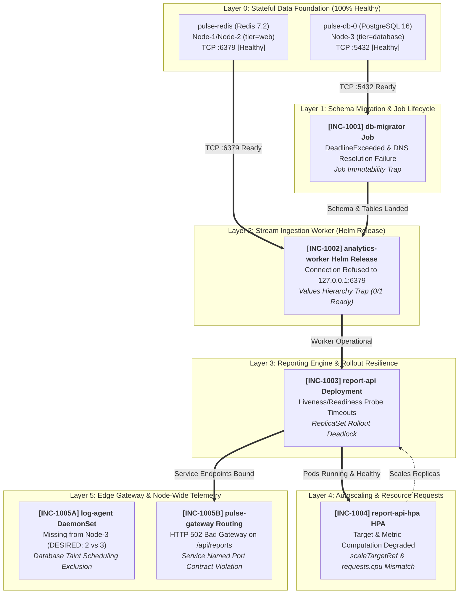
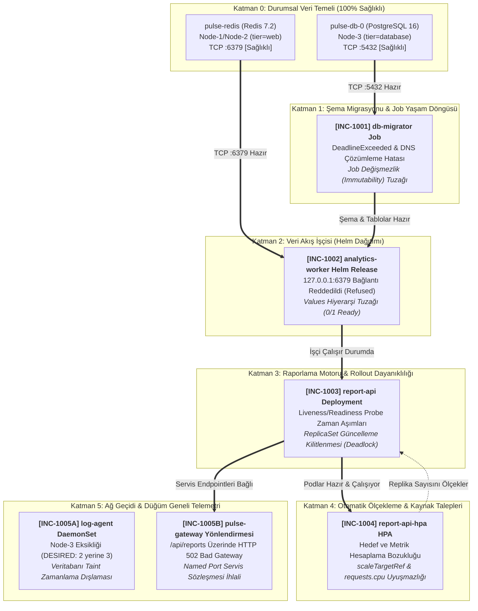

# 🚨 SRE Incident Lab 11: PulseStream — Real-Time Analytics & Reporting Platform Incident Triage

This workspace serves as the active **Incident Triage War Room** during a high-severity production deployment failure of **PulseStream**, an enterprise real-time event analytics streaming and analytical metrics platform.

All manifests and Helm charts deployed to the cluster are **syntactically valid** and accepted by the Kubernetes API server and Helm engine (`./setup.sh` executes with exit code 0). However, at runtime the platform suffers from cascading failures across multiple layers: database migrations terminate prematurely with deadline errors, analytics stream workers fail to discover Redis and remain unready, the reporting API deadlocks during rolling deployment due to probe timeout failures, the Horizontal Pod Autoscaler controller cannot calculate utilization metrics, node-level log telemetry misses the database host, and external gateway requests return HTTP 502 Bad Gateway.

Your mission: triage and remediate the incident tickets **in strictly sequential (linear, bottom-up) order**, perform systematic root cause analysis (RCA) based on telemetry and runtime symptoms, and satisfy the **Success Criteria** for each ticket before proceeding to the next.

> 📖 **Post-Mortem & Deep Root Cause Analyses (RCA):**  
> 👉 **[Explore Senior SRE Post-Mortem Guide (SOLUTION.md)](./SOLUTION.md)** — *Attempt resolution on your own before consulting the guide!*

---

## 🗺️ Cluster Topology & Infrastructure Constraints

The incident scenario is grounded strictly in the following 3-node cluster topology:

| Node Name | Internal IP | Label | Constraint / Taint | Allocated Tier Role |
| :--- | :--- | :--- | :--- | :--- |
| **Node-1** | `10.0.10.122` | `tier=web` | *None* | Web / API / Analytics Worker / Ingress Gateway |
| **Node-2** | `10.0.10.208` | `tier=web` | *None* | Web / API / Analytics Worker / Ingress Gateway |
| **Node-3** | `10.0.10.78` | `tier=database` | `workload=database:NoSchedule` | Database Tier Only (Isolated) |

* **Target Namespace:** `pulsestream-prod`
* **Default StorageClass:** `oci-bv` (Oracle Block Volume CSI, dynamic block provisioning, `ReadWriteOnce` only)
* **Default Ingress / Gateway Service:** `pulse-gateway` Service (NodePort: `8080` -> containerPort `8080`)
* **Core Architecture Stack:**
  1. `pulse-db`: PostgreSQL 16 StatefulSet (`1/1`, ClusterIP Service :5432, Node-3, oci-bv PVC 10Gi, subPath: pgdata — **100% Healthy & Pre-configured**)
  2. `pulse-redis`: Redis 7.2 Deployment (`1/1`, ClusterIP Service :6379, Node-1/Node-2 web pool — **100% Healthy & Pre-configured**)
  3. `db-migrator`: Batch Migration Job (`manifests/20-db-migration-job.yaml`)
  4. `analytics-worker`: Python 3.12 Stream Worker (Helm Release via `./charts/analytics-worker` & `helm-values/worker-prod.yaml`)
  5. `report-api`: Python 3.12 High-Frequency Reporting Engine (2 Replicas, ClusterIP Service :80 -> :8000, `manifests/30-report-api.yaml`)
  6. `report-api-hpa`: Horizontal Pod Autoscaler (2-6 replicas, CPU 70%, `manifests/40-report-hpa.yaml`)
  7. `log-agent`: BusyBox Node Telemetry Collector DaemonSet (`manifests/50-edge-and-daemon.yaml`)
  8. `pulse-gateway`: Nginx 1.25 Reverse Proxy Gateway (`1/1`, NodePort :8080, `manifests/50-edge-and-daemon.yaml`)

> [!IMPORTANT]
> **Architectural Guarantees & Constraints:**
> 1. **Healthy Stateful Foundation:** Lower-layer storage and stateful traps (`oci-bv` RWO vs RWX, PostgreSQL `lost+found` initdb error) are fully resolved out of the box in `10-core-infra.yaml`. Both `pulse-db` (on Node-3) and `pulse-redis` (on Node-1/Node-2) run `1/1 Running` immediately.
> 2. **Strict Bottom-Up Linear Chain:** The incident tickets follow a strict linear dependency hierarchy (L1 -> L2 -> L3 -> L4 -> L5). Upper-layer components depend directly on the health and state of lower layers.
> 3. **Single Application Container (`1/1`):** Every pod runs strictly 1 container (`1/1`). There are zero sidecars and zero initContainers.
> 4. **Zero RBAC / Zero Custom ServiceAccounts:** No custom ServiceAccounts, ClusterRoles, or RoleBindings exist. All failures stem from workload lifecycle, scheduling, probe tuning, service networking, and Helm parameter hierarchy.

---

## 🚀 Environment Initialization (Deploying the Broken Platform)

Execute the bundled setup script to deploy the initial broken production state:

```bash
./setup.sh
```

Or apply the manifests and Helm release manually:

```bash
# 1. Ensure target namespace exists
kubectl apply -f manifests/00-namespace.yaml

# 2. Deploy core manifests (Stateful, Job, Deployment, HPA, DaemonSet, Gateway)
kubectl apply -f manifests/

# 3. Deploy analytics-worker Helm release
helm upgrade --install analytics-worker ./charts/analytics-worker \
  -f helm-values/worker-prod.yaml \
  -n pulsestream-prod
```

Inspect the initial broken state across the namespace:

```bash
kubectl get pods,svc,endpoints,pvc,job,hpa,ds -n pulsestream-prod -o wide
kubectl get events -n pulsestream-prod --sort-by=.lastTimestamp
```

---

## 🗺️ Architecture & Incident Dependency Graph



---

## 📋 On-Call SRE Incident Board

Resolve the tickets sequentially from **INC-1001** to **INC-1005**.

---

### [INC-1001] Database Migration Job Terminating Prematurely with Deadline Errors
* **Priority:** `P1 - Blocker`
* **Alert (PagerDuty / Prometheus):**
  > `[CRITICAL] KubeJobFailed: pulsestream-prod/db-migrator execution failed or exceeded active deadline.`
* **Symptoms:**
  * `kubectl get job db-migrator -n pulsestream-prod` shows `COMPLETIONS: 0/1`.
  * The pod created by the Job terminates with error exit codes and event status `DeadlineExceeded`.
  * Logs from the failed pod report an inability to resolve or connect to the target database host.
  * Subsequent execution simulation time exceeds the allowable Job execution window.
  * Attempting to modify the existing Job directly via `kubectl apply` results in API server validation errors indicating immutable fields cannot be changed.
* **Suspected Component:**
  * Database migration Job manifest (`manifests/20-db-migration-job.yaml`), target database service resolution, and active deadline budget.
* **Step-by-Step Verification Commands:**
  ```bash
  # 1. Inspect Job status and events
  kubectl get job db-migrator -n pulsestream-prod
  # Expected before fix: COMPLETIONS 0/1, DURATION > activeDeadlineSeconds

  kubectl describe job db-migrator -n pulsestream-prod
  # Expected before fix: Job has reached the specified deadline / DeadlineExceeded

  # 2. Inspect failed pod logs
  kubectl logs -n pulsestream-prod job/db-migrator
  # Expected before fix: Connection failure / hostname lookup failure

  # 3. Post-remediation verification
  kubectl get job db-migrator -n pulsestream-prod
  # Expected after fix: COMPLETIONS 1/1, STATUS Complete

  kubectl logs -n pulsestream-prod job/db-migrator
  # Expected after fix: Output contains "Migration complete."

  # 4. Verify table creation in PostgreSQL database
  kubectl exec -n pulsestream-prod pulse-db-0 -- psql -U pulse_admin -d pulse_analytics -c "\dt"
  # Expected: public | events | table | pulse_admin
  ```

---

### [INC-1002] Analytics Worker Crashing & Failing Probes Due to Redis Connection Refusal
* **Priority:** `P1 - Blocker`
* **Alert (PagerDuty / Alertmanager):**
  > `[CRITICAL] KubePodNotReady: pulsestream-prod/analytics-worker-* readiness probe failed with HTTP 500.`
* **Symptoms:**
  * Pod for `analytics-worker` remains in `0/1 Running` or flaps in `CrashLoopBackOff`.
  * The container logs indicate: `Connection refused: Redis at 127.0.0.1:6379 is unreachable`.
  * The production values file (`helm-values/worker-prod.yaml`) ostensibly specifies a remote Redis service, yet the running pod environment uses `127.0.0.1`.
  * The Helm release was deployed without errors, but the rendered configuration does not match on-call expectations.
* **Suspected Component:**
  * Helm values hierarchy in `helm-values/worker-prod.yaml` versus the variable schema expected by `charts/analytics-worker`.
* **Step-by-Step Verification Commands:**
  ```bash
  # 1. Inspect pod status and readiness probe failure
  kubectl get pods -n pulsestream-prod -l app.kubernetes.io/name=analytics-worker
  # Expected before fix: READY 0/1

  kubectl logs -n pulsestream-prod deploy/analytics-worker
  # Expected before fix: Target Redis endpoint: 127.0.0.1:6379 -> Connection refused

  # 2. Inspect active Helm release values
  helm get values analytics-worker -n pulsestream-prod
  helm get values analytics-worker -n pulsestream-prod --all

  # 3. Post-remediation verification
  kubectl get pods -n pulsestream-prod -l app.kubernetes.io/name=analytics-worker
  # Expected after fix: READY 1/1, STATUS Running, RESTARTS 0

  kubectl logs -n pulsestream-prod deploy/analytics-worker
  # Expected after fix: "Target Redis endpoint: pulse-redis:6379", "Initial Redis check: Connected"

  # 4. Test metrics and health endpoints directly
  kubectl exec -n pulsestream-prod deploy/analytics-worker -- python3 -c '
  import urllib.request
  print(urllib.request.urlopen("http://localhost:9100/health").read().decode())
  '
  # Expected: {"status": "healthy", "redis": "connected", "host": "pulse-redis", "port": 6379}
  ```

---

### [INC-1003] Report API Deployment Rollout Deadlock Caused by Probe Timeouts
* **Priority:** `P1 - Blocker`
* **Alert (PagerDuty / Alertmanager):**
  > `[CRITICAL] DeploymentRolloutStalled: pulsestream-prod/report-api rollout deadlocked; readiness and liveness probes failing.`
* **Symptoms:**
  * `report-api` pods are cycling in restarts or stuck in `0/1 Running`.
  * Running `kubectl rollout status deployment/report-api -n pulsestream-prod` hangs indefinitely.
  * `kubectl describe pod` reveals recurring warning events:
    `Liveness probe failed: Get "http://...:8000/healthz": context deadline exceeded (Client.Timeout exceeded while awaiting headers)`
    `Readiness probe failed: Get "http://...:8000/ready": context deadline exceeded (Client.Timeout exceeded while awaiting headers)`
  * Kubelet kills the container every ~10–15 seconds due to liveness probe failure, preventing the new ReplicaSet from completing rollout.
* **Suspected Component:**
  * Health probe timing configurations (`timeoutSeconds`) relative to internal endpoint execution latency in `manifests/30-report-api.yaml`.
* **Step-by-Step Verification Commands:**
  ```bash
  # 1. Inspect deployment rollout progress
  kubectl rollout status deployment/report-api -n pulsestream-prod --timeout=10s
  # Expected before fix: Waiting for deployment "report-api" rollout to finish...

  # 2. Inspect probe failure events
  kubectl describe pod -n pulsestream-prod -l app.kubernetes.io/name=report-api | grep -E "(Unhealthy|Killing)"
  # Expected before fix: context deadline exceeded (Client.Timeout exceeded while awaiting headers)

  # 3. Post-remediation rollout verification
  kubectl rollout status deployment/report-api -n pulsestream-prod
  # Expected after fix: deployment "report-api" successfully rolled out

  # 4. Verify pod readiness and stability
  kubectl get pods -n pulsestream-prod -l app.kubernetes.io/name=report-api
  # Expected after fix: 2/2 replicas READY 1/1, STATUS Running, 0 restarts
  ```

---

### [INC-1004] Horizontal Pod Autoscaler Metric Computation Failure & Target Mismatch
* **Priority:** `P2 - Degraded`
* **Alert (PagerDuty / Alertmanager):**
  > `[WARNING] KubeHpaTargetDegraded: pulsestream-prod/report-api-hpa failed to compute metric utilization (<unknown>/70%).`
* **Symptoms:**
  * `kubectl get hpa -n pulsestream-prod` outputs:
    `TARGETS: <unknown>/70%` and `REFERENCE: Deployment/reporting-service`.
  * `kubectl describe hpa report-api-hpa -n pulsestream-prod` displays:
    `Warning FailedGetScale: the server could not find the requested resource (get deployments.apps reporting-service)`
  * Even if the target resource name is updated, the autoscaler cannot compute CPU utilization percentage because container CPU requests are missing from the workload specification.
* **Suspected Component:**
  * Autoscaler target reference in `manifests/40-report-hpa.yaml` and container resource reservation requests in `manifests/30-report-api.yaml`.
* **Step-by-Step Verification Commands:**
  ```bash
  # 1. Inspect HPA targets and reference
  kubectl get hpa report-api-hpa -n pulsestream-prod
  # Expected before fix: REFERENCE: Deployment/reporting-service, TARGETS: <unknown>/70%

  kubectl describe hpa report-api-hpa -n pulsestream-prod
  # Expected before fix: FailedGetScale or FailedComputeMetrics

  # 2. Post-remediation verification
  kubectl get hpa report-api-hpa -n pulsestream-prod
  # Expected after fix: REFERENCE: Deployment/report-api, TARGETS: 0%/70% (or current valid utilization)

  kubectl describe hpa report-api-hpa -n pulsestream-prod | grep -A 5 "Conditions:"
  # Expected after fix:
  # AbleToScale: True (ReadyForNewScale)
  # ScalingActive: True (ValidMetricFound)
  ```

---

### [INC-1005] Node Telemetry DaemonSet Under-Replication & Edge Gateway 502 Bad Gateway
* **Priority:** `P1 - Blocker`
* **Alert (PagerDuty / Alertmanager):**
  > `[CRITICAL] DaemonSetNotScheduledAcrossAllNodes: pulsestream-prod/log-agent missing from Node-3 (DESIRED: 2 vs 3 nodes).`  
  > `[CRITICAL] EdgeGateway502BadGateway: pulse-gateway returning HTTP 502 Bad Gateway on /api/reports.`
* **Symptoms:**
  * `kubectl get ds log-agent -n pulsestream-prod` reports `DESIRED: 2, CURRENT: 2, READY: 2` on a 3-node cluster. Telemetry collection is absent on Node-3 (`tier=database`).
  * Running `curl http://<pulse-gateway-ip>:8080/api/reports` returns:
    `<html><head><title>502 Bad Gateway</title></head>...`
  * Nginx error logs on `pulse-gateway` indicate:
    `connect() failed (111: Connection refused) while connecting to upstream` or endpoint resolution failure.
  * `kubectl describe svc report-api -n pulsestream-prod` reveals that the service port definition uses a named target port contract that does not resolve against the container port definition in the pod spec.
* **Suspected Component:**
  * Node scheduling tolerations in `manifests/50-edge-and-daemon.yaml` (`log-agent`), and named port mapping contracts between `manifests/30-report-api.yaml` (Service `report-api`) and pod container port declarations.
* **Step-by-Step Verification Commands:**
  ```bash
  # 1. Check DaemonSet scheduling across nodes
  kubectl get ds log-agent -n pulsestream-prod
  # Expected before fix: DESIRED: 2, READY: 2

  kubectl get pods -n pulsestream-prod -l app.kubernetes.io/name=log-agent -o wide
  # Expected before fix: Pods only present on Node-1 and Node-2; missing on Node-3 (10.0.10.78)

  # 2. Test gateway HTTP route
  kubectl exec -n pulsestream-prod deploy/pulse-gateway -- wget -qO- http://localhost:8080/api/reports
  # Expected before fix: wget: server returned error: HTTP/1.1 502 Bad Gateway

  # 3. Post-remediation DaemonSet verification
  kubectl get ds log-agent -n pulsestream-prod
  # Expected after fix: DESIRED: 3, CURRENT: 3, READY: 3

  kubectl get pods -n pulsestream-prod -l app.kubernetes.io/name=log-agent -o wide
  # Expected after fix: Pods scheduled on Node-1, Node-2, AND Node-3

  # 4. Post-remediation Gateway & Service verification
  kubectl get endpoints report-api -n pulsestream-prod
  # Expected after fix: ENDPOINTS contains both pod IPs on port 8000

  kubectl exec -n pulsestream-prod deploy/pulse-gateway -- wget -qO- http://localhost:8080/api/reports
  # Expected after fix: {"platform": "PulseStream", "status": "active", "realtime_metrics": {...}}
  ```

---

## 🏁 Bottom-Up Production Health Check (Full Cluster Verification)

Execute this unified bash sequence to verify that all five layers of the PulseStream platform meet strict production SLAs:

```bash
#!/usr/bin/env bash
set -euo pipefail

NS="pulsestream-prod"
echo "=== [1/6] Layer 0: Stateful Foundation ==="
kubectl get sts pulse-db -n "${NS}" -o jsonpath='{.status.readyReplicas}' | grep -q "1" && echo "✅ pulse-db is 1/1 Ready"
kubectl get deploy pulse-redis -n "${NS}" -o jsonpath='{.status.readyReplicas}' | grep -q "1" && echo "✅ pulse-redis is 1/1 Ready"

echo "=== [2/6] Layer 1: Schema Migration ==="
kubectl get job db-migrator -n "${NS}" -o jsonpath='{.status.succeeded}' | grep -q "1" && echo "✅ db-migrator Job Succeeded (1/1)"
kubectl exec -n "${NS}" pulse-db-0 -- psql -U pulse_admin -d pulse_analytics -c "\dt" | grep -q "events" && echo "✅ PostgreSQL 'events' table verified"

echo "=== [3/6] Layer 2: Stream Ingestion Worker ==="
kubectl get deploy analytics-worker -n "${NS}" -o jsonpath='{.status.readyReplicas}' | grep -q "1" && echo "✅ analytics-worker is 1/1 Ready"
kubectl exec -n "${NS}" deploy/analytics-worker -- python3 -c '
import urllib.request, json
res = json.loads(urllib.request.urlopen("http://localhost:9100/health").read().decode())
assert res["status"] == "healthy" and res["redis"] == "connected"
' && echo "✅ analytics-worker health endpoint verifies active Redis connection"

echo "=== [4/6] Layer 3: Reporting Engine Deployment ==="
kubectl rollout status deployment/report-api -n "${NS}" --timeout=5s
kubectl get deploy report-api -n "${NS}" -o jsonpath='{.status.readyReplicas}' | grep -q "2" && echo "✅ report-api has 2/2 Replicas Ready"

echo "=== [5/6] Layer 4: Auto-Scaling Infrastructure ==="
HPA_TARGET=$(kubectl get hpa report-api-hpa -n "${NS}" -o jsonpath='{.spec.scaleTargetRef.name}')
[ "${HPA_TARGET}" = "report-api" ] && echo "✅ HPA correctly targets 'report-api'"
kubectl describe hpa report-api-hpa -n "${NS}" | grep -q "ScalingActive.*True" && echo "✅ HPA metrics calculation active"

echo "=== [6/6] Layer 5: Edge Gateway & DaemonSet ==="
kubectl get ds log-agent -n "${NS}" -o jsonpath='{.status.numberReady}' | grep -q "3" && echo "✅ log-agent DaemonSet running on all 3 nodes"
GATEWAY_RESP=$(kubectl exec -n "${NS}" deploy/pulse-gateway -- wget -qO- http://localhost:8080/api/reports)
echo "${GATEWAY_RESP}" | grep -q "PulseStream" && echo "✅ pulse-gateway reverse proxy returned 200 OK with analytics payload"

echo "🎉 ALL PULSESTREAM PRODUCTION TIERS FULLY HEALTHY & OPERATIONAL!"
```

<br>

---

## 🇹🇷 Türkçe Dokümantasyon / Turkish Version

# 🚨 SRE Olay Müdahale Laboratuvarı 10: PulseStream — Gerçek Zamanlı Analitik ve Raporlama Platformu

Bu çalışma alanı, kurumsal gerçek zamanlı olay akışı ve yüksek frekanslı analitik raporlama platformu olan **PulseStream**'in (`pulsestream-prod` namespace) production dağıtımında yaşanan zincirleme kesintiler için kurulan aktif **Incident Triage War Room**'dur (Olay Müdahale Masası).

Kümeye uygulanan tüm Kubernetes manifestoları ve Helm chart'ları **sözdizimi açısından kusursuzdur** ve Kubernetes API sunucusu ile Helm motoru tarafından hatasız kabul edilmiştir (`./setup.sh` 0 çıkış koduyla tamamlanır). Ancak çalışma zamanında (runtime) sistem katman katman çökmektedir: veritabanı migration Job'ı zaman aşımıyla erkenden sonlanmakta, analitik işçi pod'u Redis'i bulamayarak sağlıksız kalmakta, raporlama API'si sağlık kontrolü (probe) zaman aşımı nedeniyle güncelleme kilitlenmesine (rollout deadlock) girmekte, HPA denetleyicisi metrikleri hesaplayamamakta, log toplama ajanı veritabanı sunucusuna uğrayamamakta ve dış gateway istekleri HTTP 502 Bad Gateway hatası döndürmektedir.

Göreviniz: biletleri **kesinlikle doğrusal (aşağıdan yukarıya, bottom-up)** sırada ele almak, telemetri ve semptomlardan yola çıkarak kök neden analizi (RCA) yapmak ve her biletin **Başarı Kriteri**'ni sağladıktan sonra bir sonrakine geçmektir.

> 📖 **Post-Mortem & Derin Kök Neden Analizi Kılavuzu (RCA):**  
> 👉 **[Kıdemli SRE Post-Mortem Rehberi (SOLUTION.md)](./SOLUTION.md)** — *Çözüme bakmadan önce mutlaka kendiniz deneyiniz!*

---

## 🗺️ Küme Topolojisi ve Altyapı Kısıtları

Senaryo, aşağıdaki 3 node'lu fiziksel küme topolojisine dayanmaktadır:

| Node Adı | Dahili IP | Etiket (Label) | Kısıt / Taint | Ayrılmış Tier Rolü |
| :--- | :--- | :--- | :--- | :--- |
| **Node-1** | `10.0.10.122` | `tier=web` | *Yok* | Web / API / Analytics Worker / Ingress Gateway |
| **Node-2** | `10.0.10.208` | `tier=web` | *Yok* | Web / API / Analytics Worker / Ingress Gateway |
| **Node-3** | `10.0.10.78` | `tier=database` | `workload=database:NoSchedule` | Yalnızca Veritabanı Katmanı (İzole) |

* **Hedef Namespace:** `pulsestream-prod`
* **Varsayılan StorageClass:** `oci-bv` (Oracle Block Volume CSI, dinamik blok depolama, yalnızca `ReadWriteOnce`)
* **Dış Gateway Servisi:** `pulse-gateway` Servisi (NodePort: `8080` -> containerPort `8080`)
* **Temel Mimari Yığını:**
  1. `pulse-db`: PostgreSQL 16 StatefulSet (`1/1`, ClusterIP Servisi :5432, Node-3, oci-bv PVC 10Gi, subPath: pgdata — **100% Sağlıklı ve Önceden Yapılandırılmış**)
  2. `pulse-redis`: Redis 7.2 Deployment (`1/1`, ClusterIP Servisi :6379, Node-1/Node-2 web havuzu — **100% Sağlıklı ve Önceden Yapılandırılmış**)
  3. `db-migrator`: Veritabanı Şema Migration Job'ı (`manifests/20-db-migration-job.yaml`)
  4. `analytics-worker`: Python 3.12 Stream Worker (Helm Release: `./charts/analytics-worker` & `helm-values/worker-prod.yaml`)
  5. `report-api`: Python 3.12 Yüksek Frekanslı Raporlama Motoru (2 Replika, ClusterIP Servisi :80 -> :8000, `manifests/30-report-api.yaml`)
  6. `report-api-hpa`: Horizontal Pod Autoscaler (2-6 replika, CPU %70, `manifests/40-report-hpa.yaml`)
  7. `log-agent`: BusyBox Düğüm Telemetri Toplayıcı DaemonSet (`manifests/50-edge-and-daemon.yaml`)
  8. `pulse-gateway`: Nginx 1.25 Ters Proxy Ağ Geçidi (`1/1`, NodePort :8080, `manifests/50-edge-and-daemon.yaml`)

> [!IMPORTANT]
> **Mimari Garantiler ve Kural Çerçevesi:**
> 1. **Sağlıklı Durumsal Temel (Stateful Foundation):** Alt katmandaki depolama ve veritabanı tuzakları (`oci-bv` RWO vs RWX, PostgreSQL `lost+found` initdb hatası) `10-core-infra.yaml` dosyasında çözülmüştür. Hem `pulse-db` (Node-3 üzerinde) hem de `pulse-redis` (web düğümleri üzerinde) kurulumdan itibaren `1/1 Running` başlar.
> 2. **Doğrusal Aşağıdan Yukarıya Akış (Bottom-Up):** Biletler L1 -> L2 -> L3 -> L4 -> L5 şeklinde kesin bir hiyerarşiye tabidir. Üst katmanlar alt katmanların sağlığına ve bağlantısına doğrudan bağımlıdır.
> 3. **Tek Container (`1/1`):** Her pod istisnasız 1 container çalıştırır (`1/1`). Sidecar veya initContainer yoktur.
> 4. **Sıfır RBAC / Özel ServiceAccount:** Kümede özel ServiceAccount veya yetkilendirme katmanı bulunmaz. Tüm arızalar pod yaşam döngüsü, zamanlama (scheduling), probe optimizasyonu, servis ağ yönlendirmesi ve Helm parametre hiyerarşisi kaynaklıdır.

---

## 🚀 Ortam Kurulumu (Hatalı Platformun Dağıtımı)

Bozuk production ortamını ayağa kaldırmak için kurulum betiğini çalıştırın:

```bash
./setup.sh
```

Veya manifestoları ve Helm sürümünü manuel olarak uygulayın:

```bash
# 1. Namespace oluşturma
kubectl apply -f manifests/00-namespace.yaml

# 2. Temel manifestoları uygulama
kubectl apply -f manifests/

# 3. analytics-worker Helm sürümünü kurma
helm upgrade --install analytics-worker ./charts/analytics-worker \
  -f helm-values/worker-prod.yaml \
  -n pulsestream-prod
```

Kümedeki ilk bozuk durumu gözlemleyin:

```bash
kubectl get pods,svc,endpoints,pvc,job,hpa,ds -n pulsestream-prod -o wide
kubectl get events -n pulsestream-prod --sort-by=.lastTimestamp
```

---

## 🗺️ Mimari ve Olay Bağımlılık Şeması



---

## 📋 Nöbetçi (On-Call) SRE Olay Müdahale Masası

Biletleri **INC-1001**'den başlayarak **INC-1005**'e kadar sırasıyla çözünüz.

---

### [INC-1001] Veritabanı Migrasyon Job'ı Zaman Aşımı ve Bağlantı Hatasıyla Çöküyor
* **Öncelik:** `P1 - Engelleyici (Blocker)`
* **Alarm (PagerDuty / Prometheus):**
  > `[CRITICAL] KubeJobFailed: pulsestream-prod/db-migrator görevi başarısız oldu veya izin verilen süreyi aştı.`
* **Semptomlar:**
  * `kubectl get job db-migrator -n pulsestream-prod` komutu `COMPLETIONS: 0/1` olarak kalmaktadır.
  * Job tarafından ayağa kaldırılan pod hata çıkış koduyla kapanmakta ve olaylarda `DeadlineExceeded` yazmaktadır.
  * Pod logları veritabanı sunucu adına erişilemediğini / DNS çözümlemesinin yapılamadığını bildirmektedir.
  * Veritabanı migrasyon ve indeksleme simülasyonu Job için tanımlanmış çalışma bütçesini aşmaktadır.
  * Hatalı Job dosyasında düzenleme yapılıp doğrudan `kubectl apply` ile uygulanmak istendiğinde Kubernetes API sunucusu değişmez (immutable) alanların güncellenemeyeceğini belirten bir hata fırlatmaktadır.
* **Şüphelenilen Bileşen:**
  * Veritabanı migrasyon Job tanımı (`manifests/20-db-migration-job.yaml`), veritabanı servis adresi ve çalışma süresi bütçesi.
* **Adım Adım Doğrulama Komutları:**
  ```bash
  # 1. Job durumunu ve olaylarını inceleyin
  kubectl get job db-migrator -n pulsestream-prod
  # Düzeltme öncesi beklenen: COMPLETIONS 0/1, DURATION > activeDeadlineSeconds

  kubectl describe job db-migrator -n pulsestream-prod
  # Düzeltme öncesi beklenen: Job has reached the specified deadline / DeadlineExceeded

  # 2. Başarısız pod loglarını okuyun
  kubectl logs -n pulsestream-prod job/db-migrator
  # Düzeltme öncesi beklenen: Hostname lookup failure / bağlantı hatası

  # 3. Düzeltme sonrası doğrulama
  kubectl get job db-migrator -n pulsestream-prod
  # Düzeltme sonrası beklenen: COMPLETIONS 1/1, STATUS Complete

  kubectl logs -n pulsestream-prod job/db-migrator
  # Düzeltme sonrası beklenen: "Migration complete." çıktısı

  # 4. PostgreSQL veritabanında tablonun açıldığını teyit edin
  kubectl exec -n pulsestream-prod pulse-db-0 -- psql -U pulse_admin -d pulse_analytics -c "\dt"
  # Beklenen: public | events | table | pulse_admin
  ```

---

### [INC-1002] Analitik İşçi Pod'u Redis Bağlantı Reddi Nedeniyle Hazır Olamıyor
* **Öncelik:** `P1 - Engelleyici (Blocker)`
* **Alarm (PagerDuty / Alertmanager):**
  > `[CRITICAL] KubePodNotReady: pulsestream-prod/analytics-worker-* readiness kontrolü HTTP 500 ile başarısız oldu.`
* **Semptomlar:**
  * `analytics-worker` pod'u sürekli `0/1 Running` durumunda kalmakta veya `CrashLoopBackOff`'a düşmektedir.
  * Container loglarında şu satır görülmektedir: `Connection refused: Redis at 127.0.0.1:6379 is unreachable`.
  * Production değerleri dosyasında (`helm-values/worker-prod.yaml`) uzak Redis servis adı yazılmış olmasına rağmen, çalışan pod `127.0.0.1` adresine bağlanmayı denemektedir.
  * Helm dağıtımı hatasız gerçekleşmiştir ancak render edilen değerler on-call mühendisinin beklediği değişkenlerle uyuşmamaktadır.
* **Şüphelenilen Bileşen:**
  * `helm-values/worker-prod.yaml` içerisindeki değerler hiyerarşisi ile `charts/analytics-worker` şablonunun beklediği değişken ağacı.
* **Adım Adım Doğrulama Komutları:**
  ```bash
  # 1. Pod durumunu ve logları inceleyin
  kubectl get pods -n pulsestream-prod -l app.kubernetes.io/name=analytics-worker
  # Düzeltme öncesi beklenen: READY 0/1

  kubectl logs -n pulsestream-prod deploy/analytics-worker
  # Düzeltme öncesi beklenen: Target Redis endpoint: 127.0.0.1:6379 -> Connection refused

  # 2. Helm değerlerini inceleyin
  helm get values analytics-worker -n pulsestream-prod
  helm get values analytics-worker -n pulsestream-prod --all

  # 3. Düzeltme sonrası pod sağlığı
  kubectl get pods -n pulsestream-prod -l app.kubernetes.io/name=analytics-worker
  # Düzeltme sonrası beklenen: READY 1/1, STATUS Running, RESTARTS 0

  kubectl logs -n pulsestream-prod deploy/analytics-worker
  # Düzeltme sonrası beklenen: "Target Redis endpoint: pulse-redis:6379", "Initial Redis check: Connected"

  # 4. Servis HTTP ve metrik uç noktalarını test edin
  kubectl exec -n pulsestream-prod deploy/analytics-worker -- python3 -c '
  import urllib.request
  print(urllib.request.urlopen("http://localhost:9100/health").read().decode())
  '
  # Beklenen çıktı: {"status": "healthy", "redis": "connected", "host": "pulse-redis", "port": 6379}
  ```

---

### [INC-1003] Raporlama Servisinde Probe Zaman Aşımı Kaynaklı Güncelleme Kilitlenmesi
* **Öncelik:** `P1 - Engelleyici (Blocker)`
* **Alarm (PagerDuty / Alertmanager):**
  > `[CRITICAL] DeploymentRolloutStalled: pulsestream-prod/report-api güncellemesi kilitlendi; liveness/readiness probe zaman aşımları yaşanıyor.`
* **Semptomlar:**
  * `report-api` pod'ları sürekli restart olmakta veya `0/1 Running` durumunda takılmaktadır.
  * `kubectl rollout status deployment/report-api -n pulsestream-prod` komutu ilerlememekte ve sonsuza kadar beklemektedir.
  * `kubectl describe pod` komutunda düzenli aralıklarla şu uyarılar görülür:
    `Readiness probe failed: Get "http://...:8000/ready": context deadline exceeded (Client.Timeout exceeded while awaiting headers)`
    `Liveness probe failed: Get "http://...:8000/healthz": context deadline exceeded (Client.Timeout exceeded while awaiting headers)`
  * Kubelet her 10–15 saniyede bir liveness hatası yüzünden container'ı öldürmekte ve yeni ReplicaSet pod'ları hazır olamadığı için rolling update durmaktadır.
* **Şüphelenilen Bileşen:**
  * `manifests/30-report-api.yaml` içerisindeki probe süre yapılandırması (`timeoutSeconds`) ile uygulamanın dahili yanıt süresi arasındaki ilişki.
* **Adım Adım Doğrulama Komutları:**
  ```bash
  # 1. Deployment güncelleme durumunu inceleyin
  kubectl rollout status deployment/report-api -n pulsestream-prod --timeout=10s
  # Düzeltme öncesi beklenen: Güncellemenin takılı kalması ve tamamlanamaması

  # 2. Pod üzerindeki probe uyarılarını görüntüleyin
  kubectl describe pod -n pulsestream-prod -l app.kubernetes.io/name=report-api | grep -E "(Unhealthy|Killing)"
  # Düzeltme öncesi beklenen: context deadline exceeded hataları

  # 3. Düzeltme sonrası rollout başarısı
  kubectl rollout status deployment/report-api -n pulsestream-prod
  # Düzeltme sonrası beklenen: deployment "report-api" successfully rolled out

  # 4. Podların kararlı hazır oluşunu doğrulayın
  kubectl get pods -n pulsestream-prod -l app.kubernetes.io/name=report-api
  # Düzeltme sonrası beklenen: 2/2 replika READY 1/1, STATUS Running, RESTARTS durmuş
  ```

---

### [INC-1004] HPA Otomatik Ölçekleme Metrik Hesaplama Bozukluğu ve Hedef Uyuşmazlığı
* **Öncelik:** `P2 - Düşük Performans (Degraded)`
* **Alarm (PagerDuty / Alertmanager):**
  > `[WARNING] KubeHpaTargetDegraded: pulsestream-prod/report-api-hpa metrik kullanımını hesaplayamadı (<unknown>/70%).`
* **Semptomlar:**
  * `kubectl get hpa -n pulsestream-prod` çıktısında:
    `TARGETS: <unknown>/70%` ve `REFERENCE: Deployment/reporting-service` görülmektedir.
  * `kubectl describe hpa report-api-hpa -n pulsestream-prod` çıktısı:
    `Warning FailedGetScale: the server could not find the requested resource (get deployments.apps reporting-service)` hatası verir.
  * Hedef kaynak adı düzeltilse bile, pod tanımında CPU istekleri (requests) bulunmadığı için HPA denetleyicisi yüzde kullanımını hesaplayamaz.
* **Şüphelenilen Bileşen:**
  * `manifests/40-report-hpa.yaml` hedef adı ile `manifests/30-report-api.yaml` içerisindeki container kaynak rezervasyon talepleri (`requests.cpu`).
* **Adım Adım Doğrulama Komutları:**
  ```bash
  # 1. HPA hedefini ve metrik durumunu kontrol edin
  kubectl get hpa report-api-hpa -n pulsestream-prod
  # Düzeltme öncesi beklenen: REFERENCE: Deployment/reporting-service, TARGETS: <unknown>/70%

  kubectl describe hpa report-api-hpa -n pulsestream-prod
  # Düzeltme öncesi beklenen: FailedGetScale veya FailedComputeMetrics uyarısı

  # 2. Düzeltme sonrası doğrulama
  kubectl get hpa report-api-hpa -n pulsestream-prod
  # Düzeltme sonrası beklenen: REFERENCE: Deployment/report-api, TARGETS: 0%/70% (veya aktif değer)

  kubectl describe hpa report-api-hpa -n pulsestream-prod | grep -A 5 "Conditions:"
  # Düzeltme sonrası beklenen:
  # AbleToScale: True (ReadyForNewScale)
  # ScalingActive: True (ValidMetricFound)
  ```

---

### [INC-1005] Düğüm Telemetri Ajanı Eksikliği & Ağ Geçidinde HTTP 502 Bad Gateway
* **Öncelik:** `P1 - Engelleyici (Blocker)`
* **Alarm (PagerDuty / Alertmanager):**
  > `[CRITICAL] DaemonSetNotScheduledAcrossAllNodes: pulsestream-prod/log-agent Node-3 üzerinde eksik (DESIRED: 2 vs 3 düğüm).`  
  > `[CRITICAL] EdgeGateway502BadGateway: pulse-gateway /api/reports yolunda HTTP 502 Bad Gateway dönüyor.`
* **Semptomlar:**
  * `kubectl get ds log-agent -n pulsestream-prod` komutunda 3 düğümlü kümede `DESIRED: 2, CURRENT: 2, READY: 2` görülmektedir. Node-3 (`tier=database`) üzerinde log ajanı bulunmamaktadır.
  * Gateway üzerinden `curl http://<pulse-gateway-ip>:8080/api/reports` çalıştırıldığında HTTP 502 Bad Gateway hatası alınmaktadır.
  * Gateway Nginx loglarında `connect() failed (111: Connection refused) while connecting to upstream` yazmaktadır.
  * `kubectl describe svc report-api -n pulsestream-prod` incelendiğinde, servisin hedef port olarak tanımladığı ismin pod container port tanımıyla eşleşmediği anlaşılmaktadır.
* **Şüphelenilen Bileşen:**
  * `manifests/50-edge-and-daemon.yaml` içerisindeki DaemonSet zamanlama kısıtları / tolerasyonları ve `manifests/30-report-api.yaml` servis port sözleşmesi.
* **Adım Adım Doğrulama Komutları:**
  ```bash
  # 1. DaemonSet'in düğüm dağılımını kontrol edin
  kubectl get ds log-agent -n pulsestream-prod
  # Düzeltme öncesi beklenen: DESIRED: 2, READY: 2

  kubectl get pods -n pulsestream-prod -l app.kubernetes.io/name=log-agent -o wide
  # Düzeltme öncesi beklenen: Yalnızca Node-1 ve Node-2 üzerinde çalışıyor, Node-3 (10.0.10.78) eksik

  # 2. Ağ geçidi HTTP çağrısını test edin
  kubectl exec -n pulsestream-prod deploy/pulse-gateway -- wget -qO- http://localhost:8080/api/reports
  # Düzeltme öncesi beklenen: HTTP 502 Bad Gateway

  # 3. Düzeltme sonrası DaemonSet doğrulaması
  kubectl get ds log-agent -n pulsestream-prod
  # Düzeltme sonrası beklenen: DESIRED: 3, CURRENT: 3, READY: 3

  kubectl get pods -n pulsestream-prod -l app.kubernetes.io/name=log-agent -o wide
  # Düzeltme sonrası beklenen: Node-1, Node-2 VE Node-3 üzerinde podlar çalışıyor

  # 4. Düzeltme sonrası Servis & Gateway doğrulaması
  kubectl get endpoints report-api -n pulsestream-prod
  # Düzeltme sonrası beklenen: ENDPOINTS altında pod IP'leri 8000 portu ile listelenir

  kubectl exec -n pulsestream-prod deploy/pulse-gateway -- wget -qO- http://localhost:8080/api/reports
  # Düzeltme sonrası beklenen: {"platform": "PulseStream", "status": "active", "realtime_metrics": {...}}
  ```

---

## 🏁 Uçtan Uca Production Sağlık Kontrolü (Bottom-Up Checklist)

PulseStream platformunun tüm katmanlarının canlı üretim standartlarını karşıladığını doğrulamak için aşağıdaki tekil kontrol betiğini çalıştırınız:

```bash
#!/usr/bin/env bash
set -euo pipefail

NS="pulsestream-prod"
echo "=== [1/6] Katman 0: Durumsal Veri Tabanı Kontrolü ==="
kubectl get sts pulse-db -n "${NS}" -o jsonpath='{.status.readyReplicas}' | grep -q "1" && echo "✅ pulse-db 1/1 Ready"
kubectl get deploy pulse-redis -n "${NS}" -o jsonpath='{.status.readyReplicas}' | grep -q "1" && echo "✅ pulse-redis 1/1 Ready"

echo "=== [2/6] Katman 1: Şema Migrasyon Kontrolü ==="
kubectl get job db-migrator -n "${NS}" -o jsonpath='{.status.succeeded}' | grep -q "1" && echo "✅ db-migrator Job Succeeded (1/1)"
kubectl exec -n "${NS}" pulse-db-0 -- psql -U pulse_admin -d pulse_analytics -c "\dt" | grep -q "events" && echo "✅ PostgreSQL 'events' tablosu doğrulandı"

echo "=== [3/6] Katman 2: Veri Akış İşçisi Kontrolü ==="
kubectl get deploy analytics-worker -n "${NS}" -o jsonpath='{.status.readyReplicas}' | grep -q "1" && echo "✅ analytics-worker 1/1 Ready"
kubectl exec -n "${NS}" deploy/analytics-worker -- python3 -c '
import urllib.request, json
res = json.loads(urllib.request.urlopen("http://localhost:9100/health").read().decode())
assert res["status"] == "healthy" and res["redis"] == "connected"
' && echo "✅ analytics-worker Redis bağlantısı canlı"

echo "=== [4/6] Katman 3: Raporlama API Dağıtım Kontrolü ==="
kubectl rollout status deployment/report-api -n "${NS}" --timeout=5s
kubectl get deploy report-api -n "${NS}" -o jsonpath='{.status.readyReplicas}' | grep -q "2" && echo "✅ report-api 2/2 Replicas Ready"

echo "=== [5/6] Katman 4: Otomatik Ölçekleme (HPA) Kontrolü ==="
HPA_TARGET=$(kubectl get hpa report-api-hpa -n "${NS}" -o jsonpath='{.spec.scaleTargetRef.name}')
[ "${HPA_TARGET}" = "report-api" ] && echo "✅ HPA 'report-api' Deployment'ını hedefliyor"
kubectl describe hpa report-api-hpa -n "${NS}" | grep -q "ScalingActive.*True" && echo "✅ HPA metrik hesaplaması aktif"

echo "=== [6/6] Katman 5: Ağ Geçidi & DaemonSet Kontrolü ==="
kubectl get ds log-agent -n "${NS}" -o jsonpath='{.status.numberReady}' | grep -q "3" && echo "✅ log-agent DaemonSet 3 düğümün tamamında çalışıyor"
GATEWAY_RESP=$(kubectl exec -n "${NS}" deploy/pulse-gateway -- wget -qO- http://localhost:8080/api/reports)
echo "${GATEWAY_RESP}" | grep -q "PulseStream" && echo "✅ pulse-gateway 200 OK ile analitik verisini döndürdü"

echo "🎉 PULSESTREAM PLATFORMUNUN TÜM KATMANLARI SAĞLIKLI VE DEVREDE!"
```
