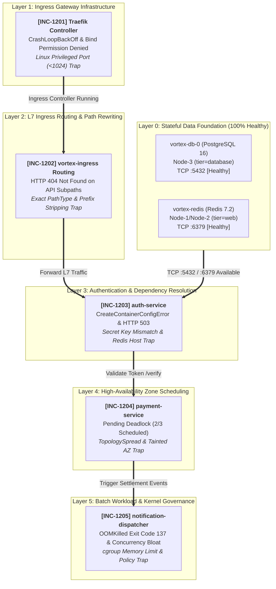

# 🚨 SRE Incident Lab 12: Vortex — Distributed Microservices & Traefik Ingress Platform Incident Triage

This workspace serves as the active **Incident Triage War Room** during a high-severity production outage of **Vortex**, an enterprise distributed microservice and edge API platform fronted by a Traefik Ingress Controller.

All Kubernetes manifests and Helm chart templates deployed to the cluster are **syntactically valid** and accepted by the Kubernetes API server and Helm engine (`./setup.sh` executes with exit code 0). However, at runtime the platform suffers from cascading failures across the networking, security, data access, scheduling, and batch layers: Traefik crashes immediately on privileged port binding permissions, edge ingress routes return HTTP 404 Not Found, the authentication service fails to boot due to missing secret references and unreachable cache endpoints, payment processing deadlocks on cross-zone topology spread constraints, and the notification dispatcher CronJob is repeatedly killed by the Linux kernel OOM killer while accumulating unbounded failed runs.

Your mission: triage and remediate the incident tickets **in strictly sequential (linear, bottom-up) order**, perform systematic root cause analysis (RCA) based on telemetry and runtime symptoms, and satisfy the **Success Criteria** for each ticket before proceeding to the next.

> 📖 **Post-Mortem & Deep Root Cause Analyses (RCA):**  
> 👉 **[Explore Senior SRE Post-Mortem Guide (SOLUTION.md)](./SOLUTION.md)** — *Attempt resolution on your own before consulting the guide!*

---

## 🗺️ Cluster Topology & Infrastructure Constraints

The incident scenario is grounded strictly in the following 3-node cluster topology:

| Node Name | Internal IP | Label | Constraint / Taint | Allocated Tier Role |
| :--- | :--- | :--- | :--- | :--- |
| **Node-1** | `10.0.10.122` | `tier=web` | *None* | Web / API / Traefik Ingress / Batch Workers |
| **Node-2** | `10.0.10.208` | `tier=web` | *None* | Web / API / Traefik Ingress / Batch Workers |
| **Node-3** | `10.0.10.78` | `tier=database` | `workload=database:NoSchedule` | Database Tier Only (Isolated) |

* **Target Namespace:** `vortex-prod`
* **Default StorageClass:** `oci-bv` (Oracle Block Volume CSI, dynamic block provisioning, `ReadWriteOnce` only)
* **Ingress Controller:** Traefik v2.11 deployed via Helm (`./charts/traefik`, Service NodePort: `80` -> containerPort `8000`, NodePort `30080`)
* **Core Architecture Stack:**
  1. `vortex-db`: PostgreSQL 16 StatefulSet (`1/1`, ClusterIP Service :5432, Node-3, oci-bv PVC 10Gi, subPath: pgdata — **100% Healthy & Pre-configured**)
  2. `vortex-redis`: Redis 7.2 Deployment (`1/1`, ClusterIP Service :6379, Node-1/Node-2 web pool — **100% Healthy & Pre-configured**)
  3. `traefik`: Traefik v2.11 Ingress Controller (Helm Release via `./charts/traefik` & `helm-values/traefik-prod.yaml`)
  4. `vortex-ingress`: Kubernetes Ingress (`manifests/20-ingress.yaml`, host: `vortex.local`)
  5. `auth-service`: Python 3.12 Token Verification & Session Engine (ClusterIP Service :8081, `manifests/30-auth-service.yaml`)
  6. `payment-service`: Python 3.12 Distributed Settlement Engine (3 Replicas, ClusterIP Service :8082, `manifests/40-payment-service.yaml`)
  7. `notification-dispatcher`: Python 3.12 Event Notification Batch Dispatcher (CronJob, `manifests/50-notification-worker.yaml`)

> [!IMPORTANT]
> **Architectural Guarantees & Constraints:**
> 1. **Healthy Stateful Foundation:** Lower-layer storage and stateful traps (`oci-bv` RWO vs RWX, PostgreSQL `lost+found` initdb error) are fully resolved out of the box in `10-core-infra.yaml`. Both `vortex-db` (on Node-3) and `vortex-redis` (on Node-1/Node-2) start `1/1 Running` immediately.
> 2. **Strict Bottom-Up Linear Chain:** The incident tickets follow a strict linear dependency hierarchy (INC-1201 -> INC-1202 -> INC-1203 -> INC-1204 -> INC-1205). Ingress routing requires a running controller; payment processing depends directly on token verification from `auth-service`, which in turn depends on Redis and PostgreSQL connectivity.
> 3. **Single Application Container (`1/1`):** Every pod runs strictly 1 container (`1/1`). There are zero sidecars and zero initContainers.
> 4. **Zero RBAC / Zero Custom ServiceAccounts:** No custom ServiceAccounts, ClusterRoles, or RoleBindings exist. All failures stem from Linux process security, L7 path matching, configuration referencing, zone scheduling constraints, and cgroup resource governance.

---

## 🚀 Environment Initialization (Deploying the Broken Platform)

Execute the bundled setup script to deploy the initial broken production state:

```bash
./setup.sh
```

Or apply the manifests and Helm release manually:

```bash
# 1. Ensure target namespace exists
kubectl apply -f manifests/00-namespace.yaml

# 2. Deploy core manifests (Stateful, Deployments, Ingress, CronJob)
kubectl apply -f manifests/

# 3. Deploy Traefik Ingress Controller Helm release
helm upgrade --install traefik ./charts/traefik \
  -f helm-values/traefik-prod.yaml \
  -n vortex-prod
```

Inspect the initial broken state across the namespace:

```bash
kubectl get pods,svc,ingress,cronjob -n vortex-prod -o wide
kubectl get events -n vortex-prod --sort-by=.lastTimestamp
```

---

## 🗺️ Architecture & Incident Dependency Graph



---

## 📋 On-Call SRE Incident Board

Resolve the tickets sequentially from **INC-1201** to **INC-1205**.

---

### [INC-1201] Traefik Ingress Controller Failing to Start with CrashLoopBackOff
* **Priority:** `P1 - Blocker`
* **Alert (PagerDuty / Alertmanager):**
  > `[CRITICAL] KubePodCrashLooping: vortex-prod/traefik-* pod is crashing repeatedly; L7 edge entrypoint is down.`
* **Symptoms:**
  * `kubectl get pods -n vortex-prod -l app.kubernetes.io/name=traefik` shows status `CrashLoopBackOff` or `Error`.
  * Pod restart count increments every few seconds; pod never reaches `1/1 Ready`.
  * Container logs reveal that Traefik fails immediately during network socket initialization with a permission denied error when attempting to bind its listening address.
  * NodePort `30080` and ClusterIP port `80` do not respond to external or in-cluster traffic.
* **Suspected Component:**
  * Traefik Helm values configuration (`helm-values/traefik-prod.yaml`), listening port definitions, and container `securityContext`.
* **Step-by-Step Verification Commands:**
  ```bash
  # 1. Inspect Traefik pod status
  kubectl get pods -n vortex-prod -l app.kubernetes.io/name=traefik
  # Expected before fix: STATUS: CrashLoopBackOff or Error, READY: 0/1

  # 2. Inspect container termination logs
  kubectl logs -n vortex-prod -l app.kubernetes.io/name=traefik --tail=30
  # Expected before fix: Error loading entryPoint web: error starting listener: listen tcp :80: bind: permission denied

  # 3. Post-remediation verification
  kubectl get pods -n vortex-prod -l app.kubernetes.io/name=traefik
  # Expected after fix: STATUS: Running, READY: 1/1, RESTARTS: 0

  # 4. Verify Traefik internal health endpoint
  kubectl exec -n vortex-prod deploy/traefik -- traefik healthcheck --ping.entrypoint=web
  # Expected after fix: OK (exit code 0)
  ```

---

### [INC-1202] Traefik Ingress Returning HTTP 404 Not Found on API Endpoints
* **Priority:** `P1 - Blocker`
* **Alert (PagerDuty / Alertmanager):**
  > `[CRITICAL] EdgeRoutingFailure: HTTP requests to http://vortex.local/api/v1/auth/verify return 404 Not Found.`
* **Symptoms:**
  * The Traefik controller is running, but HTTP requests targeted at `http://vortex.local/api/v1/auth/verify` return `HTTP/1.1 404 Not Found`.
  * Requests directed at subpaths under `/api/v1/auth/` never reach the `auth-service` application backend.
  * Ingress definition rules specify path matching that fails to cover child endpoints or fails to forward the expected URI path structure to the backend server.
* **Suspected Component:**
  * Ingress resource manifest (`manifests/20-ingress.yaml`), path matching types (`pathType`), and Traefik path rewriting / prefix handling.
* **Step-by-Step Verification Commands:**
  ```bash
  # 1. Test Ingress routing via Traefik service port
  TRAEFIK_IP=$(kubectl get svc traefik -n vortex-prod -o jsonpath='{.spec.clusterIP}')
  curl -i -H "Host: vortex.local" "http://${TRAEFIK_IP}/api/v1/auth/verify"
  # Expected before fix: HTTP/1.1 404 Not Found

  # 2. Inspect Ingress resource rules
  kubectl get ingress vortex-ingress -n vortex-prod -o yaml
  # Expected before fix: path: /api/v1/auth, pathType: Exact

  # 3. Post-remediation verification
  curl -s -o /dev/null -w "%{http_code}\n" -H "Host: vortex.local" "http://${TRAEFIK_IP}/api/v1/auth/verify"
  # Expected after fix: 200 (or 503/500 if downstream dependencies in INC-1203 are still pending)
  ```

---

### [INC-1203] Auth Service Pod Unhealthy & Returning HTTP 500 / 503 on Dependencies
* **Priority:** `P1 - Blocker`
* **Alert (PagerDuty / Alertmanager):**
  > `[CRITICAL] KubePodNotReady: vortex-prod/auth-service failed container configuration and database/cache probes.`
* **Symptoms:**
  * The `auth-service` pod initially fails to start, displaying `CreateContainerConfigError` or crashing with missing secret key errors in `kubectl describe pod`.
  * After initial pod startup, liveness/readiness probes fail or the `/verify` endpoint returns HTTP 503 with dependency errors (`cache-service` unreachable / connection refused).
  * The downstream `payment-service` cannot validate caller identities because `http://auth-service:8081/verify` is unavailable.
* **Suspected Component:**
  * Secret key references in `manifests/30-auth-service.yaml` and environment variables in `auth-service-config` ConfigMap.
* **Step-by-Step Verification Commands:**
  ```bash
  # 1. Inspect auth-service pod status and events
  kubectl get pods -n vortex-prod -l app.kubernetes.io/name=auth-service
  # Expected before fix: STATUS: CreateContainerConfigError or CrashLoopBackOff

  kubectl describe pod -n vortex-prod -l app.kubernetes.io/name=auth-service | grep -E "(Error|Warning)"
  # Expected before fix: Couldn't find key ... in Secret vortex-prod/vortex-db-secret

  # 2. Inspect dependency health via service port once pod runs
  kubectl exec -n vortex-prod deploy/auth-service -- python3 -c '
  import urllib.request
  try:
      resp = urllib.request.urlopen("http://localhost:8081/ready")
      print(resp.read().decode())
  except Exception as e:
      print("Probe failed:", e)
  '
  # Expected before fix: HTTP 503 or unreachable redis host

  # 3. Post-remediation verification
  kubectl get pods -n vortex-prod -l app.kubernetes.io/name=auth-service
  # Expected after fix: STATUS: Running, READY: 1/1, RESTARTS: 0

  kubectl exec -n vortex-prod deploy/auth-service -- python3 -c '
  import urllib.request, json
  data = json.loads(urllib.request.urlopen("http://localhost:8081/ready").read().decode())
  assert data["ready"] is True
  print("Auth Service Status: HEALTHY & CONNECTED")
  '
  # Expected after fix: Auth Service Status: HEALTHY & CONNECTED
  ```

---

### [INC-1204] Payment Service Pods Stuck in Scheduling Deadlock Across Availability Zones
* **Priority:** `P1 - Blocker`
* **Alert (PagerDuty / Alertmanager):**
  > `[CRITICAL] DeploymentReplicasUnavailable: vortex-prod/payment-service has 2/3 replicas available; 1 replica is Pending.`
* **Symptoms:**
  * `kubectl get deployment payment-service -n vortex-prod` reports `READY: 2/3`.
  * Exactly one pod remains permanently stuck in `Pending` state.
  * Running `kubectl describe pod` on the pending pod outputs:
    `0/3 nodes are available: 1 node(s) had untolerated taint {workload: database}, 2 node(s) didn't match pod topology spread constraints.`
  * The cluster scheduling constraints prevent the third pod from scheduling on web nodes due to skew enforcement, while the database node rejects the pod due to an un-tolerated taint.
* **Suspected Component:**
  * `topologySpreadConstraints` policy, `topologyKey`, and `whenUnsatisfiable` rules in `manifests/40-payment-service.yaml`.
* **Step-by-Step Verification Commands:**
  ```bash
  # 1. Inspect payment-service replicas
  kubectl get deployment payment-service -n vortex-prod
  # Expected before fix: READY: 2/3, UP-TO-DATE: 3, AVAILABLE: 2

  # 2. Inspect pending pod scheduling failure events
  kubectl describe pod -n vortex-prod -l app.kubernetes.io/name=payment-service | grep -A 4 "FailedScheduling"
  # Expected before fix: didn't match pod topology spread constraints

  # 3. Post-remediation verification
  kubectl rollout status deployment/payment-service -n vortex-prod --timeout=30s
  # Expected after fix: deployment "payment-service" successfully rolled out

  kubectl get pods -n vortex-prod -l app.kubernetes.io/name=payment-service
  # Expected after fix: 3/3 pods Running, 1/1 Ready across each replica
  ```

---

### [INC-1205] Notification Dispatcher CronJob Failing with OOMKilled & Unbounded Pod Sprawl
* **Priority:** `P2 - High`
* **Alert (PagerDuty / Alertmanager):**
  > `[WARNING] CronJobExecutionFailed: vortex-prod/notification-dispatcher pod terminated with OOMKilled (Exit Code 137).`
* **Symptoms:**
  * Pods created by the `notification-dispatcher` CronJob terminate immediately with status `OOMKilled` and exit code `137`.
  * Because the schedule runs every minute and `concurrencyPolicy` allows concurrent jobs, failed pods accumulate rapidly on worker nodes.
  * `kubectl describe pod` indicates that the container was terminated because memory consumption exceeded the configured cgroup memory limit.
* **Suspected Component:**
  * Container resource limits (`resources.limits.memory`), concurrency management (`concurrencyPolicy`), and job deadlines in `manifests/50-notification-worker.yaml`.
* **Step-by-Step Verification Commands:**
  ```bash
  # 1. Inspect CronJob status and recent pods
  kubectl get cronjob notification-dispatcher -n vortex-prod
  kubectl get pods -n vortex-prod -l app.kubernetes.io/name=notification-dispatcher
  # Expected before fix: STATUS: OOMKilled or CrashLoopBackOff, RESTARTS > 0

  # 2. Inspect container termination reason
  kubectl describe pod -n vortex-prod -l app.kubernetes.io/name=notification-dispatcher | grep -E "(OOMKilled|Exit Code)"
  # Expected before fix: Last State: Terminated, Reason: OOMKilled, Exit Code: 137

  # 3. Post-remediation verification (Trigger manual test run)
  kubectl create job --from=cronjob/notification-dispatcher manual-dispatch-test -n vortex-prod
  kubectl wait --for=condition=complete job/manual-dispatch-test -n vortex-prod --timeout=30s
  # Expected after fix: job.batch/manual-dispatch-test condition met

  kubectl logs -n vortex-prod job/manual-dispatch-test
  # Expected after fix: "Notification batch completed successfully."
  ```

---

## 🏁 End-to-End Production Health Checklist (Bottom-Up Checklist)

Run the following automated verification script to confirm that all layers of the Vortex platform are 100% operational:

```bash
#!/usr/bin/env bash
set -euo pipefail

NS="vortex-prod"
echo "========================================================"
echo " 🏁 VORTEX END-TO-END PRODUCTION HEALTH VERIFICATION"
echo "========================================================"

echo "=== [1/6] Layer 0: Stateful Foundation (PostgreSQL & Redis) ==="
kubectl get statefulset vortex-db -n "${NS}" -o jsonpath='{.status.readyReplicas}' | grep -q "1" && echo "✅ vortex-db (PostgreSQL 16) is 1/1 Ready on Node-3"
kubectl get deployment vortex-redis -n "${NS}" -o jsonpath='{.status.readyReplicas}' | grep -q "1" && echo "✅ vortex-redis (Redis 7.2) is 1/1 Ready in Web Pool"

echo "=== [2/6] Layer 1: Ingress Controller (Traefik v2.11) ==="
kubectl get deployment traefik -n "${NS}" -o jsonpath='{.status.readyReplicas}' | grep -q "1" && echo "✅ Traefik Ingress Controller running 1/1 (unprivileged port 8000)"

echo "=== [3/6] Layer 2: Authentication Engine (auth-service) ==="
kubectl get deployment auth-service -n "${NS}" -o jsonpath='{.status.readyReplicas}' | grep -q "1" && echo "✅ auth-service running 1/1 (Secret & Redis host resolved)"

echo "=== [4/6] Layer 3: High-Availability Settlement (payment-service) ==="
PAYMENT_READY=$(kubectl get deployment payment-service -n "${NS}" -o jsonpath='{.status.readyReplicas}')
test "${PAYMENT_READY}" -eq 3 && echo "✅ payment-service has 3/3 replicas running across available web nodes"

echo "=== [5/6] Layer 4: Edge Ingress Routing & Token Verification ==="
TRAEFIK_IP=$(kubectl get svc traefik -n "${NS}" -o jsonpath='{.spec.clusterIP}')
AUTH_STATUS=$(curl -s -o /dev/null -w "%{http_code}" -H "Host: vortex.local" "http://${TRAEFIK_IP}/api/v1/auth/verify")
test "${AUTH_STATUS}" -eq 200 && echo "✅ Traefik L7 routing to /api/v1/auth/verify returned HTTP 200 OK"

PAYMENT_RESP=$(curl -s -H "Host: vortex.local" "http://${TRAEFIK_IP}/api/v1/payments/process")
echo "${PAYMENT_RESP}" | grep -q "tx_vortex" && echo "✅ End-to-end payment processing completed successfully"

echo "=== [6/6] Layer 5: Batch Notification Worker (CronJob) ==="
CJ_CONCURRENCY=$(kubectl get cronjob notification-dispatcher -n "${NS}" -o jsonpath='{.spec.concurrencyPolicy}')
test "${CJ_CONCURRENCY}" = "Forbid" && echo "✅ notification-dispatcher concurrencyPolicy set to Forbid"
CJ_MEM_LIMIT=$(kubectl get cronjob notification-dispatcher -n "${NS}" -o jsonpath='{.spec.jobTemplate.spec.template.spec.containers[0].resources.limits.memory}')
echo "✅ notification-dispatcher memory limit safely configured to ${CJ_MEM_LIMIT}"

echo "========================================================"
echo " 🎉 ALL VORTEX PRODUCTION TIERS FULLY HEALTHY & OPERATIONAL!"
echo "========================================================"
```

<br>

---

## 🇹🇷 Türkçe Dokümantasyon / Turkish Version

# 🚨 SRE Olay Müdahale Laboratuvarı 12: Vortex — Dağıtık Mikroservis ve Traefik Ingress Platformu

Bu çalışma alanı, Traefik Ingress Controller ile dış dünyaya açılan kurumsal dağıtık mikroservis ve işlem platformu olan **Vortex**'in (`vortex-prod` namespace) production ortamında yaşanan kritik arızalar için oluşturulmuş aktif **Incident Triage War Room**'dur (Olay Müdahale Masası).

Kümeye uygulanan tüm Kubernetes manifestoları ve Helm chart şablonları **sözdizimi açısından kusursuzdur** ve Kubernetes API sunucusu ile Helm motoru tarafından hatasız kabul edilmiştir (`./setup.sh` 0 çıkış koduyla tamamlanır). Ancak çalışma zamanında (runtime) sistem katman katman çökmektedir: Traefik Ingress Controller yetkisiz port dinleme girişimi nedeniyle CrashLoopBackOff olmakta, L7 ingress yönlendirmeleri HTTP 404 döndürmekte, kimlik doğrulama servisi hatalı secret anahtarı ve yanlış redis hostu nedeniyle HTTP 500/503 vermekte, ödeme servisi çoklu zone zamanlama kısıtı (topology spread) yüzünden kilitlenmekte ve bildirim CronJob'ı yetersiz bellek limiti nedeniyle çekirdek tarafından OOMKilled edilerek sonsuz pod biriktirmektedir.

Göreviniz: biletleri **kesinlikle doğrusal (aşağıdan yukarıya, bottom-up)** sırada ele almak, telemetri ve semptomlardan yola çıkarak kök neden analizi (RCA) yapmak ve her biletin **Başarı Kriteri**'ni sağladıktan sonra bir sonrakine geçmektir.

> 📖 **Post-Mortem & Derin Kök Neden Analizi Kılavuzu (RCA):**  
> 👉 **[Kıdemli SRE Post-Mortem Rehberi (SOLUTION.md)](./SOLUTION.md)** — *Çözüme bakmadan önce mutlaka kendiniz deneyiniz!*

---

## 🗺️ Küme Topolojisi ve Altyapı Kısıtları

Senaryo, aşağıdaki 3 node'lu fiziksel küme topolojisine dayanmaktadır:

| Node Adı | Dahili IP | Etiket (Label) | Kısıt / Taint | Ayrılmış Tier Rolü |
| :--- | :--- | :--- | :--- | :--- |
| **Node-1** | `10.0.10.122` | `tier=web` | *Yok* | Web / API / Traefik Ingress / Batch İşçileri |
| **Node-2** | `10.0.10.208` | `tier=web` | *Yok* | Web / API / Traefik Ingress / Batch İşçileri |
| **Node-3** | `10.0.10.78` | `tier=database` | `workload=database:NoSchedule` | Yalnızca Veritabanı Katmanı (İzole) |

* **Hedef Namespace:** `vortex-prod`
* **Varsayılan StorageClass:** `oci-bv` (Oracle Block Volume CSI, dinamik blok depolama, yalnızca `ReadWriteOnce`)
* **Ingress Controller:** Helm ile kurulan Traefik v2.11 (`./charts/traefik`, Service NodePort: `80` -> containerPort `8000`, NodePort `30080`)
* **Temel Mimari Yığını:**
  1. `vortex-db`: PostgreSQL 16 StatefulSet (`1/1`, ClusterIP Servisi :5432, Node-3, oci-bv PVC 10Gi, subPath: pgdata — **100% Sağlıklı ve Önceden Yapılandırılmış**)
  2. `vortex-redis`: Redis 7.2 Deployment (`1/1`, ClusterIP Servisi :6379, Node-1/Node-2 web havuzu — **100% Sağlıklı ve Önceden Yapılandırılmış**)
  3. `traefik`: Traefik v2.11 Ingress Controller (Helm Sürümü: `./charts/traefik` & `helm-values/traefik-prod.yaml`)
  4. `vortex-ingress`: Kubernetes Ingress (`manifests/20-ingress.yaml`, host: `vortex.local`)
  5. `auth-service`: Python 3.12 Token Doğrulama & Oturum Motoru (ClusterIP Servisi :8081, `manifests/30-auth-service.yaml`)
  6. `payment-service`: Python 3.12 Dağıtık Ödeme İşleme Motoru (3 Replika, ClusterIP Servisi :8082, `manifests/40-payment-service.yaml`)
  7. `notification-dispatcher`: Python 3.12 Olay Bildirim Batch Görevlisi (CronJob, `manifests/50-notification-worker.yaml`)

> [!IMPORTANT]
> **Mimari Garantiler ve Kural Çerçevesi:**
> 1. **Sağlıklı Durumsal Temel (Stateful Foundation):** Alt katmandaki depolama ve veritabanı tuzakları (`oci-bv` RWO vs RWX, PostgreSQL `lost+found` initdb hatası) `10-core-infra.yaml` dosyasında çözülmüştür. Hem `vortex-db` (Node-3 üzerinde) hem de `vortex-redis` (web düğümleri üzerinde) kurulumdan itibaren `1/1 Running` başlar.
> 2. **Doğrusal Aşağıdan Yukarıya Akış (Bottom-Up):** Biletler INC-1201 -> INC-1202 -> INC-1203 -> INC-1204 -> INC-1205 şeklinde kesin bir hiyerarşiye tabidir. Ingress trafiği için önce controller'ın ayağa kalkması gerekir; ödeme servisi doğrudan `auth-service`'in doğrulama yanıtına, o da Redis ve Postgres erişimine bağımlıdır.
> 3. **Tek Container (`1/1`):** Her pod istisnasız 1 container çalıştırır (`1/1`). Sidecar veya initContainer yoktur.
> 4. **Sıfır RBAC / Özel ServiceAccount:** Kümede özel ServiceAccount veya yetkilendirme katmanı bulunmaz. Tüm arızalar Linux süreç güvenlik modelleri, L7 path eşleştirme mantığı, konfigürasyon referansları, kullanılabilirlik alanı (zone) zamanlama kısıtları ve cgroup kaynak yönetiminden kaynaklanır.

---

## 🚀 Ortam Kurulumu (Hatalı Platformun Dağıtımı)

Bozuk production ortamını ayağa kaldırmak için kurulum betiğini çalıştırın:

```bash
./setup.sh
```

Veya manifestoları ve Helm sürümünü manuel olarak uygulayın:

```bash
# 1. Namespace oluşturma
kubectl apply -f manifests/00-namespace.yaml

# 2. Temel manifestoları uygulama (Stateful, Deployments, Ingress, CronJob)
kubectl apply -f manifests/

# 3. Traefik Ingress Controller Helm sürümünü kurma
helm upgrade --install traefik ./charts/traefik \
  -f helm-values/traefik-prod.yaml \
  -n vortex-prod
```

Kümedeki ilk bozuk durumu gözlemleyin:

```bash
kubectl get pods,svc,ingress,cronjob -n vortex-prod -o wide
kubectl get events -n vortex-prod --sort-by=.lastTimestamp
```

---

## 📋 Nöbetçi SRE Olay Müdahale Masası (On-Call Incident Board)

Biletleri sırasıyla **INC-1201**'den **INC-1205**'e kadar çözün.

---

### [INC-1201] Traefik Ingress Controller Başlatılamıyor (CrashLoopBackOff)
* **Öncelik:** `P1 - Blocker`
* **Alarm (PagerDuty / Alertmanager):**
  > `[CRITICAL] KubePodCrashLooping: vortex-prod/traefik-* pod'u sürekli çöküyor; L7 giriş kapısı kapalı.`
* **Semptomlar:**
  * `kubectl get pods -n vortex-prod -l app.kubernetes.io/name=traefik` komutu pod durumunu `CrashLoopBackOff` veya `Error` olarak gösterir.
  * Pod yeniden başlama sayısı sürekli artar; pod asla `1/1 Ready` durumuna gelemez.
  * Konteyner logları incelendiğinde, Traefik'in dinleyeceği portu açmaya çalışırken `bind: permission denied` hatası vererek derhal çöktüğü görülür.
  * NodePort `30080` ve ClusterIP port `80` üzerinden gelen trafik yanıt alamaz.
* **Şüphelenilen Bileşen:**
  * Traefik Helm değerleri konfigürasyonu (`helm-values/traefik-prod.yaml`), port tanımları ve konteyner `securityContext` izinleri.
* **Adım Adım Doğrulama Komutları:**
  ```bash
  # 1. Traefik pod durumunu kontrol edin
  kubectl get pods -n vortex-prod -l app.kubernetes.io/name=traefik
  # Düzeltme öncesi beklenen: STATUS: CrashLoopBackOff veya Error, READY: 0/1

  # 2. Konteyner çöküş loglarını okuyun
  kubectl logs -n vortex-prod -l app.kubernetes.io/name=traefik --tail=30
  # Düzeltme öncesi beklenen: Error loading entryPoint web: error starting listener: listen tcp :80: bind: permission denied

  # 3. Düzeltme sonrası pod durumunu doğrulayın
  kubectl get pods -n vortex-prod -l app.kubernetes.io/name=traefik
  # Düzeltme sonrası beklenen: STATUS: Running, READY: 1/1, RESTARTS: 0

  # 4. Traefik dahili sağlık kontrolünü test edin
  kubectl exec -n vortex-prod deploy/traefik -- traefik healthcheck --ping.entrypoint=web
  # Düzeltme sonrası beklenen: OK (çıkış kodu 0)
  ```

---

### [INC-1202] Traefik Ingress API Yollarında HTTP 404 Not Found Döndürüyor
* **Öncelik:** `P1 - Blocker`
* **Alarm (PagerDuty / Alertmanager):**
  > `[CRITICAL] EdgeRoutingFailure: http://vortex.local/api/v1/auth/verify istekleri 404 Not Found alıyor.`
* **Semptomlar:**
  * Traefik controller ayağa kalkmış olmasına rağmen, `http://vortex.local/api/v1/auth/verify` adresine yapılan HTTP istekleri `HTTP/1.1 404 Not Found` almaktadır.
  * `/api/v1/auth/` altındaki alt yollara yapılan istekler `auth-service` uygulamasına ulaşamamaktadır.
  * Ingress kural tanımlarındaki yol eşleştirme tipi alt yolları kapsamamaktadır veya iletilen istek yolu backend servisinin beklediği biçimle uyuşmamaktadır.
* **Şüphelenilen Bileşen:**
  * Ingress manifestosu (`manifests/20-ingress.yaml`), yol eşleştirme tipleri (`pathType`) ve Traefik önek kırpma / yol yeniden yazma ayarları.
* **Adım Adım Doğrulama Komutları:**
  ```bash
  # 1. Ingress üzerinden servisi test edin
  TRAEFIK_IP=$(kubectl get svc traefik -n vortex-prod -o jsonpath='{.spec.clusterIP}')
  curl -i -H "Host: vortex.local" "http://${TRAEFIK_IP}/api/v1/auth/verify"
  # Düzeltme öncesi beklenen: HTTP/1.1 404 Not Found

  # 2. Ingress yol kurallarını inceleyin
  kubectl get ingress vortex-ingress -n vortex-prod -o yaml
  # Düzeltme öncesi beklenen: path: /api/v1/auth, pathType: Exact

  # 3. Düzeltme sonrası Ingress yanıtını test edin
  curl -s -o /dev/null -w "%{http_code}\n" -H "Host: vortex.local" "http://${TRAEFIK_IP}/api/v1/auth/verify"
  # Düzeltme sonrası beklenen: 200 (veya alt servis bağımlılıkları INC-1203 henüz çözülmediyse 503/500)
  ```

---

### [INC-1203] Auth Service Başlatılamıyor ve Veritabanı/Redis Hatası Veriyor
* **Öncelik:** `P1 - Blocker`
* **Alarm (PagerDuty / Alertmanager):**
  > `[CRITICAL] KubePodNotReady: vortex-prod/auth-service konteyner konfigürasyon hatası ve probe başarısızlığı.`
* **Semptomlar:**
  * `auth-service` pod'u ilk dağıtımda `CreateContainerConfigError` hatası verir; `kubectl describe pod` çıktısında secret anahtarının bulunamadığı belirtilir.
  * Pod ayağa kalktıktan sonra bile sağlık kontrolleri (probes) ve `/verify` ucu HTTP 503 döndürür (`cache-service` hostu çözülemez/bağlanılamaz).
  * `payment-service` kimlik doğrulayamadığı için tüm işlem isteklerini reddeder.
* **Şüphelenilen Bileşen:**
  * `manifests/30-auth-service.yaml` içindeki Secret anahtar referansı (`secretKeyRef`) ve ConfigMap `REDIS_HOST` ortam değişkeni.
* **Adım Adım Doğrulama Komutları:**
  ```bash
  # 1. auth-service pod durumunu ve olaylarını inceleyin
  kubectl get pods -n vortex-prod -l app.kubernetes.io/name=auth-service
  # Düzeltme öncesi beklenen: STATUS: CreateContainerConfigError veya CrashLoopBackOff

  kubectl describe pod -n vortex-prod -l app.kubernetes.io/name=auth-service | grep -E "(Error|Warning)"
  # Düzeltme öncesi beklenen: Couldn't find key ... in Secret vortex-prod/vortex-db-secret

  # 2. Pod çalıştıktan sonra bağımlılık erişimini test edin
  kubectl exec -n vortex-prod deploy/auth-service -- python3 -c '
  import urllib.request
  try:
      resp = urllib.request.urlopen("http://localhost:8081/ready")
      print(resp.read().decode())
  except Exception as e:
      print("Probe failed:", e)
  '
  # Düzeltme öncesi beklenen: HTTP 503 veya Redis hostu çözülemedi hatası

  # 3. Düzeltme sonrası doğrulama
  kubectl get pods -n vortex-prod -l app.kubernetes.io/name=auth-service
  # Düzeltme sonrası beklenen: STATUS: Running, READY: 1/1, RESTARTS: 0

  kubectl exec -n vortex-prod deploy/auth-service -- python3 -c '
  import urllib.request, json
  data = json.loads(urllib.request.urlopen("http://localhost:8081/ready").read().decode())
  assert data["ready"] is True
  print("Auth Service Status: HEALTHY & CONNECTED")
  '
  # Düzeltme sonrası beklenen: Auth Service Status: HEALTHY & CONNECTED
  ```

---

### [INC-1204] Payment Service Podları Çoklu Zone Zamanlama Kilitlenmesinde (Pending)
* **Öncelik:** `P1 - Blocker`
* **Alarm (PagerDuty / Alertmanager):**
  > `[CRITICAL] DeploymentReplicasUnavailable: vortex-prod/payment-service 2/3 hazır; 1 replika Pending.`
* **Semptomlar:**
  * `kubectl get deployment payment-service -n vortex-prod` çıktısında `READY: 2/3` görülür.
  * Bir pod kalıcı olarak `Pending` durumunda asılı kalır.
  * `kubectl describe pod` çıktısında zamanlayıcı (kube-scheduler) hatası görülür:
    `0/3 nodes are available: 1 node(s) had untolerated taint {workload: database}, 2 node(s) didn't match pod topology spread constraints.`
  * Kümedeki web düğümleri zone bazında 3. pod'u kabul edemezken, 3. node database taint'ine sahip olduğu için pod hiçbir yere schedule olamamaktadır.
* **Şüphelenilen Bileşen:**
  * `manifests/40-payment-service.yaml` içindeki `topologySpreadConstraints` kuralları, `topologyKey` ve `whenUnsatisfiable` parametreleri.
* **Adım Adım Doğrulama Komutları:**
  ```bash
  # 1. payment-service replika durumunu inceleyin
  kubectl get deployment payment-service -n vortex-prod
  # Düzeltme öncesi beklenen: READY: 2/3, UP-TO-DATE: 3, AVAILABLE: 2

  # 2. Bekleyen pod'un zamanlama olaylarını inceleyin
  kubectl describe pod -n vortex-prod -l app.kubernetes.io/name=payment-service | grep -A 4 "FailedScheduling"
  # Düzeltme öncesi beklenen: didn't match pod topology spread constraints

  # 3. Düzeltme sonrası replika durumunu doğrulayın
  kubectl rollout status deployment/payment-service -n vortex-prod --timeout=30s
  # Düzeltme sonrası beklenen: deployment "payment-service" successfully rolled out

  kubectl get pods -n vortex-prod -l app.kubernetes.io/name=payment-service
  # Düzeltme sonrası beklenen: 3/3 pods Running, 1/1 Ready
  ```

---

### [INC-1205] Notification Dispatcher CronJob OOMKilled Oluyor ve Pod Biriktiriyor
* **Öncelik:** `P2 - Yüksek`
* **Alarm (PagerDuty / Alertmanager):**
  > `[WARNING] CronJobExecutionFailed: vortex-prod/notification-dispatcher podu OOMKilled (Exit Code 137) ile çöktü.`
* **Semptomlar:**
  * `notification-dispatcher` CronJob'ının ürettiği podlar `OOMKilled` ve `Exit Code 137` ile anında ölmektedir.
  * Görev her dakika tetiklendiği ve eşzamanlılık politikası serbest (`Allow`) olduğu için, başarısız podlar düğümler üzerinde kontrolsüzce birikmektedir.
  * `kubectl describe pod` incelendiğinde sürecin tanımlanan cgroup bellek limitini aştığı için Linux çekirdeği tarafından sonlandırıldığı görülür.
* **Şüphelenilen Bileşen:**
  * `manifests/50-notification-worker.yaml` içindeki konteyner bellek limiti (`resources.limits.memory`), eşzamanlılık kuralı (`concurrencyPolicy`) ve zaman aşımı limitleri.
* **Adım Adım Doğrulama Komutları:**
  ```bash
  # 1. CronJob durumunu ve biriken podları listeleyin
  kubectl get cronjob notification-dispatcher -n vortex-prod
  kubectl get pods -n vortex-prod -l app.kubernetes.io/name=notification-dispatcher
  # Düzeltme öncesi beklenen: STATUS: OOMKilled veya CrashLoopBackOff

  # 2. Pod sonlanma nedenini inceleyin
  kubectl describe pod -n vortex-prod -l app.kubernetes.io/name=notification-dispatcher | grep -E "(OOMKilled|Exit Code)"
  # Düzeltme öncesi beklenen: Reason: OOMKilled, Exit Code: 137

  # 3. Düzeltme sonrası test işi (Job) çalıştırarak doğrulayın
  kubectl create job --from=cronjob/notification-dispatcher test-dispatch-tr -n vortex-prod
  kubectl wait --for=condition=complete job/test-dispatch-tr -n vortex-prod --timeout=30s
  # Düzeltme sonrası beklenen: condition met (Tamamlandı)

  kubectl logs -n vortex-prod job/test-dispatch-tr
  # Düzeltme sonrası beklenen: "Notification batch completed successfully."
  ```

---

## 🏁 Uçtan Uca Production Sağlık Kontrolü (Bottom-Up Checklist)

Tüm katmanların sağlıklı çalıştığını doğrulamak için aşağıdaki kontrol betiğini çalıştırın:

```bash
#!/usr/bin/env bash
set -euo pipefail

NS="vortex-prod"
echo "========================================================"
echo " 🏁 VORTEX SİSTEM SAĞLIK DOĞRULAMA KONTROL LİSTESİ"
echo "========================================================"

echo "=== [1/6] Katman 0: Durumsal Veri Tabanı (PostgreSQL & Redis) ==="
kubectl get statefulset vortex-db -n "${NS}" -o jsonpath='{.status.readyReplicas}' | grep -q "1" && echo "✅ vortex-db (PostgreSQL 16) Node-3 üzerinde 1/1 Hazır"
kubectl get deployment vortex-redis -n "${NS}" -o jsonpath='{.status.readyReplicas}' | grep -q "1" && echo "✅ vortex-redis (Redis 7.2) Web Havuzunda 1/1 Hazır"

echo "=== [2/6] Katman 1: Ingress Ağ Geçidi (Traefik v2.11) ==="
kubectl get deployment traefik -n "${NS}" -o jsonpath='{.status.readyReplicas}' | grep -q "1" && echo "✅ Traefik Ingress Controller 1/1 Hazır (Yetkisiz port 8000)"

echo "=== [3/6] Katman 2: Kimlik Doğrulama Motoru (auth-service) ==="
kubectl get deployment auth-service -n "${NS}" -o jsonpath='{.status.readyReplicas}' | grep -q "1" && echo "✅ auth-service 1/1 Hazır (Secret ve Redis hostu çözüldü)"

echo "=== [4/6] Katman 3: Yüksek Erişilebilir Ödeme Motoru (payment-service) ==="
PAYMENT_READY=$(kubectl get deployment payment-service -n "${NS}" -o jsonpath='{.status.readyReplicas}')
test "${PAYMENT_READY}" -eq 3 && echo "✅ payment-service 3/3 replika ile web düğümlerine dengeli dağıldı"

echo "=== [5/6] Katman 4: Uçtan Uca Ingress Yönlendirmesi ve İşlem Akışı ==="
TRAEFIK_IP=$(kubectl get svc traefik -n "${NS}" -o jsonpath='{.spec.clusterIP}')
AUTH_STATUS=$(curl -s -o /dev/null -w "%{http_code}" -H "Host: vortex.local" "http://${TRAEFIK_IP}/api/v1/auth/verify")
test "${AUTH_STATUS}" -eq 200 && echo "✅ Traefik L7 /api/v1/auth/verify yönlendirmesi HTTP 200 OK döndü"

PAYMENT_RESP=$(curl -s -H "Host: vortex.local" "http://${TRAEFIK_IP}/api/v1/payments/process")
echo "${PAYMENT_RESP}" | grep -q "tx_vortex" && echo "✅ Uçtan uca ödeme süreci başarıyla tamamlandı"

echo "=== [6/6] Katman 5: Batch Bildirim Görevlisi (CronJob) ==="
CJ_CONCURRENCY=$(kubectl get cronjob notification-dispatcher -n "${NS}" -o jsonpath='{.spec.concurrencyPolicy}')
test "${CJ_CONCURRENCY}" = "Forbid" && echo "✅ notification-dispatcher eşzamanlılık kuralı 'Forbid' olarak doğrulandı"
CJ_MEM_LIMIT=$(kubectl get cronjob notification-dispatcher -n "${NS}" -o jsonpath='{.spec.jobTemplate.spec.template.spec.containers[0].resources.limits.memory}')
echo "✅ notification-dispatcher bellek limiti güvenli şekilde ${CJ_MEM_LIMIT} olarak ayarlandı"

echo "========================================================"
echo " 🎉 TÜM VORTEX PRODUCTION KATMANLARI SAĞLIKLI VE AKTİF!"
echo "========================================================"
```
