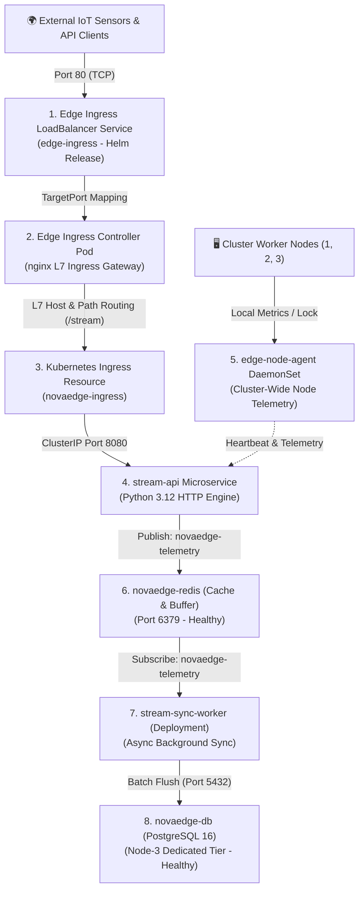
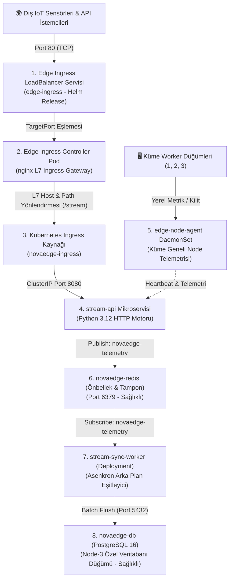

# 🇬🇧 English Version / Comprehensive SRE Incident Guide: Lab 13 (NovaEdge)

# 🚨 SRE Incident Lab 13: NovaEdge Real-Time Edge IoT & Ingress Stream Gateway Outage

Welcome to **Incident Lab 13**. You are the Lead Site Reliability Engineer (SRE) on-call for **NovaEdge**, an enterprise real-time IoT stream ingestion and edge routing platform running in the dedicated `novaedge-prod` namespace.

NovaEdge ingests high-frequency edge sensor telemetry through a public Ingress LoadBalancer, routes payloads through a high-performance HTTP stream ingestion layer (`stream-api`), aggregates node-level telemetry via a cluster-wide DaemonSet (`edge-node-agent`), buffers telemetry in Redis (`novaedge-redis`), and continuously synchronizes state into a persistent PostgreSQL database (`novaedge-db`) via an asynchronous background worker (`stream-sync-worker`).

---

## 🏗️ Production Architecture & Traffic Flow



---

## 📋 On-Call Incident Board (Active P1 / P2 Tickets)

| Incident ID | Impacted Component | Kubernetes / Helm Object | Observed Symptom | Triage Target | Severity |
| :--- | :--- | :--- | :--- | :--- | :--- |
| **[INC-1301]** | `edge-ingress` | Helm Release / Service `type: LoadBalancer` | External requests to LoadBalancer fail with `Connection refused` or timeout; pod healthy but endpoints misrouted. | Ingress LoadBalancer Service Port Forwarding & Helm Values | `P1 - Blocker` |
| **[INC-1302]** | `novaedge-ingress` | Kubernetes `Ingress` (Networking v1) | Testing through Ingress returns `HTTP 404 Not Found` or `503 Service Unavailable`; controller ignores routing rules. | IngressClassName Binding & Backend Service Port Match | `P1 - Blocker` |
| **[INC-1303]** | `stream-api` | Deployment / Container Lifecycle | `stream-api` pods stuck in `CrashLoopBackOff` (0/1 Ready); restarts rapidly climbing; API unreachable. | Container Startup Command Path & Runtime Env Validation | `P1 - Blocker` |
| **[INC-1304]** | `edge-node-agent` | DaemonSet / Node Telemetry | DaemonSet missing from Node-3 (2/3 pods scheduled); scheduled pods failing with `CrashLoopBackOff`. | Dedicated Taint Toleration & Volume Mount Read-Only Mode | `P1 - Blocker` |
| **[INC-1305]** | `stream-sync-worker` | Deployment / Background Queue Processor | Background worker stuck in `0/1 Ready`; readiness probe constantly failing; events not syncing to DB. | Non-HTTP Readiness Probe Protocol & Redis Channel Name | `P2 - High` |

---

## ⚡ Quick Start: Environment Provisioning

Run the automated provisioning script to deploy the faulty production stack:

```bash
cd /home/ysf/k8sfundamentals/k8-troubleshoot-13
./setup.sh
```

Inspect initial cluster health across `novaedge-prod`:

```bash
kubectl get pods,svc,ingress,ds -n novaedge-prod -o wide
```

---

## 🔍 Investigation & Troubleshooting Playbook

### Incident 1 [INC-1301]: Edge Ingress Gateway Port Misrouting (Helm Release)
- **Symptom:**
  External requests to the Ingress LoadBalancer on port 80 fail with `Connection refused` or `502 Bad Gateway`.
- **Diagnostic Commands:**
  ```bash
  # Check Edge Ingress Service and Pods:
  kubectl get svc,pods -n novaedge-prod -l app.kubernetes.io/name=edge-ingress
  
  # Inspect Service targetPort vs Container listening port:
  kubectl describe svc edge-ingress -n novaedge-prod | grep -E "(Port:|TargetPort:|Endpoints:)"
  kubectl get deployment edge-ingress -n novaedge-prod -o yaml | grep -A 5 containerPort
  
  # Review production Helm values:
  cat helm-values/edge-ingress-prod.yaml
  ```
- **Verification:**
  ```bash
  LB_IP=$(kubectl get svc edge-ingress -n novaedge-prod -o jsonpath='{.spec.clusterIP}')
  curl -v "http://${LB_IP}/healthz"
  # Expected: HTTP 200 OK {"status":"ok","controller":"edge-ingress"}
  ```

---

### Incident 2 [INC-1302]: Ingress Resource Ignored & Backend Port Mismatch
- **Symptom:**
  Requests to `http://api.novaedge.io/stream` return `404 Not Found` (default backend) or `503 Service Unavailable`.
- **Diagnostic Commands:**
  ```bash
  # Inspect Ingress object:
  kubectl describe ingress novaedge-ingress -n novaedge-prod
  
  # Verify IngressClass in cluster:
  kubectl get ingressclass
  
  # Inspect target stream-api Service port:
  kubectl get svc stream-api -n novaedge-prod
  ```
- **Verification:**
  ```bash
  kubectl apply -f manifests/20-ingress.yaml
  kubectl get ingress novaedge-ingress -n novaedge-prod
  ```

---

### Incident 3 [INC-1303]: Stream API Startup Crash & Environment Validation
- **Symptom:**
  `stream-api` pods are in `CrashLoopBackOff` (`0/1 Ready`). Logs show file not found or environment configuration failure.
- **Diagnostic Commands:**
  ```bash
  # Check pod logs and termination state:
  kubectl logs -n novaedge-prod -l app.kubernetes.io/name=stream-api --tail=30
  kubectl describe pod -n novaedge-prod -l app.kubernetes.io/name=stream-api | grep -A 10 "Last State:"
  
  # Inspect command and volumeMounts in manifest:
  cat manifests/30-stream-api.yaml
  ```
- **Verification:**
  ```bash
  kubectl apply -f manifests/30-stream-api.yaml
  kubectl rollout status deployment/stream-api -n novaedge-prod --timeout=30s
  kubectl get pods -n novaedge-prod -l app.kubernetes.io/name=stream-api
  # Expected: 2/2 pods Running (1/1 Ready)
  ```

---

### Incident 4 [INC-1304]: Edge Node DaemonSet Node Taint & Volume Permissions
- **Symptom:**
  `kubectl get ds edge-node-agent -n novaedge-prod` reports `DESIRED: 3, CURRENT: 2, READY: 0`.
  Pods on Web nodes crash with filesystem permission errors; no pod is scheduled on Node-3.
- **Diagnostic Commands:**
  ```bash
  # Inspect DaemonSet scheduling events:
  kubectl describe ds edge-node-agent -n novaedge-prod
  
  # Check node taints:
  kubectl get nodes -L tier -o custom-columns=NAME:.metadata.name,TAINTS:.spec.taints
  
  # Read crashing agent pod logs:
  kubectl logs -n novaedge-prod -l app.kubernetes.io/name=edge-node-agent --tail=25
  ```
- **Verification:**
  ```bash
  kubectl apply -f manifests/40-edge-daemonset.yaml
  kubectl rollout status ds/edge-node-agent -n novaedge-prod --timeout=30s
  kubectl get ds edge-node-agent -n novaedge-prod
  # Expected: DESIRED: 3, CURRENT: 3, READY: 3
  ```

---

### Incident 5 [INC-1305]: Stream Sync Worker Probe Protocol & Queue Channel
- **Symptom:**
  `stream-sync-worker` pods remain in `0/1 Ready` (`Readiness probe failed: connection refused`).
- **Diagnostic Commands:**
  ```bash
  # Inspect worker probe configuration and events:
  kubectl describe pod -n novaedge-prod -l app.kubernetes.io/name=stream-sync-worker | grep -A 5 "Readiness:"
  
  # Check worker code and channel name in ConfigMap:
  kubectl get configmap sync-worker-config -n novaedge-prod -o yaml
  ```
- **Verification:**
  ```bash
  kubectl apply -f manifests/50-sync-worker.yaml
  kubectl rollout status deployment/stream-sync-worker -n novaedge-prod --timeout=30s
  kubectl get pods -n novaedge-prod -l app.kubernetes.io/name=stream-sync-worker
  # Expected: 2/2 pods Running (1/1 Ready)
  ```

---

## 🏁 Final End-to-End Health Verification

```bash
#!/usr/bin/env bash
set -euo pipefail

NS="novaedge-prod"
echo "=== [1/5] Core Infrastructure (Postgres & Redis) ==="
kubectl get statefulset novaedge-db -n "${NS}" -o jsonpath='{.status.readyReplicas}' | grep -q "1" && echo "✅ PostgreSQL 16 1/1 Ready on Node-3"
kubectl get deployment novaedge-redis -n "${NS}" -o jsonpath='{.status.readyReplicas}' | grep -q "1" && echo "✅ Redis 7.2 1/1 Ready"

echo "=== [2/5] Ingress Controller & LoadBalancer ==="
kubectl get deployment edge-ingress -n "${NS}" -o jsonpath='{.status.readyReplicas}' | grep -q "1" && echo "✅ Ingress Controller 1/1 Ready"

echo "=== [3/5] Stream API Ingestion ==="
kubectl get deployment stream-api -n "${NS}" -o jsonpath='{.status.readyReplicas}' | grep -q "2" && echo "✅ stream-api 2/2 Ready"

echo "=== [4/5] Cluster-Wide Edge DaemonSet ==="
kubectl get ds edge-node-agent -n "${NS}" -o jsonpath='{.status.numberReady}' | grep -q "3" && echo "✅ edge-node-agent 3/3 Ready across all nodes"

echo "=== [5/5] Background Sync Worker & End-to-End Routing ==="
kubectl get deployment stream-sync-worker -n "${NS}" -o jsonpath='{.status.readyReplicas}' | grep -q "2" && echo "✅ stream-sync-worker 2/2 Ready"

INGRESS_IP=$(kubectl get svc edge-ingress -n "${NS}" -o jsonpath='{.spec.clusterIP}')
RESP=$(curl -s -H "Host: api.novaedge.io" "http://${INGRESS_IP}/stream")
echo "${RESP}" | grep -q "stream_" && echo "✅ Ingress L7 stream routing operational!"
echo "🎉 ALL NOVAEDGE PLATFORM SERVICES ARE 100% HEALTHY!"
```

---

<br>

---

# 🇹🇷 Türkçe Versiyon / Kapsamlı SRE Olay Müdahale Rehberi: Lab 13 (NovaEdge)

# 🚨 SRE Olay Müdahale Labı 13: NovaEdge Gerçek Zamanlı Edge IoT & Ingress Akış Ağ Geçidi Kesintisi

**Incident Lab 13**'e hoş geldiniz. `novaedge-prod` namespace'inde çalışan kurumsal IoT telemetri ve akış ağ geçidi platformu **NovaEdge**'den sorumlu nöbetçi Kıdemli SRE (Site Reliability Engineer) mühendisisiniz.

NovaEdge; uç noktalardaki IoT sensörlerinden gelen yüksek frekanslı telemetri verilerini genel bir Ingress LoadBalancer üzerinden karşılar, yüksek performanslı HTTP akış servisine (`stream-api`) yönlendirir, küme genelindeki DaemonSet (`edge-node-agent`) ile düğüm bazlı metrikleri toplar, Redis (`novaedge-redis`) üzerinde önbelleğe alır ve arka plan eşitleyicisi (`stream-sync-worker`) ile kalıcı PostgreSQL (`novaedge-db`) veritabanına yazar.

---

## 🏗️ Üretim Mimarisi ve Trafik Akışı



---

## 📋 Nöbetçi Mühendis Olay Panosu (Aktif P1 / P2 Biletleri)

| Olay No | Etkilenen Bileşen | Kubernetes / Helm Nesnesi | Gözlemlenen Semptom | İnceleme Hedefi | Önem |
| :--- | :--- | :--- | :--- | :--- | :--- |
| **[INC-1301]** | `edge-ingress` | Helm Sürümü / Service `type: LoadBalancer` | LoadBalancer port 80'e gelen istekler `Connection refused` veya zaman aşımı veriyor; pod sağlıklı ama endpoint portu yanlış. | Ingress LoadBalancer Servis Port Yönlendirmesi & Helm Değerleri | `P1 - Blocker` |
| **[INC-1302]** | `novaedge-ingress` | Kubernetes `Ingress` (Networking v1) | Ingress üzerinden test edildiğinde `HTTP 404 Not Found` veya `503 Service Unavailable` dönüyor; kontrolcü kuralı görmezden geliyor. | IngressClassName Eşleşmesi & Backend Servis Port Doğrulaması | `P1 - Blocker` |
| **[INC-1303]** | `stream-api` | Deployment / Konteyner Yaşam Döngüsü | `stream-api` pod'ları `CrashLoopBackOff` durumunda (0/1 Ready); yeniden başlatma sayısı hızla artıyor; API erişilemez. | Konteyner Başlatma Komut Yolu & Çalışma Zamanı Değişken Doğrulaması | `P1 - Blocker` |
| **[INC-1304]** | `edge-node-agent` | DaemonSet / Düğüm Telemetrisi | DaemonSet Node-3'e hiç zamanlanamıyor (2/3 pod); çalışan pod'lar ise dosya sistemi izin hatasıyla çöküyor. | Ayrılmış Düğüm Taint Toleration & Volume Mount Read-Only Kısıtı | `P1 - Blocker` |
| **[INC-1305]** | `stream-sync-worker` | Deployment / Arka Plan Kuyruk İşleyicisi | Arka plan işleyicisi sürekli `0/1 Ready` durumunda; readiness probe bağlantı reddi veriyor; veritabanına olay akışı durdu. | HTTP Olmayan İş Yükünde HTTP Probe Hatası & Redis Kanal Adı | `P2 - High` |

---

## ⚡ Hızlı Başlangıç: Ortamın Kurulması

Arızalı üretim ortamını ayağa kaldırmak için kurulum betiğini çalıştırın:

```bash
cd /home/ysf/k8sfundamentals/k8-troubleshoot-13
./setup.sh
```

Kümedeki ilk durumu gözlemleyin:

```bash
kubectl get pods,svc,ingress,ds -n novaedge-prod -o wide
```

---

## 🔍 Teşhis ve Arıza Çözüm Rehberi

### Olay 1 [INC-1301]: Edge Ingress Gateway Port Yönlendirme Hatası (Helm Sürümü)
- **Semptom:**
  Ingress LoadBalancer port 80'e gönderilen istekler `Connection refused` veya `502 Bad Gateway` veriyor.
- **Teşhis Komutları:**
  ```bash
  kubectl get svc,pods -n novaedge-prod -l app.kubernetes.io/name=edge-ingress
  kubectl describe svc edge-ingress -n novaedge-prod | grep -E "(Port:|TargetPort:|Endpoints:)"
  cat helm-values/edge-ingress-prod.yaml
  ```
- **Doğrulama:**
  ```bash
  LB_IP=$(kubectl get svc edge-ingress -n novaedge-prod -o jsonpath='{.spec.clusterIP}')
  curl -v "http://${LB_IP}/healthz"
  # Beklenen: HTTP 200 OK {"status":"ok","controller":"edge-ingress"}
  ```

---

### Olay 2 [INC-1302]: Ingress Kaynağı Tanınmıyor & Backend Port Uyuşmazlığı
- **Semptom:**
  `http://api.novaedge.io/stream` adresine gönderilen istekler `404 Not Found` veya `503 Service Unavailable` dönüyor.
- **Teşhis Komutları:**
  ```bash
  kubectl describe ingress novaedge-ingress -n novaedge-prod
  kubectl get ingressclass
  kubectl get svc stream-api -n novaedge-prod
  ```
- **Doğrulama:**
  ```bash
  kubectl apply -f manifests/20-ingress.yaml
  kubectl get ingress novaedge-ingress -n novaedge-prod
  ```

---

### Olay 3 [INC-1303]: Stream API Başlatma Çöküşü & Ortam Değişken Doğrulaması
- **Semptom:**
  `stream-api` pod'ları `CrashLoopBackOff` durumunda (0/1 Ready). Loglarda dosya bulunamadı veya konfigürasyon hatası görülüyor.
- **Teşhis Komutları:**
  ```bash
  kubectl logs -n novaedge-prod -l app.kubernetes.io/name=stream-api --tail=30
  kubectl describe pod -n novaedge-prod -l app.kubernetes.io/name=stream-api | grep -A 10 "Last State:"
  cat manifests/30-stream-api.yaml
  ```
- **Doğrulama:**
  ```bash
  kubectl apply -f manifests/30-stream-api.yaml
  kubectl rollout status deployment/stream-api -n novaedge-prod --timeout=30s
  kubectl get pods -n novaedge-prod -l app.kubernetes.io/name=stream-api
  # Beklenen: 2/2 pod Running (1/1 Ready)
  ```

---

### Olay 4 [INC-1304]: Edge Node DaemonSet Taint Hatası & Volume Yazma Engeli
- **Semptom:**
  `kubectl get ds edge-node-agent -n novaedge-prod` çıktısında `DESIRED: 3, CURRENT: 2, READY: 0` görülüyor. Node-3'e pod gitmiyor; Node-1/2'deki pod'lar ise çöküyor.
- **Teşhis Komutları:**
  ```bash
  kubectl describe ds edge-node-agent -n novaedge-prod
  kubectl get nodes -L tier -o custom-columns=NAME:.metadata.name,TAINTS:.spec.taints
  kubectl logs -n novaedge-prod -l app.kubernetes.io/name=edge-node-agent --tail=25
  ```
- **Doğrulama:**
  ```bash
  kubectl apply -f manifests/40-edge-daemonset.yaml
  kubectl rollout status ds/edge-node-agent -n novaedge-prod --timeout=30s
  kubectl get ds edge-node-agent -n novaedge-prod
  # Beklenen: DESIRED: 3, CURRENT: 3, READY: 3
  ```

---

### Olay 5 [INC-1305]: Stream Sync Worker Prob Protokolü & Kuyruk Kanalı Hatası
- **Semptom:**
  `stream-sync-worker` pod'ları `0/1 Ready` durumunda takılıyor (`Readiness probe failed: connection refused`).
- **Teşhis Komutları:**
  ```bash
  kubectl describe pod -n novaedge-prod -l app.kubernetes.io/name=stream-sync-worker | grep -A 5 "Readiness:"
  kubectl get configmap sync-worker-config -n novaedge-prod -o yaml
  ```
- **Doğrulama:**
  ```bash
  kubectl apply -f manifests/50-sync-worker.yaml
  kubectl rollout status deployment/stream-sync-worker -n novaedge-prod --timeout=30s
  kubectl get pods -n novaedge-prod -l app.kubernetes.io/name=stream-sync-worker
  # Beklenen: 2/2 pod Running (1/1 Ready)
  ```

---

## 🏁 Uçtan Uca Sağlık Doğrulama Betiği

Platformdaki tüm arızalar çözüldükten sonra aşağıdaki doğrulama betiğini çalıştırın:

```bash
#!/usr/bin/env bash
set -euo pipefail

NS="novaedge-prod"
echo "=== [1/5] Çekirdek Veritabanı ve Önbellek (Postgres & Redis) ==="
kubectl get statefulset novaedge-db -n "${NS}" -o jsonpath='{.status.readyReplicas}' | grep -q "1" && echo "✅ PostgreSQL 16 Node-3 üzerinde 1/1 Hazır"
kubectl get deployment novaedge-redis -n "${NS}" -o jsonpath='{.status.readyReplicas}' | grep -q "1" && echo "✅ Redis 7.2 1/1 Hazır"

echo "=== [2/5] Ingress Controller & LoadBalancer ==="
kubectl get deployment edge-ingress -n "${NS}" -o jsonpath='{.status.readyReplicas}' | grep -q "1" && echo "✅ Ingress Controller 1/1 Hazır"

echo "=== [3/5] Stream API Katmanı ==="
kubectl get deployment stream-api -n "${NS}" -o jsonpath='{.status.readyReplicas}' | grep -q "2" && echo "✅ stream-api 2/2 Hazır"

echo "=== [4/5] Küme Geneli Edge DaemonSet ==="
kubectl get ds edge-node-agent -n "${NS}" -o jsonpath='{.status.numberReady}' | grep -q "3" && echo "✅ edge-node-agent tüm 3 düğümde 3/3 Hazır"

echo "=== [5/5] Arka Plan Eşitleyici & Uçtan Uca Yönlendirme ==="
kubectl get deployment stream-sync-worker -n "${NS}" -o jsonpath='{.status.readyReplicas}' | grep -q "2" && echo "✅ stream-sync-worker 2/2 Hazır"

INGRESS_IP=$(kubectl get svc edge-ingress -n "${NS}" -o jsonpath='{.spec.clusterIP}')
RESP=$(curl -s -H "Host: api.novaedge.io" "http://${INGRESS_IP}/stream")
echo "${RESP}" | grep -q "stream_" && echo "✅ Ingress L7 akış yönlendirmesi başarıyla HTTP 200 OK yanıtı verdi!"
echo "🎉 TÜM NOVAEDGE PLATFORM KATMANLARI %100 SAĞLIKLI VE DEVREDE!"
```
