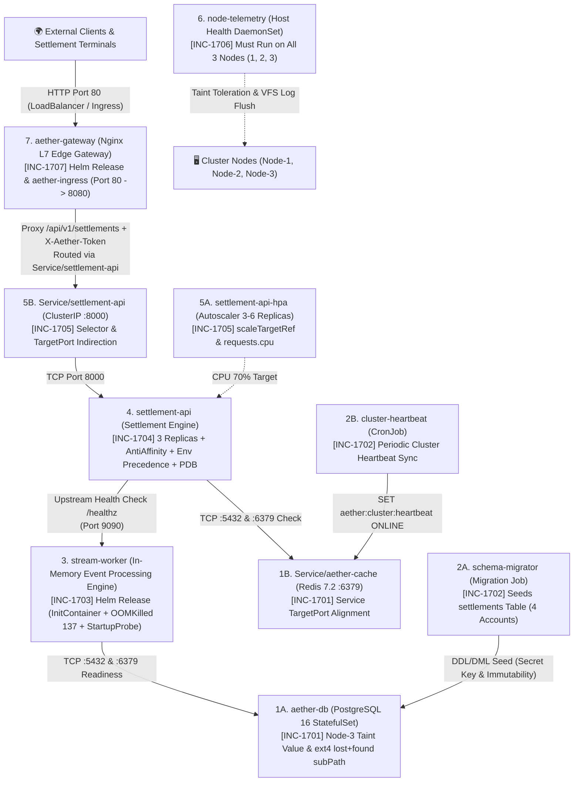

# 🇬🇧 English Version

# 🚨 SRE Incident Lab 17 (Master Review): AetherMesh — Global Payment, Event Stream & API Gateway Platform Outage

Welcome to **SRE Incident Lab 17 (Master Review)**. This workspace serves as the active **Incident Triage War Room** during a high-severity, cluster-wide production outage of **AetherMesh**, our next-generation enterprise real-time payment settlement, in-memory event stream processing, node health telemetry, and L7 edge API gateway platform running in the `aether-prod` namespace.

This lab is designed as a **comprehensive end-to-end review** of critical Kubernetes architecture and SRE failure domains:
* **Layer 1 (`[INC-1701]`):** StatefulSet Scheduling, Dedicated Node Taints (`workload=database:NoSchedule`), CSI Block Storage VolumeMount (`subPath: pgdata`), and L4 Redis Service `targetPort` Alignment.
* **Layer 2 (`[INC-1702]`):** Kubelet Pre-Start Secret Resolution (`CreateContainerConfigError`), Database Host Discovery, `Job` Spec Immutability (`kubectl replace --force`), and `CronJob` Suspension & Target Host DNS.
* **Layer 3 (`[INC-1703]`):** Helm Release Overrides, Sequential `InitContainer` TCP Gating (`Init:0/1`), Linux Kernel cgroup `OOMKilled` (`Exit Code 137`), and `startupProbe` Warmup Budget Starvation.
* **Layer 4 (`[INC-1704]`):** 2-Node Hard `podAntiAffinity` Scheduling Deadlock (`Pending`), `readinessProbe` Port Mismatch, Kubernetes `env` vs `envFrom` (`ConfigMap`) Precedence Override, and `PodDisruptionBudget` (`PDB`).
* **Layer 5 (`[INC-1705]`):** `HorizontalPodAutoscaler` (`HPA`) `scaleTargetRef` & Missing `resources.requests.cpu` Metric Starvation (`<unknown>/70%`), and L4 `Service` Selector Over-Specification (`Endpoints: <none>`).
* **Layer 6 (`[INC-1706]`):** Cluster-Wide `DaemonSet` Taint Key Mismatch (`DESIRED: 2` vs `3`) and Linux VFS Read-Only VolumeMount Crash (`Read-only file system`).
* **Layer 7 (`[INC-1707]`):** Helm L7 Edge Gateway `LoadBalancer` `targetPort`, L7 Security Header (`403 Forbidden`), Kubelet `subPath` ConfigMap Reload Mechanics (`rollout restart`), and `IngressClass` Routing.

> 📖 **Post-Mortem & Deep Root Cause Analyses (RCA):**  
> 👉 **[Explore Principal SRE Post-Mortem Guide (SOLUTION.md)](./SOLUTION.md)** — *Attempt resolution on your own before consulting the guide!*

---

## 🗺️ Cluster Topology & Node Constraints

The incident scenario is grounded in the following 3-node cluster topology:

| Node Name | Internal IP | Label | Taint / Constraint | Allocated Tier Role |
| :--- | :--- | :--- | :--- | :--- |
| **Node-1** | `10.0.10.122` | `tier=web` | *None* | Web / API / Edge Gateway / Stream Workers / Batch Jobs |
| **Node-2** | `10.0.10.208` | `tier=web` | *None* | Web / API / Edge Gateway / Stream Workers / Batch Jobs |
| **Node-3** | `10.0.10.78` | `tier=database` | `workload=database:NoSchedule` | Isolated Stateful Database Tier (`aether-db`) + Cluster-Wide Telemetry DaemonSet |

* **Target Namespace:** `aether-prod`
* **Default StorageClass:** Standard / CSI Block Volume (`ReadWriteOnce`)

---

## 📂 Workspace Directory Structure

```text
k8-troubleshoot-17/
├── README.md                              # On-Call Incident Board & Triage Runbook (Zero Spoilers)
├── SOLUTION.md                            # Principal SRE Post-Mortem & Step-by-Step RCA Guide
├── setup.sh                               # Automated Outage Simulation Provisioning Script
├── cleanup.sh                             # Environment Teardown Script
├── manifests/
│   ├── 00-namespace.yaml                  # Target namespace (aether-prod)
│   ├── 10-stateful-data.yaml              # [INC-1701] PostgreSQL 16 StatefulSet (aether-db) & Redis 7.2 (aether-cache)
│   ├── 20-batch-jobs.yaml                 # [INC-1702] Schema Migrator Job & Cluster Heartbeat CronJob
│   ├── 30-settlement-api.yaml             # [INC-1704] Settlement API Deployment (3 Replicas), ConfigMap & PDB
│   ├── 40-scaling-and-service.yaml        # [INC-1705] Settlement API HPA & ClusterIP Service
│   ├── 50-daemonset.yaml                  # [INC-1706] Cluster-Wide node-telemetry DaemonSet
│   └── 60-ingress.yaml                    # [INC-1707] Kubernetes Ingress Resource (aether-ingress)
├── charts/
│   ├── stream-worker/                     # [INC-1703] Helm Chart for In-Memory Stream Worker
│   │   ├── Chart.yaml
│   │   ├── values.yaml
│   │   └── templates/
│   │       ├── configmap.yaml
│   │       ├── deployment.yaml
│   │       └── service.yaml
│   └── aether-gateway/                    # [INC-1707] Helm Chart for L7 Edge API Gateway
│   │   ├── Chart.yaml
│   │   ├── values.yaml
│   │   └── templates/
│   │       ├── configmap.yaml
│   │       ├── deployment.yaml
│   │       └── service.yaml
└── helm-values/
    ├── worker-prod.yaml                   # [INC-1703] Production Helm overrides for stream-worker
    └── gateway-prod.yaml                  # [INC-1707] Production Helm overrides for aether-gateway
```

---

## 🏗️ Production Architecture & 7-Layer Dependency Graph



---

## ⚡ Quick Start: Environment Provisioning

Deploy the faulty production state using the automated setup script:

```bash
cd /home/ysf/k8sfundamentals/Troubleshoot/k8-troubleshoot-17
./setup.sh
```

Inspect the initial cluster status in `aether-prod`:

```bash
kubectl get pods,pvc,jobs,cronjobs,ds,svc,hpa,pdb,ingress -n aether-prod -o wide
```

---

## 📋 On-Call SRE Incident Board (7 Sequential Review Tickets)

| Ticket ID | Impacted Component | Kubernetes / Helm Object | Observed Symptom | Triage Layer | Severity |
| :--- | :--- | :--- | :--- | :--- | :--- |
| **[INC-1701]** | `aether-db` & `aether-cache` | `StatefulSet`, `PVC` & `Service` (`manifests/10-stateful-data.yaml`) | `aether-db-0` stuck in `Pending`, then `CrashLoopBackOff` (`initdb` failure); `Service/aether-cache` refuses connections. | Layer 1: Stateful Storage, Taints & L4 Cache Service | `P1 - Blocker` |
| **[INC-1702]** | `schema-migrator` & `cluster-heartbeat` | `Job` & `CronJob` (`manifests/20-batch-jobs.yaml`) | Migration Job stuck in `CreateContainerConfigError` or waiting on unreachable DB host; CronJob suspended and fails Redis sync. | Layer 2: Batch Jobs, Secret Keys & Job Immutability | `P1 - Blocker` |
| **[INC-1703]** | `stream-worker` | Helm Release (`charts/stream-worker/` & `helm-values/worker-prod.yaml`) | Pod hangs in `Init:0/1`, crashes immediately with `OOMKilled` (`Exit Code 137`), then restarts every 4s due to Startup Probe failure. | Layer 3: Helm Lifecycle, cgroups Memory & StartupProbe | `P1 - Blocker` |
| **[INC-1704]** | `settlement-api` | `Deployment`, `ConfigMap` & `PDB` (`manifests/30-settlement-api.yaml`) | 2 of 3 replicas `0/1 Running` (`connection refused` / `503` on `/ready`), 3rd replica stuck in `Pending` on 2-node web tier. | Layer 4: PodAntiAffinity, Probe Port & Env Precedence | `P1 - Blocker` |
| **[INC-1705]** | `settlement-api-hpa` & `Service/settlement-api` | `HPA` & `Service` (`manifests/40-scaling-and-service.yaml`) | HPA shows `<unknown>/70%` and `0` replicas; `Service/settlement-api` has `<none>` endpoints and wrong target port. | Layer 5: HPA Resource Metrics & EndpointSlice Routing | `P1 - Blocker` |
| **[INC-1706]** | `node-telemetry` | `DaemonSet` (`manifests/50-daemonset.yaml`) | DaemonSet schedules on only 2 of 3 nodes (`DESIRED: 2`) and pods crash in `CrashLoopBackOff` (`Read-only file system`). | Layer 6: DaemonSet Node Taints & Linux VFS Permissions | `P1 - Blocker` |
| **[INC-1707]** | `aether-gateway` & `aether-ingress` | Helm Release (`charts/aether-gateway/`) & `Ingress` (`manifests/60-ingress.yaml`) | Gateway Service refuses connections on port `80`, then returns `403 Forbidden` on `/api/v1/settlements`; Ingress class/port misaligned. | Layer 7: L7 Gateway, `subPath` Reload & Ingress Binding | `P1 - Blocker` |

---

## 🔍 Incident Triage & Verification Runbook

---

### 🎫 [INC-1701] Stateful Database Scheduling, Ext4 `lost+found` & Redis Service Port
**Slack Alert (`#aether-ops`):**
> *"🔔 PagerDuty P1: Primary database `aether-db-0` is stuck in `Pending`. Once scheduled onto `Node-3`, PostgreSQL crashes during `initdb`. Meanwhile, applications cannot connect to `aether-cache:6379` even though the Redis pod is `1/1 Running`."*

#### 🔎 Diagnostic Commands (How to Investigate)
```bash
# 1. Inspect StatefulSet pod, PVC status, and scheduler events
kubectl get pods,pvc -n aether-prod -l app.kubernetes.io/name=aether-db
kubectl describe pod aether-db-0 -n aether-prod

# 2. Compare Node-3 taint key/value/effect against aether-db tolerations
kubectl get nodes -o custom-columns=NAME:.metadata.name,TIER:.metadata.labels.tier,TAINTS:.spec.taints

# 3. Once scheduled, if aether-db-0 enters CrashLoopBackOff, check container logs
kubectl logs aether-db-0 -n aether-prod

# 4. Inspect Service/aether-cache port vs targetPort mapping
kubectl describe svc aether-cache -n aether-prod
cat manifests/10-stateful-data.yaml
```

> [!TIP]
> **StatefulSet `OrderedReady` Note:** When a `StatefulSet` pod (`aether-db-0`) is stuck in `Pending` or `CrashLoopBackOff`, updating the `StatefulSet` manifest alone will not automatically recreate the broken pod until you delete the pod (`kubectl delete pod aether-db-0 -n aether-prod`) so the controller can spawn it from the updated template.

#### ✅ Success Criteria & Verification
```bash
# 1. Verify aether-db-0 is 1/1 Running on Node-3 and PVC is Bound
kubectl wait --for=condition=ready pod/aether-db-0 -n aether-prod --timeout=90s
kubectl get pod aether-db-0 -n aether-prod -o wide
kubectl get pvc data-aether-db-0 -n aether-prod
# Expected: aether-db-0 1/1 Running, PVC Bound

# 2. Verify Redis is reachable through Service/aether-cache on port 6379
kubectl exec -n aether-prod deploy/aether-cache -- redis-cli -h aether-cache -p 6379 ping
# Expected: PONG
```

---

### 🎫 [INC-1702] Schema Migrator Job & Cluster Heartbeat CronJob Failure
**Slack Alert (`#aether-ops`):**
> *"🔔 PagerDuty P1: `schema-migrator` Job is stuck in `CreateContainerConfigError` (`0/1 Completed`), leaving `settlements` unseeded. Meanwhile, `cluster-heartbeat` CronJob is suspended and targets an invalid Redis hostname."*

#### 🔎 Diagnostic Commands (How to Investigate)
```bash
# 1. Inspect Job, CronJob, and pod status
kubectl get job,cronjob -n aether-prod
kubectl get pods -n aether-prod -l app.kubernetes.io/name=schema-migrator

# 2. Inspect Kubelet events on the schema-migrator pod
kubectl describe pod -n aether-prod -l app.kubernetes.io/name=schema-migrator

# 3. Check actual Secret key names and Service names in aether-prod
kubectl get secret aether-db-secret -n aether-prod -o jsonpath='{.data}' && echo ""
kubectl get svc -n aether-prod
cat manifests/20-batch-jobs.yaml
```

#### ✅ Success Criteria & Verification
```bash
# 1. Verify schema-migrator Job completed (1/1) and seeded 4 rows in settlements
kubectl wait --for=condition=complete job/schema-migrator -n aether-prod --timeout=45s
kubectl exec -n aether-prod aether-db-0 -- psql -U aether_admin -d aether_settlement -tAc "SELECT count(*) FROM settlements;"
# Expected: 4

# 2. Verify cluster-heartbeat CronJob is unsuspended (SUSPEND: False) and manual trigger succeeds
kubectl get cronjob cluster-heartbeat -n aether-prod
kubectl create job --from=cronjob/cluster-heartbeat manual-heartbeat -n aether-prod && kubectl wait --for=condition=complete job/manual-heartbeat -n aether-prod --timeout=30s
kubectl exec -n aether-prod deploy/aether-cache -- redis-cli GET aether:cluster:heartbeat
# Expected: ONLINE_<timestamp>
```

---

### 🎫 [INC-1703] Stream Worker Stuck in `Init:0/1`, `OOMKilled` (`137`) & StartupProbe Failure
**Slack Alert (`#aether-ops`):**
> *"🔔 PagerDuty P1: Helm release `stream-worker` is down. It hangs in `Init:0/1`, then gets killed immediately by the Linux kernel (`OOMKilled` / `Exit Code 137`), and then gets killed at second 4 by Kubelet's `startupProbe` before its 7-second buffer warmup finishes."*

#### 🔎 Diagnostic Commands (How to Investigate)
```bash
# 1. Check stream-worker pod status and initContainer logs
kubectl get pods -n aether-prod -l app.kubernetes.io/name=stream-worker
kubectl logs -n aether-prod deploy/stream-worker -c wait-for-db

# 2. Inspect pod termination reasons (OOMKilled / Exit Code 137) and StartupProbe events
kubectl describe pod -n aether-prod -l app.kubernetes.io/name=stream-worker

# 3. Inspect chart configmap, default values, and production overrides
cat charts/stream-worker/templates/configmap.yaml
cat charts/stream-worker/values.yaml
cat helm-values/worker-prod.yaml
```

#### ✅ Success Criteria & Verification
```bash
# 1. Verify stream-worker reaches 1/1 Running with 0 new restarts
kubectl rollout status deploy/stream-worker -n aether-prod --timeout=60s
kubectl get pods -n aether-prod -l app.kubernetes.io/name=stream-worker

# 2. Verify internal /healthz endpoint responds with HTTP 200 OK on port 9090
kubectl exec -n aether-prod deploy/aether-cache -- wget -qO- http://stream-worker:9090/healthz
# Expected: {"status": "healthy", "service": "stream-worker", "buffer_mib": 64, "db": "aether-db:5432", "cache": "aether-cache:6379"}
```

---

### 🎫 [INC-1704] Settlement API Scheduling Deadlock, Probe Port & Env Precedence
**Slack Alert (`#aether-ops`):**
> *"🔔 PagerDuty P1: `settlement-api` (3 replicas) has 1 pod permanently stuck in `Pending` on our 2-node web tier, while the other 2 pods remain `0/1 Running` failing `/ready` checks."*

#### 🔎 Diagnostic Commands (How to Investigate)
```bash
# 1. Check pod statuses and why the 3rd pod is Pending
kubectl get pods,pdb -n aether-prod -l app.kubernetes.io/name=settlement-api -o wide
kubectl describe pod -n aether-prod -l app.kubernetes.io/name=settlement-api

# 2. Inspect active environment variables inside a running settlement-api container
kubectl exec -n aether-prod deploy/settlement-api -- env | grep -E "DB_|CACHE_|WORKER_"

# 3. Review manifests/30-settlement-api.yaml
cat manifests/30-settlement-api.yaml
```

#### ✅ Success Criteria & Verification
```bash
# 1. Verify all 3 pods are 1/1 Running across web nodes
kubectl rollout status deploy/settlement-api -n aether-prod --timeout=60s
kubectl get pods -n aether-prod -l app.kubernetes.io/name=settlement-api -o wide
# Expected: 3/3 Running

# 2. Test internal /ready endpoint returns HTTP 200 with all dependencies verified
kubectl exec -n aether-prod deploy/aether-cache -- wget -qO- http://settlement-api:8000/ready
# Expected: {"status": "ready", "database": "aether-db:5432", "cache": "aether-cache:6379", "worker": "stream-worker:9090"}
```

---

### 🎫 [INC-1705] Settlement API Service Selector & HPA Metric Starvation
**Slack Alert (`#aether-ops`):**
> *"🔔 PagerDuty P1: Traffic to `Service/settlement-api` fails with connection refused. Meanwhile, `settlement-api-hpa` reports `<unknown>/70%` CPU utilization and cannot scale."*

#### 🔎 Diagnostic Commands (How to Investigate)
```bash
# 1. Inspect Service endpoints and port configuration
kubectl get svc settlement-api -n aether-prod
kubectl describe svc settlement-api -n aether-prod
kubectl get endpoints settlement-api -n aether-prod

# 2. Check HPA status and pod resource requests
kubectl get hpa settlement-api-hpa -n aether-prod
kubectl describe hpa settlement-api-hpa -n aether-prod
cat manifests/40-scaling-and-service.yaml
```

#### ✅ Success Criteria & Verification
```bash
# 1. Verify Service/settlement-api has 3 healthy endpoints on port 8000
kubectl get endpoints settlement-api -n aether-prod
# Expected: 3 IP:8000 endpoints listed

# 2. Verify HPA reports target deployment and active CPU percentage
kubectl get hpa settlement-api-hpa -n aether-prod
# Expected: TARGETS shows percentage (e.g., 0%/70% or 1%/70%), REPLICAS shows 3
```

---

### 🎫 [INC-1706] Node Telemetry DaemonSet Scheduling & Read-Only VFS Crash
**Slack Alert (`#aether-ops`):**
> *"🔔 PagerDuty P1: `node-telemetry` DaemonSet reports `DESIRED: 2` instead of 3 (omitting Node-3). The pods scheduled on web nodes enter `CrashLoopBackOff` with `Read-only file system` errors."*

#### 🔎 Diagnostic Commands (How to Investigate)
```bash
# 1. Inspect DaemonSet desired/current counts and pod distribution
kubectl get ds node-telemetry -n aether-prod
kubectl get pods -n aether-prod -l app.kubernetes.io/name=node-telemetry -o wide

# 2. Check container crash logs and volume mounts
kubectl logs -n aether-prod ds/node-telemetry
kubectl describe ds node-telemetry -n aether-prod
cat manifests/50-daemonset.yaml
```

#### ✅ Success Criteria & Verification
```bash
# 1. Verify DaemonSet runs on all 3 nodes and reaches 3/3 Ready
kubectl rollout status ds/node-telemetry -n aether-prod --timeout=45s
kubectl get ds node-telemetry -n aether-prod
# Expected: DESIRED: 3, CURRENT: 3, READY: 3

# 2. Verify collector writes heartbeats successfully
kubectl logs -n aether-prod ds/node-telemetry --tail=5
# Expected: Heartbeat recorded on <node-name>
```

---

### 🎫 [INC-1707] L7 Edge API Gateway LoadBalancer, Header Security & Ingress Binding
**Slack Alert (`#aether-ops`):**
> *"🔔 PagerDuty P1: External traffic to `aether-gateway` fails with connection refused on port `80`. Once port routing is corrected, requests return `403 Forbidden` (`Invalid or missing security token X-Aether-Token`). Ingress routing remains disconnected."*

#### 🔎 Diagnostic Commands (How to Investigate)
```bash
# 1. Inspect Gateway Service port vs targetPort
kubectl describe svc aether-gateway -n aether-prod
cat charts/aether-gateway/templates/service.yaml
cat helm-values/gateway-prod.yaml

# 2. Test settlement API directly through gateway pod
kubectl exec -n aether-prod deploy/aether-gateway -- curl -s http://127.0.0.1:8080/api/v1/settlements

# 3. Inspect Ingress resource configuration and ingressClassName
kubectl describe ingress aether-ingress -n aether-prod
cat manifests/60-ingress.yaml
```

> [!WARNING]
> **Kubelet `subPath` Inode Reload Mechanics:** In Kubernetes, ConfigMaps mounted with `subPath` do **not** receive automatic live file updates via inotify. After performing `helm upgrade`, you **must** trigger a rolling restart (`kubectl rollout restart deployment/aether-gateway -n aether-prod`) to bind the updated ConfigMap inode!

#### ✅ Success Criteria & Verification
```bash
# 1. Verify Gateway Service port 80 forwards to container port 8080
kubectl get svc aether-gateway -n aether-prod

# 2. Query settlement API via aether-gateway Service and verify HTTP 200 OK
kubectl exec -n aether-prod deploy/aether-cache -- curl -s http://aether-gateway:80/api/v1/settlements
# Expected output:
# {
#   "platform": "AetherMesh Global Settlement Platform",
#   "status": "UPSTREAM_OK",
#   "accounts": [
#     {"id": "ACC-101", "balance": 50000.0, "status": "VERIFIED"},
#     {"id": "ACC-102", "balance": 125000.5, "status": "VERIFIED"},
#     {"id": "ACC-103", "balance": 9400.0, "status": "VERIFIED"},
#     {"id": "ACC-104", "balance": 382100.75, "status": "VERIFIED"}
#   ],
#   "settlement_cycle": "REALTIME_T0"
# }

# 3. Verify Ingress backend matches aether-gateway on port 80
kubectl get ingress aether-ingress -n aether-prod
```

---

## 🧹 Teardown & Clean Reset

To tear down all resources in `aether-prod`:

```bash
cd /home/ysf/k8sfundamentals/Troubleshoot/k8-troubleshoot-17
./cleanup.sh
```

---
---

# 🇹🇷 Türkçe Sürüm

# 🚨 SRE Olay Müdahale Laboratuvarı 17 (Kapsamlı Tekrar): AetherMesh — Küresel Ödeme, Stream ve API Gateway Platform Kesintisi

**SRE Incident Lab 17 (Master Review)** ortamına hoş geldiniz. Bu çalışma alanı, `aether-prod` ad alanında çalışan yeni nesil gerçek zamanlı ödeme takas, bellek-içi stream işleme, sunucu sağlık telemetrisi ve L7 edge API gateway platformumuz **AetherMesh** üzerinde meydana gelen yüksek öncelikli (P1) küme çapındaki kesintinin **Olay Müdahale Kriz Masası**dır.

Bu laboratuvar, kritik Kubernetes mimarisi ve SRE arıza alanlarının **kapsamlı bir uçtan uca tekrarı** olarak tasarlanmıştır:
* **Katman 1 (`[INC-1701]`):** StatefulSet Zamanlaması, Özel Node Taint'leri (`workload=database:NoSchedule`), CSI Blok Depolama VolumeMount (`subPath: pgdata`), ve L4 Redis Servisi `targetPort` Uyumu.
* **Katman 2 (`[INC-1702]`):** Kubelet Başlatma Öncesi Secret Çözümlemesi (`CreateContainerConfigError`), Veritabanı Host Keşfi, `Job` Değişmezliği (`kubectl replace --force`), ve `CronJob` Askıya Alınması (`suspend: true`) & Redis DNS.
* **Katman 3 (`[INC-1703]`):** Helm Release Değerleri, Sıralı `InitContainer` TCP Kapısı (`Init:0/1`), Linux Çekirdeği cgroup `OOMKilled` (`Exit Code 137`), ve `startupProbe` Isınma Bütçesi Açlığı.
* **Katman 4 (`[INC-1704]`):** 2 Node'lu Kümede Katı `podAntiAffinity` Zamanlama Kilitlenmesi (`Pending`), `readinessProbe` Port Hatası, Kubernetes `env` vs `envFrom` (`ConfigMap`) Öncelik Ezmesi, ve `PodDisruptionBudget` (`PDB`).
* **Katman 5 (`[INC-1705]`):** `HorizontalPodAutoscaler` (`HPA`) `scaleTargetRef` & Eksik `resources.requests.cpu` Metrik Açlığı (`<unknown>/70%`), ve L4 `Service` Etiket Seçici Aşırı Kısıtlama (`Endpoints: <none>`).
* **Katman 6 (`[INC-1706]`):** Küme Çapında `DaemonSet` Taint Key Uyuşmazlığı (`DESIRED: 2` vs `3`) ve Linux VFS Salt Okunur Bağlantı Çökmesi (`Read-only file system`).
* **Katman 7 (`[INC-1707]`):** Helm L7 Edge Gateway `LoadBalancer` `targetPort`, L7 Güvenlik Başlığı (`403 Forbidden`), Kubelet `subPath` ConfigMap Yenilenmeme Mekanizması (`rollout restart`), ve `IngressClass` Yönlendirmesi.

> 📖 **Post-Mortem & Derinlemesine Kök Neden Analizleri (RCA):**  
> 👉 **[Kıdemli SRE Post-Mortem Kılavuzunu İncele (SOLUTION.md)](./SOLUTION.md)** — *Kılavuza bakmadan önce arızaları kendi başına çözmeyi dene!*

---

## ⚡ Hızlı Başlangıç: Ortam Kurulumu

Arızalı üretim ortamını otomatik kurulum betiğiyle ayağa kaldırın:

```bash
cd /home/ysf/k8sfundamentals/Troubleshoot/k8-troubleshoot-17
./setup.sh
```

`aether-prod` ad alanındaki ilk durumu inceleyin:

```bash
kubectl get pods,pvc,jobs,cronjobs,ds,svc,hpa,pdb,ingress -n aether-prod -o wide
```

---

## 📋 Nöbetçi SRE Olay Panosu (7 Sıralı Tekrar Bileti)

| Bilet No | Etkilenen Bileşen | Kubernetes / Helm Nesnesi | Gözlemlenen Belirti | Katman | Öncelik |
| :--- | :--- | :--- | :--- | :--- | :--- |
| **[INC-1701]** | `aether-db` & `aether-cache` | `StatefulSet`, `PVC` & `Service` (`manifests/10-stateful-data.yaml`) | `aether-db-0` `Pending` durumunda takılı, ardından `CrashLoopBackOff` (`initdb` hatası); `aether-cache` servisi bağlantıyı reddediyor. | Katman 1: Stateful Depolama, Taint & L4 Cache Servisi | `P1 - Blocker` |
| **[INC-1702]** | `schema-migrator` & `cluster-heartbeat` | `Job` & `CronJob` (`manifests/20-batch-jobs.yaml`) | Migrator Job'u `CreateContainerConfigError` hatasında; CronJob askıya alınmış (`suspend: true`) ve Redis hostuna bağlanamıyor. | Katman 2: Batch Job'lar, Secret Key & Job Değişmezliği | `P1 - Blocker` |
| **[INC-1703]** | `stream-worker` | Helm Release (`charts/stream-worker/` & `helm-values/worker-prod.yaml`) | Pod `Init:0/1` aşamasında kalıyor, başlar başlamaz Linux kernel tarafından `OOMKilled` (`137`) ediliyor, ardından `startupProbe` bütçesi yetmediği için sürekli yeniden başlatılıyor. | Katman 3: Helm Yaşam Döngüsü, cgroup Bellek & StartupProbe | `P1 - Blocker` |
| **[INC-1704]** | `settlement-api` | `Deployment`, `ConfigMap` & `PDB` (`manifests/30-settlement-api.yaml`) | 3 replikadan 1'i 2 node'lu web katmanında `Pending` kalıyor, diğer 2 replika `/ready` probe hatasıyla `0/1 Running` kalıyor. | Katman 4: PodAntiAffinity, Probe Portu & Env Önceliği | `P1 - Blocker` |
| **[INC-1705]** | `settlement-api-hpa` & `Service/settlement-api` | `HPA` & `Service` (`manifests/40-scaling-and-service.yaml`) | HPA `<unknown>/70%` gösteriyor ve ölçeklenemiyor; Servis `<none>` endpoint veriyor ve hedef portu yanlış. | Katman 5: HPA Kaynak Metrikleri & Endpoint Yönlendirme | `P1 - Blocker` |
| **[INC-1706]** | `node-telemetry` | `DaemonSet` (`manifests/50-daemonset.yaml`) | DaemonSet yalnızca 2 node üzerinde çalışıyor (`DESIRED: 2`), çalışan pod'lar ise `Read-only file system` hatasıyla çöküyor. | Katman 6: DaemonSet Taint Uyumu & Linux VFS İzinleri | `P1 - Blocker` |
| **[INC-1707]** | `aether-gateway` & `aether-ingress` | Helm Release (`charts/aether-gateway/`) & `Ingress` (`manifests/60-ingress.yaml`) | Gateway Servisi 80 portunda bağlantıyı reddediyor, ardından `/api/v1/settlements` `403 Forbidden` dönüyor; Ingress yönlendirmesi kopuk. | Katman 7: L7 Gateway, `subPath` Yenilenme & Ingress Bağı | `P1 - Blocker` |

---

## 🧹 Temizlik ve Sıfırlama

`aether-prod` içerisindeki tüm kaynakları temizlemek için:

```bash
cd /home/ysf/k8sfundamentals/Troubleshoot/k8-troubleshoot-17
./cleanup.sh
```
