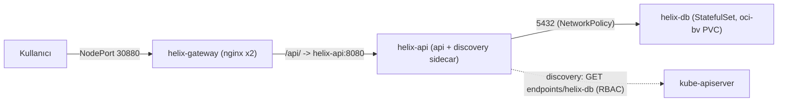
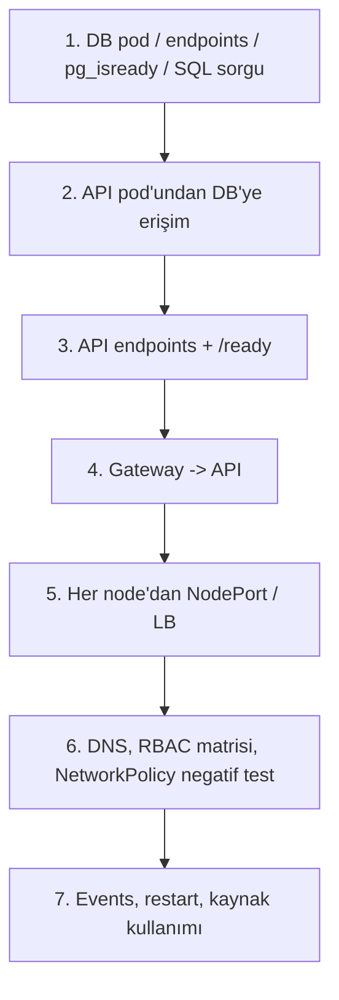

# 🛠️ SRE Olay Müdahale Rehberi ve Post-Mortem: Lab 8 (Helix Ledger)

Bu belge **Lab 8 (Helix Ledger — `helix-prod` namespace)** kesintisinin kök neden analizlerini (RCA), teşhis komutlarını, düzeltme adımlarını ve sektörden edge-case deneyimlerini içerir.

> [!NOTE]
> Manifest dosyaları (`manifests/`) bilerek hatalı bırakılmıştır. Aşağıdaki diff'ler, düzeltmenin **minimal** halidir. Uygulama: dosyayı düzelt → `kubectl apply -f manifests/<dosya>.yaml`.

Mimari akış:



---

## 📑 Yönetici Özeti

| Ticket | Bileşen | Kök Neden | Düzeltme | İlgili Kontrol Düzlemi Bileşeni | Önem |
| :--- | :--- | :--- | :--- | :--- | :--- |
| **INC-801** | `helix-db` StatefulSet | Toleration `effect: NoExecute`, taint `NoSchedule` ile eşleşmiyor | `effect: NoSchedule` | kube-scheduler `TaintToleration` filtresi | P1 |
| **INC-802** | `helix-db` StatefulSet | ext4 volume kökünde `lost+found` → `initdb` boş olmayan dizini reddediyor | `PGDATA=/var/lib/postgresql/data/pgdata` | kubelet volume mount + container runtime | P1 |
| **INC-803** | `helix-api` Deployment | `secretKeyRef.key: password` yok; `optional: true` hatayı gizliyor | `key: POSTGRES_PASSWORD`, `optional` kaldır | kubelet env çözümleme | P1 |
| **INC-804** | `helix-api` Deployment | startupProbe bütçesi 4×5=20s < 30s açılış | `failureThreshold: 12` (60s) | kubelet prober | P1 |
| **INC-805** | `helix-db-ingress` NetworkPolicy | `namespaceSelector` + `podSelector` aynı eleman = AND; namespace'te `team` etiketi yok | `namespaceSelector` kaldır | CNI NetworkPolicy enforcement | P1 |
| **INC-806** | `helix-api` ServiceAccount | `automountServiceAccountToken: false` → sidecar token bulamıyor | SA'da veya pod spec'te `true` | kubelet projected SA token volume / ServiceAccount admission | P1 |
| **INC-807** | RoleBinding | Subject namespace `default` | `namespace: helix-prod` | API server RBAC authorizer | P1 |
| **INC-808** | Role | `apiGroups: ["apps"]` — endpoints core grubunda | `apiGroups: [""]` | API server RBAC authorizer | P1 |
| **INC-809** | `helix-gateway` Deployment | `nodeSelector tier: frontend` olan node yok | `tier: web` | kube-scheduler `NodeAffinity` filtresi | P1 |
| **INC-810** | `helix-api` Service | Selector `tier: api`, pod'lar `tier: backend` → boş endpoints → nginx 502 | `tier` selector'dan çıkar | EndpointSlice/Endpoints controller, kube-proxy | P1 |

---

## 🔧 Ticket Bazında Çözümler

---

### [INC-801] Veritabanı Pod'u Pending'de Kalıyor

#### 1. Kök Neden Analizi
DB node'u `workload=database:NoSchedule` taint'ine sahip. `30-database.yaml` içinde:
```yaml
tolerations:
  - key: workload
    operator: Equal
    value: database
    effect: NoExecute   # ❌
```
**kube-scheduler**'ın Filter aşamasındaki **`TaintToleration`** plugin'i bir taint'in tolere edilmesi için `key`, `value` (operator Equal ise) **ve `effect`** alanlarının eşleşmesini ister (`effect` boş bırakılırsa tüm effect'lerle eşleşir). `NoExecute` toleration'ı `NoSchedule` taint'ini karşılamaz. Aynı zamanda `nodeSelector: tier=database` (**`NodeAffinity`** plugin'i) pod'u **sadece** bu node'a zorladığı için diğer node'lar zaten elenir → `0/N nodes are available: 1 node(s) had untolerated taint {workload: database}, N-1 node(s) didn't match Pod's node affinity/selector`. Pod sonsuza dek `Pending` kalır; PVC de `WaitForFirstConsumer` ise bağlanmaz.

#### 2. Teşhis Komutları
```bash
kubectl -n helix-prod get pod helix-db-0 -o wide
kubectl -n helix-prod describe pod helix-db-0 | sed -n '/Events/,$p'
kubectl get nodes -L tier -o custom-columns=NAME:.metadata.name,TAINTS:.spec.taints
kubectl -n helix-prod get sts helix-db -o jsonpath='{.spec.template.spec.tolerations}'
kubectl -n helix-prod get pvc
```

#### 3. Çözüm
```diff
       tolerations:
         - key: workload
           operator: Equal
           value: database
-          effect: NoExecute
+          effect: NoSchedule
```
```bash
kubectl apply -f manifests/30-database.yaml
# StatefulSet Pending pod'u otomatik yeniden oluşturmayabilir (OrderedReady + eski revizyon):
kubectl -n helix-prod delete pod helix-db-0
kubectl -n helix-prod rollout status sts/helix-db
```

#### 4. Sektör Deneyimi / Edge Case
- **Diğer kılıklar:** value typo (`db` vs `database`), `operator: Exists` ile `value` birlikte yazmak (reddedilir), key büyük/küçük harf, node'a sonradan eklenen `NoExecute` taint'i çalışan pod'ları tahliye eder (`tolerationSeconds` yoksa anında).
- Toleration **çekmez**, sadece izin verir; dedicated node için **taint + nodeSelector/affinity birlikte** gerekir.
- **Önlem:** Kyverno/OPA ile "`tier=database` nodeSelector'ı olan pod'larda `workload=database:NoSchedule` toleration'ı zorunlu" kuralı; CI'da `kubeconform` + özel policy testi (`conftest`).

---

### [INC-802] Veritabanı CrashLoopBackOff

#### 1. Kök Neden Analizi
`oci-bv` StorageClass'ı (OCI Block Volume) diski **ext4** ile formatlar; ext4 dosya sisteminin kökünde her zaman `lost+found` dizini bulunur. Kubelet bu block device'ı node'da mount edip container içine `/var/lib/postgresql/data` olarak bind-mount eder. Postgres imajının entrypoint'i `PGDATA` (varsayılan `/var/lib/postgresql/data`) boşsa `initdb` çalıştırır; `initdb` ise **boş olmayan** dizini reddeder:
```
initdb: error: directory "/var/lib/postgresql/data" exists but is not empty
It contains a lost+found directory, perhaps due to it being a mount point.
Using a mount point directly as the data directory is not recommended.
Create a subdirectory under the mount point.
```
Container çıkar → kubelet yeniden başlatır → **CrashLoopBackOff**.

**`fsGroup: 70` neden var?** Alpine postgres imajında `postgres` kullanıcısı UID/GID **70**'tir. `fsGroup` ile kubelet, volume'u mount ederken grup sahipliğini 70 yapar ve setgid biti koyar; böylece entrypoint (root olarak başlayıp `postgres`'e düşer) veya non-root çalışan süreç dizine yazabilir. fsGroup tek başına `lost+found` sorununu çözmez — bu izin değil **içerik** sorunudur. (Büyük volume'larda `fsGroupChangePolicy: OnRootMismatch` recursive chown süresini kısaltır.)

#### 2. Teşhis Komutları
```bash
kubectl -n helix-prod get pod helix-db-0
kubectl -n helix-prod logs helix-db-0 --previous
kubectl -n helix-prod describe pod helix-db-0 | grep -A5 "Last State"
kubectl -n helix-prod get pvc data-helix-db-0 -o wide
# Volume içeriğini görmek için (crash döngüsünde kısa süre):
kubectl -n helix-prod debug helix-db-0 -it --image=busybox --target=postgres -- ls -la /proc/1/root/var/lib/postgresql/data
```

#### 3. Çözüm
```diff
           envFrom:
             - secretRef:
                 name: helix-db-credentials
+          env:
+            - name: PGDATA
+              value: /var/lib/postgresql/data/pgdata
```
Alternatif: `volumeMounts` içinde `subPath: pgdata`.
```bash
kubectl apply -f manifests/30-database.yaml
# StatefulSet CrashLoop'taki pod'u yeni revizyonla değiştirmeyebilir (OrderedReady takılması):
kubectl -n helix-prod delete pod helix-db-0
kubectl -n helix-prod rollout status sts/helix-db
kubectl -n helix-prod logs helix-db-0 | tail
```
> [!TIP]
> PVC silmek **gerekmez** (opsiyonel): yeni `pgdata` alt dizini temiz başlar. Yalnızca yarım kalmış bir init'ten temiz başlamak isterseniz `kubectl -n helix-prod delete pvc data-helix-db-0` + pod silme yapın — **veri kaybı** demektir, prod'da yapmayın.

#### 4. Sektör Deneyimi / Edge Case
- **Diğer kılıklar:** MySQL (`--initialize specified but the data directory has files in it`), MongoDB ve Elasticsearch'te aynı `lost+found` sorunu; NFS'de `root_squash` ile `chown` hataları; fsGroup'u desteklemeyen CSI sürücülerinde `Permission denied`.
- `PGDATA` değiştirildiğinde mevcut veri eski yolda kalır — migrasyon gerekir.
- **Önlem:** Helm chart/Kustomize base'inde `PGDATA` alt dizinini standart yapın; Kyverno ile "postgres imajı + PVC mount varsa PGDATA alt dizin olmalı" kuralı; staging'de gerçek StorageClass ile smoke test (kind/local-path'te `lost+found` olmadığından hata görünmez!).

---

### [INC-803] API 10 Saniye Sonra Çıkıyor

#### 1. Kök Neden Analizi
```yaml
- name: DB_PASSWORD
  valueFrom:
    secretKeyRef:
      name: helix-db-credentials
      key: password        # ❌ Secret'ta POSTGRES_PASSWORD var
      optional: true       # ❌ hatayı gizliyor
```
**Kubelet**, container'ı oluştururken env değerlerini çözer. Normalde eksik key `CreateContainerConfigError` ile açıkça görünür. `optional: true` ise kubelet'e "key yoksa değişkeni hiç tanımlama" der → pod **sorunsuz başlar**, uygulama `time.sleep(10)` sonrası validasyonda `FATAL: ... unset variables: ['DB_PASSWORD']` ile `exit 1` olur → CrashLoopBackOff. Hata, platform katmanından uygulama katmanına kaydırılmış olur.

#### 2. Teşhis Komutları
```bash
kubectl -n helix-prod logs deploy/helix-api -c api --previous
kubectl -n helix-prod get secret helix-db-credentials -o jsonpath='{.data}' | jq 'keys'
kubectl -n helix-prod get deploy helix-api -o jsonpath='{.spec.template.spec.containers[0].env}' | jq
kubectl -n helix-prod exec deploy/helix-api -c api -- env | grep DB_   # pod ayaktayken
```

#### 3. Çözüm
```diff
             - name: DB_PASSWORD
               valueFrom:
                 secretKeyRef:
                   name: helix-db-credentials
-                  key: password
-                  optional: true
+                  key: POSTGRES_PASSWORD
```
```bash
kubectl apply -f manifests/40-api.yaml
kubectl -n helix-prod rollout status deploy/helix-api
```

#### 4. Sektör Deneyimi / Edge Case
- **Diğer kılıklar:** `envFrom` ile secret prefix'i, Secret değerinde sondaki `\n` (`echo` vs `echo -n`), ExternalSecrets/Vault senkronunun geç gelmesi, Secret güncellemesinin env'e **yansımaması** (env yalnızca başlangıçta okunur; rollout gerekir).
- **Önlem:** Kritik credential'larda `optional: true` yasaklayan Kyverno kuralı; uygulamada fail-fast config validasyonu (bu lab'da vardı — iyi pratik); Reloader ile Secret değişince rollout.

---

### [INC-804] startupProbe Bütçesi Yetersiz

#### 1. Kök Neden Analizi
Uygulama açılışı: 10s bootstrap + 20s cache warmup = **~30s** sonra port 8080 dinlenir. startupProbe: `periodSeconds: 5 × failureThreshold: 4 = 20s`. **Kubelet prober**'ı 20s içinde başarı göremeyince container'ı öldürür (`Startup probe failed: connection refused` → restart) → asla açılamayan sonsuz döngü.

Önemli: startupProbe tanımlıysa kubelet **liveness ve readiness probe'larını startup başarılı olana kadar devre dışı bırakır**. Amacı, yavaş açılan uygulamalara liveness'ı gevşetmeden zaman tanımaktır. Bu yüzden startup bütçesi gerçek açılış süresinin (p99) rahatça üstünde olmalı.

#### 2. Teşhis Komutları
```bash
kubectl -n helix-prod describe pod -l app.kubernetes.io/name=helix-api | grep -E "Startup|Liveness|Killing|Restart"
kubectl -n helix-prod get events --field-selector reason=Unhealthy --sort-by=.lastTimestamp
kubectl -n helix-prod logs deploy/helix-api -c api --previous   # "warming ledger caches" sonrası kesiliyor
```

#### 3. Çözüm
```diff
           startupProbe:
             httpGet:
               path: /healthz
               port: http
             periodSeconds: 5
-            failureThreshold: 4
+            failureThreshold: 12   # 60s bütçe
```
```bash
kubectl apply -f manifests/40-api.yaml
kubectl -n helix-prod rollout status deploy/helix-api --timeout=180s
```

#### 4. Sektör Deneyimi / Edge Case
- **Diğer kılıklar:** CPU limit throttling'i JVM/Python açılışını uzatır (staging'de geçer, prod'da düşer); liveness'ı DB'ye bağlamak (DB yavaşlayınca tüm API pod'ları restart → kaskad kesinti); readiness yerine liveness ile bağımlılık kontrolü.
- **Önlem:** Startup süresini metriklerle ölçüp ×2 bütçe; liveness'ı sadece "süreç canlı mı" ile sınırlayın; Polaris/Kyverno ile probe varlığı ve makul eşik denetimi.

---

### [INC-805] NetworkPolicy API→DB Trafiğini Engelliyor

#### 1. Kök Neden Analizi
```yaml
ingress:
  - from:
      - namespaceSelector:          # tek liste elemanı...
          matchLabels: {team: ledger}
        podSelector:                # ...aynı elemanın alanı → AND
          matchLabels: {app.kubernetes.io/name: helix-api}
```
Aynı `from` elemanı içindeki `namespaceSelector` ve `podSelector` **AND** ile birleşir: "`team=ledger` etiketli namespace'teki `helix-api` pod'ları". `helix-prod` namespace'inde `team` etiketi **yok** (sadece `app.kubernetes.io/part-of`, `environment`). Policy DB pod'unu seçtiği için DB izole olur ve hiçbir kaynak eşleşmez → **CNI** (Calico/Cilium/OCI VCN-native + policy engine) 5432 SYN paketlerini düşürür. Belirti: API `/ready` → `database unreachable: timed out` (refused değil, **timeout** — DROP'un imzası).

**YAML tire tuzağı:**
```yaml
# AND (tek eleman)            # OR (iki eleman)
- namespaceSelector: {...}    - namespaceSelector: {...}
  podSelector: {...}          - podSelector: {...}
```
Tek bir `-` farkı politikanın anlamını tamamen değiştirir; OR hali "o namespace'teki TÜM pod'lar VEYA bu namespace'teki helix-api" demektir (genellikle istenenden geniş).

#### 2. Teşhis Komutları
```bash
kubectl -n helix-prod get netpol helix-db-ingress -o yaml
kubectl -n helix-prod describe netpol helix-db-ingress
kubectl get ns helix-prod --show-labels
kubectl -n helix-prod exec deploy/helix-api -c api -- python -c \
  "import socket;socket.create_connection(('helix-db',5432),3);print('OK')"
kubectl -n helix-prod logs deploy/helix-api -c api | grep readiness
```

#### 3. Çözüm
```diff
     - from:
-        - namespaceSelector:
-            matchLabels:
-              team: ledger
-          podSelector:
+        - podSelector:
             matchLabels:
               app.kubernetes.io/name: helix-api
```
(Alternatif: `namespaceSelector.matchLabels: {kubernetes.io/metadata.name: helix-prod}` — bu etiket API server tarafından her namespace'e otomatik ve değiştirilemez şekilde eklenir.)
```bash
kubectl apply -f manifests/30-database.yaml
```

#### 4. Sektör Deneyimi / Edge Case
- **Diğer kılıklar:** egress default-deny varken DNS (UDP/TCP 53, kube-system) izni unutmak; `ports` içinde named port uyuşmazlığı; policy'yi desteklemeyen CNI'da (flannel) policy'nin **sessizce yok sayılması**; hostNetwork pod'ların policy dışı kalması.
- **Önlem:** Namespace başına **default-deny** + açık allow kuralları; namespace etiketleri için `kubernetes.io/metadata.name` kullanın; CI'da policy için pozitif **ve negatif** bağlantı testleri (örn. `netassert`, Cilium `connectivity test`); Cilium Hubble / Calico flow log ile drop görünürlüğü.

---

### [INC-806] Discovery Sidecar Token Bulamıyor

#### 1. Kök Neden Analizi
ServiceAccount `helix-api` üzerinde `automountServiceAccountToken: false`. API server'daki **ServiceAccount admission controller**, pod oluşturulurken bu değere bakarak `kube-api-access-xxxxx` **projected volume**'unu (token + `ca.crt` + `namespace`) pod'a ekleyip eklemeyeceğine karar verir; kubelet de bu volume'u `/var/run/secrets/kubernetes.io/serviceaccount` altına mount eder. Devre dışı olduğu için dosyalar yok → `FATAL: service account credentials not found` → sidecar çıkar, pod hiçbir zaman Ready olmaz.

Öncelik: **pod spec'teki `automountServiceAccountToken` SA'daki değeri ezer.**

Modern clusterlarda (1.22+) mount edilen token, **bound projected token**'dır: audience'a bağlı, süreli (~1 saat, kubelet otomatik yeniler), pod silinince geçersiz olur. Eski uzun ömürlü Secret token'larından çok daha güvenlidir.

#### 2. Teşhis Komutları
```bash
kubectl -n helix-prod logs deploy/helix-api -c discovery --previous
kubectl -n helix-prod get sa helix-api -o yaml | grep automount
kubectl -n helix-prod get pod -l app.kubernetes.io/name=helix-api -o jsonpath='{.items[0].spec.volumes[*].name}'
kubectl -n helix-prod exec deploy/helix-api -c api -- ls /var/run/secrets/kubernetes.io/serviceaccount
```

#### 3. Çözüm
En az ayrıcalık açısından tercih edilen: SA'da `false` kalsın, **sadece ihtiyaç duyan pod'da** açılsın:
```diff
     spec:
       serviceAccountName: helix-api
+      automountServiceAccountToken: true
```
Alternatif (lab'ın basit çözümü): `20-rbac.yaml` içinde SA'da `automountServiceAccountToken: true`.
```bash
kubectl apply -f manifests/40-api.yaml      # veya 20-rbac.yaml + rollout restart
kubectl -n helix-prod rollout restart deploy/helix-api   # SA değişikliği mevcut pod'lara yansımaz
```

#### 4. Sektör Deneyimi / Edge Case
- **Diğer kılıklar:** eski client kütüphaneleri token'ı bir kez okuyup cache'ler → 1 saat sonra 401 (bound token rotasyonu); `readOnlyRootFilesystem`/özel volume'un mount yolunu gölgelemesi; Vault/Istio gibi farklı audience isteyen sistemler.
- **Önlem:** Default SA'larda automount kapalı, sadece API'ye ihtiyacı olan workload'larda açık; Kyverno "automount açık pod'ların default SA kullanmasını yasakla"; client-go/official SDK'ların güncel sürümleri.

---

### [INC-807] RoleBinding Yanlış Namespace'teki SA'yı Bağlıyor

#### 1. Kök Neden Analizi
Token mount edildikten sonra sidecar `403 Forbidden` alır. API server isteği önce **authn** (token → kimlik `system:serviceaccount:helix-prod:helix-api`), sonra **authz** (RBAC authorizer) aşamasından geçirir. RoleBinding subject'i:
```yaml
subjects:
  - kind: ServiceAccount
    name: helix-api
    namespace: default   # ❌ → system:serviceaccount:default:helix-api
```
Bu, var olmayan **başka** bir kimliği bağlar. RBAC authorizer gerçek kimlik için eşleşen binding bulamaz → deny. RBAC, subject'in var olup olmadığını doğrulamaz.

#### 2. Teşhis Komutları
```bash
kubectl -n helix-prod logs deploy/helix-api -c discovery --previous    # 403 ... "system:serviceaccount:helix-prod:helix-api" cannot get ...
kubectl -n helix-prod get rolebinding helix-api-endpoint-reader -o yaml
kubectl auth can-i get endpoints -n helix-prod --as=system:serviceaccount:helix-prod:helix-api
kubectl -n helix-prod describe rolebinding helix-api-endpoint-reader
```

#### 3. Çözüm
```diff
 subjects:
   - kind: ServiceAccount
     name: helix-api
-    namespace: default
+    namespace: helix-prod
```
```bash
kubectl apply -f manifests/20-rbac.yaml
kubectl auth can-i get endpoints -n helix-prod --as=system:serviceaccount:helix-prod:helix-api
```

#### 4. Sektör Deneyimi / Edge Case
- **Diğer kılıklar:** `kind: User` ile SA adı yazmak; `roleRef` değiştirilemez (binding silip yeniden oluşturmak gerekir); ClusterRole'u RoleBinding ile bağlayınca sadece o namespace'te geçerli olması; `system:serviceaccounts:<ns>` grup subject'inin istemeden geniş yetki vermesi.
- **Önlem:** CI'da `kubectl auth can-i --as=...` matris testleri; `rbac-tool`/`kubectl-who-can` ile denetim; Kyverno ile "RoleBinding SA subject namespace'i binding namespace'iyle aynı olmalı" kuralı.

---

### [INC-808] Role Yanlış API Grubunu Kullanıyor

#### 1. Kök Neden Analizi
```yaml
rules:
  - apiGroups: ["apps"]   # ❌
    resources: ["endpoints"]
```
`endpoints` **core** (legacy) grubundadır: `/api/v1/...` → `apiGroups: [""]`. RBAC authorizer istekteki (group, resource, verb) üçlüsünü kurallarla eşleştirir; `apps/endpoints` diye bir kaynak yoktur ama **RBAC kaynak/grup adlarını doğrulamaz** — kural geçerli YAML olarak kabul edilir ve hiçbir şeyle eşleşmez → yine 403.

Not: `endpointslices` ayrı bir grupta, `discovery.k8s.io`'dadır. Kubernetes 1.33+ ile **v1 Endpoints API deprecated** olmuştur (EndpointSlice önerilir); yeni kodda discovery için EndpointSlice tercih edilmelidir.

#### 2. Teşhis Komutları
```bash
kubectl api-resources | grep -Ei "endpoints|endpointslices"   # APIVERSION: v1 / discovery.k8s.io/v1
kubectl -n helix-prod get role helix-endpoint-reader -o yaml
kubectl auth can-i list endpoints -n helix-prod --as=system:serviceaccount:helix-prod:helix-api
kubectl auth can-i --list -n helix-prod --as=system:serviceaccount:helix-prod:helix-api
```

#### 3. Çözüm
```diff
 rules:
-  - apiGroups: ["apps"]
+  - apiGroups: [""]
     resources: ["endpoints"]
     verbs: ["get", "list", "watch"]
```
```bash
kubectl apply -f manifests/20-rbac.yaml
kubectl -n helix-prod rollout restart deploy/helix-api   # CrashLoop backoff'u beklememek için
kubectl -n helix-prod logs deploy/helix-api -c discovery -f   # discovery: helix-db backends=[...]
```

#### 4. Sektör Deneyimi / Edge Case
- **Diğer kılıklar:** `deployments` için `""` yazmak (doğrusu `apps`), `ingresses` için `extensions` (artık `networking.k8s.io`), subresource unutmak (`pods/log`, `pods/exec`, `deployments/scale`), çoğul/tekil (`endpoint`).
- **Önlem:** `kubectl create role ... --dry-run=client -o yaml` ile üretmek (gruplar doğru gelir); CI'da `can-i` testleri; `kubectl-lint`/Kubescape ile bilinmeyen kaynak uyarısı.

---

### [INC-809] Gateway Pod'ları Pending

#### 1. Kök Neden Analizi
`helix-gateway` `nodeSelector: tier: frontend` istiyor; clusterda `tier=frontend` etiketli node yok (web node'ları `tier=web`, API de aynı havuzu `tier: web` ile kullanıyor). **kube-scheduler `NodeAffinity`** filter plugin'i (nodeSelector da bu plugin ile değerlendirilir) tüm node'ları eler → `0/N nodes are available: N node(s) didn't match Pod's node affinity/selector`. Soft podAntiAffinity (preferred) sadece skorlamayı etkiler, sorunla ilgisi yoktur.

#### 2. Teşhis Komutları
```bash
kubectl -n helix-prod get pods -l app.kubernetes.io/name=helix-gateway -o wide
kubectl -n helix-prod describe pod -l app.kubernetes.io/name=helix-gateway | sed -n '/Events/,$p'
kubectl get nodes -L tier
```

#### 3. Çözüm
```diff
       nodeSelector:
-        tier: frontend
+        tier: web
```
```bash
kubectl apply -f manifests/50-gateway.yaml
kubectl -n helix-prod rollout status deploy/helix-gateway
```

#### 4. Sektör Deneyimi / Edge Case
- **Diğer kılıklar:** node pool yeniden oluşturulunca etiketlerin kaybolması (etiketi kubectl ile verip node pool şablonuna eklememek), cluster autoscaler'ın eşleşen node grubunu bilmemesi, `requiredDuringScheduling` anti-affinity ile replika > node.
- **Önlem:** Node etiketlerini IaC'de (Terraform node pool `node_labels`) yönetin; Kyverno/OPA ile "nodeSelector değerleri izinli listeden olmalı"; `Pending > 5dk` için alarm.

---

### [INC-810] Service Selector Uyuşmazlığı → nginx 502

#### 1. Kök Neden Analizi
```yaml
# Service helix-api
selector:
  app.kubernetes.io/name: helix-api
  tier: api          # ❌ pod'lar tier: backend
```
**EndpointSlice/Endpoints controller** (kube-controller-manager), selector'ın **tüm** etiketlerini taşıyan Ready pod'ları backend olarak yazar. Eşleşen pod yok → Endpoints boş. **kube-proxy** (iptables/IPVS) ClusterIP için backend'siz bir kural kurar; paket REJECT edilir (`connection refused`). nginx `proxy_pass http://helix-api:8080` → DNS çözülür ama bağlantı reddedilir → istemciye **502 Bad Gateway** (timeout olsaydı 504). Statik `index.html` çalıştığı için "site açık ama API kırık" görünümü oluşur.

#### 2. Teşhis Komutları
```bash
kubectl -n helix-prod get endpoints helix-api
kubectl -n helix-prod get endpointslices -l kubernetes.io/service-name=helix-api
kubectl -n helix-prod get svc helix-api -o jsonpath='{.spec.selector}'; echo
kubectl -n helix-prod get pods -l app.kubernetes.io/name=helix-api --show-labels
kubectl -n helix-prod logs deploy/helix-gateway | grep -i upstream
```

#### 3. Çözüm
```diff
   selector:
     app.kubernetes.io/name: helix-api
-    tier: api
```
(veya `tier: backend`.)
```bash
kubectl apply -f manifests/40-api.yaml
kubectl -n helix-prod get endpoints helix-api   # 2 IP:8080 görünmeli
```

#### 4. Sektör Deneyimi / Edge Case
- **Diğer kılıklar:** pod Ready değilse de Endpoints boş görünür (`notReadyAddresses`) — selector doğru olsa bile; `targetPort` isminin container port adıyla uyuşmaması; Deployment selector'ı immutable olduğu için etiket "düzeltirken" yeni Deployment yaratma; iki farklı uygulamanın aynı selector'ı paylaşıp trafiği karıştırması.
- **Önlem:** Service selector'ı sadece `app.kubernetes.io/name` (+ instance) ile sınırlayın; CI'da Service selector ⊆ pod template labels kontrolü (Kyverno/conftest); "endpoints sayısı 0" için Prometheus alarmı (`kube_endpoint_address_available == 0`).

---

## 🩺 FİNAL: Çalışan Bir Web Platformunun Uçtan Uca Sağlık Kontrolü

Prensip: **içeriden dışarıya, katman katman** ilerleyin; bir katman yeşil olmadan üstüne güvenmeyin. "Pod Running" ≠ "servis çalışıyor".

### Web sitesi vs. uygulama
- **Statik web sitesi** (sadece nginx + HTML): Pod Ready → Service endpoints → NodePort/LB → HTTP 200 + doğru içerik + TLS/DNS. Durum yok, kontrol kısa.
- **Uygulama** (gateway → API → DB): Yukarıdakilere ek olarak bağımlılık zinciri, kimlik/RBAC, ağ politikaları, kalıcı veri ve **gerçek işlem** (sorgu) doğrulanmalı. `/healthz` 200 dönmesi DB'nin çalıştığını kanıtlamaz.



### 0. Genel bakış
```bash
kubectl -n helix-prod get all,pvc,netpol,sa,role,rolebinding -o wide
kubectl get nodes -L tier -o wide
```

### 1. Veritabanı katmanı
```bash
kubectl -n helix-prod get pod helix-db-0 -o wide                # Running 1/1, restart 0
kubectl -n helix-prod get endpoints helix-db                    # pod IP:5432
kubectl -n helix-prod get pvc data-helix-db-0                   # Bound
kubectl -n helix-prod exec helix-db-0 -- sh -c 'pg_isready -U "$POSTGRES_USER" -d "$POSTGRES_DB"'
# Gerçek sorgu (pg_isready sadece kabul ettiğini söyler):
kubectl -n helix-prod exec helix-db-0 -- sh -c \
  'psql -U "$POSTGRES_USER" -d "$POSTGRES_DB" -c "select version(), now(), current_database();"'
kubectl -n helix-prod exec helix-db-0 -- sh -c 'echo $PGDATA; ls $PGDATA | head'
```

### 2. Uygulama DB'ye ulaşabiliyor mu? (API pod'unun içinden)
```bash
kubectl -n helix-prod exec deploy/helix-api -c api -- python -c \
  "import socket;print(socket.gethostbyname('helix-db'));socket.create_connection(('helix-db',5432),3);print('TCP OK')"
kubectl -n helix-prod exec deploy/helix-api -c api -- env | grep -E '^DB_(HOST|PORT|NAME|USER)='
# Kimlik bilgisiyle gerçek login testi (aynı credential, geçici pod):
kubectl -n helix-prod run pgcheck --rm -it --restart=Never --image=postgres:16-alpine \
  --labels=app.kubernetes.io/name=helix-api \
  --env=PGPASSWORD=$(kubectl -n helix-prod get secret helix-db-credentials -o jsonpath='{.data.POSTGRES_PASSWORD}' | base64 -d) \
  -- psql -h helix-db -U helix_app -d helix_ledger -c 'select 1;'
```
> Not: Geçici pod'a `app.kubernetes.io/name=helix-api` etiketi verilmezse NetworkPolicy onu engeller — bu da politikanın çalıştığının kanıtıdır.

### 3. API katmanı
```bash
kubectl -n helix-prod get pods -l app.kubernetes.io/name=helix-api -o wide     # 2/2 READY her pod
kubectl -n helix-prod get endpoints helix-api                                    # 2 adres
kubectl -n helix-prod exec deploy/helix-api -c api -- python -c \
  "import urllib.request as u;[print(p,u.urlopen('http://localhost:8080'+p).read()) for p in ('/healthz','/ready','/api/status')]"
kubectl -n helix-prod logs deploy/helix-api -c discovery --tail=5                # backends=[...]
```

### 4. Gateway → API
```bash
kubectl -n helix-prod get pods -l app.kubernetes.io/name=helix-gateway -o wide   # farklı node'larda
kubectl -n helix-prod exec deploy/helix-gateway -- wget -qO- http://helix-api:8080/api/status
kubectl -n helix-prod exec deploy/helix-gateway -- wget -qO- http://localhost:8080/api/status
kubectl -n helix-prod exec deploy/helix-gateway -- nginx -t
```

### 5. Dış erişim (her node'dan NodePort / LB)
```bash
for ip in $(kubectl get nodes -o jsonpath='{.items[*].status.addresses[?(@.type=="InternalIP")].address}'); do
  echo "== $ip"; curl -s -o /dev/null -w "/ %{http_code}  " --max-time 3 http://$ip:30880/
  curl -s --max-time 5 http://$ip:30880/api/status; echo
done
# Tekrarlı istekle her iki API pod'una dağıldığını görün ("pod" alanı değişmeli):
for i in $(seq 1 6); do curl -s http://<NODE_IP>:30880/api/status; echo; done
```
> `externalTrafficPolicy: Cluster` (varsayılan) ile gateway pod'u olmayan node'dan da 200 dönmeli. Dönmüyorsa kube-proxy/security list (OCI) /firewall kontrol edin. LB varsa LB IP'sini ve health-check durumunu da test edin.

### 6. DNS, RBAC matrisi, NetworkPolicy negatif test
```bash
# DNS
kubectl -n helix-prod exec deploy/helix-gateway -- nslookup helix-api.helix-prod.svc.cluster.local
kubectl -n helix-prod exec deploy/helix-gateway -- nslookup helix-db-0.helix-db.helix-prod.svc.cluster.local
kubectl -n kube-system get pods -l k8s-app=kube-dns

# RBAC matrisi (beklenen: yes / yes / yes / no / no / no)
SA=system:serviceaccount:helix-prod:helix-api
for v in "get endpoints" "list endpoints" "watch endpoints" "get secrets" "delete pods" "list endpoints -n default"; do
  printf "%-28s %s\n" "$v" "$(kubectl auth can-i $v -n helix-prod --as=$SA 2>/dev/null || true)"
done
kubectl auth can-i --list -n helix-prod --as=$SA

# NetworkPolicy NEGATİF test — etiketsiz pod DB'ye ulaşamamalı (timeout beklenir)
kubectl -n helix-prod run nettest --rm -it --restart=Never --image=busybox -- nc -zv -w 3 helix-db 5432
# Pozitif kontrol: aynı test api etiketiyle başarılı olmalı
kubectl -n helix-prod run nettest2 --rm -it --restart=Never --image=busybox \
  --labels=app.kubernetes.io/name=helix-api -- nc -zv -w 3 helix-db 5432
```

### 7. Events, restart'lar, kaynak kullanımı
```bash
kubectl -n helix-prod get events --sort-by=.lastTimestamp | tail -30
kubectl -n helix-prod get events --field-selector type=Warning
kubectl -n helix-prod get pods -o custom-columns=NAME:.metadata.name,READY:.status.containerStatuses[*].ready,RESTARTS:.status.containerStatuses[*].restartCount,NODE:.spec.nodeName
kubectl -n helix-prod top pods --containers     # metrics-server gerekli; limit'e yakın mı?
kubectl top nodes
kubectl -n helix-prod get pods -o jsonpath='{range .items[*]}{.metadata.name}{"\t"}{.status.containerStatuses[*].lastState.terminated.reason}{"\n"}{end}'   # OOMKilled?
```

### ✅ Sağlıklı durumun kabul kriterleri
| Katman | Beklenen |
| :--- | :--- |
| DB | `helix-db-0` 1/1, restart 0, PVC Bound, `pg_isready` accepting, `select` sonuç dönüyor |
| API | 2 pod × 2/2 Ready, endpoints 2 adres, `/ready` → `{"database":"up"}` |
| Discovery | Log'da `backends=[<db-ip>]`, 403/FATAL yok |
| Gateway | 2 pod farklı node'larda, `/healthz` 200, `/api/status` 200 |
| Dış erişim | Her node IP:30880 → `/` 200 ve `/api/status` 200 |
| Güvenlik | `can-i` matrisi beklenen gibi; etiketsiz pod DB'ye **ulaşamıyor** |
| Gözlem | Warning event yok, restart sayısı artmıyor, CPU/bellek limitlerin altında |
