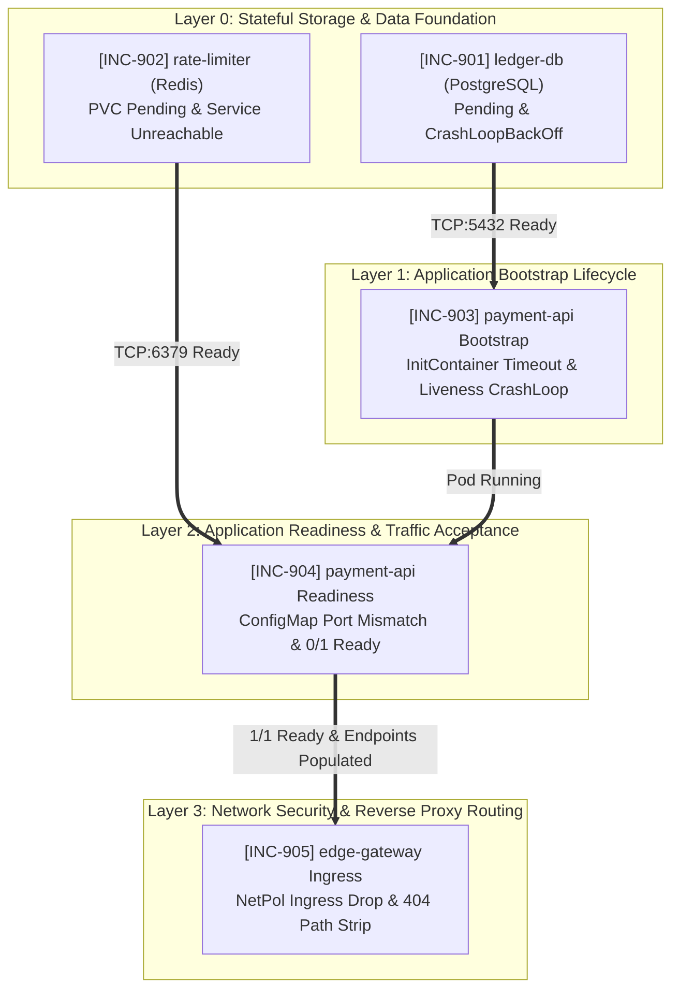

# 🚨 SRE Incident Lab 9: PayStream — High-Frequency Payment & Settlement System Incident Triage

This workspace serves as the active **Incident Triage War Room** during a mission-critical production deployment failure of **PayStream**, an enterprise high-frequency payment processing and transaction settlement platform.

All manifests deployed to the cluster are **syntactically valid** and accepted without errors by the Kubernetes API server (`kubectl apply -f manifests/` returns 0). However, the platform fails completely at runtime: database and caching workloads cannot schedule or mount storage, application containers fail their bootstrap lifecycle and health checks, internal routing is blackholed, and public gateway requests return timeouts and 404s.

Your mission: triage and remediate the incident tickets **in strictly sequential (linear, bottom-up) order**, perform systematic root cause analysis (RCA) based on telemetry and runtime symptoms, and satisfy the **Success Criteria** for each ticket before moving to the next.

> 📖 **Post-Mortem & Deep Root Cause Analyses (RCA):**  
> 👉 **[Explore Senior SRE Post-Mortem Guide (SOLUTION.md)](./SOLUTION.md)** — *Attempt resolution on your own before consulting the guide!*

---

## 🗺️ Cluster Topology & Infrastructure Constraints

The incident scenario is grounded strictly in the following 3-node cluster topology:

| Node Name | Internal IP | Label | Constraint / Taint | Allocated Tier Role |
| :--- | :--- | :--- | :--- | :--- |
| **Node-1** | `10.0.10.122` | `tier=web` | *None* | Web / API / Gateway Workloads |
| **Node-2** | `10.0.10.208` | `tier=web` | *None* | Web / API / Gateway Workloads |
| **Node-3** | `10.0.10.78` | `tier=database` | `workload=database:NoSchedule` | Database Tier Only (Isolated) |

* **Target Namespace:** `paystream-prod`
* **Default StorageClass:** `oci-bv` (Oracle Block Volume CSI, dynamic block provisioning, `ReadWriteOnce` only)
* **Ingress / Gateway Access:** `edge-gateway` Service (ClusterIP:80 -> containerPort 8080)
* **Core Architecture Stack:**
  1. `ledger-db`: PostgreSQL 16 StatefulSet (`1/1`, Headless Service :5432)
  2. `rate-limiter`: Redis 7.2 Deployment (`1/1`, ClusterIP Service :6379, PVC backed)
  3. `payment-api`: Python 3.11 Settlement Engine (2 Replicas, `1/1` + 1 `wait-for-db` initContainer, ClusterIP Service :80 -> :8000)
  4. `edge-gateway`: Nginx 1.25 Reverse Proxy (`1/1`, ClusterIP Service :80 -> :8080)
  5. `payment-api-netpol`: Ingress NetworkPolicy securing the payment API tier

> [!IMPORTANT]
> **Architectural Guarantees & Constraints:**
> 1. **Zero RBAC / ServiceAccount:** No custom ServiceAccounts, Roles, or Kubernetes API sidecars exist. All bugs are purely workload lifecycle, scheduling, storage, networking, and configuration.
> 2. **Single Application Container (`1/1`):** Every Pod runs exactly 1 application container (`1/1`). Only `payment-api` contains an `initContainer` for database readiness checking.
> 3. **100% Linear Bottom-Up Flow:** INC-901 and INC-902 establish the stateful foundation. Once solved, each layer becomes fully healthy and verifiable before touching upper layers.
> 4. **NetworkPolicy Enforcement:** Ensure your cluster CNI enforces `NetworkPolicy` (e.g., Calico, Cilium, or OCI VCN-Native with Network Policy enabled) to experience the network boundary incident.

---

## 🚀 Environment Initialization (Deploying the Broken Platform)

Apply all manifests to deploy the initial broken state:

```bash
kubectl apply -f manifests/
```

Inspect the initial broken state across the namespace:

```bash
kubectl get pods,svc,endpoints,pvc -n paystream-prod -o wide
kubectl get events -n paystream-prod --sort-by=.lastTimestamp
```

---

## 📋 On-Call SRE Incident Board

Tickets are strictly ordered in a **bottom-up linear dependency chain**. Resolve them sequentially.



---

### [INC-901] Ledger Database Pod Stuck in Pending & CrashLoopBackOff
* **Priority:** `P1 - Blocker`
* **Alert (Prometheus / Alertmanager):**
  > `[CRITICAL] KubePodNotScheduled: paystream-prod/ledger-db-0 has been Pending for > 5 minutes.`
* **Symptoms:**
  * `ledger-db-0` cannot be scheduled to any node; `NODE` column displays `<none>`.
  * `kubectl describe pod ledger-db-0` reveals `FailedScheduling` events citing untolerated taints.
  * Once scheduled, the container immediately enters `CrashLoopBackOff` during volume initialization.
* **Success Criteria & Verification:**
  ```bash
  # 1. Pod must be running on Node-3 (10.0.10.78) with 0 restarts
  kubectl get pod ledger-db-0 -n paystream-prod -o wide
  # Expected: STATUS Running, READY 1/1, NODE Node-3

  # 2. Database must accept TCP connections on port 5432
  kubectl exec -n paystream-prod ledger-db-0 -- pg_isready -U ledger_admin -d paystream
  # Expected: /var/run/postgresql:5432 - accepting connections

  # 3. Headless Service must register the active Pod IP
  kubectl get endpoints ledger-db -n paystream-prod
  # Expected: ENDPOINTS contains <POD_IP>:5432
  ```

---

### [INC-902] Rate Limiter Pod Pending & Service Unreachable
* **Priority:** `P1 - Blocker`
* **Alert (Prometheus / Alertmanager):**
  > `[CRITICAL] KubePersistentVolumeClaimPending: paystream-prod/rate-limiter-pvc volume binding stalled.`
* **Symptoms:**
  * The `rate-limiter` Pod remains stuck in `Pending` waiting for its PersistentVolumeClaim (`rate-limiter-pvc`).
  * Storage provisioner events log capability rejection on the requested AccessMode.
  * Even after pod startup, client connections to the `rate-limiter` Service fail with connection refused or timeout; `kubectl get endpoints rate-limiter` shows `<none>`.
* **Success Criteria & Verification:**
  ```bash
  # 1. PVC must be Bound
  kubectl get pvc rate-limiter-pvc -n paystream-prod
  # Expected: STATUS Bound, ACCESS MODES RWO

  # 2. Pod must be Running
  kubectl get pod -l app.kubernetes.io/name=rate-limiter -n paystream-prod
  # Expected: STATUS Running, READY 1/1

  # 3. Service Endpoints must be populated
  kubectl get endpoints rate-limiter -n paystream-prod
  # Expected: ENDPOINTS contains <POD_IP>:6379

  # 4. Redis PING test must return PONG
  kubectl exec -n paystream-prod deploy/rate-limiter -- redis-cli ping
  # Expected: PONG
  ```

---

### [INC-903] Payment API Initialization Failure & Pod CrashLoop
* **Priority:** `P1 - Blocker`
* **Slack (#paystream-war-room):**
  > **@dev-oncall:** We resolved the database and Redis backends, but both `payment-api` pods are frozen in `Init:0/1`. When the init container is bypassed manually in dev, the main container enters `CrashLoopBackOff` every 30 seconds!
* **Symptoms:**
  * Both replicas of `deployment/payment-api` hang indefinitely in `Init:0/1`.
  * Pod logs (`kubectl logs -c wait-for-db`) show repeated connection refused errors to an unexpected port.
  * Once the initContainer succeeds, the main `api` container starts but gets killed periodically by kubelet with `Unhealthy` liveness probe events (`RestartCount` increments steadily).
* **Success Criteria & Verification:**
  ```bash
  # 1. Init container must complete and main container must reach Running without restart loops
  kubectl get pods -l app.kubernetes.io/name=payment-api -n paystream-prod
  # Expected: STATUS Running, RESTARTS 0 (or constant)

  # Note: The pods will temporarily show 0/1 READY.
  # This is the expected bridge to INC-904 (readiness probe depends on application configuration).
  ```

---

### [INC-904] Payment API Readiness Probe Failure & Traffic Blackhole
* **Priority:** `P1 - Blocker`
* **Alert (Prometheus / Alertmanager):**
  > `[CRITICAL] KubeEndpointSliceEmpty: Service paystream-prod/payment-api has 0 available endpoints.`
* **Symptoms:**
  * Both `payment-api` pods remain in `0/1 Ready` despite status being `Running`.
  * `kubectl describe pod` logs `Readiness probe failed: HTTP probe failed with statuscode: 503`.
  * Inspecting the application health endpoint (`curl http://localhost:8000/ready`) reveals that the settlement engine is attempting to validate connectivity to an upstream dependency on an invalid port specified via configuration.
  * The `payment-api` Service has empty endpoints (`<none>`), blackholing all internal cluster traffic.
* **Success Criteria & Verification:**
  ```bash
  # 1. Both replicas must become 1/1 Ready
  kubectl get pods -l app.kubernetes.io/name=payment-api -n paystream-prod
  # Expected: 2/2 pods in READY 1/1, STATUS Running

  # 2. Service Endpoints must contain both Pod IPs
  kubectl get endpoints payment-api -n paystream-prod
  # Expected: ENDPOINTS shows 2 Pod IPs on port 8000 (e.g., 10.244.x.y:8000, 10.244.a.b:8000)

  # 3. Direct probe to /ready returns HTTP 200 with all dependencies connected
  kubectl exec -n paystream-prod deploy/payment-api -c api -- python -c "
  import urllib.request, json
  res = urllib.request.urlopen('http://localhost:8000/ready')
  print(json.loads(res.read().decode()))
  "
  # Expected: {'ready': True, 'database': {'reachable': True}, 'cache': {'reachable': True}}
  ```

---

### [INC-905] Edge Gateway Ingress Drop & API Route 404
* **Priority:** `P1 - Blocker`
* **Symptoms:**
  * External clients accessing the PayStream edge gateway at `/api/v1/settlements` receive `504 Gateway Time-out` (or connection drops).
  * Checking network policy telemetry shows that CNI packet filtering is dropping traffic between `edge-gateway` and `payment-api`.
  * Once the network policy is aligned, the gateway returns `404 Not Found` (`{"error": "not_found"}`) instead of the transaction settlement payload.
  * Upstream `payment-api` logs show requests arriving as `GET /` instead of `GET /api/v1/settlements` due to reverse proxy path substitution rules.
* **Success Criteria & Verification:**
  ```bash
  # 1. Edge Gateway Pod and Service must be healthy
  kubectl get pods,svc,endpoints -l app.kubernetes.io/name=edge-gateway -n paystream-prod

  # 2. End-to-end transaction settlement API call must return HTTP 200 OK with active settlement payload
  kubectl exec -n paystream-prod deploy/edge-gateway -- wget -qO- http://localhost:8080/api/v1/settlements
  # Expected Output:
  # {
  #   "status": "success",
  #   "service": "payment-api",
  #   "settlement_engine": "active",
  #   "transactions_sample": [
  #     {"id": "tx_1001", "amount": 250.0, "currency": "USD", "state": "SETTLED"},
  #     ...
  #   ]
  # }
  ```

---

## 🏁 End-to-End Production Verification Checklist (Bottom-Up)

Execute this comprehensive audit script once all tickets are remediated:

```bash
#!/usr/bin/env bash
set -euo pipefail

echo "========================================================"
echo "  PayStream SRE Production Health Check Audit"
echo "========================================================"

echo "--> 1. Verifying Namespace & Workload Distribution..."
kubectl get nodes -L tier
kubectl get pods -n paystream-prod -o wide

echo "--> 2. Verifying Layer 0: Stateful Backends..."
kubectl get pvc -n paystream-prod
kubectl exec -n paystream-prod ledger-db-0 -- pg_isready -U ledger_admin -d paystream
kubectl exec -n paystream-prod deploy/rate-limiter -- redis-cli ping
kubectl get endpoints ledger-db rate-limiter -n paystream-prod

echo "--> 3. Verifying Layer 1 & 2: Application Cluster..."
kubectl get deployment payment-api -n paystream-prod
kubectl get endpoints payment-api -n paystream-prod
kubectl exec -n paystream-prod deploy/payment-api -c api -- wget -qO- http://localhost:8000/ready

echo "--> 4. Verifying Layer 3: Network Security & Ingress Gateway..."
kubectl exec -n paystream-prod deploy/edge-gateway -- wget -qO- http://localhost:8080/health
kubectl exec -n paystream-prod deploy/edge-gateway -- wget -qO- http://localhost:8080/api/v1/settlements

echo "========================================================"
echo "  [PASS] All PayStream SLAs satisfied. Incident Closed!"
echo "========================================================"
```

---

## 🧹 Cleanup Instructions

To completely purge the lab environment:

```bash
kubectl delete namespace paystream-prod --ignore-not-found
```

> [!CAUTION]
> Deleting the namespace removes all Pods, Services, ConfigMaps, and Secrets. Note that depending on CSI reclaim policies, associated storage volumes may be decommissioned.

---

<br>

---

## 🇹🇷 Türkçe Dokümantasyon / Turkish Version

# 🚨 SRE Incident Lab 9: PayStream — Yüksek Frekanslı Ödeme ve Mutabakat Sistemi

Bu çalışma alanı, kurumsal ödeme ve takas mutabakat platformu **PayStream**'in canlıya geçiş (production rollout) aşamasında yaşanan kritik arızalar için kurulan **Incident War Room**'dur.

Kümeye uygulanan tüm manifestolar **şema açısından %100 geçerlidir** ve Kubernetes API sunucusu tarafından hiçbir sözdizimi hatası olmadan kabul edilmiştir (`kubectl apply -f manifests/` sıfır hata ile tamamlanır). Ancak çalışma zamanında (runtime) sistem tamamen çökmüş durumdadır: veritabanı ve önbellek iş yükleri schedule edilemez veya disk bağlayamaz, uygulama pod'ları başlatma ve sağlık kontrollerinden geçemez, iç ağ trafiği kara deliğe düşer ve dış gateway çağrıları zaman aşımı ile 404 döner.

Göreviniz: ticket'ları **aşağıdan yukarıya (bottom-up), kesinlikle sıralı ve doğrusal** olarak çözmek, sistem telemetrisi ve loglardan kök neden analizi (RCA) yapmak ve her ticket'ın **Başarı Kriteri**'ni sağladıktan sonra bir sonrakine geçmektir.

> 📖 **Post-Mortem & Detaylı Kök Neden Analizleri (RCA):**  
> 👉 **[Kıdemli SRE Çözüm Rehberi (SOLUTION.md)](./SOLUTION.md)** — *Önce kendi mühendislik reflekslerinizle çözmeyi deneyin!*

---

### 🗺️ Küme Topolojisi ve Altyapı Kısıtları

Senaryo aşağıdaki 3 node'lu küme topolojisine dayanmaktadır:

| Node Adı | Dahili IP | Label | Kısıt / Taint | Tahsis Edilen Rol |
| :--- | :--- | :--- | :--- | :--- |
| **Node-1** | `10.0.10.122` | `tier=web` | *Yok* | Web / API / Gateway İş Yükleri |
| **Node-2** | `10.0.10.208` | `tier=web` | *Yok* | Web / API / Gateway İş Yükleri |
| **Node-3** | `10.0.10.78` | `tier=database` | `workload=database:NoSchedule` | Yalnızca Veritabanı (İzole) |

* **Hedef Namespace:** `paystream-prod`
* **Varsayılan StorageClass:** `oci-bv` (Oracle Block Volume CSI, `ReadWriteOnce`)
* **Dış Erişim / Gateway:** `edge-gateway` Service (ClusterIP:80 -> containerPort 8080)
* **Temel Mimari:**
  1. `ledger-db`: PostgreSQL 16 StatefulSet (`1/1`, Headless Service :5432)
  2. `rate-limiter`: Redis 7.2 Deployment (`1/1`, ClusterIP Service :6379, PVC destekli)
  3. `payment-api`: Python 3.11 Settlement Engine (2 Replicas, `1/1` + 1 `wait-for-db` initContainer, ClusterIP Service :80 -> :8000)
  4. `edge-gateway`: Nginx 1.25 Tersine Proxy (`1/1`, ClusterIP Service :80 -> :8080)
  5. `payment-api-netpol`: Ödeme API katmanını izole eden Ingress NetworkPolicy

> [!IMPORTANT]
> **Kesin Tasarım Prensipleri:**
> 1. **Sıfır RBAC / ServiceAccount:** Sistemde kurgusal ServiceAccount, cluster yetkisi ya da API sorgulayan yan konteyner YOKTUR.
> 2. **Tek Ana Uygulama Konteyneri (`1/1`):** Her Pod'da sadece 1 ana konteyner çalışır (`payment-api`'deki bağımlılık bekleyen `initContainer` hariç).
> 3. **%100 Doğrusal Akış:** INC-901'den INC-905'e kadar her adım bir öncekinin üzerine inşa edilir. Bir adımı çözdüğünüzde o katman %100 çalışır ve doğrulanabilir.

---

### 🚀 Ortamın Başlatılması (Bozuk Sistemin Dağıtımı)

Tüm manifestoları uygulayın:

```bash
kubectl apply -f manifests/
```

İlk durumu gözlemleyin:

```bash
kubectl get pods,svc,endpoints,pvc -n paystream-prod -o wide
kubectl get events -n paystream-prod --sort-by=.lastTimestamp
```

---

### 📋 Nöbetçi SRE Olay Müdahale Panosu

---

#### [INC-901] Ledger Veritabanı Pod'u Pending ve CrashLoop Durumunda
* **Öncelik:** `P1 - Blocker`
* **Alarm:**
  > `[CRITICAL] KubePodNotScheduled: paystream-prod/ledger-db-0 podu 5 dakikadan uzun süredir Pending durumunda.`
* **Semptomlar:**
  * `ledger-db-0` hiçbir node'a atanamıyor (`NODE: <none>`).
  * `kubectl describe pod` çıktısında tolere edilmeyen taint uyarısı görülüyor.
  * Pod doğru node'a atandığında ise disk mount edilir edilmez `CrashLoopBackOff`'a düşüyor.
* **Başarı Kriteri & Doğrulama:**
  ```bash
  kubectl get pod ledger-db-0 -n paystream-prod -o wide
  # Beklenen: STATUS Running, READY 1/1, NODE Node-3 (10.0.10.78)

  kubectl exec -n paystream-prod ledger-db-0 -- pg_isready -U ledger_admin -d paystream
  # Beklenen: /var/run/postgresql:5432 - accepting connections

  kubectl get endpoints ledger-db -n paystream-prod
  # Beklenen: ENDPOINTS altında <POD_IP>:5432 görünmeli
  ```

---

#### [INC-902] Rate Limiter Pod'u Pending ve Servis Erişilemez Durumda
* **Öncelik:** `P1 - Blocker`
* **Alarm:**
  > `[CRITICAL] KubePersistentVolumeClaimPending: rate-limiter-pvc kalıcı disk bağlama işlemi kilitlendi.`
* **Semptomlar:**
  * `rate-limiter` pod'u PVC'nin bağlanmasını beklerken `Pending` kalıyor. CSI storage provisioner istenen erişim modunu desteklemediğini bildiriyor.
  * Pod ayağa kalksa bile `rate-limiter` servisi üzerinden Redis'e erişilemiyor; `kubectl get endpoints rate-limiter` çıktısı `<none>` veriyor.
* **Başarı Kriteri & Doğrulama:**
  ```bash
  kubectl get pvc rate-limiter-pvc -n paystream-prod
  # Beklenen: STATUS Bound, ACCESS MODES RWO

  kubectl get pod -l app.kubernetes.io/name=rate-limiter -n paystream-prod
  # Beklenen: STATUS Running, READY 1/1

  kubectl get endpoints rate-limiter -n paystream-prod
  # Beklenen: ENDPOINTS altında <POD_IP>:6379 görünmeli

  kubectl exec -n paystream-prod deploy/rate-limiter -- redis-cli ping
  # Beklenen: PONG
  ```

---

#### [INC-903] Payment API Başlatma Hatası ve Liveness CrashLoop
* **Öncelik:** `P1 - Blocker`
* **Semptomlar:**
  * `payment-api` pod'ları `Init:0/1` durumunda sonsuz bekleyişe geçiyor.
  * `wait-for-db` init konteyner logları veritabanı portuna ulaşılamadığını gösteriyor.
  * Init konteyner düzeltildikten sonra ana konteyner çalışıyor ancak Kubelet her 30 saniyede bir konteyneri öldürüyor (`Unhealthy` liveness probe; restart sayısı durmaksızın artıyor).
* **Başarı Kriteri & Doğrulama:**
  ```bash
  kubectl get pods -l app.kubernetes.io/name=payment-api -n paystream-prod
  # Beklenen: STATUS Running, RESTARTS 0 (veya sabit)
  # Not: Pod'un 0/1 READY kalması beklenen bir durumdur ve INC-904'e organik köprüdür.
  ```

---

#### [INC-904] Payment API Readiness Hatası ve Trafik Kara Deliği
* **Öncelik:** `P1 - Blocker`
* **Alarm:**
  > `[CRITICAL] KubeEndpointSliceEmpty: payment-api servisinin arkasında aktif endpoint bulunmuyor.`
* **Semptomlar:**
  * `payment-api` pod'ları `Running` olmasına rağmen `0/1 Ready` durumunda kalıyor.
  * Kubelet event'lerinde `Readiness probe failed: HTTP probe failed with statuscode: 503` yazıyor.
  * Pod içindeki `/ready` endpoint'i sorgulandığında uygulamanın ConfigMap'ten okuduğu hatalı bir port üzerinden önbelleğe bağlanmaya çalıştığı görülüyor.
  * `payment-api` servisinin endpoint listesi boştur (`<none>`).
* **Başarı Kriteri & Doğrulama:**
  ```bash
  kubectl get pods -l app.kubernetes.io/name=payment-api -n paystream-prod
  # Beklenen: 2/2 pod READY 1/1, STATUS Running

  kubectl get endpoints payment-api -n paystream-prod
  # Beklenen: ENDPOINTS altında 8000 portunda 2 Pod IP'si görünmeli

  kubectl exec -n paystream-prod deploy/payment-api -c api -- wget -qO- http://localhost:8000/ready
  # Beklenen: {"ready": true, "database": {"reachable": true}, "cache": {"reachable": true}}
  ```

---

#### [INC-905] Edge Gateway Ingress Engellemesi ve 404 Yönlendirme Hatası
* **Öncelik:** `P1 - Blocker`
* **Semptomlar:**
  * Gateway üzerinden `/api/v1/settlements` çağrıldığında `504 Gateway Time-out` alınıyor.
  * CNI seviyesinde NetworkPolicy paket düşürmesi yaşanıyor.
  * NetworkPolicy düzeltildikten sonra gateway `404 Not Found` (`{"error": "not_found"}`) dönüyor.
  * API loglarında isteğin tersine proxy kuralı yüzünden `/api/v1/settlements` yerine doğrudan `/` olarak geldiği tespit ediliyor.
* **Başarı Kriteri & Doğrulama:**
  ```bash
  kubectl get pods,svc,endpoints -l app.kubernetes.io/name=edge-gateway -n paystream-prod

  kubectl exec -n paystream-prod deploy/edge-gateway -- wget -qO- http://localhost:8080/api/v1/settlements
  # Beklenen Çıktı:
  # HTTP 200 OK ve JSON formatında aktif settlement/transactions verisi
  ```

---

### 🏁 Uçtan Uca Doğrulama Kontrol Listesi

Tüm ticket'ları çözdükten sonra production testini çalıştırın:

```bash
kubectl exec -n paystream-prod deploy/edge-gateway -- wget -qO- http://localhost:8080/api/v1/settlements
```

Tüm sistem hazır olduğunda HTTP 200 dönecek ve işlem listesini basacaktır!
