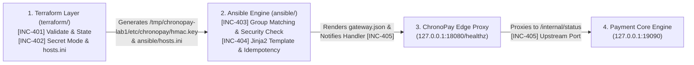

# 🇬🇧 English Version

# 🚨 SRE Incident Lab: tf-troubleshoot-4 — ChronoPay Edge Gateway (Terraform + Ansible Pipeline Outage)

Welcome to **tf-troubleshoot-4**. This workspace serves as the active **Incident Triage War Room** during a production provisioning and configuration management outage of **ChronoPay**, an edge payment gateway and internal payment verification service managed end-to-end via **Terraform** (infrastructure metadata, secrets, and dynamic inventory generation) and **Ansible** (daemon orchestration, security validation, Jinja2 templating, and handler lifecycle).

Your mission as the On-Call DevOps / SRE Engineer is to resolve the incident tickets **in strictly sequential (bottom-up) order** from **INC-401** to **INC-405**, gather evidence using `terraform`, `ansible`, and `curl`, and pass every verification check without needing AI assistance.

> 📖 **Post-Mortem & Deep Root Cause Analyses (RCA):**  
> 👉 **[Explore Principal SRE Post-Mortem Guide (SOLUTION.md)](./SOLUTION.md)** — *Attempt resolution on your own before consulting the guide!*

---

## 📂 Workspace Directory Structure

```text
tf-troubleshoot-4/
├── README.md                              # On-Call Incident Board & Triage Runbook (Zero Spoilers)
├── SOLUTION.md                            # Principal SRE Post-Mortem & Step-by-Step RCA Guide
├── setup.sh                               # Automated Outage Simulation Provisioning Script
├── cleanup.sh                             # Environment Teardown Script
├── terraform/
│   ├── main.tf                            # [INC-401 / INC-402] Node metadata, HMAC secret & Ansible inventory generator
│   ├── variables.tf                       # [INC-401] Input variables & type constraints
│   ├── outputs.tf                         # [INC-401] Deployment outputs
│   └── templates/
│       └── hosts.tftpl                    # [INC-402] Terraform template for Ansible hosts.ini
└── ansible/
    ├── ansible.cfg                        # Ansible configuration
    ├── hosts.ini                          # Auto-generated by Terraform local_file
    ├── site.yml                           # [INC-403 / INC-404 / INC-405] Gateway & Backend Playbook
    ├── templates/
    │   └── gateway.conf.j2                # [INC-404] Jinja2 configuration template for ChronoPay Proxy
    └── files/
        ├── chronopay_backend_lab1.py      # Internal Payment Engine HTTP daemon
        └── chronopay_proxy_lab1.py        # Edge Gateway L7 Reverse Proxy daemon
```

---

## 🏗️ Pipeline Architecture & Cascading Dependency Graph



---

## ⚡ Quick Start: Environment Provisioning

Initialize the faulty lab state using the automated setup script:

```bash
cd /home/ysf/k8sfundamentals/Troubleshoot/tf-troubleshoot-4
./setup.sh
```

---

## 📋 On-Call Incident Board (Active P1 Tickets)

| Ticket ID | Layer | Component / Tool | Observed Symptom | Suspected File(s) | Severity |
| :--- | :--- | :--- | :--- | :--- | :--- |
| **[INC-401]** | Terraform | `terraform validate` & `plan` | Terraform fails validation with 4 errors: variable type mismatch, duplicate `local_file` resource block, undeclared variable, and invalid resource attribute. | `terraform/variables.tf`, `terraform/main.tf`, `terraform/outputs.tf` | `P1 - Blocker` |
| **[INC-402]** | Terraform -> Ansible | Inventory Handoff & Secret File Mode | `ansible all -m ping` fails or targets unreachable IP `192.0.2.99`, and Ansible security check rejects `/tmp/chronopay-lab1/etc/chronopay/hmac.key` (`mode 0644 != 0600`). | `terraform/main.tf` | `P1 - Blocker` |
| **[INC-403]** | Ansible | Playbook Target Group | Running `ansible-playbook site.yml` outputs `skipping: no hosts matched` and executes `0` tasks. | `ansible/site.yml` & `ansible/hosts.ini` | `P1 - Blocker` |
| **[INC-404]** | Ansible | Idempotency & Jinja2 Rendering | Playbook fails on `Create ChronoPay audit log directory` (`File exists`), and subsequently crashes with `AnsibleUndefinedVariable: 'gateway_port_number' is undefined`. | `ansible/site.yml` & `ansible/templates/gateway.conf.j2` | `P1 - Blocker` |
| **[INC-405]** | Ansible & Runtime | Handler Notification & Upstream Port | Playbook fails with `ERROR! The requested handler 'Restart Edge Proxy' was not found`, and `curl http://127.0.0.1:18080/healthz` returns `HTTP 502 Bad Gateway` (`Connection refused` on port `19099`). | `ansible/site.yml` | `P1 - Blocker` |

---

## 🔍 Incident Triage & Verification Playbook

Resolve each ticket in order from **INC-401** to **INC-405**.

---

### [INC-401] Terraform Configuration & Schema Validation Failures

* **Observed Symptoms:**
  * Running `terraform validate` inside `terraform/` fails immediately with multiple HCL schema and reference errors, preventing `terraform apply` from provisioning the node metadata, HMAC secret key, and Ansible inventory.
* **Triage Commands (Before Fix):**
  ```bash
  cd /home/ysf/k8sfundamentals/Troubleshoot/tf-troubleshoot-4/terraform
  terraform validate
  ```
* **Verification Commands (After Fix):**
  ```bash
  cd /home/ysf/k8sfundamentals/Troubleshoot/tf-troubleshoot-4/terraform
  terraform validate
  terraform apply -auto-approve
  ```

---

### [INC-402] Terraform-to-Ansible Inventory Handoff & Secret Permission Leak

* **Observed Symptoms:**
  * Inspecting `ansible/hosts.ini` shows `ansible_host=192.0.2.99` instead of `127.0.0.1`.
  * Furthermore, the generated HMAC secret file `/tmp/chronopay-lab1/etc/chronopay/hmac.key` has world-readable permissions (`0644`), which violates the strict `0600` security check in the Ansible playbook.
* **Triage Commands (Before Fix):**
  ```bash
  cat /home/ysf/k8sfundamentals/Troubleshoot/tf-troubleshoot-4/ansible/hosts.ini
  stat -c "%a %n" /tmp/chronopay-lab1/etc/chronopay/hmac.key
  ```
* **Verification Commands (After Fix):**
  ```bash
  cd /home/ysf/k8sfundamentals/Troubleshoot/tf-troubleshoot-4/terraform
  terraform apply -auto-approve
  grep "127.0.0.1" ../ansible/hosts.ini
  stat -c "%a %n" /tmp/chronopay-lab1/etc/chronopay/hmac.key
  cd ../ansible && ansible all -m ping
  ```

---

### [INC-403] Ansible Host Group Selector Mismatch

* **Observed Symptoms:**
  * `ansible all -m ping` succeeds (`pong`), but running `ansible-playbook site.yml` immediately outputs `skipping: no hosts matched` without running any tasks.
* **Triage Commands (Before Fix):**
  ```bash
  cd /home/ysf/k8sfundamentals/Troubleshoot/tf-troubleshoot-4/ansible
  ansible-inventory --list
  grep -n "hosts:" site.yml
  ansible-playbook site.yml
  ```
* **Verification Commands (After Fix):**
  ```bash
  cd /home/ysf/k8sfundamentals/Troubleshoot/tf-troubleshoot-4/ansible
  ansible-playbook site.yml --list-hosts
  ```

---

### [INC-404] Broken Task Idempotency & Jinja2 Undefined Variable Crash

* **Observed Symptoms:**
  * Once `site.yml` targets the correct host group, the task `Create ChronoPay audit log directory` fails with `mkdir: cannot create directory ‘/tmp/chronopay-lab1/var/log/chronopay/audit’: File exists` because it uses a raw `command: mkdir` instead of the idempotent `file:` module (`state: directory`).
  * Next, the `Render ChronoPay Edge Gateway configuration` task fails with `AnsibleUndefinedVariable: 'gateway_port_number' is undefined`.
* **Triage Commands (Before Fix):**
  ```bash
  cd /home/ysf/k8sfundamentals/Troubleshoot/tf-troubleshoot-4/ansible
  ansible-playbook site.yml || true
  cat hosts.ini
  cat templates/gateway.conf.j2
  ```
* **Verification Commands (After Fix):**
  ```bash
  # Check that templates/gateway.conf.j2 uses the variable name defined in hosts.ini (gateway_listen_port)
  grep "gateway_listen_port" templates/gateway.conf.j2
  ```

---

### [INC-405] Handler Notification Mismatch & Upstream Port 502 Bad Gateway

* **Observed Symptoms:**
  * Running `ansible-playbook site.yml` fails with `ERROR! The requested handler 'Restart Edge Proxy' was not found in either the main handlers list nor in the listening handlers list`.
  * Even after aligning the handler name, querying the gateway health endpoint (`curl -i http://127.0.0.1:18080/healthz`) returns `HTTP 502 Bad Gateway` (`Connection refused` on port `19099`) because `upstream_backend_port` in `site.yml` does not match the actual backend port (`19090` / `backend_service_port`).
* **Triage Commands (Before Fix):**
  ```bash
  cd /home/ysf/k8sfundamentals/Troubleshoot/tf-troubleshoot-4/ansible
  grep -n -E "notify:|handlers:|- name:" site.yml
  curl -i http://127.0.0.1:18080/healthz || true
  ```
* **Verification Commands (After Fix):**
  ```bash
  cd /home/ysf/k8sfundamentals/Troubleshoot/tf-troubleshoot-4/ansible
  # 1. Run playbook (should complete with failed=0)
  ansible-playbook site.yml

  # 2. Verify idempotency: run a second time (should show changed=0, failed=0)
  ansible-playbook site.yml

  # 3. Verify HTTP 200 OK from Edge Gateway -> Payment Core Engine
  curl -s http://127.0.0.1:18080/healthz
  ```

---

<br>

---

# 🇹🇷 Türkçe Versiyon

# 🚨 SRE Arıza Labı: tf-troubleshoot-4 — ChronoPay Edge Gateway (Terraform + Ansible Hattı Kesintisi)

**tf-troubleshoot-4** laboratuvarına hoş geldiniz. Bu çalışma alanı, **Terraform** (altyapı metaverisi, gizli anahtarlar ve dinamik envanter üretimi) ve **Ansible** (servis orkestrasyonu, güvenlik doğrulaması, Jinja2 şablonlama ve handler yaşam döngüsü) ile uçtan uca yönetilen **ChronoPay** ödeme ağ geçidinde yaşanan kesintinin **Olay Müdahale Merkezi (War Room)** olarak tasarlanmıştır.

Nöbetçi DevOps / SRE Mühendisi olarak göreviniz; arıza kayıtlarını **INC-401**'den **INC-405**'e kadar **sırasıyla (aşağıdan yukarıya)** çözmek, `terraform`, `ansible` ve `curl` komutlarıyla kanıt toplamak ve tüm doğrulama adımlarını geçmektir.

> 📖 **Kök Neden Analizi (RCA) ve Çözüm Rehberi:**  
> 👉 **[Detaylı Çözüm Rehberini İncele (SOLUTION.md)](./SOLUTION.md)** — *Rehbere bakmadan önce kendi başınıza çözmeyi deneyin!*

---

## ⚡ Hızlı Başlangıç: Arızalı Ortamın Kurulması

Otomatik kurulum betiğini çalıştırarak arızalı durumu başlatın:

```bash
cd /home/ysf/k8sfundamentals/Troubleshoot/tf-troubleshoot-4
./setup.sh
```

---

## 📋 Aktif Arıza Kayıtları (On-Call Incident Board)

| Kayıt No | Katman | Bileşen / Araç | Gözlemlenen Semptom | Şüpheli Dosya(lar) | Öncelik |
| :--- | :--- | :--- | :--- | :--- | :--- |
| **[INC-401]** | Terraform | `terraform validate` & `plan` | Terraform doğrulaması 4 hatayla başarısız oluyor: değişken tip uyuşmazlığı, mükerrer `local_file` kaynak adı, tanımsız değişken ve geçersiz attribute (`random_id.value`). | `terraform/variables.tf`, `terraform/main.tf`, `terraform/outputs.tf` | `P1 - Engelleyici` |
| **[INC-402]** | Terraform -> Ansible | Envanter Aktarımı & Dosya İzinleri | `hosts.ini` içinde erişilemeyen IP (`192.0.2.99`) var ve `/tmp/chronopay-lab1/etc/chronopay/hmac.key` dosyası `0600` yerine `0644` izniyle üretildiği için Ansible güvenlik adımında kalıyor. | `terraform/main.tf` | `P1 - Engelleyici` |
| **[INC-403]** | Ansible | Playbook Hedef Grup Seçimi | `ansible-playbook site.yml` çalıştırıldığında `skipping: no hosts matched` uyarısı veriyor ve hiçbir görev çalışmıyor. | `ansible/site.yml` & `ansible/hosts.ini` | `P1 - Engelleyici` |
| **[INC-404]** | Ansible | Idempotency & Jinja2 Şablon Hatası | Playbook `mkdir` adımında `File exists` hatası veriyor (idempotency ihlali) ve ardından `gateway.conf.j2` şablonunda `gateway_port_number is undefined` hatasıyla çöküyor. | `ansible/site.yml` & `ansible/templates/gateway.conf.j2` | `P1 - Engelleyici` |
| **[INC-405]** | Ansible & Çalışma Zamanı | Handler Bildirimi & Upstream Port Hatası | Playbook `The requested handler 'Restart Edge Proxy' was not found` hatası veriyor ve `curl http://127.0.0.1:18080/healthz` isteği yanlış upstream port (`19099` vs `19090`) nedeniyle `HTTP 502 Bad Gateway` dönüyor. | `ansible/site.yml` | `P1 - Engelleyici` |
