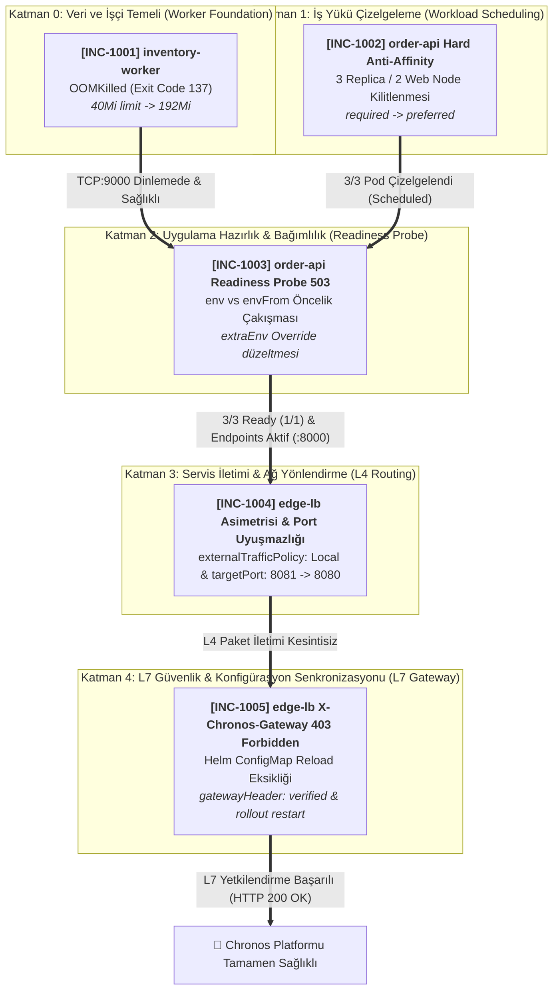

# 🚨 SRE Incident Lab 10: Chronos — Distributed Order Fulfillment & Real-Time Inventory Coordination Incident Triage

This workspace serves as the active **Incident Triage War Room** during a catastrophic production deployment failure of **Chronos**, an enterprise distributed order fulfillment and real-time inventory coordination platform.

The platform is deployed using native, parametric Helm charts alongside core declarative Kubernetes manifests. While all manifests and Helm charts are **syntactically valid** and accepted by the Kubernetes API server (`./setup.sh` executes with exit code 0), the system experiences cascading runtime outages: the inventory worker crashes immediately under kernel memory pressure, order processing pods deadlock on cluster scheduling constraints and fail health checks, cluster ingress drops client connections asymmetrically, and external orders are rejected with HTTP 403 Forbidden.

Your mission: triage and remediate the incident tickets **in strictly sequential (linear, bottom-up) order**, perform systematic root cause analysis (RCA) based on telemetry and runtime symptoms, and satisfy the **Success Criteria** for each ticket before moving to the next.

> 📖 **Post-Mortem & Deep Root Cause Analyses (RCA):**  
> 👉 **[Explore Senior SRE Post-Mortem Guide (SOLUTION.md)](./SOLUTION.md)** — *Attempt resolution on your own before consulting the guide!*

---

## 🗺️ Cluster Topology & Infrastructure Constraints

The incident scenario is grounded strictly in the following 3-node cluster topology:

| Node Name | Internal IP | Label | Constraint / Taint | Allocated Tier Role |
| :--- | :--- | :--- | :--- | :--- |
| **Node-1** | `10.0.10.122` | `tier=web` | *None* | Web / API / Ingress Gateway Workloads |
| **Node-2** | `10.0.10.208` | `tier=web` | *None* | Web / API / Ingress Gateway Workloads |
| **Node-3** | `10.0.10.78` | `tier=database` | `workload=database:NoSchedule` | Database Tier (Isolated) |

* **Target Namespace:** `chronos-prod`
* **StorageClass:** `oci-bv` (Oracle Block Volume CSI, `ReadWriteOnce`)
* **Default Ingress / Gateway Service:** `edge-lb` (LoadBalancer / NodePort on port 80 -> containerPort 8080)
* **Core Architecture Stack:**
  1. `state-db`: PostgreSQL 16 StatefulSet (`1/1`, Headless Service :5432, Node-3, oci-bv PVC, subPath: pgdata — **100% Healthy & Pre-configured**)
  2. `inventory-worker`: Python In-Memory Inventory Catalog Worker (`1/1`, ClusterIP Service :9000, Node-1/Node-2 web pool)
  3. `order-api`: Python High-Frequency Order Intake Engine (3 Replicas via Helm, `1/1`, ClusterIP Service :80 -> :8000, Node-1/Node-2 web pool)
  4. `edge-lb`: Nginx Reverse Proxy & Load Balancer (`1/1` via Helm, LoadBalancer :80 -> :8080)

> [!IMPORTANT]
> **Architectural Guarantees & Constraints:**
> 1. **Healthy Stateful Foundation:** Previous storage traps (`oci-bv` RWX vs RWO, Postgres `lost+found`) are resolved out of the box in `10-state-db.yaml`. The database starts `1/1 Running` on Node-3 immediately.
> 2. **Strict Bottom-Up Linear Chain:** Lower-layer service sockets are strict prerequisites for upper-layer readiness. `order-api` cannot pass `/ready` without `inventory-worker:9000`, and `edge-lb` cannot route traffic without healthy `order-api:80` endpoints.
> 3. **Helm & Declarative Workflow:** Workload updates must be applied cleanly through Helm values (`helm-values/order-api-prod.yaml`, `helm-values/edge-lb-prod.yaml`) and manifests (`manifests/20-inventory-worker.yaml`).
> 4. **Zero RBAC / Zero Sidecars:** No custom ServiceAccounts, token mounts, or multi-container pods exist. Every pod has strictly 1 application container (`1/1`).

---

## 🚀 Environment Initialization (Deploying the Broken Platform)

Execute the bundled setup script to deploy the initial broken production state:

```bash
./setup.sh
```

Or execute the deployment steps manually:

```bash
# 1. Ensure target namespace exists
kubectl create namespace chronos-prod --dry-run=client -o yaml | kubectl apply -f -

# 2. Deploy core manifests (state-db and inventory-worker)
kubectl apply -f manifests/

# 3. Deploy order-api and edge-lb Helm releases
helm upgrade --install order-api ./charts/order-api -f helm-values/order-api-prod.yaml -n chronos-prod
helm upgrade --install edge-lb ./charts/edge-lb -f helm-values/edge-lb-prod.yaml -n chronos-prod
```

Inspect the initial broken state across the namespace:

```bash
kubectl get pods,svc,endpoints,pvc -n chronos-prod -o wide
kubectl get events -n chronos-prod --sort-by=.lastTimestamp
```

---

## 📋 On-Call SRE Incident Board

Tickets are strictly ordered in a **bottom-up linear dependency chain**. Resolve them sequentially.



---

### [INC-1001 / INC-901] inventory-worker Crashing with OOMKilled (Exit Code 137)
* **Priority:** `P1 - Blocker`
* **Alert (Prometheus / Alertmanager):**
  > `[CRITICAL] KubePodCrashLooping: chronos-prod/inventory-worker pod has terminated with Exit Code 137.`
* **Symptoms:**
  * `state-db-0` is completely healthy (`1/1 Running` on Node-3). However, `inventory-worker` terminates repeatedly seconds after starting up.
  * Application logs show initialization banners (`Loading in-memory inventory stock catalog...`), but zero Python exception stack traces. The process vanishes abruptly.
  * `kubectl get pods -n chronos-prod` displays `CrashLoopBackOff` with restart counts climbing steadily.
  * Pod inspection reveals `Last State: Terminated, Reason: OOMKilled, Exit Code: 137`.
* **Success Criteria & Verification:**
  ```bash
  # 1. Pod must achieve Running state with 1/1 Ready and stop restarting
  kubectl get pod -l app.kubernetes.io/name=inventory-worker -n chronos-prod -o wide
  # Expected: STATUS Running, READY 1/1, RESTARTS stopped

  # 2. Worker must respond on TCP port 9000
  kubectl exec -n chronos-prod deploy/inventory-worker -- nc -zv 127.0.0.1 9000
  # Expected: 127.0.0.1 (9000) open

  # 3. inventory-worker Service must point to the healthy pod IP
  kubectl get endpoints inventory-worker -n chronos-prod
  # Expected: ENDPOINTS contains <POD_IP>:9000
  ```

---

### [INC-1002 / INC-902] order-api Pod Pending Due to Hard PodAntiAffinity Deadlock
* **Priority:** `P1 - Blocker`
* **Alert (Prometheus / Alertmanager):**
  > `[CRITICAL] KubeDeploymentReplicasMismatch: Deployment chronos-prod/order-api has 2/3 desired pods scheduled.`
* **Symptoms:**
  * `order-api` Deployment desires 3 replicas. 2 pods are scheduled and running across `Node-1` and `Node-2`.
  * The 3rd pod remains permanently trapped in `Pending` state (`NODE: <none>`).
  * `kubectl describe pod` on the pending pod reports `FailedScheduling` events citing that nodes failed to match pod anti-affinity rules.
  * Cluster topology provides only 2 dedicated web nodes (`tier=web`), making 3 hard anti-affinity replicas mathematically impossible to schedule.
* **Success Criteria & Verification:**
  ```bash
  # 1. All 3 order-api replicas must be scheduled across the web nodes
  kubectl get pods -l app.kubernetes.io/name=order-api -n chronos-prod -o wide
  # Expected: Exactly 3 pods in STATUS Running (or transitioning to Running), NODE assigned to Node-1 or Node-2

  # 2. Deployment rollout status must report successful completion
  kubectl rollout status deployment/order-api -n chronos-prod --timeout=45s
  # Expected: deployment "order-api" successfully rolled out

  # Note: The pods will show 0/1 READY.
  # This is the expected bridge to INC-1003 (readiness probe depends on application configuration).
  ```

---

### [INC-1003 / INC-903] order-api Readiness Probe 503 & Environment Variable Precedence Conflict
* **Priority:** `P1 - Blocker`
* **Alert (Prometheus / Alertmanager):**
  > `[CRITICAL] KubeEndpointSliceEmpty: Service chronos-prod/order-api has 0 available endpoints.`
* **Symptoms:**
  * All 3 `order-api` pods are in `Running` state without container restarts, yet all 3 report `0/1 Ready`.
  * `kubectl describe pod` logs repeated warnings: `Readiness probe failed: HTTP probe failed with statuscode: 503`.
  * Inspecting the `order-api-config` ConfigMap shows `INVENTORY_HOST: "inventory-worker"` which looks 100% correct!
  * Yet inspecting the running container's environment (`kubectl exec ... -- env`) reveals the process is using a conflicting host address injected via an overriding configuration block.
  * The Kubernetes `Endpoints` list for `order-api` remains empty (`<none>`), blackholing internal cluster traffic.
* **Success Criteria & Verification:**
  ```bash
  # 1. All 3 replicas must achieve 1/1 Ready
  kubectl get pods -l app.kubernetes.io/name=order-api -n chronos-prod
  # Expected: 3/3 pods in READY 1/1, STATUS Running

  # 2. Service Endpoints must contain all 3 active Pod IPs
  kubectl get endpoints order-api -n chronos-prod
  # Expected: ENDPOINTS contains 3 distinct IP addresses on port 8000

  # 3. Direct probe to /ready must return HTTP 200 with all dependencies connected
  kubectl exec -n chronos-prod deploy/order-api -c order-api -- python -c "
  import urllib.request, json
  res = urllib.request.urlopen('http://localhost:8000/ready')
  print(json.loads(res.read().decode()))
  "
  # Expected: {'status': 'ready', 'database': 'connected', 'inventory': 'connected'}
  ```

---

### [INC-1004 / INC-904] edge-lb Asymmetric Traffic Blackholing & Port Mismatch
* **Priority:** `P1 - Blocker`
* **Alert (Prometheus / Alertmanager):**
  > `[CRITICAL] IngressTrafficDrop: edge-lb external ingress dropping client connections or returning connection refused.`
* **Symptoms:**
  * `edge-lb` is deployed as a single replica (`replicaCount: 1`) on only one web node, yet the Service specifies `externalTrafficPolicy: Local`. Traffic hitting the second web node is dropped by `kube-proxy` without being routed to the healthy pod.
  * Direct client requests to the load balancer fail with connection refused because the Service forwards traffic to `targetPort: 8081`, while Nginx inside the container listens strictly on port `8080`.
* **Success Criteria & Verification:**
  ```bash
  # 1. Ingress Service policy must allow multi-node routing (or have full replica coverage)
  kubectl get svc edge-lb -n chronos-prod -o jsonpath='{.spec.externalTrafficPolicy}'
  # Expected: Cluster (or replicaCount set to 2)

  # 2. Ingress targetPort must match the Nginx listener port (8080)
  kubectl get svc edge-lb -n chronos-prod -o jsonpath='{.spec.ports[0].targetPort}'
  # Expected: 8080

  # 3. Healthz probe through edge-lb Service must return HTTP 200 OK
  kubectl exec -n chronos-prod deploy/edge-lb -- wget -qO- http://localhost:8080/healthz
  # Expected: OK
  ```

---

### [INC-1005 / INC-905] edge-lb Gateway Header 403 Forbidden & Helm ConfigMap Rollout Trap
* **Priority:** `P1 - Blocker`
* **Alert (Prometheus / Alertmanager):**
  > `[CRITICAL] GatewaySecurityRejection: chronos-prod/edge-lb requests rejected with HTTP 403 Forbidden.`
* **Symptoms:**
  * Ingress health check `/healthz` succeeds with `200 OK`. However, requests to `/api/v1/orders` return `HTTP 403 Forbidden: {"error": "untrusted proxy: missing X-Chronos-Gateway header"}`.
  * Upstream `order-api` enforces edge security validation and drops requests without the verified gateway signature.
  * Updating Helm values alone (`gatewayHeader: "verified"`) and running `helm upgrade` does not fix the issue! The running Nginx container continues serving the stale configuration because Kubernetes does not trigger a rollout when only a ConfigMap changes.
* **Success Criteria & Verification:**
  ```bash
  # 1. Verify proxy configuration inside edge-lb container includes the verified header
  kubectl exec -n chronos-prod deploy/edge-lb -- grep -i "X-Chronos-Gateway" /etc/nginx/nginx.conf
  # Expected: proxy_set_header X-Chronos-Gateway "verified";

  # 2. Full end-to-end order processing endpoint through edge-lb must return HTTP 200 OK
  kubectl exec -n chronos-prod deploy/edge-lb -- wget -qO- http://localhost:8080/api/v1/orders
  # Expected Output:
  # {
  #   "status": "success",
  #   "orders": [
  #     {"order_id": "ORD-7701", "customer": "chronos-client", "status": "confirmed", ...}
  #   ]
  # }
  ```

---

## 🏁 End-to-End Production Verification Checklist (Bottom-Up)

Execute this comprehensive audit script once all tickets are remediated:

```bash
#!/usr/bin/env bash
set -euo pipefail

NS="chronos-prod"
echo "========================================================"
echo "  Chronos Platform SRE Production Health Check Audit"
echo "========================================================"

echo "--> 1. Verifying Cluster Topology & Node Assignments..."
kubectl get nodes -L tier
kubectl get pods -n $NS -o wide

echo "--> 2. Verifying Layer 0: Stateful Backends & Workers..."
kubectl get pvc -n $NS
kubectl exec -n $NS state-db-0 -- pg_isready -U chronos_admin -d chronos
kubectl exec -n $NS deploy/inventory-worker -- nc -zv 127.0.0.1 9000
kubectl get endpoints state-db inventory-worker -n $NS

echo "--> 3. Verifying Layer 1 & 2: order-api Scheduling & Readiness..."
kubectl get deployment order-api -n $NS
READY_REPLICAS=$(kubectl get deployment order-api -n $NS -o jsonpath='{.status.readyReplicas}')
if [ "$READY_REPLICAS" -ne 3 ]; then
  echo "[-] FAILURE: Expected 3 ready replicas, got ${READY_REPLICAS}"
  exit 1
fi
echo "[+] All 3 order-api pods are 1/1 Ready."
kubectl get endpoints order-api -n $NS
kubectl exec -n $NS deploy/order-api -c order-api -- wget -qO- http://localhost:8000/ready

echo "--> 4. Verifying Layer 3 & 4: edge-lb Delivery & L7 Authorization..."
kubectl get svc edge-lb -n $NS
kubectl exec -n $NS deploy/edge-lb -- wget -qO- http://localhost:8080/healthz
kubectl exec -n $NS deploy/edge-lb -- wget -qO- http://localhost:8080/api/v1/orders

echo "========================================================"
echo "  🎉 ALL CHRONOS SYSTEM AUDITS PASSED - PLATFORM OPERATIONAL"
echo "========================================================"
```

---

## 🧹 Cleanup Instructions

To completely purge the lab environment:

```bash
helm uninstall order-api -n chronos-prod --ignore-not-found
helm uninstall edge-lb -n chronos-prod --ignore-not-found
kubectl delete pvc data-state-db-0 -n chronos-prod --ignore-not-found
kubectl delete namespace chronos-prod --ignore-not-found
```

---

<br>

---

## 🇹🇷 Türkçe Dokümantasyon / Turkish Version

# 🚨 SRE Incident Lab 10: Chronos — Dağıtık Sipariş ve Gerçek Zamanlı Stok Platformu

Bu çalışma alanı, kurumsal sipariş işleme ve gerçek zamanlı stok koordinasyon platformu **Chronos**'un canlıya geçiş (production rollout) aşamasında yaşanan kritik arızalar için kurulan **Incident War Room**'dur.

Sistem, saf Kubernetes manifestoları ve Helm chart'ları ile dağıtılmıştır. Uygulanan tüm tanımlar **şema açısından %100 geçerlidir** ve Kubernetes API sunucusu tarafından hiçbir sözdizimi hatası olmadan kabul edilmiştir (`./setup.sh` sıfır hata ile tamamlanır). Ancak çalışma zamanında platform tamamen çökmüş durumdadır: stok worker'ı bellek baskısı altında log bırakmadan ölür, API pod'ları zamanlama kuralları ve hazırlık testlerinde takılır, dış yük dengeleyici trafiği asimetrik olarak düşürür ve API çağrıları 403 Forbidden ile reddedilir.

Göreviniz: ticket'ları **aşağıdan yukarıya (bottom-up), kesinlikle sıralı ve doğrusal** olarak çözmek, sistem telemetrisi ve loglardan kök neden analizi (RCA) yapmak ve her ticket'ın **Başarı Kriteri**'ni sağladıktan sonra bir sonrakine geçmektir.

> 📖 **Post-Mortem & Detaylı Kök Neden Analizleri (RCA):**  
> 👉 **[Kıdemli SRE Çözüm Rehberi (SOLUTION.md)](./SOLUTION.md)** — *Önce kendi mühendislik reflekslerinizle çözmeyi deneyin!*

---

### 🗺️ Küme Topolojisi ve Altyapı Kısıtları

Senaryo aşağıdaki 3 node'lu küme topolojisine dayanmaktadır:

| Node Adı | Dahili IP | Label | Kısıt / Taint | Tahsis Edilen Rol |
| :--- | :--- | :--- | :--- | :--- |
| **Node-1** | `10.0.10.122` | `tier=web` | *Yok* | Web / API / Ingress Gateway İş Yükleri |
| **Node-2** | `10.0.10.208` | `tier=web` | *Yok* | Web / API / Ingress Gateway İş Yükleri |
| **Node-3** | `10.0.10.78` | `tier=database` | `workload=database:NoSchedule` | Yalnızca Veritabanı (İzole) |

* **Hedef Namespace:** `chronos-prod`
* **Varsayılan StorageClass:** `oci-bv` (Oracle Block Volume CSI, `ReadWriteOnce`)
* **Dış Erişim / Gateway:** `edge-lb` Service (LoadBalancer :80 -> containerPort 8080)
* **Temel Mimari:**
  1. `state-db`: PostgreSQL 16 StatefulSet (`1/1`, Headless Service :5432, Node-3, oci-bv PVC, subPath: pgdata — **%100 Sağlam Başlar**)
  2. `inventory-worker`: Python In-Memory Stok Kataloğu Servisi (`1/1`, ClusterIP Service :9000, Node-1/Node-2 web havuzu)
  3. `order-api`: Python Yüksek Frekanslı Sipariş API'si (Helm ile 3 Replica, `1/1`, ClusterIP Service :80 -> :8000)
  4. `edge-lb`: Nginx Tersine Proxy & Yük Dengeleyici (Helm ile `1/1`, LoadBalancer :80 -> :8080)

> [!IMPORTANT]
> **Önemli Prensipler:**
> 1. **Eski Hatalar Yok:** `10-state-db.yaml` içinde `oci-bv` ve `subPath: pgdata` doğru ayarlanmıştır; veritabanı ilk saniyeden itibaren `1/1 Running` başlar.
> 2. **Sıfır RBAC / Sıfır Sidecar:** Sistemde kurgusal ServiceAccount veya yan konteyner yoktur. Her Pod'da tam 1 ana konteyner (`1/1`) çalışır.
> 3. **%100 Doğrusal Akış:** INC-1001'den INC-1005'e kadar her katman bir öncekinin üzerine inşa edilir.

---

### 🚀 Ortamın Başlatılması

Kurulum betiğini çalıştırın:

```bash
./setup.sh
```

İlk durumu gözlemleyin:

```bash
kubectl get pods,svc,endpoints,pvc -n chronos-prod -o wide
kubectl get events -n chronos-prod --sort-by=.lastTimestamp
```

---

### 📋 Nöbetçi SRE Olay Müdahale Panosu

#### [INC-1001 / INC-901] inventory-worker OOMKilled Çökmesi (Exit Code 137)
* **Öncelik:** `P1 - Blocker`
* **Alarm:**
  > `[CRITICAL] KubePodCrashLooping: chronos-prod/inventory-worker podu Exit Code 137 ile sonlandı.`
* **Semptomlar:**
  * `state-db-0` Node-3 üzerinde `1/1 Running` durumundadır. Ancak `inventory-worker` başladıktan birkaç saniye sonra çöker (`CrashLoopBackOff`).
  * Konteyner loglarında Python hata izi (traceback) yoktur; süreç sessizce kaybolur.
  * `kubectl describe pod` çıktısında `Last State: Terminated, Reason: OOMKilled, Exit Code: 137` görülür.
* **Başarı Kriteri & Doğrulama:**
  ```bash
  kubectl get pod -l app.kubernetes.io/name=inventory-worker -n chronos-prod -o wide
  # Beklenen: STATUS Running, READY 1/1, RESTARTS durmuş olmalı

  kubectl exec -n chronos-prod deploy/inventory-worker -- nc -zv 127.0.0.1 9000
  # Beklenen: 127.0.0.1 (9000) open

  kubectl get endpoints inventory-worker -n chronos-prod
  # Beklenen: ENDPOINTS altında <POD_IP>:9000 görünmeli
  ```

---

#### [INC-1002 / INC-902] order-api Hard PodAntiAffinity Kilitlenmesi
* **Öncelik:** `P1 - Blocker`
* **Alarm:**
  > `[CRITICAL] KubeDeploymentReplicasMismatch: chronos-prod/order-api istenen 3 replikanın yalnızca 2'si çalışıyor.`
* **Semptomlar:**
  * `order-api` 3 replica ister. 2 pod Node-1 ve Node-2'ye yerleşir. 3. pod kalıcı olarak `Pending` durumunda kalır (`NODE: <none>`).
  * `kubectl describe pod` çıktısında Scheduler'ın pod anti-affinity kuralını karşılayacak uygun node bulamadığı (`0/3 nodes available`) yazmaktadır.
* **Başarı Kriteri & Doğrulama:**
  ```bash
  kubectl get pods -l app.kubernetes.io/name=order-api -n chronos-prod -o wide
  # Beklenen: 3 pod'un tamamı Running (veya ilerleyen aşamada Ready), Node-1 ve Node-2'ye atanmış

  kubectl rollout status deployment/order-api -n chronos-prod --timeout=45s
  # Beklenen: deployment "order-api" successfully rolled out
  ```

---

#### [INC-1003 / INC-903] order-api Readiness 503 & Çevre Değişkeni Öncelik Çakışması
* **Öncelik:** `P1 - Blocker`
* **Alarm:**
  > `[CRITICAL] KubeEndpointSliceEmpty: order-api servisinin arkasında aktif endpoint bulunmuyor.`
* **Semptomlar:**
  * 3 pod da `Running` durumundadır ve çökmez, fakat `0/1 Ready` kalırlar.
  * `describe pod` çıktısında `Readiness probe failed with statuscode: 503` görülür.
  * `order-api-config` ConfigMap'inde adresler doğru yazmasına rağmen, çalışan konteyner içinde `env` komutu çalıştırıldığında `extraEnv` bloğundan gelen eski bir adresin ConfigMap'i ezdiği tespit edilir.
  * Servisin endpoint havuzu boştur (`<none>`).
* **Başarı Kriteri & Doğrulama:**
  ```bash
  kubectl get pods -l app.kubernetes.io/name=order-api -n chronos-prod
  # Beklenen: 3/3 pod READY 1/1, STATUS Running

  kubectl get endpoints order-api -n chronos-prod
  # Beklenen: ENDPOINTS altında 8000 portunda 3 Pod IP'si görünmeli

  kubectl exec -n chronos-prod deploy/order-api -c order-api -- wget -qO- http://localhost:8000/ready
  # Beklenen: {"status": "ready", "database": "connected", "inventory": "connected"}
  ```

---

#### [INC-1004 / INC-904] edge-lb Asimetrik Trafik Kaybı & Port Uyuşmazlığı
* **Öncelik:** `P1 - Blocker`
* **Alarm:**
  > `[CRITICAL] IngressTrafficDrop: edge-lb servis bağlantıları asimetrik olarak düşürülüyor.`
* **Semptomlar:**
  * Tek replikalı `edge-lb` üzerinde `externalTrafficPolicy: Local` açıktır; pod'un bulunmadığı node'a gelen trafik düşürülür.
  * Yük dengeleyici servisi `targetPort: 8081`'e paket gönderirken Nginx içeride 8080 portunu dinlemektedir (bağlantı reddedilir).
* **Başarı Kriteri & Doğrulama:**
  ```bash
  kubectl get svc edge-lb -n chronos-prod -o jsonpath='{.spec.externalTrafficPolicy}'
  # Beklenen: Cluster (veya replicaCount: 2)

  kubectl get svc edge-lb -n chronos-prod -o jsonpath='{.spec.ports[0].targetPort}'
  # Beklenen: 8080

  kubectl exec -n chronos-prod deploy/edge-lb -- wget -qO- http://localhost:8080/healthz
  # Beklenen: OK
  ```

---

#### [INC-1005 / INC-905] edge-lb Gateway Header 403 Forbidden & ConfigMap Reload Tuzağı
* **Öncelik:** `P1 - Blocker`
* **Alarm:**
  > `[CRITICAL] GatewaySecurityRejection: chronos-prod/edge-lb istekleri HTTP 403 Forbidden ile reddediliyor.`
* **Semptomlar:**
  * `/healthz` HTTP 200 dönerken, `/api/v1/orders` rotası `HTTP 403 Forbidden: {"error": "untrusted proxy: missing X-Chronos-Gateway header"}` yanıtı verir.
  * Helm değerlerinde `gatewayHeader: "verified"` yapılıp `helm upgrade` çalıştırılsa bile pod'lar restart olmadığı için Nginx eski konfigürasyonu çalıştırmaya devam eder.
* **Başarı Kriteri & Doğrulama:**
  ```bash
  kubectl exec -n chronos-prod deploy/edge-lb -- grep -i "X-Chronos-Gateway" /etc/nginx/nginx.conf
  # Beklenen: proxy_set_header X-Chronos-Gateway "verified";

  kubectl exec -n chronos-prod deploy/edge-lb -- wget -qO- http://localhost:8080/api/v1/orders
  # Beklenen: HTTP 200 OK ve sipariş JSON çıktısı
  ```

---

### 🏁 Uçtan Uca Doğrulama

Tüm biletleri tamamladıktan sonra terminalden sipariş servisini sorgulayın:

```bash
kubectl exec -n chronos-prod deploy/edge-lb -- wget -qO- http://localhost:8080/api/v1/orders
```

aaa
