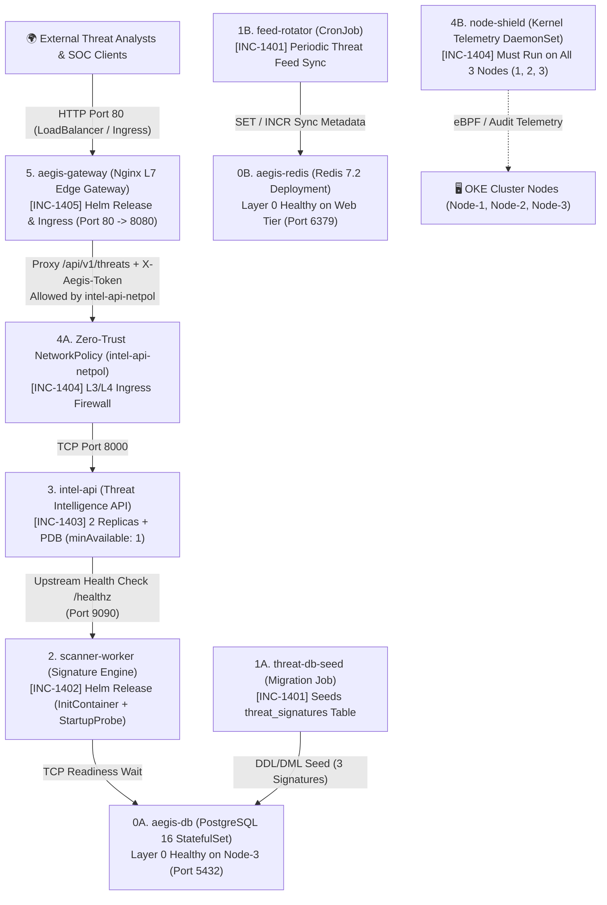
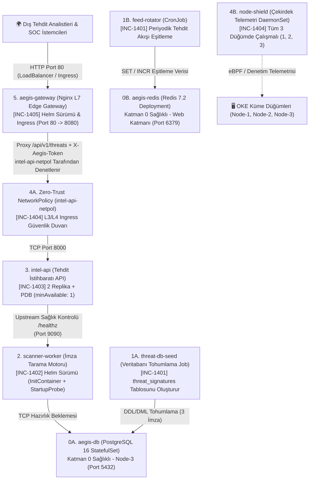

# 🇬🇧 English Version

# 🚨 SRE Incident Lab 14: AegisGrid — Distributed Threat Intelligence & Security Telemetry Platform Outage

Welcome to **SRE Incident Lab 14**. This workspace serves as the active **Incident Triage War Room** during a high-severity production outage of **AegisGrid**, an enterprise distributed threat intelligence, malware signature scanning, and security telemetry platform running in the `aegis-prod` namespace on an Oracle Cloud Kubernetes Engine (OKE) cluster.

All Kubernetes manifests and Helm charts deployed to the cluster are **syntactically valid** and accepted by the Kubernetes API server and Helm engine (`./setup.sh` exits with code `0`). However, at runtime the platform suffers from a multi-layer cascading outage across the batch ingestion, signature scanning, threat intelligence API, zero-trust network policy, node-level security daemon, and edge API gateway layers.

Your mission as the Lead On-Call SRE is to triage and remediate the incident tickets **in strictly sequential (bottom-up) order** from **INC-1401** to **INC-1405**, gather runtime evidence using `kubectl` and `helm`, and pass every verification check before moving to the next layer.

> 📖 **Post-Mortem & Deep Root Cause Analyses (RCA):**  
> 👉 **[Explore Principal SRE Post-Mortem Guide (SOLUTION.md)](./SOLUTION.md)** — *Attempt resolution on your own before consulting the guide!*

---

## 🗺️ Cluster Topology & Infrastructure Constraints

The incident scenario is grounded in the following 3-node OKE cluster topology:

| Node Name | Internal IP | Label | Taint / Constraint | Allocated Tier Role |
| :--- | :--- | :--- | :--- | :--- |
| **Node-1** | `10.0.10.122` | `tier=web` | *None* | Web / API / Edge Gateway / Scanner Workers / Batch Jobs |
| **Node-2** | `10.0.10.208` | `tier=web` | *None* | Web / API / Edge Gateway / Scanner Workers / Batch Jobs |
| **Node-3** | `10.0.10.78` | `tier=database` | `workload=database:NoSchedule` | Isolated Stateful Database Tier (+ Cluster-Wide Security DaemonSet) |

* **Target Namespace:** `aegis-prod`
* **Default StorageClass:** `oci-bv` (Oracle Block Volume CSI, `ReadWriteOnce`, `subPath: pgdata`)
* **Layer 0 (Healthy Stateful Foundation — `manifests/10-core-infra.yaml`):**
  1. `aegis-db`: PostgreSQL 16 StatefulSet (`1/1 Running` on **Node-3**, ClusterIP Service `:5432`, user `aegis_admin`, database `aegis_intel`, credentials stored in `Secret/aegis-db-secret`).
  2. `aegis-redis`: Redis 7.2 Deployment (`1/1 Running` on **Web Tier**, ClusterIP Service `:6379`).

---

## 📂 Workspace Directory Structure

```text
k8-troubleshoot-14/
├── README.md                              # On-Call Incident Board & Triage Runbook (Zero Spoilers)
├── SOLUTION.md                            # Principal SRE Post-Mortem & Step-by-Step RCA Guide
├── setup.sh                               # Automated Outage Simulation Provisioning Script
├── manifests/
│   ├── 00-namespace.yaml                  # Target namespace (aegis-prod)
│   ├── 10-core-infra.yaml                 # Layer 0: Healthy PostgreSQL 16 (aegis-db) & Redis 7.2 (aegis-redis)
│   ├── 20-feed-jobs.yaml                  # [INC-1401] Threat DB Seed Job & Feed Rotator CronJob
│   ├── 30-intel-api.yaml                  # [INC-1403] Intel API Deployment, Service, ConfigMap & PDB
│   ├── 40-security-and-daemon.yaml        # [INC-1404] Zero-Trust NetworkPolicy & node-shield DaemonSet
│   └── 50-ingress.yaml                    # [INC-1405] Kubernetes Ingress Resource (aegis-ingress)
├── charts/
│   ├── scanner-worker/                    # [INC-1402] Helm Chart for Signature Scanner Worker
│   │   ├── Chart.yaml
│   │   ├── values.yaml
│   │   └── templates/
│   │       ├── configmap.yaml
│   │       ├── deployment.yaml
│   │       └── service.yaml
│   └── aegis-gateway/                     # [INC-1405] Helm Chart for Edge API Gateway
│       ├── Chart.yaml
│       ├── values.yaml
│       └── templates/
│           ├── configmap.yaml
│           ├── deployment.yaml
│           └── service.yaml
└── helm-values/
    ├── scanner-prod.yaml                  # [INC-1402] Production Helm overrides for scanner-worker
    └── gateway-prod.yaml                  # [INC-1405] Production Helm overrides for aegis-gateway
```

---

## 🏗️ Production Architecture & Cascading Dependency Graph



---

## ⚡ Quick Start: Environment Provisioning

Deploy the faulty production state using the automated setup script:

```bash
cd /home/ysf/k8sfundamentals/k8-troubleshoot-14
./setup.sh
```

Inspect the initial cluster status in `aegis-prod`:

```bash
kubectl get pods,jobs,cronjobs,ds,svc,pdb,netpol,ingress -n aegis-prod -o wide
```

> [!IMPORTANT]
> **Remote `kubectl` Client Rule (OKE Bastion / Local Workstation):**  
> Never execute `curl http://<CLUSTER_IP>` directly from your host shell, as Kubernetes `ClusterIP` addresses are virtual IPs routed only inside the cluster CNI network. Always use `kubectl exec -n aegis-prod ...` for internal checks, or query the external LoadBalancer IP (`EXTERNAL-IP`) of `svc/aegis-gateway` once provisioned.

---

## 📋 On-Call Incident Board (Active P1 / P2 Tickets)

| Ticket ID | Impacted Component | Kubernetes / Helm Object | Observed Symptom | Suspected File / Layer | Severity |
| :--- | :--- | :--- | :--- | :--- | :--- |
| **[INC-1401]** | `threat-db-seed` & `feed-rotator` | `Job` & `CronJob` | `threat-db-seed` pod stuck in `CreateContainerConfigError` (`0/1` Completed); `feed-rotator` CronJob suspended and fails cache sync. | `manifests/20-feed-jobs.yaml` | `P1 - Blocker` |
| **[INC-1402]** | `scanner-worker` | Helm Release (`Deployment`) | Pod stuck in `Init:0/1` waiting on DB; once init passes, container loops in `CrashLoopBackOff` (`Startup probe failed`). | `helm-values/scanner-prod.yaml` & `charts/scanner-worker/` | `P1 - Blocker` |
| **[INC-1403]** | `intel-api` | `Deployment`, `ConfigMap`, `PDB` | Pods `Running` (`0/1 Ready`) with `connection refused` on readiness probe, followed by `HTTP 503` on upstream scanner check. | `manifests/30-intel-api.yaml` | `P1 - Blocker` |
| **[INC-1404]** | `intel-api-netpol` & `node-shield` | `NetworkPolicy` & `DaemonSet` | Gateway requests to `intel-api` time out (`wget: download timed out`); `node-shield` DaemonSet only runs on `2/3` nodes (missing Node-3). | `manifests/40-security-and-daemon.yaml` | `P1 - Blocker` |
| **[INC-1405]** | `aegis-gateway` & `aegis-ingress` | Helm Release (`Deployment`, `ConfigMap`) & `Ingress` | Requests to `/api/v1/threats` return `502 Bad Gateway`, then `403 Forbidden` (`untrusted proxy`), and ConfigMap reload lags. | `helm-values/gateway-prod.yaml` & `manifests/50-ingress.yaml` | `P1 - Blocker` |

---

## 🔍 Incident Triage & Verification Playbook

Resolve each ticket in order from **INC-1401** to **INC-1405**.

---

### [INC-1401] Threat Feed Seed Job & CronJob Schedule Failure

* **Priority:** `P1 - Blocker`
* **Alert (PagerDuty / Alertmanager):**
  > `[CRITICAL] BatchSeedFailure: aegis-prod/threat-db-seed failed pre-start config creation; aegis-prod/feed-rotator schedule is suspended.`
* **Observed Symptoms:**
  * The database initialization Job `threat-db-seed` never reaches `Completed` (`COMPLETIONS: 0/1`); its pod is stuck in `CreateContainerConfigError`.
  * Downstream services querying PostgreSQL (`aegis-db`) find that the `threat_signatures` table does not exist.
  * The periodic threat feed rotation CronJob `feed-rotator` displays `SUSPEND: True`, and any manually spawned job from this CronJob fails to resolve the Redis cache hostname.
* **Suspected Components:**
  * `manifests/20-feed-jobs.yaml` (`Job/threat-db-seed`, `CronJob/feed-rotator`)
  * `manifests/10-core-infra.yaml` (`Secret/aegis-db-secret`, `Service/aegis-redis`)
* **Triage Commands (Before Fix):**
  ```bash
  # 1. Check Job, CronJob, and batch pod states
  kubectl get job,cronjob -n aegis-prod
  kubectl get pods -n aegis-prod -l app.kubernetes.io/name=threat-db-seed

  # 2. Inspect the exact Kubelet config error on the threat-db-seed pod
  kubectl describe pod -n aegis-prod -l app.kubernetes.io/name=threat-db-seed | grep -A 8 "Events:"

  # 3. Compare available keys inside aegis-db-secret and active Services in aegis-prod
  kubectl get secret aegis-db-secret -n aegis-prod -o jsonpath='{.data}' && echo ""
  kubectl get svc -n aegis-prod
  ```
* **Verification Commands (After Fix):**
  ```bash
  # 1. Verify threat-db-seed Job completed (1/1)
  kubectl get job threat-db-seed -n aegis-prod

  # 2. Verify PostgreSQL threat_signatures table contains exactly 3 rows
  kubectl exec -n aegis-prod aegis-db-0 -- psql -U aegis_admin -d aegis_intel -tAc "SELECT count(*) FROM threat_signatures;"

  # 3. Verify feed-rotator CronJob is unsuspended (SUSPEND: False)
  kubectl get cronjob feed-rotator -n aegis-prod

  # 4. Trigger a manual job from feed-rotator and wait for completion
  kubectl create job --from=cronjob/feed-rotator manual-feed-sync -n aegis-prod && kubectl wait --for=condition=complete job/manual-feed-sync -n aegis-prod --timeout=30s
  ```

---

### [INC-1402] Scanner Worker Stuck in Init:0/1 & Failing Startup Probe

* **Priority:** `P1 - Blocker`
* **Alert (PagerDuty / Alertmanager):**
  > `[CRITICAL] ScannerWorkerDown: aegis-prod/scanner-worker pod trapped in Init:0/1 and subsequently killed by Kubelet startupProbe.`
* **Observed Symptoms:**
  * `scanner-worker` pod remains stuck in `Init:0/1` status (`wait-for-db` init container loops indefinitely waiting for database connectivity).
  * Once the init container passes, the main `scanner` container takes ~6 seconds to load threat signatures into memory before binding port `9090`, but Kubelet kills the container after 4 seconds (`Startup probe failed` -> `CrashLoopBackOff`).
* **Suspected Components:**
  * `helm-values/scanner-prod.yaml`
  * `charts/scanner-worker/templates/deployment.yaml` & `charts/scanner-worker/templates/configmap.yaml`
* **Triage Commands (Before Fix):**
  ```bash
  # 1. Check scanner-worker pod status
  kubectl get pods -n aegis-prod -l app.kubernetes.io/name=scanner-worker

  # 2. Check logs of the blocking init container
  kubectl logs -n aegis-prod deploy/scanner-worker -c wait-for-db --tail=20

  # 3. Inspect active Helm release override values and rendered template
  helm get values scanner-worker -n aegis-prod
  kubectl describe pod -n aegis-prod -l app.kubernetes.io/name=scanner-worker | grep -A 12 "Events:"
  ```
* **Verification Commands (After Fix):**
  ```bash
  # 1. Wait for scanner-worker rollout to succeed
  kubectl rollout status deploy/scanner-worker -n aegis-prod --timeout=45s

  # 2. Verify in-cluster health endpoint on port 9090
  kubectl exec -n aegis-prod deploy/scanner-worker -- python3 -c "import urllib.request; print(urllib.request.urlopen('http://localhost:9090/healthz').read().decode())"
  ```

---

### [INC-1403] Intel API Readiness Probe Port & Upstream Service Discovery

* **Priority:** `P1 - Blocker`
* **Alert (PagerDuty / Alertmanager):**
  > `[CRITICAL] ServiceEndpointsEmpty: aegis-prod/intel-api has 0 ready replicas; PodDisruptionBudget disruptionsAllowed=0.`
* **Observed Symptoms:**
  * Both `intel-api` replicas show `STATUS: Running` (`RESTARTS: 0`), yet remain stuck at `READY: 0/1`.
  * `kubectl describe pod` shows `Readiness probe failed: Get "http://...:8080/ready": dial tcp ...:8080: connect: connection refused`.
  * After aligning the readiness probe port with the container's actual listening port (`8000`), the `/ready` endpoint returns `HTTP 503 Service Unavailable` because it cannot reach the upstream scanner worker hostname configured in `intel-api-config`.
* **Suspected Components:**
  * `manifests/30-intel-api.yaml` (`ConfigMap/intel-api-config`, `Deployment/intel-api`)
* **Triage Commands (Before Fix):**
  ```bash
  # 1. Check intel-api pods, service endpoints, and PDB status
  kubectl get pods,svc,endpoints,pdb -n aegis-prod -l app.kubernetes.io/name=intel-api

  # 2. Inspect pod readiness probe definition and failure events
  kubectl describe pod -n aegis-prod -l app.kubernetes.io/name=intel-api | grep -A 10 "Readiness:"
  kubectl describe pod -n aegis-prod -l app.kubernetes.io/name=intel-api | grep -A 10 "Events:"

  # 3. Inspect ConfigMap environment variables vs actual Service names
  kubectl get configmap intel-api-config -n aegis-prod -o yaml
  kubectl get svc -n aegis-prod
  ```
* **Verification Commands (After Fix):**
  ```bash
  # 1. Wait for intel-api Deployment rollout to complete (2/2 Ready)
  kubectl rollout status deploy/intel-api -n aegis-prod --timeout=45s

  # 2. Verify /ready endpoint returns HTTP 200 JSON from inside the pod
  kubectl exec -n aegis-prod deploy/intel-api -- python3 -c "import urllib.request; print(urllib.request.urlopen('http://localhost:8000/ready').read().decode())"
  ```

---

### [INC-1404] Zero-Trust NetworkPolicy Packet Drop & Node-Shield DaemonSet Toleration

* **Priority:** `P1 - Blocker`
* **Alert (PagerDuty / Alertmanager):**
  > `[CRITICAL] ZeroTrustDrop & NodeCoverageGap: Traffic from aegis-gateway to intel-api drops silently; node-shield missing on database node.`
* **Observed Symptoms:**
  * `intel-api` is `2/2 Ready` when tested locally inside its own container, but any request from `aegis-gateway` to `http://intel-api:8000/ready` hangs until socket timeout (`wget: download timed out`).
  * The cluster-wide security telemetry DaemonSet `node-shield` shows `DESIRED: 2, CURRENT: 2, READY: 2` instead of `3`, leaving `Node-3` (`tier=database`) unmonitored.
* **Suspected Components:**
  * `manifests/40-security-and-daemon.yaml` (`NetworkPolicy/intel-api-netpol`, `DaemonSet/node-shield`)
* **Triage Commands (Before Fix):**
  ```bash
  # 1. Reproduce the network timeout from aegis-gateway to intel-api
  kubectl exec -n aegis-prod deploy/aegis-gateway -- wget -qO- -T 3 http://intel-api:8000/ready || true

  # 2. Inspect NetworkPolicy rules and compare against aegis-gateway pod labels
  kubectl get networkpolicy intel-api-netpol -n aegis-prod -o yaml
  kubectl get pods -n aegis-prod -l app.kubernetes.io/name=aegis-gateway --show-labels

  # 3. Inspect DaemonSet status and node taints across the 3-node cluster
  kubectl get ds node-shield -n aegis-prod
  kubectl get nodes -o custom-columns=NAME:.metadata.name,TIER:.metadata.labels.tier,TAINTS:.spec.taints
  ```
* **Verification Commands (After Fix):**
  ```bash
  # 1. Verify node-shield DaemonSet is scheduled and Ready across all 3 nodes
  kubectl get ds node-shield -n aegis-prod

  # 2. Verify aegis-gateway can reach intel-api:8000/ready across the NetworkPolicy
  kubectl exec -n aegis-prod deploy/aegis-gateway -- wget -qO- -T 3 http://intel-api:8000/ready
  ```

---

### [INC-1405] Edge Gateway 502 Bad Gateway, 403 Token Rejection & ConfigMap Reload

* **Priority:** `P1 - Blocker`
* **Alert (PagerDuty / Alertmanager):**
  > `[CRITICAL] EdgeGatewayFailure: aegis-gateway returning 502 Bad Gateway and 403 Forbidden on /api/v1/threats.`
* **Observed Symptoms:**
  * Calling `http://localhost:8080/api/v1/threats` on `aegis-gateway` returns `502 Bad Gateway` because Nginx proxies to an incorrect upstream port on `intel-api`.
  * Once the upstream port is corrected, requests return `403 Forbidden` (`{"error": "untrusted proxy: invalid or missing X-Aegis-Token header"}`) because the gateway injects an outdated security token header.
  * Updating `helm-values/gateway-prod.yaml` and running `helm upgrade` updates `ConfigMap/aegis-gateway-config`, but Nginx continues using the old configuration until the gateway pods are restarted.
* **Suspected Components:**
  * `helm-values/gateway-prod.yaml`
  * `charts/aegis-gateway/templates/configmap.yaml` & `charts/aegis-gateway/templates/deployment.yaml`
  * `manifests/50-ingress.yaml`
* **Triage Commands (Before Fix):**
  ```bash
  # 1. Inspect current Helm values and gateway ConfigMap
  helm get values aegis-gateway -n aegis-prod
  kubectl get configmap aegis-gateway-config -n aegis-prod -o yaml

  # 2. Test gateway response in-cluster and check Nginx error/access logs
  kubectl exec -n aegis-prod deploy/aegis-gateway -- wget -S -O- http://localhost:8080/api/v1/threats 2>&1 || true
  kubectl logs -n aegis-prod deploy/aegis-gateway --tail=20

  # 3. Check expected token in intel-api-config and inspect Ingress resource
  kubectl get configmap intel-api-config -n aegis-prod -o yaml
  kubectl get ingress aegis-ingress -n aegis-prod -o yaml
  ```
* **Verification Commands (After Fix):**
  ```bash
  # 1. Verify in-cluster request through aegis-gateway returns HTTP 200 JSON with 3 threat signatures
  kubectl exec -n aegis-prod deploy/aegis-gateway -- wget -qO- http://localhost:8080/api/v1/threats

  # 2. Verify external access via OCI LoadBalancer IP (when EXTERNAL-IP is assigned)
  LB_IP=$(kubectl get svc aegis-gateway -n aegis-prod -o jsonpath='{.status.loadBalancer.ingress[0].ip}')
  echo "Gateway LoadBalancer IP: ${LB_IP:-Pending}"
  if [ -n "${LB_IP}" ]; then
    curl -s -H "Host: aegis.local" "http://${LB_IP}/api/v1/threats"
  fi
  ```

---

## 🏁 End-to-End Production Health Check (Bottom-Up Checklist)

Run this comprehensive verification script from your `kubectl` client to validate that all 5 incidents are resolved and **AegisGrid** is 100% operational:

```bash
#!/usr/bin/env bash
set -euo pipefail

NS="aegis-prod"
echo "=================================================================="
echo " 🏁 AEGISGRID END-TO-END PRODUCTION HEALTH CHECK (aegis-prod)"
echo "=================================================================="

echo "--> [Layer 0] Checking Stateful Foundation (PostgreSQL 16 & Redis 7.2)..."
kubectl get statefulset aegis-db -n "${NS}" -o jsonpath='{.status.readyReplicas}' | grep -qx "1"
kubectl get deploy aegis-redis -n "${NS}" -o jsonpath='{.status.readyReplicas}' | grep -qx "1"
echo "    ✅ aegis-db (1/1) & aegis-redis (1/1) are Healthy."

echo "--> [INC-1401] Checking Threat DB Seed Job & Feed Rotator CronJob..."
kubectl get job threat-db-seed -n "${NS}" -o jsonpath='{.status.succeeded}' | grep -qx "1"
SIG_COUNT=$(kubectl exec -n "${NS}" aegis-db-0 -- psql -U aegis_admin -d aegis_intel -tAc "SELECT count(*) FROM threat_signatures;" | tr -d '[:space:]')
[ "${SIG_COUNT}" = "3" ]
kubectl get cronjob feed-rotator -n "${NS}" -o jsonpath='{.spec.suspend}' | grep -qx "false"
echo "    ✅ threat-db-seed Completed (3 signatures in DB) & feed-rotator active."

echo "--> [INC-1402] Checking Scanner Worker Deployment & Startup Probe..."
kubectl rollout status deploy/scanner-worker -n "${NS}" --timeout=30s >/dev/null
SCAN_RESP=$(kubectl exec -n "${NS}" deploy/scanner-worker -- python3 -c "import urllib.request; print(urllib.request.urlopen('http://localhost:9090/healthz').read().decode())")
echo "${SCAN_RESP}" | grep -q '"status": "healthy"'
echo "    ✅ scanner-worker (1/1 Ready) responding on :9090/healthz."

echo "--> [INC-1403] Checking Intel API Readiness, Upstream Discovery & PDB..."
kubectl rollout status deploy/intel-api -n "${NS}" --timeout=30s >/dev/null
API_READY=$(kubectl exec -n "${NS}" deploy/intel-api -- python3 -c "import urllib.request; print(urllib.request.urlopen('http://localhost:8000/ready').read().decode())")
echo "${API_READY}" | grep -q '"status": "ready"'
echo "    ✅ intel-api (2/2 Ready) connected to DB, Redis, and scanner-worker."

echo "--> [INC-1404] Checking Zero-Trust NetworkPolicy & Node-Shield DaemonSet..."
DESIRED_DS=$(kubectl get ds node-shield -n "${NS}" -o jsonpath='{.status.desiredNumberScheduled}')
READY_DS=$(kubectl get ds node-shield -n "${NS}" -o jsonpath='{.status.numberReady}')
[ "${DESIRED_DS}" = "3" ] && [ "${READY_DS}" = "3" ]
kubectl exec -n "${NS}" deploy/aegis-gateway -- wget -qO- -T 3 http://intel-api:8000/ready | grep -q '"status": "ready"'
echo "    ✅ node-shield running on 3/3 nodes & NetworkPolicy allows gateway -> intel-api:8000."

echo "--> [INC-1405] Checking Edge Gateway L7 Routing & Threat Signatures Payload..."
THREATS_JSON=$(kubectl exec -n "${NS}" deploy/aegis-gateway -- wget -qO- http://localhost:8080/api/v1/threats)
echo "${THREATS_JSON}" | grep -q "SQLI-9001"
echo "${THREATS_JSON}" | grep -q "XSS-9002"
echo "${THREATS_JSON}" | grep -q "RCE-9003"
echo "    ✅ aegis-gateway returned HTTP 200 with SQLI-9001, XSS-9002, RCE-9003."

LB_IP=$(kubectl get svc aegis-gateway -n "${NS}" -o jsonpath='{.status.loadBalancer.ingress[0].ip}')
if [ -n "${LB_IP}" ]; then
  echo "--> [External LoadBalancer Check] Testing http://${LB_IP}/api/v1/threats..."
  curl -sf -H "Host: aegis.local" "http://${LB_IP}/api/v1/threats" | grep -q "SQLI-9001"
  echo "    ✅ External LoadBalancer (${LB_IP}) verified!"
fi

echo "=================================================================="
echo " 🎉 ALL AEGISGRID PRODUCTION SYSTEMS ARE 100% HEALTHY!"
echo "=================================================================="
```

---

# 🇹🇷 Türkçe Versiyon

# 🚨 SRE Olay Müdahale Labı 14: AegisGrid — Dağıtık Tehdit İstihbaratı ve Güvenlik Telemetrisi Platformu Kesintisi

**SRE Incident Lab 14**'e hoş geldiniz. Bu çalışma alanı, Oracle Cloud Kubernetes Engine (OKE) kümesi üzerindeki `aegis-prod` namespace'inde çalışan kurumsal tehdit istihbaratı, zararlı yazılım imza tarama ve güvenlik telemetrisi platformu **AegisGrid**'de yaşanan kritik üretim kesintisi için aktif **Olay Müdahale (Incident Triage) Savaş Odası** olarak kurgulanmıştır.

Kümeye dağıtılan tüm Kubernetes manifestoları ve Helm şablonları **sözdizimsel olarak geçerlidir** ve Kubernetes API sunucusu ile Helm tarafından hatasız kabul edilmektedir (`./setup.sh` betiği `0` çıkış koduyla tamamlanır). Ancak çalışma zamanında (runtime); toplu veri hazırlama (batch seed), imza tarama motoru, tehdit istihbaratı API'si, sıfır-güven (Zero-Trust) ağ politikası, düğüm güvenliği DaemonSet'i ve uç ağ geçidi (Edge Gateway) katmanlarında birbirini tetikleyen zincirleme arızalar meydana gelmektedir.

Nöbetçi Kıdemli SRE (Lead On-Call SRE) olarak göreviniz: Olay biletlerini **INC-1401**'den **INC-1405**'e kadar **kesinlikle sırasıyla (aşağıdan yukarıya / bottom-up)** teşhis etmek, `kubectl` ve `helm` araçlarıyla kanıt toplamak ve bir sonraki bilete geçmeden önce doğrulama kriterlerini eksiksiz sağlamaktır.

> 📖 **Post-Mortem ve Derinlemesine Kök Neden Analizleri (RCA):**  
> 👉 **[Kıdemli SRE Post-Mortem Rehberini İnceleyin (SOLUTION.md)](./SOLUTION.md)** — *Rehbere bakmadan önce arızaları kendi başınıza çözmeyi deneyin!*

---

## 🗺️ Küme Topolojisi ve Altyapı Kısıtları

Olay senaryosu aşağıdaki 3 düğümlü (node) OKE küme topolojisi üzerinde çalışmaktadır:

| Düğüm Adı | İç IP Adresi | Etiket (Label) | Taint / Kısıt | Tahsis Edilen Katman Rolü |
| :--- | :--- | :--- | :--- | :--- |
| **Node-1** | `10.0.10.122` | `tier=web` | *Yok* | Web / API / Edge Gateway / Scanner Worker / Batch İşleri |
| **Node-2** | `10.0.10.208` | `tier=web` | *Yok* | Web / API / Edge Gateway / Scanner Worker / Batch İşleri |
| **Node-3** | `10.0.10.78` | `tier=database` | `workload=database:NoSchedule` | İzole Veritabanı Katmanı (+ Küme Geneli Güvenlik DaemonSet'i) |

* **Hedef Namespace:** `aegis-prod`
* **Varsayılan StorageClass:** `oci-bv` (Oracle Block Volume CSI, `ReadWriteOnce`, `subPath: pgdata`)
* **Katman 0 (Sağlıklı Durum Bilgili Altyapı — `manifests/10-core-infra.yaml`):**
  1. `aegis-db`: PostgreSQL 16 StatefulSet (**Node-3** üzerinde `1/1 Running`, ClusterIP Servisi `:5432`, kullanıcı `aegis_admin`, veritabanı `aegis_intel`, kimlik bilgileri `Secret/aegis-db-secret` içinde).
  2. `aegis-redis`: Redis 7.2 Deployment (**Web Katmanında** `1/1 Running`, ClusterIP Servisi `:6379`).

---

## 📂 Çalışma Alanı Dizin Yapısı

```text
k8-troubleshoot-14/
├── README.md                              # Nöbetçi SRE Olay Panosu ve Teşhis Rehberi (Spoiler İçermez)
├── SOLUTION.md                            # Kıdemli SRE Post-Mortem ve Adım Adım Kök Neden Analizi Rehberi
├── setup.sh                               # Arızalı Üretim Ortamını Kurma Betiği
├── manifests/
│   ├── 00-namespace.yaml                  # Hedef namespace (aegis-prod)
│   ├── 10-core-infra.yaml                 # Katman 0: Sağlıklı PostgreSQL 16 (aegis-db) & Redis 7.2 (aegis-redis)
│   ├── 20-feed-jobs.yaml                  # [INC-1401] Tehdit Veritabanı Tohumlama Job & Feed Rotator CronJob
│   ├── 30-intel-api.yaml                  # [INC-1403] Intel API Deployment, Service, ConfigMap & PDB
│   ├── 40-security-and-daemon.yaml        # [INC-1404] Zero-Trust NetworkPolicy & node-shield DaemonSet
│   └── 50-ingress.yaml                    # [INC-1405] Kubernetes Ingress Kaynağı (aegis-ingress)
├── charts/
│   ├── scanner-worker/                    # [INC-1402] İmza Tarayıcı Worker Helm Chart Paketi
│   │   ├── Chart.yaml
│   │   ├── values.yaml
│   │   └── templates/
│   │       ├── configmap.yaml
│   │       ├── deployment.yaml
│   │       └── service.yaml
│   └── aegis-gateway/                     # [INC-1405] Edge API Gateway Helm Chart Paketi
│       ├── Chart.yaml
│       ├── values.yaml
│       └── templates/
│           ├── configmap.yaml
│           ├── deployment.yaml
│           └── service.yaml
└── helm-values/
    ├── scanner-prod.yaml                  # [INC-1402] scanner-worker üretim ortamı Helm değerleri
    └── gateway-prod.yaml                  # [INC-1405] aegis-gateway üretim ortamı Helm değerleri
```

---

## 🏗️ Üretim Mimarisi ve Zincirleme Bağımlılık Grafiği



---

## ⚡ Hızlı Başlangıç: Ortamın Kurulması

Arızalı üretim ortamını dağıtmak için kurulum betiğini çalıştırın:

```bash
cd /home/ysf/k8sfundamentals/k8-troubleshoot-14
./setup.sh
```

`aegis-prod` namespace'indeki başlangıç durumunu inceleyin:

```bash
kubectl get pods,jobs,cronjobs,ds,svc,pdb,netpol,ingress -n aegis-prod -o wide
```

> [!IMPORTANT]
> **Uzak `kubectl` İstemcisi Kuralı (OKE Bastion / Yerel İş İstasyonu):**  
> Kubernetes `ClusterIP` adresleri yalnızca küme CNI ağı içinde yönlendirilen sanal IP'ler olduğundan, kendi terminalinizde doğrudan `curl http://<CLUSTER_IP>` çalıştırmayın! Küme içi HTTP/DB/Redis kontrolleri için daima `kubectl exec -n aegis-prod ...` kullanın veya `svc/aegis-gateway` LoadBalancer servisinin dış IP'si (`EXTERNAL-IP`) üzerinden test yapın.

---

## 📋 Nöbetçi Mühendis Olay Panosu (Aktif P1 / P2 Biletleri)

| Bilet No | Etkilenen Bileşen | Kubernetes / Helm Nesnesi | Gözlemlenen Semptom | İncelenecek Dosya / Katman | Önem |
| :--- | :--- | :--- | :--- | :--- | :--- |
| **[INC-1401]** | `threat-db-seed` & `feed-rotator` | `Job` & `CronJob` | `threat-db-seed` pod'u `CreateContainerConfigError` hatasında (`0/1` Completed); `feed-rotator` CronJob askıda ve önbellek eşitlemesi başarısız. | `manifests/20-feed-jobs.yaml` | `P1 - Blocker` |
| **[INC-1402]** | `scanner-worker` | Helm Sürümü (`Deployment`) | Pod veritabanını beklerken `Init:0/1` durumunda takılı kalıyor; init geçilse bile `Startup probe failed` ile `CrashLoopBackOff` döngüsüne giriyor. | `helm-values/scanner-prod.yaml` & `charts/scanner-worker/` | `P1 - Blocker` |
| **[INC-1403]** | `intel-api` | `Deployment`, `ConfigMap`, `PDB` | Pod'lar `Running` (`0/1 Ready`) ve readiness probunda `connection refused` veriyor; ardından upstream tarayıcı kontrolünde `HTTP 503` dönüyor. | `manifests/30-intel-api.yaml` | `P1 - Blocker` |
| **[INC-1404]** | `intel-api-netpol` & `node-shield` | `NetworkPolicy` & `DaemonSet` | Gateway'den `intel-api` servisine giden istekler zaman aşımına uğruyor (`wget: download timed out`); `node-shield` `2/3` düğümde çalışıyor (Node-3 eksik). | `manifests/40-security-and-daemon.yaml` | `P1 - Blocker` |
| **[INC-1405]** | `aegis-gateway` & `aegis-ingress` | Helm Sürümü (`Deployment`, `ConfigMap`) & `Ingress` | `/api/v1/threats` çağrıları önce `502 Bad Gateway`, ardından `403 Forbidden` (`untrusted proxy`) dönüyor ve ConfigMap değişimi yansımıyor. | `helm-values/gateway-prod.yaml` & `manifests/50-ingress.yaml` | `P1 - Blocker` |

---

## 🔍 Olay Teşhis ve Doğrulama Rehberi

Biletleri **INC-1401**'den **INC-1405**'e kadar sırasıyla çözün.

---

### [INC-1401] Threat Feed Seed Job & CronJob Zamanlama Hatası

* **Öncelik:** `P1 - Blocker`
* **Alarm (PagerDuty / Alertmanager):**
  > `[CRITICAL] BatchSeedFailure: aegis-prod/threat-db-seed konteyner yapılandırma hatası verdi; aegis-prod/feed-rotator zamanlaması askıya alınmış.`
* **Gözlemlenen Semptomlar:**
  * Veritabanı ilklendirme ve imza yükleme işi `threat-db-seed` tamamlanamıyor (`COMPLETIONS: 0/1`) ve pod `CreateContainerConfigError` durumunda bekliyor.
  * PostgreSQL (`aegis-db`) veritabanında `threat_signatures` tablosu oluşmadığı için üst katman servisleri tehdit imzalarını okuyamıyor.
  * Periyodik tehdit akışı rotasyon işi `feed-rotator` `SUSPEND: True` durumunda; manuel tetiklendiğinde ise Redis önbellek sunucusuna bağlanamıyor.
* **Şüphelenilen Bileşenler:**
  * `manifests/20-feed-jobs.yaml` (`Job/threat-db-seed`, `CronJob/feed-rotator`)
  * `manifests/10-core-infra.yaml` (`Secret/aegis-db-secret`, `Service/aegis-redis`)
* **Teşhis Komutları (Çözüm Öncesi):**
  ```bash
  # 1. Job, CronJob ve ilgili pod durumlarını kontrol edin
  kubectl get job,cronjob -n aegis-prod
  kubectl get pods -n aegis-prod -l app.kubernetes.io/name=threat-db-seed

  # 2. threat-db-seed pod'undaki Kubelet yapılandırma hatasını inceleyin
  kubectl describe pod -n aegis-prod -l app.kubernetes.io/name=threat-db-seed | grep -A 8 "Events:"

  # 3. aegis-db-secret içindeki mevcut anahtarları ve aegis-prod içindeki servisleri karşılaştırın
  kubectl get secret aegis-db-secret -n aegis-prod -o jsonpath='{.data}' && echo ""
  kubectl get svc -n aegis-prod
  ```
* **Doğrulama Komutları (Çözüm Sonrası):**
  ```bash
  # 1. threat-db-seed Job kaynağının başarıyla tamamlandığını doğrulayın (1/1)
  kubectl get job threat-db-seed -n aegis-prod

  # 2. PostgreSQL threat_signatures tablosunda 3 adet kayıt olduğunu doğrulayın
  kubectl exec -n aegis-prod aegis-db-0 -- psql -U aegis_admin -d aegis_intel -tAc "SELECT count(*) FROM threat_signatures;"

  # 3. feed-rotator CronJob kaynağının aktif olduğunu doğrulayın (SUSPEND: False)
  kubectl get cronjob feed-rotator -n aegis-prod

  # 4. feed-rotator üzerinden manuel bir test işi oluşturup tamamlanmasını bekleyin
  kubectl create job --from=cronjob/feed-rotator manual-feed-sync -n aegis-prod && kubectl wait --for=condition=complete job/manual-feed-sync -n aegis-prod --timeout=30s
  ```

---

### [INC-1402] Scanner Worker Init:0/1 Takılması & Startup Probe Çöküşü

* **Öncelik:** `P1 - Blocker`
* **Alarm (PagerDuty / Alertmanager):**
  > `[CRITICAL] ScannerWorkerDown: aegis-prod/scanner-worker pod'u Init:0/1 aşamasında kilitli kaldı ve ardından Kubelet startupProbe tarafından sonlandırıldı.`
* **Gözlemlenen Semptomlar:**
  * `scanner-worker` pod'u `Init:0/1` durumunda asılı kalıyor (`wait-for-db` init konteyneri veritabanı bağlantısını beklerken sonsuz döngüde kalıyor).
  * Init konteyneri geçildikten sonra ana `scanner` konteyneri tehdit imzalarını belleğe yüklemek için ~6 saniye harcıyor, ancak Kubelet 4 saniye sonunda konteyneri öldürerek `CrashLoopBackOff` (`Startup probe failed`) döngüsüne sokuyor.
* **Şüphelenilen Bileşenler:**
  * `helm-values/scanner-prod.yaml`
  * `charts/scanner-worker/templates/deployment.yaml` & `charts/scanner-worker/templates/configmap.yaml`
* **Teşhis Komutları (Çözüm Öncesi):**
  ```bash
  # 1. scanner-worker pod durumunu kontrol edin
  kubectl get pods -n aegis-prod -l app.kubernetes.io/name=scanner-worker

  # 2. Bloklayan init konteynerinin loglarını inceleyin
  kubectl logs -n aegis-prod deploy/scanner-worker -c wait-for-db --tail=20

  # 3. Aktif Helm sürüm değerlerini ve pod olaylarını inceleyin
  helm get values scanner-worker -n aegis-prod
  kubectl describe pod -n aegis-prod -l app.kubernetes.io/name=scanner-worker | grep -A 12 "Events:"
  ```
* **Doğrulama Komutları (Çözüm Sonrası):**
  ```bash
  # 1. scanner-worker dağıtımının başarıyla tamamlanmasını bekleyin
  kubectl rollout status deploy/scanner-worker -n aegis-prod --timeout=45s

  # 2. Küme içinden port 9090 üzerindeki sağlık uç noktasını doğrulayın
  kubectl exec -n aegis-prod deploy/scanner-worker -- python3 -c "import urllib.request; print(urllib.request.urlopen('http://localhost:9090/healthz').read().decode())"
  ```

---

### [INC-1403] Intel API Readiness Probe Portu & Upstream Servis Keşfi Hatası

* **Öncelik:** `P1 - Blocker`
* **Alarm (PagerDuty / Alertmanager):**
  > `[CRITICAL] ServiceEndpointsEmpty: aegis-prod/intel-api hazır replikası 0; PodDisruptionBudget disruptionsAllowed=0.`
* **Gözlemlenen Semptomlar:**
  * Her iki `intel-api` pod'u `STATUS: Running` (`RESTARTS: 0`) görünmesine rağmen sürekli `READY: 0/1` durumunda kalıyor.
  * `kubectl describe pod` çıktısında `Readiness probe failed: Get "http://...:8080/ready": dial tcp ...:8080: connect: connection refused` hatası görülüyor.
  * Readiness probe portu konteynerin gerçek dinleme portuna (`8000`) çekildikten sonra `/ready` uç noktası `intel-api-config` içindeki hatalı tarayıcı servisi adresi nedeniyle `HTTP 503 Service Unavailable` döndürüyor.
* **Şüphelenilen Bileşenler:**
  * `manifests/30-intel-api.yaml` (`ConfigMap/intel-api-config`, `Deployment/intel-api`)
* **Teşhis Komutları (Çözüm Öncesi):**
  ```bash
  # 1. intel-api pod, servis endpoint ve PDB durumlarını kontrol edin
  kubectl get pods,svc,endpoints,pdb -n aegis-prod -l app.kubernetes.io/name=intel-api

  # 2. Pod readiness probe tanımını ve hata olaylarını inceleyin
  kubectl describe pod -n aegis-prod -l app.kubernetes.io/name=intel-api | grep -A 10 "Readiness:"
  kubectl describe pod -n aegis-prod -l app.kubernetes.io/name=intel-api | grep -A 10 "Events:"

  # 3. ConfigMap ortam değişkenlerini kümedeki gerçek Servis adlarıyla karşılaştırın
  kubectl get configmap intel-api-config -n aegis-prod -o yaml
  kubectl get svc -n aegis-prod
  ```
* **Doğrulama Komutları (Çözüm Sonrası):**
  ```bash
  # 1. intel-api Deployment rollout işleminin tamamlanmasını bekleyin (2/2 Ready)
  kubectl rollout status deploy/intel-api -n aegis-prod --timeout=45s

  # 2. Pod içinden /ready uç noktasının HTTP 200 JSON yanıtı döndüğünü doğrulayın
  kubectl exec -n aegis-prod deploy/intel-api -- python3 -c "import urllib.request; print(urllib.request.urlopen('http://localhost:8000/ready').read().decode())"
  ```

---

### [INC-1404] Zero-Trust NetworkPolicy Paket Düşürme & Node-Shield DaemonSet Toleration Hatası

* **Öncelik:** `P1 - Blocker`
* **Alarm (PagerDuty / Alertmanager):**
  > `[CRITICAL] ZeroTrustDrop & NodeCoverageGap: aegis-gateway -> intel-api trafiği sessizce düşürülüyor; node-shield veritabanı düğümünde eksik.`
* **Gözlemlenen Semptomlar:**
  * `intel-api` kendi konteyneri içinden test edildiğinde `2/2 Ready` ve sağlıklıdır; ancak `aegis-gateway` pod'undan `http://intel-api:8000/ready` adresine yapılan tüm istekler zaman aşımına uğrar (`wget: download timed out`).
  * Küme genelinde çalışması gereken güvenlik telemetrisi DaemonSet'i `node-shield`, `3` düğüm yerine `DESIRED: 2, CURRENT: 2, READY: 2` gösterir ve `Node-3` (`tier=database`) düğümüne zamanlanamaz.
* **Şüphelenilen Bileşenler:**
  * `manifests/40-security-and-daemon.yaml` (`NetworkPolicy/intel-api-netpol`, `DaemonSet/node-shield`)
* **Teşhis Komutları (Çözüm Öncesi):**
  ```bash
  # 1. aegis-gateway pod'undan intel-api servisine erişim zaman aşımını gözlemleyin
  kubectl exec -n aegis-prod deploy/aegis-gateway -- wget -qO- -T 3 http://intel-api:8000/ready || true

  # 2. NetworkPolicy kurallarını inceleyin ve aegis-gateway pod etiketleriyle karşılaştırın
  kubectl get networkpolicy intel-api-netpol -n aegis-prod -o yaml
  kubectl get pods -n aegis-prod -l app.kubernetes.io/name=aegis-gateway --show-labels

  # 3. DaemonSet durumunu ve 3 düğümdeki taint tanımlarını inceleyin
  kubectl get ds node-shield -n aegis-prod
  kubectl get nodes -o custom-columns=NAME:.metadata.name,TIER:.metadata.labels.tier,TAINTS:.spec.taints
  ```
* **Doğrulama Komutları (Çözüm Sonrası):**
  ```bash
  # 1. node-shield DaemonSet'inin 3 düğümün tamamında Ready olduğunu doğrulayın
  kubectl get ds node-shield -n aegis-prod

  # 2. aegis-gateway pod'unun NetworkPolicy üzerinden intel-api:8000/ready adresine erişebildiğini doğrulayın
  kubectl exec -n aegis-prod deploy/aegis-gateway -- wget -qO- -T 3 http://intel-api:8000/ready
  ```

---

### [INC-1405] Edge Gateway 502 Bad Gateway, 403 Token Reddi & ConfigMap Yenileme

* **Öncelik:** `P1 - Blocker`
* **Alarm (PagerDuty / Alertmanager):**
  > `[CRITICAL] EdgeGatewayFailure: aegis-gateway /api/v1/threats uç noktasında 502 Bad Gateway ve 403 Forbidden döndürüyor.`
* **Gözlemlenen Semptomlar:**
  * `aegis-gateway` üzerinde `http://localhost:8080/api/v1/threats` çağrıldığında Nginx yanlış bir upstream portuna yönlendirme yaptığı için `502 Bad Gateway` döner.
  * Upstream portu düzeltildikten sonra istekler `intel-api` tarafından `403 Forbidden` (`{"error": "untrusted proxy: invalid or missing X-Aegis-Token header"}`) ile reddedilir.
  * `helm-values/gateway-prod.yaml` güncellenip `helm upgrade` çalıştırılsa bile, çalışan Nginx pod'ları yeniden başlatılana kadar eski ConfigMap içeriğini sunmaya devam eder.
* **Şüphelenilen Bileşenler:**
  * `helm-values/gateway-prod.yaml`
  * `charts/aegis-gateway/templates/configmap.yaml` & `charts/aegis-gateway/templates/deployment.yaml`
  * `manifests/50-ingress.yaml`
* **Teşhis Komutları (Çözüm Öncesi):**
  ```bash
  # 1. Mevcut Helm değerlerini ve gateway ConfigMap içeriğini inceleyin
  helm get values aegis-gateway -n aegis-prod
  kubectl get configmap aegis-gateway-config -n aegis-prod -o yaml

  # 2. Küme içinden gateway yanıtını test edin ve Nginx loglarını kontrol edin
  kubectl exec -n aegis-prod deploy/aegis-gateway -- wget -S -O- http://localhost:8080/api/v1/threats 2>&1 || true
  kubectl logs -n aegis-prod deploy/aegis-gateway --tail=20

  # 3. intel-api-config içindeki beklenen güvenlik token'ını ve Ingress kaynağını inceleyin
  kubectl get configmap intel-api-config -n aegis-prod -o yaml
  kubectl get ingress aegis-ingress -n aegis-prod -o yaml
  ```
* **Doğrulama Komutları (Çözüm Sonrası):**
  ```bash
  # 1. Küme içinden aegis-gateway üzerinden yapılan isteğin 3 tehdit imzasıyla HTTP 200 döndüğünü doğrulayın
  kubectl exec -n aegis-prod deploy/aegis-gateway -- wget -qO- http://localhost:8080/api/v1/threats

  # 2. OCI LoadBalancer dış IP'si (EXTERNAL-IP) üzerinden uçtan uca erişimi doğrulayın
  LB_IP=$(kubectl get svc aegis-gateway -n aegis-prod -o jsonpath='{.status.loadBalancer.ingress[0].ip}')
  echo "Gateway LoadBalancer IP: ${LB_IP:-Pending}"
  if [ -n "${LB_IP}" ]; then
    curl -s -H "Host: aegis.local" "http://${LB_IP}/api/v1/threats"
  fi
  ```

---

## 🏁 Uçtan Uca Üretim Sağlık Kontrolü (Bottom-Up Kontrol Listesi)

5 olayın tamamının çözüldüğünü ve **AegisGrid** platformunun %100 sağlıklı çalıştığını doğrulamak için `kubectl` istemcinizden aşağıdaki betiği çalıştırın:

```bash
#!/usr/bin/env bash
set -euo pipefail

NS="aegis-prod"
echo "=================================================================="
echo " 🏁 AEGISGRID UÇTAN UCA ÜRETİM SAĞLIK KONTROLÜ (aegis-prod)"
echo "=================================================================="

echo "--> [Katman 0] Çekirdek Veritabanı ve Önbellek Kontrolü (PostgreSQL 16 & Redis 7.2)..."
kubectl get statefulset aegis-db -n "${NS}" -o jsonpath='{.status.readyReplicas}' | grep -qx "1"
kubectl get deploy aegis-redis -n "${NS}" -o jsonpath='{.status.readyReplicas}' | grep -qx "1"
echo "    ✅ aegis-db (1/1) & aegis-redis (1/1) Sağlıklı."

echo "--> [INC-1401] Threat DB Seed Job & Feed Rotator CronJob Kontrolü..."
kubectl get job threat-db-seed -n "${NS}" -o jsonpath='{.status.succeeded}' | grep -qx "1"
SIG_COUNT=$(kubectl exec -n "${NS}" aegis-db-0 -- psql -U aegis_admin -d aegis_intel -tAc "SELECT count(*) FROM threat_signatures;" | tr -d '[:space:]')
[ "${SIG_COUNT}" = "3" ]
kubectl get cronjob feed-rotator -n "${NS}" -o jsonpath='{.spec.suspend}' | grep -qx "false"
echo "    ✅ threat-db-seed Tamamlandı (DB'de 3 imza mevcut) & feed-rotator aktif."

echo "--> [INC-1402] Scanner Worker Deployment & Startup Probe Kontrolü..."
kubectl rollout status deploy/scanner-worker -n "${NS}" --timeout=30s >/dev/null
SCAN_RESP=$(kubectl exec -n "${NS}" deploy/scanner-worker -- python3 -c "import urllib.request; print(urllib.request.urlopen('http://localhost:9090/healthz').read().decode())")
echo "${SCAN_RESP}" | grep -q '"status": "healthy"'
echo "    ✅ scanner-worker (1/1 Ready) :9090/healthz üzerinde yanıt veriyor."

echo "--> [INC-1403] Intel API Readiness, Upstream Keşfi & PDB Kontrolü..."
kubectl rollout status deploy/intel-api -n "${NS}" --timeout=30s >/dev/null
API_READY=$(kubectl exec -n "${NS}" deploy/intel-api -- python3 -c "import urllib.request; print(urllib.request.urlopen('http://localhost:8000/ready').read().decode())")
echo "${API_READY}" | grep -q '"status": "ready"'
echo "    ✅ intel-api (2/2 Ready) DB, Redis ve scanner-worker ile bağlantılı."

echo "--> [INC-1404] Zero-Trust NetworkPolicy & Node-Shield DaemonSet Kontrolü..."
DESIRED_DS=$(kubectl get ds node-shield -n "${NS}" -o jsonpath='{.status.desiredNumberScheduled}')
READY_DS=$(kubectl get ds node-shield -n "${NS}" -o jsonpath='{.status.numberReady}')
[ "${DESIRED_DS}" = "3" ] && [ "${READY_DS}" = "3" ]
kubectl exec -n "${NS}" deploy/aegis-gateway -- wget -qO- -T 3 http://intel-api:8000/ready | grep -q '"status": "ready"'
echo "    ✅ node-shield 3/3 düğümde çalışıyor & NetworkPolicy gateway -> intel-api:8000 trafiğine izin veriyor."

echo "--> [INC-1405] Edge Gateway L7 Yönlendirme & Tehdit İmzaları Yanıt Kontrolü..."
THREATS_JSON=$(kubectl exec -n "${NS}" deploy/aegis-gateway -- wget -qO- http://localhost:8080/api/v1/threats)
echo "${THREATS_JSON}" | grep -q "SQLI-9001"
echo "${THREATS_JSON}" | grep -q "XSS-9002"
echo "${THREATS_JSON}" | grep -q "RCE-9003"
echo "    ✅ aegis-gateway SQLI-9001, XSS-9002, RCE-9003 imzalarıyla HTTP 200 döndürdü."

LB_IP=$(kubectl get svc aegis-gateway -n "${NS}" -o jsonpath='{.status.loadBalancer.ingress[0].ip}')
if [ -n "${LB_IP}" ]; then
  echo "--> [Dış LoadBalancer Kontrolü] http://${LB_IP}/api/v1/threats test ediliyor..."
  curl -sf -H "Host: aegis.local" "http://${LB_IP}/api/v1/threats" | grep -q "SQLI-9001"
  echo "    ✅ Dış LoadBalancer (${LB_IP}) doğrulandı!"
fi

echo "=================================================================="
echo " 🎉 TÜM AEGISGRID ÜRETİM SİSTEMLERİ %100 SAĞLIKLI VE DEVREDE!"
echo "=================================================================="
```
