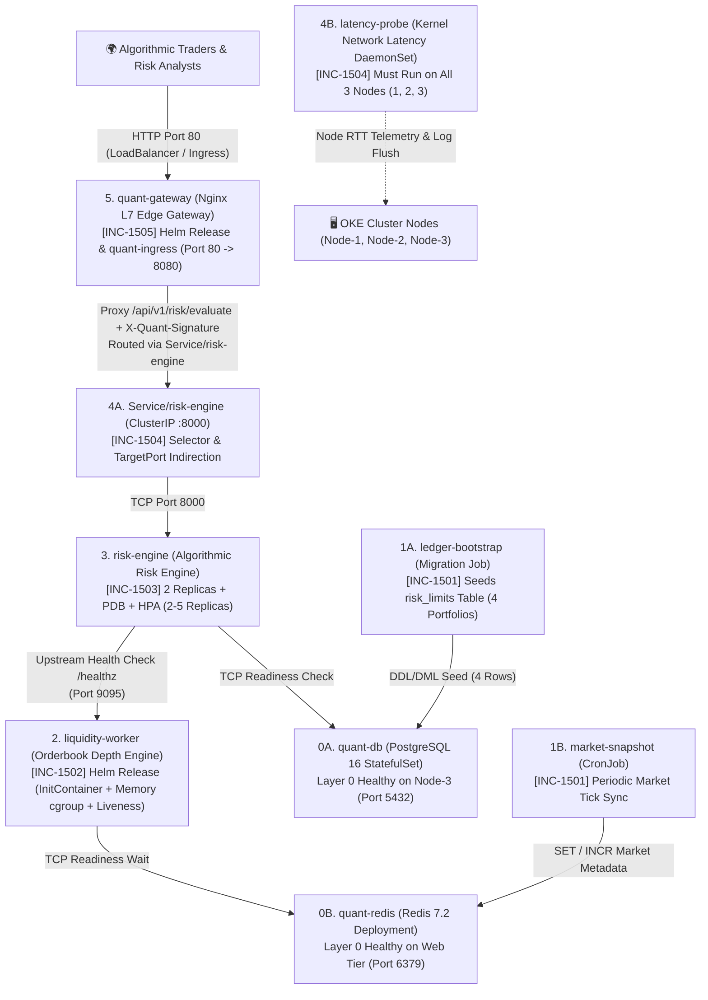

# 🇬🇧 English Version

# 🚨 SRE Incident Lab 15: QuantFlow — Algorithmic Risk, Liquidity Engine & L7 Edge Gateway Outage

Welcome to **SRE Incident Lab 15**. This workspace serves as the active **Incident Triage War Room** during a high-severity production outage of **QuantFlow**, an enterprise algorithmic risk evaluation, orderbook liquidity calculation, and edge gateway platform running in the `quantflow-prod` namespace on an Oracle Cloud Kubernetes Engine (OKE) cluster.

All Kubernetes manifests and Helm charts deployed to the cluster are **syntactically valid** and accepted by the Kubernetes API server and Helm engine (`./setup.sh` exits with code `0`). However, at runtime the platform suffers from a multi-layer cascading outage across the batch ledger seeding, liquidity matrix worker, algorithmic risk engine, autoscaling metrics pipeline, node-level network latency daemon, and L7 edge API gateway layers.

Your mission as the Lead On-Call SRE is to triage and remediate the incident tickets **in strictly sequential (bottom-up) order** from **INC-1501** to **INC-1505**, gather runtime evidence using `kubectl` and `helm`, and pass every verification check before moving to the next layer.

> 📖 **Post-Mortem & Deep Root Cause Analyses (RCA):**  
> 👉 **[Explore Principal SRE Post-Mortem Guide (SOLUTION.md)](./SOLUTION.md)** — *Attempt resolution on your own before consulting the guide!*

---

## 🗺️ Cluster Topology & Infrastructure Constraints

The incident scenario is grounded in the following 3-node OKE cluster topology:

| Node Name | Internal IP | Label | Taint / Constraint | Allocated Tier Role |
| :--- | :--- | :--- | :--- | :--- |
| **Node-1** | `10.0.10.122` | `tier=web` | *None* | Web / API / Edge Gateway / Liquidity Workers / Batch Jobs |
| **Node-2** | `10.0.10.208` | `tier=web` | *None* | Web / API / Edge Gateway / Liquidity Workers / Batch Jobs |
| **Node-3** | `10.0.10.78` | `tier=database` | `workload=database:NoSchedule` | Isolated Stateful Database Tier (+ Cluster-Wide Latency DaemonSet) |

* **Target Namespace:** `quantflow-prod`
* **Default StorageClass:** `oci-bv` (Oracle Block Volume CSI, `ReadWriteOnce`, `subPath: pgdata`)
* **Layer 0 (Healthy Stateful Foundation — `manifests/10-core-infra.yaml`):**
  1. `quant-db`: PostgreSQL 16 StatefulSet (`1/1 Running` on **Node-3**, ClusterIP Service `:5432`, user `quant_admin`, database `quant_ledger`, credentials stored in `Secret/quant-db-secret`).
  2. `quant-redis`: Redis 7.2 Deployment (`1/1 Running` on **Web Tier**, ClusterIP Service `:6379`).

---

## 📂 Workspace Directory Structure

```text
k8-troubleshoot-15/
├── README.md                              # On-Call Incident Board & Triage Runbook (Zero Spoilers)
├── SOLUTION.md                            # Principal SRE Post-Mortem & Step-by-Step RCA Guide
├── setup.sh                               # Automated Outage Simulation Provisioning Script
├── manifests/
│   ├── 00-namespace.yaml                  # Target namespace (quantflow-prod)
│   ├── 10-core-infra.yaml                 # Layer 0: Healthy PostgreSQL 16 (quant-db) & Redis 7.2 (quant-redis)
│   ├── 20-batch-jobs.yaml                 # [INC-1501] Ledger Bootstrap Job & Market Snapshot CronJob
│   ├── 30-risk-engine.yaml                # [INC-1503] Risk Engine Deployment, ConfigMap, PDB & HPA
│   ├── 40-network-and-daemon.yaml         # [INC-1504] Risk Engine Service & latency-probe DaemonSet
│   └── 50-ingress.yaml                    # [INC-1505] Kubernetes Ingress Resource (quant-ingress)
├── charts/
│   ├── liquidity-worker/                  # [INC-1502] Helm Chart for In-Memory Liquidity Matrix Worker
│   │   ├── Chart.yaml
│   │   ├── values.yaml
│   │   └── templates/
│   │       ├── configmap.yaml
│   │       ├── deployment.yaml
│   │       └── service.yaml
│   └── quant-gateway/                     # [INC-1505] Helm Chart for L7 Edge API Gateway
│       ├── Chart.yaml
│       ├── values.yaml
│       └── templates/
│           ├── configmap.yaml
│           ├── deployment.yaml
│           └── service.yaml
└── helm-values/
    ├── liquidity-prod.yaml                # [INC-1502] Production Helm overrides for liquidity-worker
    └── gateway-prod.yaml                  # [INC-1505] Production Helm overrides for quant-gateway
```

---

## 🏗️ Production Architecture & Cascading Dependency Graph



---

## ⚡ Quick Start: Environment Provisioning

Deploy the faulty production state using the automated setup script:

```bash
cd /home/ysf/k8sfundamentals/k8-troubleshoot-15
./setup.sh
```

Inspect the initial cluster status in `quantflow-prod`:

```bash
kubectl get pods,jobs,cronjobs,ds,svc,hpa,pdb,ingress -n quantflow-prod -o wide
```

---

## 📋 On-Call SRE Incident Board (Active P1 Tickets)

| Ticket ID | Impacted Component | Kubernetes / Helm Object | Observed Symptom | Triage Layer | Severity |
| :--- | :--- | :--- | :--- | :--- | :--- |
| **[INC-1501]** | `ledger-bootstrap` & `market-snapshot` | `Job` & `CronJob` (`manifests/20-batch-jobs.yaml`) | Bootstrap Job stuck in `CreateContainerConfigError` or waiting on unreachable DB host; CronJob never schedules and fails Redis sync when triggered. | Layer 1: Batch Seeding & Scheduled Sync | `P1 - Blocker` |
| **[INC-1502]** | `liquidity-worker` | Helm Release (`charts/liquidity-worker/` & `helm-values/liquidity-prod.yaml`) | Pod hangs in `Init:0/1`; once initialized, crashes immediately (`OOMKilled` / `Exit Code 137`), then restarts periodically due to Liveness Probe failure. | Layer 2: Helm Workload Lifecycle, cgroups & Probes | `P1 - Blocker` |
| **[INC-1503]** | `risk-engine` & `risk-engine-hpa` | `Deployment`, `ConfigMap`, `PDB` & `HPA` (`manifests/30-risk-engine.yaml`) | Pods `Running` (`0/1 Ready`) failing `/ready` with `503 Service Unavailable`; HPA shows `<unknown>/70%` and cannot scale target. | Layer 3: Env Precedence, Upstream Discovery & Autoscaling | `P1 - Blocker` |
| **[INC-1504]** | `risk-engine` Service & `latency-probe` | `Service` & `DaemonSet` (`manifests/40-network-and-daemon.yaml`) | Internal Service has `<none>` endpoints; `latency-probe` DaemonSet schedules on only 2 of 3 nodes and crashes (`CrashLoopBackOff`). | Layer 4: L4 Service Routing, Node Taints & VFS Mounts | `P1 - Blocker` |
| **[INC-1505]** | `quant-gateway` & `quant-ingress` | Helm Release (`charts/quant-gateway/`) & `Ingress` (`manifests/50-ingress.yaml`) | Gateway Service refuses connections (`Connection refused`), then returns `403 Forbidden` on `/api/v1/risk/evaluate`; Ingress routing misaligned. | Layer 5: L7 API Gateway, `subPath` Config Reload & Ingress | `P1 - Blocker` |

---

## 🔍 Incident Triage & Verification Runbook

---

### 🎫 [INC-1501] Ledger Bootstrap Job & Market Snapshot CronJob Failure
**Slack Alert (`#quantflow-ops`):**
> *"🔔 PagerDuty P1: Database migration job `ledger-bootstrap` has not seeded the `risk_limits` table in `quant-db` (`0/1 Completed`), and the periodic `market-snapshot` CronJob has not recorded a single market tick in Redis (`LAST SCHEDULE: <none>`)."*

#### 🔎 Diagnostic Commands (How to Investigate)
```bash
# 1. Inspect Job, CronJob, and pod statuses in quantflow-prod
kubectl get job,cronjob -n quantflow-prod
kubectl get pods -n quantflow-prod -l app.kubernetes.io/name=ledger-bootstrap

# 2. Check Kubelet events on the ledger-bootstrap pod for Secret/Config errors
kubectl describe pod -n quantflow-prod -l app.kubernetes.io/name=ledger-bootstrap

# 3. Compare Secret keys and active Database/Redis Service names in the namespace
kubectl get secret quant-db-secret -n quantflow-prod -o jsonpath='{.data}' && echo ""
kubectl get svc -n quantflow-prod

# 4. Inspect the batch manifests for credential, host, port, and schedule settings
cat manifests/20-batch-jobs.yaml
```

#### ✅ Success Criteria & Verification
Run the following commands to verify **INC-1501** is resolved:
```bash
# 1. Verify ledger-bootstrap Job completed (1/1)
kubectl wait --for=condition=complete job/ledger-bootstrap -n quantflow-prod --timeout=45s
kubectl get job ledger-bootstrap -n quantflow-prod
# Expected: COMPLETIONS 1/1

# 2. Verify PostgreSQL risk_limits table contains 4 portfolio rows
kubectl exec -n quantflow-prod quant-db-0 -- psql -U quant_admin -d quant_ledger -tAc "SELECT count(*) FROM risk_limits;"
# Expected: 4

# 3. Verify market-snapshot CronJob is active (SUSPEND: False) and test a manual run
kubectl get cronjob market-snapshot -n quantflow-prod
kubectl create job --from=cronjob/market-snapshot manual-snapshot -n quantflow-prod && kubectl wait --for=condition=complete job/manual-snapshot -n quantflow-prod --timeout=30s
kubectl exec -n quantflow-prod deploy/quant-redis -- redis-cli GET quant:market:status
# Expected: ACTIVE
```

---

### 🎫 [INC-1502] Liquidity Worker Stuck in `Init:0/1`, `OOMKilled` & Probe Restarts
**Slack Alert (`#quantflow-ops`):**
> *"🔔 PagerDuty P1: Helm release `liquidity-worker` is down. The pod hangs in `Init:0/1`; after fixing initialization, it crashes immediately with `OOMKilled` (`Exit Code 137`), and once running, Kubelet repeatedly restarts it after 15 seconds."*

#### 🔎 Diagnostic Commands (How to Investigate)
```bash
# 1. Inspect the liquidity-worker pod status and initContainer logs
kubectl get pods -n quantflow-prod -l app.kubernetes.io/name=liquidity-worker
kubectl logs -n quantflow-prod deploy/liquidity-worker -c wait-for-redis

# 2. Inspect container termination reason (Exit Code / OOMKilled) and probe events
kubectl describe pod -n quantflow-prod -l app.kubernetes.io/name=liquidity-worker

# 3. Compare the Helm chart templates & default values against production overrides
cat charts/liquidity-worker/templates/configmap.yaml
cat charts/liquidity-worker/values.yaml
cat helm-values/liquidity-prod.yaml
```

#### ✅ Success Criteria & Verification
Run the following commands to verify **INC-1502** is resolved:
```bash
# 1. Verify liquidity-worker pod is 1/1 Running and stable
kubectl rollout status deploy/liquidity-worker -n quantflow-prod --timeout=45s
kubectl get pods -n quantflow-prod -l app.kubernetes.io/name=liquidity-worker
# Expected: 1/1 Running (0 new restarts)

# 2. Verify internal /healthz endpoint responds with HTTP 200 OK on port 9095
kubectl exec -n quantflow-prod deploy/quant-redis -- wget -qO- http://liquidity-worker:9095/healthz
# Expected: {"status": "healthy", "service": "liquidity-worker", "matrix_buffer_mib": 48, "redis": "quant-redis:6379"}
```

---

### 🎫 [INC-1503] Risk Engine Failing Readiness (`0/1 Ready`) & HPA Metric Starvation
**Slack Alert (`#quantflow-ops`):**
> *"🔔 PagerDuty P1: `risk-engine` pods are `Running` but stuck at `0/1 Ready` (`HTTP 503` on `/ready`). Additionally, `risk-engine-hpa` reports `<unknown>/70%` utilization and fails to bind to the deployment."*

#### 🔎 Diagnostic Commands (How to Investigate)
```bash
# 1. Inspect risk-engine pod status, readiness failure events, and application logs
kubectl get pods,pdb,hpa -n quantflow-prod
kubectl describe pod -n quantflow-prod -l app.kubernetes.io/name=risk-engine
kubectl logs -n quantflow-prod deploy/risk-engine --tail=30

# 2. Check the effective environment variables inside a running risk-engine container
kubectl exec -n quantflow-prod deploy/risk-engine -- env | grep -E "DB_|REDIS_|LIQUIDITY_"

# 3. Inspect HPA events to diagnose target reference and CPU metric calculation errors
kubectl describe hpa risk-engine-hpa -n quantflow-prod

# 4. Review manifests/30-risk-engine.yaml
cat manifests/30-risk-engine.yaml
```

#### ✅ Success Criteria & Verification
Run the following commands to verify **INC-1503** is resolved:
```bash
# 1. Verify both risk-engine replicas reach 1/1 Ready and PDB allows disruptions
kubectl rollout status deploy/risk-engine -n quantflow-prod --timeout=45s
kubectl get pods -n quantflow-prod -l app.kubernetes.io/name=risk-engine
kubectl get pdb risk-engine-pdb -n quantflow-prod
# Expected: 2/2 pods 1/1 Running, PDB ALLOWED DISRUPTIONS: 1

# 2. Verify HPA targets Deployment/risk-engine and Deployment requests.cpu is set
kubectl get hpa risk-engine-hpa -n quantflow-prod
# Expected: REFERENCE Deployment/risk-engine, MINPODS 2, MAXPODS 5, REPLICAS 2
```

---

### 🎫 [INC-1504] Risk Engine Service Blackhole & Node Latency DaemonSet Failure
**Slack Alert (`#quantflow-ops`):**
> *"🔔 PagerDuty P1: Even with `risk-engine` pods `1/1 Ready`, requests to `http://risk-engine:8000` fail with `Connection refused`. Meanwhile, the `latency-probe` DaemonSet is missing from `Node-3` (`DESIRED: 2` instead of `3`) and its scheduled pods are crashing in `CrashLoopBackOff`."*

#### 🔎 Diagnostic Commands (How to Investigate)
```bash
# 1. Check Service endpoints and compare Service selector/ports against risk-engine pod labels
kubectl get svc,ep risk-engine -n quantflow-prod
kubectl describe svc risk-engine -n quantflow-prod
kubectl get pods -n quantflow-prod -l app.kubernetes.io/name=risk-engine --show-labels

# 2. Inspect latency-probe DaemonSet status, pod crash logs, and Node-3 taints
kubectl get ds latency-probe -n quantflow-prod
kubectl logs -n quantflow-prod -l app.kubernetes.io/name=latency-probe --tail=20
kubectl get nodes -o custom-columns=NAME:.metadata.name,TAINTS:.spec.taints

# 3. Inspect manifests/40-network-and-daemon.yaml
cat manifests/40-network-and-daemon.yaml
```

#### ✅ Success Criteria & Verification
Run the following commands to verify **INC-1504** is resolved:
```bash
# 1. Verify Service/risk-engine populates 2 healthy endpoints on port 8000
kubectl get endpoints risk-engine -n quantflow-prod
kubectl exec -n quantflow-prod deploy/quant-redis -- wget -qO- http://risk-engine:8000/ready
# Expected: {"status": "ready", "db": "quant-db:5432", "redis": "quant-redis:6379", "liquidity_worker": "connected"}

# 2. Verify latency-probe DaemonSet runs 3/3 Ready across all 3 cluster nodes
kubectl rollout status ds/latency-probe -n quantflow-prod --timeout=45s
kubectl get ds latency-probe -n quantflow-prod
# Expected: DESIRED: 3, CURRENT: 3, READY: 3
```

---

### 🎫 [INC-1505] Edge Gateway Connection Refused, `403 Forbidden` & Ingress Misalignment
**Slack Alert (`#quantflow-ops`):**
> *"🔔 PagerDuty P1: External traffic to `quant-gateway` on port `80` fails with `Connection refused`. Once port forwarding is restored, `/api/v1/risk/evaluate` returns `HTTP 403 Forbidden: untrusted gateway`, and `quant-ingress` points to a non-existent IngressClass and wrong port."*

#### 🔎 Diagnostic Commands (How to Investigate)
```bash
# 1. Inspect quant-gateway Service port mapping vs container port
kubectl get svc,pods -n quantflow-prod -l app.kubernetes.io/name=quant-gateway
kubectl describe svc quant-gateway -n quantflow-prod

# 2. Check the rendered Nginx configuration inside the running quant-gateway pod
kubectl exec -n quantflow-prod deploy/quant-gateway -- cat /etc/nginx/nginx.conf

# 3. Review Helm chart templates and production override values for quant-gateway
cat charts/quant-gateway/templates/deployment.yaml
cat charts/quant-gateway/values.yaml
cat helm-values/gateway-prod.yaml

# 4. Inspect IngressClass in cluster and quant-ingress manifest
kubectl get ingressclass
cat manifests/50-ingress.yaml
```

#### ✅ Success Criteria & Final End-to-End Verification
Run the following commands to verify **INC-1505** and full platform recovery:
```bash
# 1. Verify quant-gateway health and end-to-end risk evaluation response through Service port 80
GW_IP=$(kubectl get svc quant-gateway -n quantflow-prod -o jsonpath='{.spec.clusterIP}')
curl -sS "http://${GW_IP}/healthz"
# Expected: {"status":"ok","gateway":"quant-gateway"}

curl -i -sS "http://${GW_IP}/api/v1/risk/evaluate"
# Expected: HTTP/1.1 200 OK
# {"platform": "QuantFlow", "status": "RISK_APPROVED", "active_portfolios": ["PORTFOLIO-ALPHA", "PORTFOLIO-BETA", "PORTFOLIO-GAMMA", "PORTFOLIO-DELTA"], "liquidity_engine": "online"}

# 2. Verify quant-ingress is bound to edge-ingress on port 80
kubectl get ingress quant-ingress -n quantflow-prod
# Expected: CLASS: edge-ingress, HOSTS: quant.local, PORTS: 80
```

---

<br>

---

# 🇹🇷 Türkçe Versiyon

# 🚨 SRE Olay Müdahale Labı 15: QuantFlow — Algoritmik Risk, Likidite Motoru ve L7 Edge Gateway Kesintisi

**SRE Incident Lab 15**'e hoş geldiniz. Bu çalışma alanı, Oracle Cloud Kubernetes Engine (OKE) kümesinde `quantflow-prod` namespace'i altında çalışan kurumsal algoritmik risk değerlendirme, emir defteri (orderbook) likidite matrisi ve L7 API ağ geçidi platformu **QuantFlow**'da meydana gelen kritik üretim kesintisi için aktif **Olay Müdahale (Incident Triage) Merkezi**dir.

Kümeye dağıtılan tüm Kubernetes manifestleri ve Helm chart'ları **sözdizimsel (syntactic) olarak geçerlidir** ve API sunucusu tarafından hatasız kabul edilir (`./setup.sh` betiği `0` çıkış koduyla tamamlanır). Ancak çalışma zamanında (runtime) platform; veritabanı tohumlama (seed) Job'ı, periyodik piyasa senkronizasyon CronJob'ı, bellek içi likidite işçisi, algoritmik risk motoru, yatay ölçekleyici (HPA), düğüm gecikme DaemonSet'i ve L7 Edge Gateway katmanlarında zincirleme bir çöküş yaşamaktadır.

Nöbetçi Kıdemli SRE (Lead On-Call SRE) olarak göreviniz: **INC-1501**'den **INC-1505**'e kadar olan arıza biletlerini **kesinlikle sıralı (aşağıdan yukarıya / bottom-up)** olarak incelemek, `kubectl` ve `helm` kullanarak çalışma zamanı kanıtlarını toplamak ve bir sonraki katmana geçmeden önce her biletin doğrulama kriterlerini eksiksiz sağlamaktır.

> 📖 **Post-Mortem & Derinlemesine Kök Neden Analizi (RCA) Rehberi:**  
> 👉 **[Principal SRE Çözüm Rehberini İnceleyin (SOLUTION.md)](./SOLUTION.md)** — *Rehbere bakmadan önce sorunları kendi başınıza teşhis edip çözmeyi deneyin!*

---

## 🗺️ Küme Topolojisi ve Altyapı Kısıtları

Olay senaryosu aşağıdaki 3 düğümlü (node) OKE küme topolojisi üzerinde çalışmaktadır:

| Düğüm Adı | İç IP | Etiket (Label) | Taint / Kısıt | Ayrılmış Katman Rolü |
| :--- | :--- | :--- | :--- | :--- |
| **Node-1** | `10.0.10.122` | `tier=web` | *Yok* | Web / API / Edge Gateway / Likidite İşçileri / Batch İşler |
| **Node-2** | `10.0.10.208` | `tier=web` | *Yok* | Web / API / Edge Gateway / Likidite İşçileri / Batch İşler |
| **Node-3** | `10.0.10.78` | `tier=database` | `workload=database:NoSchedule` | İzole Veritabanı Katmanı (+ Küme Geneli Gecikme DaemonSet'i) |

* **Hedef Namespace:** `quantflow-prod`
* **Varsayılan StorageClass:** `oci-bv` (Oracle Block Volume CSI, `ReadWriteOnce`, `subPath: pgdata`)
* **Katman 0 (Sağlam Durum Bilgili Altyapı — `manifests/10-core-infra.yaml`):**
  1. `quant-db`: PostgreSQL 16 StatefulSet (**Node-3** üzerinde `1/1 Running`, ClusterIP Servis `:5432`, kullanıcı `quant_admin`, veritabanı `quant_ledger`, şifre `Secret/quant-db-secret` içinde).
  2. `quant-redis`: Redis 7.2 Deployment (**Web Katmanı** üzerinde `1/1 Running`, ClusterIP Servis `:6379`).

---

## ⚡ Hızlı Başlangıç: Ortamın Kurulması

Bozuk üretim ortamını kümeye dağıtmak için kurulum betiğini çalıştırın:

```bash
cd /home/ysf/k8sfundamentals/k8-troubleshoot-15
./setup.sh
```

`quantflow-prod` içindeki başlangıç durumunu kontrol edin:

```bash
kubectl get pods,jobs,cronjobs,ds,svc,hpa,pdb,ingress -n quantflow-prod -o wide
```

---

## 📋 Nöbetçi SRE Olay Panosu (Aktif P1 Biletleri)

| Bilet Kodu | Etkilenen Bileşen | Kubernetes / Helm Nesnesi | Gözlemlenen Belirti (Semptom) | Müdahale Katmanı | Önem |
| :--- | :--- | :--- | :--- | :--- | :--- |
| **[INC-1501]** | `ledger-bootstrap` & `market-snapshot` | `Job` & `CronJob` (`manifests/20-batch-jobs.yaml`) | Bootstrap Job `CreateContainerConfigError` hatasında veya yanlış DB adresinde bekliyor; CronJob hiç tetiklenmiyor ve Redis senkronizasyonu başarısız. | Katman 1: Batch Tohumlama & Zamanlanmış Görevler | `P1 - Kritik` |
| **[INC-1502]** | `liquidity-worker` | Helm Sürümü (`charts/liquidity-worker/` & `helm-values/liquidity-prod.yaml`) | Pod `Init:0/1` aşamasında takılı kalıyor; başlatıldığında `OOMKilled` (`Exit Code 137`) ile çöküyor ve ardından Liveness Probe hatasıyla yeniden başlıyor. | Katman 2: Helm Yaşam Döngüsü, cgroups Bellek & Probe | `P1 - Kritik` |
| **[INC-1503]** | `risk-engine` & `risk-engine-hpa` | `Deployment`, `ConfigMap`, `PDB` & `HPA` (`manifests/30-risk-engine.yaml`) | Pod'lar `Running` ancak `0/1 Ready` (`HTTP 503`); HPA `<unknown>/70%` gösteriyor ve hedef Deployment'ı ölçekleyemiyor. | Katman 3: Env Önceliği, Bağımlılık Keşfi & HPA | `P1 - Kritik` |
| **[INC-1504]** | `risk-engine` Servisi & `latency-probe` | `Service` & `DaemonSet` (`manifests/40-network-and-daemon.yaml`) | İç serviste `<none>` endpoint görünüyor; `latency-probe` DaemonSet'i 3 düğüm yerine 2 düğümde çalışıyor ve `CrashLoopBackOff` oluyor. | Katman 4: L4 Servis Yönlendirme, Taint & VFS İzinleri | `P1 - Kritik` |
| **[INC-1505]** | `quant-gateway` & `quant-ingress` | Helm Sürümü (`charts/quant-gateway/`) & `Ingress` (`manifests/50-ingress.yaml`) | Gateway Servisi bağlantıyı reddediyor (`Connection refused`), ardından `/api/v1/risk/evaluate` `403 Forbidden` dönüyor; Ingress ayarları hatalı. | Katman 5: L7 API Gateway, `subPath` Reload & Ingress | `P1 - Kritik` |

---

## 🔍 Olay Teşhis ve Doğrulama Rehberi

---

### 🎫 [INC-1501] Veritabanı Tohumlama Job'ı ve Market Snapshot CronJob Arızası
**Slack Alarmı (`#quantflow-ops`):**
> *"🔔 PagerDuty P1: `ledger-bootstrap` veritabanı hazırlama Job'ı `quant-db` içindeki `risk_limits` tablosunu oluşturamadı (`0/1 Completed`) ve periyodik `market-snapshot` CronJob'ı Redis'e hiçbir piyasa verisi yazmadı (`LAST SCHEDULE: <none>`)."*

#### 🔎 Teşhis Komutları (Nasıl İncelenir?)
```bash
# 1. Job, CronJob ve pod durumlarını inceleyin
kubectl get job,cronjob -n quantflow-prod
kubectl get pods -n quantflow-prod -l app.kubernetes.io/name=ledger-bootstrap

# 2. ledger-bootstrap pod'undaki Kubelet olaylarını (Secret/Config hatalarını) kontrol edin
kubectl describe pod -n quantflow-prod -l app.kubernetes.io/name=ledger-bootstrap

# 3. Secret içindeki gerçek anahtar adını ve aktif Servis adlarını karşılaştırın
kubectl get secret quant-db-secret -n quantflow-prod -o jsonpath='{.data}' && echo ""
kubectl get svc -n quantflow-prod

# 4. Batch manifest dosyasındaki kimlik bilgisi, sunucu adı, port ve zamanlama ayarlarını inceleyin
cat manifests/20-batch-jobs.yaml
```

#### ✅ Başarı Kriterleri ve Doğrulama
**INC-1501** biletinin çözüldüğünü doğrulamak için aşağıdaki komutları çalıştırın:
```bash
# 1. ledger-bootstrap Job'ının başarıyla tamamlandığını (1/1) doğrulayın
kubectl wait --for=condition=complete job/ledger-bootstrap -n quantflow-prod --timeout=45s
kubectl get job ledger-bootstrap -n quantflow-prod
# Beklenen: COMPLETIONS 1/1

# 2. PostgreSQL risk_limits tablosunda 4 adet portföy kaydı olduğunu doğrulayın
kubectl exec -n quantflow-prod quant-db-0 -- psql -U quant_admin -d quant_ledger -tAc "SELECT count(*) FROM risk_limits;"
# Beklenen: 4

# 3. market-snapshot CronJob'ının aktif olduğunu (SUSPEND: False) ve manuel tetiklemenin çalıştığını doğrulayın
kubectl get cronjob market-snapshot -n quantflow-prod
kubectl create job --from=cronjob/market-snapshot manual-snapshot -n quantflow-prod && kubectl wait --for=condition=complete job/manual-snapshot -n quantflow-prod --timeout=30s
kubectl exec -n quantflow-prod deploy/quant-redis -- redis-cli GET quant:market:status
# Beklenen: ACTIVE
```

---

### 🎫 [INC-1502] Liquidity Worker `Init:0/1` Takılması, `OOMKilled` ve Probe Yeniden Başlatmaları
**Slack Alarmı (`#quantflow-ops`):**
> *"🔔 PagerDuty P1: `liquidity-worker` Helm sürümü çalışmıyor. Pod önce `Init:0/1` aşamasında asılı kalıyor; init geçildikten sonra anında `OOMKilled` (`Exit Code 137`) ile çöküyor ve çalışmaya başladıktan sonra da Liveness Probe hatası nedeniyle sürekli yeniden başlatılıyor."*

#### 🔎 Teşhis Komutları (Nasıl İncelenir?)
```bash
# 1. liquidity-worker pod durumunu ve initContainer loglarını kontrol edin
kubectl get pods -n quantflow-prod -l app.kubernetes.io/name=liquidity-worker
kubectl logs -n quantflow-prod deploy/liquidity-worker -c wait-for-redis

# 2. Konteyner sonlanma nedenini (Exit Code 137 / OOMKilled) ve probe olaylarını inceleyin
kubectl describe pod -n quantflow-prod -l app.kubernetes.io/name=liquidity-worker

# 3. Helm şablonlarını ve varsayılan değerleri üretim override dosyasıyla karşılaştırın
cat charts/liquidity-worker/templates/configmap.yaml
cat charts/liquidity-worker/values.yaml
cat helm-values/liquidity-prod.yaml
```

#### ✅ Başarı Kriterleri ve Doğrulama
**INC-1502** biletinin çözüldüğünü doğrulamak için aşağıdaki komutları çalıştırın:
```bash
# 1. liquidity-worker pod'unun 1/1 Running ve stabil olduğunu doğrulayın
kubectl rollout status deploy/liquidity-worker -n quantflow-prod --timeout=45s
kubectl get pods -n quantflow-prod -l app.kubernetes.io/name=liquidity-worker
# Beklenen: 1/1 Running (yeni restart yok)

# 2. İç /healthz uç noktasının 9095 portunda HTTP 200 OK döndüğünü doğrulayın
kubectl exec -n quantflow-prod deploy/quant-redis -- wget -qO- http://liquidity-worker:9095/healthz
# Beklenen: {"status": "healthy", "service": "liquidity-worker", "matrix_buffer_mib": 48, "redis": "quant-redis:6379"}
```

---

### 🎫 [INC-1503] Risk Engine Hazırlık (`0/1 Ready`) Hatası ve HPA Metrik Açlığı
**Slack Alarmı (`#quantflow-ops`):**
> *"🔔 PagerDuty P1: `risk-engine` pod'ları `Running` durumunda ancak `0/1 Ready` olarak takılı kalıyor (`/ready` uç noktası `HTTP 503` dönüyor). Ayrıca `risk-engine-hpa` `<unknown>/70%` gösteriyor ve hedef Deployment'ı bulamıyor."*

#### 🔎 Teşhis Komutları (Nasıl İncelenir?)
```bash
# 1. risk-engine pod durumunu, readiness olaylarını ve uygulama loglarını inceleyin
kubectl get pods,pdb,hpa -n quantflow-prod
kubectl describe pod -n quantflow-prod -l app.kubernetes.io/name=risk-engine
kubectl logs -n quantflow-prod deploy/risk-engine --tail=30

# 2. Çalışan konteyner içindeki aktif ortam değişkenlerini kontrol edin (env vs envFrom önceliği!)
kubectl exec -n quantflow-prod deploy/risk-engine -- env | grep -E "DB_|REDIS_|LIQUIDITY_"

# 3. HPA olaylarını inceleyerek hedef referans ve CPU metrik hesaplama hatalarını teşhis edin
kubectl describe hpa risk-engine-hpa -n quantflow-prod

# 4. manifests/30-risk-engine.yaml dosyasını inceleyin
cat manifests/30-risk-engine.yaml
```

#### ✅ Başarı Kriterleri ve Doğrulama
**INC-1503** biletinin çözüldüğünü doğrulamak için aşağıdaki komutları çalıştırın:
```bash
# 1. Her iki risk-engine replikasının 1/1 Ready olduğunu ve PDB'nin kesintiye izin verdiğini doğrulayın
kubectl rollout status deploy/risk-engine -n quantflow-prod --timeout=45s
kubectl get pods -n quantflow-prod -l app.kubernetes.io/name=risk-engine
kubectl get pdb risk-engine-pdb -n quantflow-prod
# Beklenen: 2/2 pod 1/1 Running, PDB ALLOWED DISRUPTIONS: 1

# 2. HPA'nın Deployment/risk-engine nesnesini hedeflediğini doğrulayın
kubectl get hpa risk-engine-hpa -n quantflow-prod
# Beklenen: REFERENCE Deployment/risk-engine, MINPODS 2, MAXPODS 5, REPLICAS 2
```

---

### 🎫 [INC-1504] Risk Engine Servis Kara Deliği ve Düğüm Gecikme DaemonSet Arızası
**Slack Alarmı (`#quantflow-ops`):**
> *"🔔 PagerDuty P1: `risk-engine` pod'ları `1/1 Ready` olmasına rağmen `http://risk-engine:8000` adresine yapılan istekler `Connection refused` alıyor. Aynı zamanda `latency-probe` DaemonSet'i `Node-3` üzerinde çalışmıyor (`DESIRED: 2`) ve çalışan pod'ları `CrashLoopBackOff` durumunda çöküyor."*

#### 🔎 Teşhis Komutları (Nasıl İncelenir?)
```bash
# 1. Servis endpoint'lerini kontrol edin ve Servis seçicisini/portunu pod etiketleriyle karşılaştırın
kubectl get svc,ep risk-engine -n quantflow-prod
kubectl describe svc risk-engine -n quantflow-prod
kubectl get pods -n quantflow-prod -l app.kubernetes.io/name=risk-engine --show-labels

# 2. latency-probe DaemonSet durumunu, pod çökme loglarını ve Node-3 taint'lerini inceleyin
kubectl get ds latency-probe -n quantflow-prod
kubectl logs -n quantflow-prod -l app.kubernetes.io/name=latency-probe --tail=20
kubectl get nodes -o custom-columns=NAME:.metadata.name,TAINTS:.spec.taints

# 3. manifests/40-network-and-daemon.yaml dosyasını inceleyin
cat manifests/40-network-and-daemon.yaml
```

#### ✅ Başarı Kriterleri ve Doğrulama
**INC-1504** biletinin çözüldüğünü doğrulamak için aşağıdaki komutları çalıştırın:
```bash
# 1. Service/risk-engine nesnesinin 8000 portunda 2 sağlıklı endpoint barındırdığını doğrulayın
kubectl get endpoints risk-engine -n quantflow-prod
kubectl exec -n quantflow-prod deploy/quant-redis -- wget -qO- http://risk-engine:8000/ready
# Beklenen: {"status": "ready", "db": "quant-db:5432", "redis": "quant-redis:6379", "liquidity_worker": "connected"}

# 2. latency-probe DaemonSet'inin 3/3 düğümde Ready çalıştığını doğrulayın
kubectl rollout status ds/latency-probe -n quantflow-prod --timeout=45s
kubectl get ds latency-probe -n quantflow-prod
# Beklenen: DESIRED: 3, CURRENT: 3, READY: 3
```

---

### 🎫 [INC-1505] Edge Gateway Bağlantı Reddi, `403 Forbidden` ve Ingress Yönlendirme Hatası
**Slack Alarmı (`#quantflow-ops`):**
> *"🔔 PagerDuty P1: `quant-gateway` servisine 80 portundan gelen dış istekler `Connection refused` ile reddediliyor. Port düzeltildikten sonra `/api/v1/risk/evaluate` uç noktası `HTTP 403 Forbidden: untrusted gateway` dönüyor ve `quant-ingress` geçersiz bir IngressClass ile yanlış porta yönlendirme yapıyor."*

#### 🔎 Teşhis Komutları (Nasıl İncelenir?)
```bash
# 1. quant-gateway Servis port eşlemesini konteyner portuyla karşılaştırın
kubectl get svc,pods -n quantflow-prod -l app.kubernetes.io/name=quant-gateway
kubectl describe svc quant-gateway -n quantflow-prod

# 2. Çalışan quant-gateway pod'u içindeki aktif Nginx konfigürasyonunu kontrol edin
kubectl exec -n quantflow-prod deploy/quant-gateway -- cat /etc/nginx/nginx.conf

# 3. quant-gateway Helm şablonlarını ve üretim override değerlerini inceleyin
cat charts/quant-gateway/templates/deployment.yaml
cat charts/quant-gateway/values.yaml
cat helm-values/gateway-prod.yaml

# 4. Kümedeki IngressClass nesnesini ve quant-ingress manifestini inceleyin
kubectl get ingressclass
cat manifests/50-ingress.yaml
```

#### ✅ Başarı Kriterleri ve Uçtan Uca Final Doğrulaması
**INC-1505** biletinin ve tüm platformun kurtarıldığını doğrulamak için aşağıdaki komutları çalıştırın:
```bash
# 1. quant-gateway sağlık durumunu ve 80 portu üzerinden uçtan uca risk değerlendirme yanıtını doğrulayın
GW_IP=$(kubectl get svc quant-gateway -n quantflow-prod -o jsonpath='{.spec.clusterIP}')
curl -sS "http://${GW_IP}/healthz"
# Beklenen: {"status":"ok","gateway":"quant-gateway"}

curl -i -sS "http://${GW_IP}/api/v1/risk/evaluate"
# Beklenen: HTTP/1.1 200 OK
# {"platform": "QuantFlow", "status": "RISK_APPROVED", "active_portfolios": ["PORTFOLIO-ALPHA", "PORTFOLIO-BETA", "PORTFOLIO-GAMMA", "PORTFOLIO-DELTA"], "liquidity_engine": "online"}

# 2. quant-ingress kaynağının edge-ingress sınıfına ve 80 portuna bağlandığını doğrulayın
kubectl get ingress quant-ingress -n quantflow-prod
# Beklenen: CLASS: edge-ingress, HOSTS: quant.local, PORTS: 80
```
