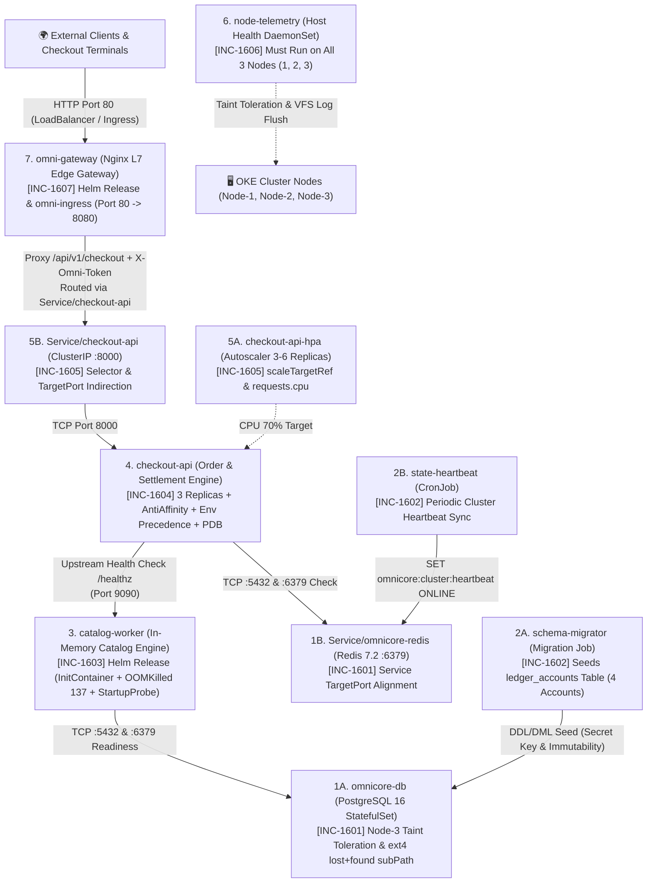

# 🇬🇧 English Version

# 🏆 SRE Incident Lab 16 (Grand Finale Capstone): OmniCore — Enterprise Order, Settlement, Telemetry & L7 Edge Platform Outage

Welcome to **SRE Incident Lab 16 (Grand Finale Master Review)**. This workspace serves as the active **Incident Triage War Room** during a catastrophic, cluster-wide production outage of **OmniCore**, our flagship enterprise order fulfillment, ledger settlement, real-time catalog indexing, node telemetry, and L7 API gateway platform running in the `omnicore-prod` namespace on an Oracle Cloud Kubernetes Engine (OKE) cluster.

This Capstone Lab is designed as a **comprehensive end-to-end review** of every critical Kubernetes and SRE failure domain:
* **Layer 1 (`[INC-1601]`):** StatefulSet Scheduling, Dedicated Node Taints (`NoExecute` vs `NoSchedule`), CSI Block Storage (`oci-bv` `WaitForFirstConsumer`), Ext4 `lost+found` `initdb` Crash (`subPath: pgdata`), and L4 Redis Service `targetPort` Alignment.
* **Layer 2 (`[INC-1602]`):** Kubelet Pre-Start Secret Resolution (`CreateContainerConfigError`), Database Host Discovery, `Job` Spec Immutability (`kubectl replace --force`), and `CronJob` Suspension & Redis DNS.
* **Layer 3 (`[INC-1603]`):** Helm Release Overrides, Sequential `InitContainer` TCP Gating (`Init:0/1`), Linux Kernel cgroup `OOMKilled` (`Exit Code 137`), and `startupProbe` Warmup Budget Starvation.
* **Layer 4 (`[INC-1604]`):** 2-Node Hard `podAntiAffinity` Scheduling Deadlock (`Pending`), `readinessProbe` Port Mismatch, Kubernetes `env` vs `envFrom` (`ConfigMap`) Precedence Override, and `PodDisruptionBudget` (`PDB`).
* **Layer 5 (`[INC-1605]`):** `HorizontalPodAutoscaler` (`HPA`) `scaleTargetRef` & Missing `resources.requests.cpu` Metric Starvation (`<unknown>/70%`), and L4 `Service` Selector Over-Specification (`Endpoints: <none>`).
* **Layer 6 (`[INC-1606]`):** Cluster-Wide `DaemonSet` Taint Key Mismatch (`DESIRED: 2` vs `3`) and Linux VFS Read-Only VolumeMount Crash (`Read-only file system`).
* **Layer 7 (`[INC-1607]`):** Helm L7 Edge Gateway `LoadBalancer` `targetPort`, L7 Security Header (`403 Forbidden`), Kubelet `subPath` ConfigMap Reload Mechanics (`rollout restart`), and `IngressClass` Routing.

> 📖 **Post-Mortem & Deep Root Cause Analyses (RCA):**  
> 👉 **[Explore Principal SRE Post-Mortem Guide (SOLUTION.md)](./SOLUTION.md)** — *Attempt resolution on your own before consulting the guide!*

---

## 🗺️ Cluster Topology & Infrastructure Constraints

The incident scenario is grounded in the following 3-node OKE cluster topology:

| Node Name | Internal IP | Label | Taint / Constraint | Allocated Tier Role |
| :--- | :--- | :--- | :--- | :--- |
| **Node-1** | `10.0.10.122` | `tier=web` | *None* | Web / API / Edge Gateway / Catalog Workers / Batch Jobs |
| **Node-2** | `10.0.10.208` | `tier=web` | *None* | Web / API / Edge Gateway / Catalog Workers / Batch Jobs |
| **Node-3** | `10.0.10.78` | `tier=database` | `workload=database:NoSchedule` | Isolated Stateful Database Tier (`omnicore-db`) + Cluster-Wide Telemetry DaemonSet |

* **Target Namespace:** `omnicore-prod`
* **Default StorageClass:** `oci-bv` (Oracle Block Volume CSI, `WaitForFirstConsumer`, `ReadWriteOnce`, min `50Gi`)

---

## 📂 Workspace Directory Structure

```text
k8-troubleshoot-16/
├── README.md                              # On-Call Incident Board & Triage Runbook (Zero Spoilers)
├── SOLUTION.md                            # Principal SRE Post-Mortem & Step-by-Step RCA Guide
├── setup.sh                               # Automated Outage Simulation Provisioning Script
├── manifests/
│   ├── 00-namespace.yaml                  # Target namespace (omnicore-prod)
│   ├── 10-stateful-data.yaml              # [INC-1601] PostgreSQL 16 StatefulSet (omnicore-db) & Redis 7.2 (omnicore-redis)
│   ├── 20-batch-jobs.yaml                 # [INC-1602] Schema Migrator Job & State Heartbeat CronJob
│   ├── 30-checkout-api.yaml               # [INC-1604] Checkout API Deployment (3 Replicas), ConfigMap & PDB
│   ├── 40-scaling-and-service.yaml        # [INC-1605] Checkout API HPA & ClusterIP Service
│   ├── 50-daemonset.yaml                  # [INC-1606] Cluster-Wide node-telemetry DaemonSet
│   └── 60-ingress.yaml                    # [INC-1607] Kubernetes Ingress Resource (omni-ingress)
├── charts/
│   ├── catalog-worker/                    # [INC-1603] Helm Chart for In-Memory Catalog Worker
│   │   ├── Chart.yaml
│   │   ├── values.yaml
│   │   └── templates/
│   │       ├── configmap.yaml
│   │       ├── deployment.yaml
│   │       └── service.yaml
│   └── omni-gateway/                      # [INC-1607] Helm Chart for L7 Edge API Gateway
│       ├── Chart.yaml
│       ├── values.yaml
│       └── templates/
│           ├── configmap.yaml
│           ├── deployment.yaml
│           └── service.yaml
└── helm-values/
    ├── catalog-prod.yaml                  # [INC-1603] Production Helm overrides for catalog-worker
    └── gateway-prod.yaml                  # [INC-1607] Production Helm overrides for omni-gateway
```

---

## 🏗️ Production Architecture & 7-Layer Dependency Graph



---

## ⚡ Quick Start: Environment Provisioning

Deploy the faulty production state using the automated setup script:

```bash
cd /home/ysf/k8sfundamentals/k8-troubleshoot-16
./setup.sh
```

Inspect the initial cluster status in `omnicore-prod`:

```bash
kubectl get pods,pvc,jobs,cronjobs,ds,svc,hpa,pdb,ingress -n omnicore-prod -o wide
```

---

## 📋 On-Call SRE Incident Board (7 Sequential Capstone Tickets)

| Ticket ID | Impacted Component | Kubernetes / Helm Object | Observed Symptom | Triage Layer | Severity |
| :--- | :--- | :--- | :--- | :--- | :--- |
| **[INC-1601]** | `omnicore-db` & `omnicore-redis` | `StatefulSet`, `PVC` & `Service` (`manifests/10-stateful-data.yaml`) | `omnicore-db-0` and PVC stuck in `Pending`, then `CrashLoopBackOff` (`initdb` failure); `Service/omnicore-redis` refuses connections. | Layer 1: Stateful Storage, Taints & L4 Cache Service | `P1 - Blocker` |
| **[INC-1602]** | `schema-migrator` & `state-heartbeat` | `Job` & `CronJob` (`manifests/20-batch-jobs.yaml`) | Migration Job stuck in `CreateContainerConfigError` or waiting on unreachable DB host; CronJob suspended and fails Redis sync. | Layer 2: Batch Jobs, Secret Keys & Job Immutability | `P1 - Blocker` |
| **[INC-1603]** | `catalog-worker` | Helm Release (`charts/catalog-worker/` & `helm-values/catalog-prod.yaml`) | Pod hangs in `Init:0/1`, crashes immediately with `OOMKilled` (`Exit Code 137`), then restarts every 4s due to Startup Probe failure. | Layer 3: Helm Lifecycle, cgroups Memory & StartupProbe | `P1 - Blocker` |
| **[INC-1604]** | `checkout-api` | `Deployment`, `ConfigMap` & `PDB` (`manifests/30-checkout-api.yaml`) | 2 of 3 replicas `0/1 Running` (`connection refused` / `503` on `/ready`), 3rd replica stuck in `Pending` on 2-node web tier. | Layer 4: PodAntiAffinity, Probe Port & Env Precedence | `P1 - Blocker` |
| **[INC-1605]** | `checkout-api-hpa` & `Service/checkout-api` | `HPA` & `Service` (`manifests/40-scaling-and-service.yaml`) | HPA shows `<unknown>/70%` and `0` replicas; `Service/checkout-api` has `<none>` endpoints and wrong target port. | Layer 5: HPA Resource Metrics & EndpointSlice Routing | `P1 - Blocker` |
| **[INC-1606]** | `node-telemetry` | `DaemonSet` (`manifests/50-daemonset.yaml`) | DaemonSet schedules on only 2 of 3 nodes (`DESIRED: 2`) and pods crash in `CrashLoopBackOff` (`Read-only file system`). | Layer 6: DaemonSet Node Taints & Linux VFS Permissions | `P1 - Blocker` |
| **[INC-1607]** | `omni-gateway` & `omni-ingress` | Helm Release (`charts/omni-gateway/`) & `Ingress` (`manifests/60-ingress.yaml`) | Gateway Service refuses connections on port `80`, then returns `403 Forbidden` on `/api/v1/checkout`; Ingress class/port misaligned. | Layer 7: L7 Gateway, `subPath` Reload & Ingress Binding | `P1 - Blocker` |

---

## 🔍 Incident Triage & Verification Runbook

---

### 🎫 [INC-1601] Stateful Database Scheduling, Ext4 `lost+found` & Redis Service Port
**Slack Alert (`#omnicore-ops`):**
> *"🔔 PagerDuty P1: Primary database `omnicore-db-0` is stuck in `Pending` alongside its `oci-bv` PVC. Once scheduled onto `Node-3`, PostgreSQL crashes during `initdb`. Meanwhile, applications cannot connect to `omnicore-redis:6379` even though the Redis pod is `1/1 Running`."*

#### 🔎 Diagnostic Commands (How to Investigate)
```bash
# 1. Inspect StatefulSet pod, PVC status, and scheduler events
kubectl get pods,pvc -n omnicore-prod -l app.kubernetes.io/name=omnicore-db
kubectl describe pod omnicore-db-0 -n omnicore-prod

# 2. Compare Node-3 taint key/value/effect against omnicore-db tolerations
kubectl get nodes -o custom-columns=NAME:.metadata.name,TIER:.metadata.labels.tier,TAINTS:.spec.taints

# 3. Once scheduled, if omnicore-db-0 enters CrashLoopBackOff, check container logs
kubectl logs omnicore-db-0 -n omnicore-prod

# 4. Inspect Service/omnicore-redis port vs targetPort mapping
kubectl describe svc omnicore-redis -n omnicore-prod
cat manifests/10-stateful-data.yaml
```

> [!TIP]
> **StatefulSet `OrderedReady` Note:** When a `StatefulSet` pod (`omnicore-db-0`) is stuck in `Pending` or `CrashLoopBackOff`, updating the `StatefulSet` manifest alone will not automatically recreate the broken pod until you delete the pod (`kubectl delete pod omnicore-db-0 -n omnicore-prod`) so the controller can spawn it from the updated template.

#### ✅ Success Criteria & Verification
```bash
# 1. Verify omnicore-db-0 is 1/1 Running on Node-3 and PVC is Bound
kubectl wait --for=condition=ready pod/omnicore-db-0 -n omnicore-prod --timeout=90s
kubectl get pod omnicore-db-0 -n omnicore-prod -o wide
kubectl get pvc data-omnicore-db-0 -n omnicore-prod
# Expected: omnicore-db-0 1/1 Running, PVC Bound

# 2. Verify Redis is reachable through Service/omnicore-redis on port 6379
kubectl exec -n omnicore-prod deploy/omnicore-redis -- redis-cli -h omnicore-redis -p 6379 ping
# Expected: PONG
```

---

### 🎫 [INC-1602] Schema Migrator Job & State Heartbeat CronJob Failure
**Slack Alert (`#omnicore-ops`):**
> *"🔔 PagerDuty P1: `schema-migrator` Job is stuck in `CreateContainerConfigError` (`0/1 Completed`), leaving `ledger_accounts` unseeded. Meanwhile, `state-heartbeat` CronJob is suspended and targets an invalid Redis hostname."*

#### 🔎 Diagnostic Commands (How to Investigate)
```bash
# 1. Inspect Job, CronJob, and pod status
kubectl get job,cronjob -n omnicore-prod
kubectl get pods -n omnicore-prod -l app.kubernetes.io/name=schema-migrator

# 2. Inspect Kubelet events on the schema-migrator pod
kubectl describe pod -n omnicore-prod -l app.kubernetes.io/name=schema-migrator

# 3. Check actual Secret key names and Service names in omnicore-prod
kubectl get secret omnicore-db-secret -n omnicore-prod -o jsonpath='{.data}' && echo ""
kubectl get svc -n omnicore-prod
cat manifests/20-batch-jobs.yaml
```

#### ✅ Success Criteria & Verification
```bash
# 1. Verify schema-migrator Job completed (1/1) and seeded 4 rows in ledger_accounts
kubectl wait --for=condition=complete job/schema-migrator -n omnicore-prod --timeout=45s
kubectl exec -n omnicore-prod omnicore-db-0 -- psql -U omni_admin -d omnicore_ledger -tAc "SELECT count(*) FROM ledger_accounts;"
# Expected: 4

# 2. Verify state-heartbeat CronJob is unsuspended (SUSPEND: False) and manual trigger succeeds
kubectl get cronjob state-heartbeat -n omnicore-prod
kubectl create job --from=cronjob/state-heartbeat manual-heartbeat -n omnicore-prod && kubectl wait --for=condition=complete job/manual-heartbeat -n omnicore-prod --timeout=30s
kubectl exec -n omnicore-prod deploy/omnicore-redis -- redis-cli GET omnicore:cluster:heartbeat
# Expected: ONLINE
```

---

### 🎫 [INC-1603] Catalog Worker Stuck in `Init:0/1`, `OOMKilled` (`137`) & StartupProbe Failure
**Slack Alert (`#omnicore-ops`):**
> *"🔔 PagerDuty P1: Helm release `catalog-worker` is down. It hangs in `Init:0/1`, then gets killed immediately by the Linux kernel (`OOMKilled` / `Exit Code 137`), and then gets killed at second 4 by Kubelet's `startupProbe` before its 6-second index warmup finishes."*

#### 🔎 Diagnostic Commands (How to Investigate)
```bash
# 1. Check catalog-worker pod status and initContainer logs
kubectl get pods -n omnicore-prod -l app.kubernetes.io/name=catalog-worker
kubectl logs -n omnicore-prod deploy/catalog-worker -c wait-for-db

# 2. Inspect pod termination reasons (OOMKilled / Exit Code 137) and StartupProbe events
kubectl describe pod -n omnicore-prod -l app.kubernetes.io/name=catalog-worker

# 3. Inspect chart configmap, default values, and production overrides
cat charts/catalog-worker/templates/configmap.yaml
cat charts/catalog-worker/values.yaml
cat helm-values/catalog-prod.yaml
```

#### ✅ Success Criteria & Verification
```bash
# 1. Verify catalog-worker reaches 1/1 Running with 0 new restarts
kubectl rollout status deploy/catalog-worker -n omnicore-prod --timeout=60s
kubectl get pods -n omnicore-prod -l app.kubernetes.io/name=catalog-worker

# 2. Verify internal /healthz endpoint responds with HTTP 200 OK on port 9090
kubectl exec -n omnicore-prod deploy/omnicore-redis -- wget -qO- http://catalog-worker:9090/healthz
# Expected: {"status": "healthy", "service": "catalog-worker", "cache_mib": 48, "db": "omnicore-db:5432", "redis": "omnicore-redis:6379"}
```

---

### 🎫 [INC-1604] Checkout API Scheduling Deadlock, Probe Port & Env Precedence
**Slack Alert (`#omnicore-ops`):**
> *"🔔 PagerDuty P1: `checkout-api` (3 replicas) has 1 pod permanently stuck in `Pending` on our 2-node web tier, while the other 2 pods remain `0/1 Running` failing `/ready` checks."*

#### 🔎 Diagnostic Commands (How to Investigate)
```bash
# 1. Check pod statuses and why the 3rd pod is Pending
kubectl get pods,pdb -n omnicore-prod -l app.kubernetes.io/name=checkout-api -o wide
kubectl describe pod -n omnicore-prod -l app.kubernetes.io/name=checkout-api

# 2. Inspect active environment variables inside a running checkout-api container
kubectl exec -n omnicore-prod deploy/checkout-api -- env | grep -E "DB_|REDIS_|CATALOG_"

# 3. Review manifests/30-checkout-api.yaml
cat manifests/30-checkout-api.yaml
```

#### ✅ Success Criteria & Verification
```bash
# 1. Verify all 3 replicas of checkout-api are 1/1 Running and PDB allows 1 disruption
kubectl rollout status deploy/checkout-api -n omnicore-prod --timeout=60s
kubectl get pods -n omnicore-prod -l app.kubernetes.io/name=checkout-api -o wide
kubectl get pdb checkout-api-pdb -n omnicore-prod
# Expected: 3/3 pods 1/1 Running, PDB ALLOWED DISRUPTIONS: 1
```

---

### 🎫 [INC-1605] HPA Metric Starvation (`<unknown>/70%`) & Service Endpoint Blackhole
**Slack Alert (`#omnicore-ops`):**
> *"🔔 PagerDuty P1: `checkout-api-hpa` reports `<unknown>/70%` and `REPLICAS: 0`. Furthermore, `Service/checkout-api` has `<none>` endpoints and fails to route traffic to the ready pods."*

#### 🔎 Diagnostic Commands (How to Investigate)
```bash
# 1. Inspect HPA status and events
kubectl get hpa checkout-api-hpa -n omnicore-prod
kubectl describe hpa checkout-api-hpa -n omnicore-prod

# 2. Inspect Service/checkout-api selector and targetPort vs pod labels and containerPort
kubectl describe svc checkout-api -n omnicore-prod
kubectl get pods -n omnicore-prod -l app.kubernetes.io/name=checkout-api --show-labels
cat manifests/40-scaling-and-service.yaml
```

#### ✅ Success Criteria & Verification
```bash
# 1. Verify Service/checkout-api has 3 endpoints and responds on port 8000
kubectl get endpoints checkout-api -n omnicore-prod
kubectl exec -n omnicore-prod deploy/omnicore-redis -- wget -qO- http://checkout-api:8000/ready
# Expected: {"status": "ready", "db": "omnicore-db:5432", "redis": "omnicore-redis:6379", "catalog": "catalog-worker:9090"}

# 2. Verify HPA binds to Deployment/checkout-api with 3 replicas
kubectl get hpa checkout-api-hpa -n omnicore-prod
# Expected: REFERENCE Deployment/checkout-api, MINPODS 3, MAXPODS 6, REPLICAS 3
```

---

### 🎫 [INC-1606] Node Telemetry DaemonSet Taint Mismatch & Read-Only VFS Crash
**Slack Alert (`#omnicore-ops`):**
> *"🔔 PagerDuty P1: Cluster-wide `node-telemetry` DaemonSet only schedules on 2 of 3 nodes (`DESIRED: 2`), and the scheduled pods crash in `CrashLoopBackOff` (`Read-only file system`)."*

#### 🔎 Diagnostic Commands (How to Investigate)
```bash
# 1. Inspect DaemonSet status and crash logs
kubectl get ds node-telemetry -n omnicore-prod
kubectl logs -n omnicore-prod -l app.kubernetes.io/name=node-telemetry --tail=20

# 2. Compare Node-3 taint against DaemonSet tolerations and volumeMounts
kubectl get nodes -o custom-columns=NAME:.metadata.name,TAINTS:.spec.taints
cat manifests/50-daemonset.yaml
```

#### ✅ Success Criteria & Verification
```bash
# 1. Verify node-telemetry DaemonSet runs 3/3 Ready across all 3 cluster nodes
kubectl rollout status ds/node-telemetry -n omnicore-prod --timeout=45s
kubectl get ds node-telemetry -n omnicore-prod
# Expected: DESIRED: 3, CURRENT: 3, READY: 3
```

---

### 🎫 [INC-1607] Edge Gateway TargetPort, `403 Forbidden` (`subPath` Reload) & Ingress Binding
**Slack Alert (`#omnicore-ops`):**
> *"🔔 PagerDuty P1: External requests to `omni-gateway` on port `80` fail with `Connection refused`. Once port forwarding is fixed, `/api/v1/checkout` returns `HTTP 403 Forbidden: untrusted gateway`, and `omni-ingress` is bound to an invalid IngressClass and backend port."*

#### 🔎 Diagnostic Commands (How to Investigate)
```bash
# 1. Inspect omni-gateway Service ports vs containerPort
kubectl describe svc omni-gateway -n omnicore-prod
kubectl exec -n omnicore-prod deploy/omni-gateway -- cat /etc/nginx/nginx.conf

# 2. Review Helm templates and production overrides for omni-gateway
cat charts/omni-gateway/templates/deployment.yaml
cat helm-values/gateway-prod.yaml

# 3. Check cluster IngressClass and omni-ingress manifest
kubectl get ingressclass
cat manifests/60-ingress.yaml
```

#### ✅ Success Criteria & Grand Finale End-to-End Verification
```bash
# 1. Verify omni-gateway health and end-to-end checkout response through Service port 80
GW_IP=$(kubectl get svc omni-gateway -n omnicore-prod -o jsonpath='{.spec.clusterIP}')
curl -sS "http://${GW_IP}/healthz"
# Expected: {"status":"ok","gateway":"omni-gateway"}

curl -i -sS "http://${GW_IP}/api/v1/checkout"
# Expected: HTTP/1.1 200 OK
# {"platform": "OmniCore", "status": "ORDER_COMMITTED", "verified_accounts": ["ACC-CORE-01", "ACC-CORE-02", "ACC-CORE-03", "ACC-CORE-04"], "catalog_engine": "online"}

# 2. Verify omni-ingress is bound to edge-ingress on port 80
kubectl get ingress omni-ingress -n omnicore-prod
# Expected: CLASS: edge-ingress, HOSTS: omnicore.local, PORTS: 80
```

---

<br>

---

# 🇹🇷 Türkçe Versiyon

# 🏆 SRE Olay Müdahale Labı 16 (Büyük Final / Genel Tekrar): OmniCore — Kurumsal Sipariş, Mutabakat, Telemetri ve L7 Edge Platform Kesintisi

**SRE Incident Lab 16 (Büyük Final Genel Tekrar Labı)**'na hoş geldiniz. Bu çalışma alanı, Oracle Cloud Kubernetes Engine (OKE) kümesinde `omnicore-prod` namespace'i altında çalışan kurumsal sipariş işleme, mutabakat defteri, gerçek zamanlı katalog indeksleme, düğüm telemetrisi ve L7 API ağ geçidi platformu **OmniCore**'da meydana gelen uçtan uca üretim kesintisi için aktif **Olay Müdahale (Incident Triage) Merkezi**dir.

Bu Büyük Final Labı, şimdiye kadar işlenen tüm kritik Kubernetes ve SRE sorun giderme konularını **7 sıralı (aşağıdan yukarıya / bottom-up) bilette** tekrar etmeniz için tasarlanmıştır:
* **Katman 1 (`[INC-1601]`):** StatefulSet Çizelgeleme, İzole Düğüm Taint/Toleration (`NoExecute` vs `NoSchedule`), CSI Blok Depolama (`oci-bv` `WaitForFirstConsumer`), Ext4 `lost+found` `initdb` Çökmesi (`subPath: pgdata`) ve L4 Redis Servis `targetPort` Eşlemesi.
* **Katman 2 (`[INC-1602]`):** Kubelet Ön-Başlatma Secret Çözümlemesi (`CreateContainerConfigError`), Veritabanı Sunucu Keşfi, `Job` Şablon Değişmezliği (`kubectl replace --force`) ve `CronJob` Askıya Alma (`suspend`) / Redis DNS.
* **Katman 3 (`[INC-1603]`):** Helm Sürüm Override Hiyerarşisi, Sıralı `InitContainer` TCP Kapısı (`Init:0/1`), Linux Kernel cgroup `OOMKilled` (`Exit Code 137`) ve `startupProbe` Isınma Bütçesi Tükenmesi.
* **Katman 4 (`[INC-1604]`):** 2 Düğümlü Web Katmanında Katı `podAntiAffinity` Kilitlenmesi (`Pending`), `readinessProbe` Port Hatası, Kubernetes `env` vs `envFrom` (`ConfigMap`) Öncelik Çakışması ve `PodDisruptionBudget` (`PDB`).
* **Katman 5 (`[INC-1605]`):** `HorizontalPodAutoscaler` (`HPA`) `scaleTargetRef` & Eksik `resources.requests.cpu` Metrik Açlığı (`<unknown>/70%`) ve L4 `Service` Seçici Etiket Fazlalığı (`Endpoints: <none>`).
* **Katman 6 (`[INC-1606]`):** Küme Geneli `DaemonSet` Taint Anahtarı Uyuşmazlığı (`DESIRED: 2` vs `3`) ve Linux VFS Salt Okunur Dosya Sistemi Çökmesi (`Read-only file system`).
* **Katman 7 (`[INC-1607]`):** Helm L7 Edge Gateway `LoadBalancer` `targetPort`, L7 Güvenlik Başlığı (`403 Forbidden`), Kubelet `subPath` ConfigMap Yeniden Yükleme Kısıtı (`rollout restart`) ve `IngressClass` Bağlama.

> 📖 **Post-Mortem & Derinlemesine Kök Neden Analizi (RCA) Rehberi:**  
> 👉 **[Principal SRE Çözüm Rehberini İnceleyin (SOLUTION.md)](./SOLUTION.md)** — *Rehbere bakmadan önce sorunları kendi başınıza teşhis edip çözmeyi deneyin!*

---

## ⚡ Hızlı Başlangıç: Ortamın Kurulması

Bozuk üretim ortamını kümeye dağıtmak için kurulum betiğini çalıştırın:

```bash
cd /home/ysf/k8sfundamentals/k8-troubleshoot-16
./setup.sh
```

`omnicore-prod` içindeki başlangıç durumunu kontrol edin:

```bash
kubectl get pods,pvc,jobs,cronjobs,ds,svc,hpa,pdb,ingress -n omnicore-prod -o wide
```

---

## 📋 Nöbetçi SRE Olay Panosu (7 Sıralı Genel Tekrar Bileti)

| Bilet Kodu | Etkilenen Bileşen | Kubernetes / Helm Nesnesi | Gözlemlenen Belirti (Semptom) | Müdahale Katmanı | Önem |
| :--- | :--- | :--- | :--- | :--- | :--- |
| **[INC-1601]** | `omnicore-db` & `omnicore-redis` | `StatefulSet`, `PVC` & `Service` (`manifests/10-stateful-data.yaml`) | `omnicore-db-0` ve PVC `Pending` durumunda; zamanlandığında `CrashLoopBackOff` (`initdb` hatası) oluyor; `Service/omnicore-redis` bağlantıyı reddediyor. | Katman 1: Durum Bilgili Depolama, Taint & L4 Önbellek | `P1 - Kritik` |
| **[INC-1602]** | `schema-migrator` & `state-heartbeat` | `Job` & `CronJob` (`manifests/20-batch-jobs.yaml`) | Migration Job `CreateContainerConfigError` hatasında; CronJob askıda (`SUSPEND: True`) ve Redis adresi hatalı. | Katman 2: Batch İşler, Secret & Job Değişmezliği | `P1 - Kritik` |
| **[INC-1603]** | `catalog-worker` | Helm Sürümü (`charts/catalog-worker/` & `helm-values/catalog-prod.yaml`) | Pod `Init:0/1` aşamasında bekliyor, ardından `OOMKilled` (`137`) ile çöküyor ve 4. saniyede `StartupProbe` hatasıyla yeniden başlıyor. | Katman 3: Helm, cgroups Bellek & StartupProbe Bütçesi | `P1 - Kritik` |
| **[INC-1604]** | `checkout-api` | `Deployment`, `ConfigMap` & `PDB` (`manifests/30-checkout-api.yaml`) | 3 replikadan 2'si `0/1 Running`, 3. replika 2 düğümlü web katmanında `Pending` olarak kilitlenmiş durumda. | Katman 4: PodAntiAffinity, Probe Portu & Env Önceliği | `P1 - Kritik` |
| **[INC-1605]** | `checkout-api-hpa` & `Service/checkout-api` | `HPA` & `Service` (`manifests/40-scaling-and-service.yaml`) | HPA `<unknown>/70%` ve `0` replika gösteriyor; `Service/checkout-api` içinde `<none>` endpoint görünüyor. | Katman 5: HPA CPU Metrikleri & Servis Yönlendirme | `P1 - Kritik` |
| **[INC-1606]** | `node-telemetry` | `DaemonSet` (`manifests/50-daemonset.yaml`) | DaemonSet 3 düğüm yerine 2 düğümde çalışıyor (`DESIRED: 2`) ve pod'lar `CrashLoopBackOff` (`Read-only file system`) oluyor. | Katman 6: DaemonSet Düğüm Taint & Linux VFS İzinleri | `P1 - Kritik` |
| **[INC-1607]** | `omni-gateway` & `omni-ingress` | Helm Sürümü (`charts/omni-gateway/`) & `Ingress` (`manifests/60-ingress.yaml`) | Gateway Servisi 80 portunda bağlantıyı reddediyor, ardından `/api/v1/checkout` `403 Forbidden` dönüyor; Ingress sınıfı/portu hatalı. | Katman 7: L7 Gateway, `subPath` Reload & Ingress | `P1 - Kritik` |

---

## 🔍 Olay Teşhis ve Doğrulama Rehberi

---

### 🎫 [INC-1601] StatefulSet Çizelgeleme, Ext4 `lost+found` ve Redis Servis Portu
#### 🔎 Teşhis Komutları
```bash
kubectl get pods,pvc -n omnicore-prod -l app.kubernetes.io/name=omnicore-db
kubectl describe pod omnicore-db-0 -n omnicore-prod
kubectl get nodes -o custom-columns=NAME:.metadata.name,TIER:.metadata.labels.tier,TAINTS:.spec.taints
kubectl logs omnicore-db-0 -n omnicore-prod
kubectl describe svc omnicore-redis -n omnicore-prod
cat manifests/10-stateful-data.yaml
```

> [!TIP]
> **StatefulSet Operasyon Notu:** `omnicore-db-0` pod'u `Pending` veya `CrashLoopBackOff` durumundayken StatefulSet şablonunu güncelledikten sonra yeni şablonun uygulanması için mevcut bozuk pod'u silmeniz (`kubectl delete pod omnicore-db-0 -n omnicore-prod`) gerekir.

#### ✅ Başarı Kriterleri ve Doğrulama
```bash
kubectl wait --for=condition=ready pod/omnicore-db-0 -n omnicore-prod --timeout=90s
kubectl get pod omnicore-db-0 -n omnicore-prod -o wide
kubectl get pvc data-omnicore-db-0 -n omnicore-prod
kubectl exec -n omnicore-prod deploy/omnicore-redis -- redis-cli -h omnicore-redis -p 6379 ping
# Beklenen: omnicore-db-0 1/1 Running, PVC Bound ve Redis PONG
```

---

### 🎫 [INC-1602] Schema Migrator Job ve State Heartbeat CronJob Arızası
#### 🔎 Teşhis Komutları
```bash
kubectl get job,cronjob -n omnicore-prod
kubectl describe pod -n omnicore-prod -l app.kubernetes.io/name=schema-migrator
kubectl get secret omnicore-db-secret -n omnicore-prod -o jsonpath='{.data}' && echo ""
kubectl get svc -n omnicore-prod
cat manifests/20-batch-jobs.yaml
```

#### ✅ Başarı Kriterleri ve Doğrulama
```bash
kubectl wait --for=condition=complete job/schema-migrator -n omnicore-prod --timeout=45s
kubectl exec -n omnicore-prod omnicore-db-0 -- psql -U omni_admin -d omnicore_ledger -tAc "SELECT count(*) FROM ledger_accounts;"
# Beklenen: 4

kubectl create job --from=cronjob/state-heartbeat manual-heartbeat -n omnicore-prod && kubectl wait --for=condition=complete job/manual-heartbeat -n omnicore-prod --timeout=30s
kubectl exec -n omnicore-prod deploy/omnicore-redis -- redis-cli GET omnicore:cluster:heartbeat
# Beklenen: ONLINE
```

---

### 🎫 [INC-1603] Catalog Worker `Init:0/1`, `OOMKilled` (`137`) ve StartupProbe Hatası
#### 🔎 Teşhis Komutları
```bash
kubectl get pods -n omnicore-prod -l app.kubernetes.io/name=catalog-worker
kubectl logs -n omnicore-prod deploy/catalog-worker -c wait-for-db
kubectl describe pod -n omnicore-prod -l app.kubernetes.io/name=catalog-worker
cat charts/catalog-worker/templates/configmap.yaml
cat helm-values/catalog-prod.yaml
```

#### ✅ Başarı Kriterleri ve Doğrulama
```bash
kubectl rollout status deploy/catalog-worker -n omnicore-prod --timeout=60s
kubectl exec -n omnicore-prod deploy/omnicore-redis -- wget -qO- http://catalog-worker:9090/healthz
# Beklenen: {"status": "healthy", "service": "catalog-worker", "cache_mib": 48, "db": "omnicore-db:5432", "redis": "omnicore-redis:6379"}
```

---

### 🎫 [INC-1604] Checkout API Çizelgeleme Kilitlenmesi, Probe Portu ve Env Önceliği
#### 🔎 Teşhis Komutları
```bash
kubectl get pods,pdb -n omnicore-prod -l app.kubernetes.io/name=checkout-api -o wide
kubectl describe pod -n omnicore-prod -l app.kubernetes.io/name=checkout-api
kubectl exec -n omnicore-prod deploy/checkout-api -- env | grep -E "DB_|REDIS_|CATALOG_"
cat manifests/30-checkout-api.yaml
```

#### ✅ Başarı Kriterleri ve Doğrulama
```bash
kubectl rollout status deploy/checkout-api -n omnicore-prod --timeout=60s
kubectl get pods -n omnicore-prod -l app.kubernetes.io/name=checkout-api -o wide
kubectl get pdb checkout-api-pdb -n omnicore-prod
# Beklenen: 3/3 pod 1/1 Running, PDB ALLOWED DISRUPTIONS: 1
```

---

### 🎫 [INC-1605] HPA Metrik Açlığı (`<unknown>/70%`) ve Servis Endpoint Kara Deliği
#### 🔎 Teşhis Komutları
```bash
kubectl get hpa checkout-api-hpa -n omnicore-prod
kubectl describe hpa checkout-api-hpa -n omnicore-prod
kubectl describe svc checkout-api -n omnicore-prod
kubectl get pods -n omnicore-prod -l app.kubernetes.io/name=checkout-api --show-labels
cat manifests/40-scaling-and-service.yaml
```

#### ✅ Başarı Kriterleri ve Doğrulama
```bash
kubectl get endpoints checkout-api -n omnicore-prod
kubectl exec -n omnicore-prod deploy/omnicore-redis -- wget -qO- http://checkout-api:8000/ready
# Beklenen: {"status": "ready", "db": "omnicore-db:5432", "redis": "omnicore-redis:6379", "catalog": "catalog-worker:9090"}

kubectl get hpa checkout-api-hpa -n omnicore-prod
# Beklenen: REFERENCE Deployment/checkout-api, MINPODS 3, MAXPODS 6, REPLICAS 3
```

---

### 🎫 [INC-1606] Node Telemetry DaemonSet Taint Uyuşmazlığı ve Salt Okunur VFS Çökmesi
#### 🔎 Teşhis Komutları
```bash
kubectl get ds node-telemetry -n omnicore-prod
kubectl logs -n omnicore-prod -l app.kubernetes.io/name=node-telemetry --tail=20
kubectl get nodes -o custom-columns=NAME:.metadata.name,TAINTS:.spec.taints
cat manifests/50-daemonset.yaml
```

#### ✅ Başarı Kriterleri ve Doğrulama
```bash
kubectl rollout status ds/node-telemetry -n omnicore-prod --timeout=45s
kubectl get ds node-telemetry -n omnicore-prod
# Beklenen: DESIRED: 3, CURRENT: 3, READY: 3
```

---

### 🎫 [INC-1607] Edge Gateway TargetPort, `403 Forbidden` (`subPath` Reload) ve Ingress Bağlama
#### 🔎 Teşhis Komutları
```bash
kubectl describe svc omni-gateway -n omnicore-prod
kubectl exec -n omnicore-prod deploy/omni-gateway -- cat /etc/nginx/nginx.conf
cat charts/omni-gateway/templates/deployment.yaml
cat helm-values/gateway-prod.yaml
kubectl get ingressclass
cat manifests/60-ingress.yaml
```

#### ✅ Başarı Kriterleri ve Büyük Final Uçtan Uca Doğrulaması
```bash
GW_IP=$(kubectl get svc omni-gateway -n omnicore-prod -o jsonpath='{.spec.clusterIP}')
curl -sS "http://${GW_IP}/healthz"
# Beklenen: {"status":"ok","gateway":"omni-gateway"}

curl -i -sS "http://${GW_IP}/api/v1/checkout"
# Beklenen: HTTP/1.1 200 OK
# {"platform": "OmniCore", "status": "ORDER_COMMITTED", "verified_accounts": ["ACC-CORE-01", "ACC-CORE-02", "ACC-CORE-03", "ACC-CORE-04"], "catalog_engine": "online"}

kubectl get ingress omni-ingress -n omnicore-prod
# Beklenen: CLASS: edge-ingress, HOSTS: omnicore.local, PORTS: 80
```
