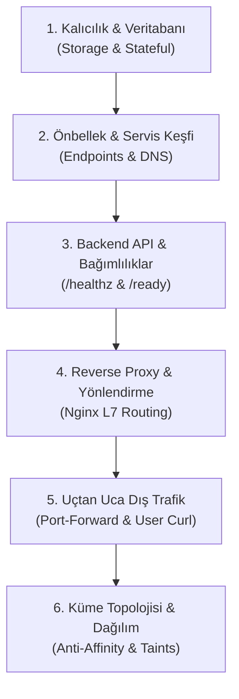

# NovaMarket (k8-troubleshoot-2) — Post-Mortem & Kök Neden Analizi (RCA) Kılavuzu

Bu belge, NovaMarket olay müdahale (incident response) sürecinde karşılaşılan 7 kritik problemin teorik kök nedenlerini, Kubernetes bileşenlerinin (`kube-scheduler`, `kubelet`, `kube-proxy`, `controller-manager`) arka plan kararlarını, minimal düzeltme (diff) kodlarını ve kurumsal sektör tecrübelerini içermektedir.

---

## [INC-201] Veritabanı Pod'u Ayağa Kalkmıyor — Pod Pending & Storage Unbound

### 1. Kök Neden Analizi (RCA)
`kube-scheduler` filtreleme (Filtering / Predicates) evresinde kümedeki 3 node'u inceler:
1. **Node-1 (`10.0.10.122`) & Node-2 (`10.0.10.208`):** Pod manifestosunda `nodeSelector: tier: database` tanımlıdır. Bu iki node `tier=web` etiketine sahip olduğundan elenir (`didn't match Pod's node affinity/selector`).
2. **Node-3 (`10.0.10.78`):** Bu node `tier=database` etiketine sahiptir ancak üzerinde `workload=database:NoSchedule` taint'i vardır.
   Pod manifestosundaki toleration incelendiğinde:
   ```yaml
   tolerations:
     - key: "workload"
       operator: "Equal"
       value: "database"
       effect: "NoExecute"
   ```
   Kubernetes'te Taints & Tolerations mekanizmasında üç temel `effect` vardır:
   * `NoSchedule`: Yeni pod'ların bu node üzerine schedule edilmesini engeller.
   * `PreferNoSchedule`: Scheduler elinden geliyorsa atamaz ama zorunlu kalırsa atar.
   * `NoExecute`: Node üzerine zaten yerleşmiş pod'ları inceler; toleration'ı olmayanları node'dan tahliye eder (evict).
   
   Scheduler filtre aşamasında `NoSchedule` taint'ini arar. Pod'da yalnızca `NoExecute` toleration'ı tanımlı olduğu için scheduler Node-3'ü de reddeder (`1 node(s) had untolerated taint {workload: database}`).
3. Sonuç olarak `0/3 nodes are available` kararı çıkar ve pod `Pending` kalır.
4. `postgres-storage` PVC'si `oci-bv` (WaitForFirstConsumer) kullandığı için, scheduler pod'u belirli bir node'a atamadan (ve o node'un Availability Domain'ini belirlemeden) OCI Block Volume diski oluşturamaz. Bu nedenle PVC de `Pending` olarak bekler.

### 2. Çözüm (Fix)
`manifests/20-database.yaml` içindeki toleration `effect` değeri `NoSchedule` yapılmalıdır:

```diff
--- a/manifests/20-database.yaml
+++ b/manifests/20-database.yaml
@@ -37,7 +37,7 @@ spec:
       tolerations:
         - key: "workload"
           operator: "Equal"
           value: "database"
-          effect: "NoExecute"
+          effect: "NoSchedule"
       containers:
```

*Uygulama Adımı:*
```bash
kubectl apply -f manifests/20-database.yaml
# StatefulSet takılı pod'u otomatik silmeyebilir, pod'u bir kez silin:
kubectl delete pod postgres-0 -n nova-prod
```

### 3. Sektör Deneyimi & Kalıcı Önlem
* **Taint Effect Ayrımı:** Toleration yazılırken `effect` satırı boş bırakılırsa Kubernetes tüm effect'leri (`NoSchedule`, `PreferNoSchedule`, `NoExecute`) tolere eder. Belirli bir kısıt koyulmuyorsa `operator: Exists` veya effect'i belirtmemek operasyonel hataları önler.
* **Kalıcı Mimari Önlem:** Veritabanı ve stateful iş yüklerinin daima doğru toleration ve nodeSelector ile konuşlandırılmasını garanti etmek için CI/CD aşamasında `kube-linter` / `conftest` veya küme girişinde bir **Kyverno / OPA Gatekeeper** Mutation Policy kullanılmalıdır.

---

## [INC-202] Veritabanı Pod'u Çöküyor — CrashLoopBackOff & Storage Mount Hatası

### 1. Kök Neden Analizi (RCA)
1. Pod Node-3'e yerleştikten sonra OCI CSI eklentisi diski formatlar (`mkfs.ext4`) ve `/var/lib/postgresql/data` yoluna bağlar.
2. Linux `ext4` dosya sistemi yapısı gereği, biçimlendirilen her disk bölümünün kök dizininde dosya sistemi kurtarma aracı (`fsck`) için otomatik olarak bir `lost+found` dizini açılır.
3. PostgreSQL resmi imajının giriş betiği (`docker-entrypoint.sh`), belirtilen dizinde var olan bir veritabanı kümesi yoksa yeni bir küme oluşturmak için `initdb` komutunu çalıştırır.
4. Varsayılan veri yolu `PGDATA=/var/lib/postgresql/data` olarak ayarlıdır.
5. `initdb`, hedef dizinin tamamen boş olmasını şart koşar. Dizin kökünde `lost+found` bulunduğu için işlem şu hatayla iptal edilir:
   ```text
   initdb: error: directory "/var/lib/postgresql/data" exists but is not empty
   detail: It contains a lost+found directory, perhaps due to it being a mount point.
   hint: If you want to create a new database system, either remove or empty the directory "/var/lib/postgresql/data" or run initdb with an argument other than "/var/lib/postgresql/data".
   ```
6. Konteyner 1 hata koduyla kapanır ve Kubelet pod'u `CrashLoopBackOff` döngüsüne alır.

### 2. Çözüm (Fix)
`manifests/20-database.yaml` dosyasında volume mount altına `subPath` eklenerek PostgreSQL verileri disk kökünden izole bir alt klasöre yazdırılmalıdır:

```diff
--- a/manifests/20-database.yaml
+++ b/manifests/20-database.yaml
@@ -69,6 +69,7 @@ spec:
           volumeMounts:
             - name: postgres-storage
               mountPath: /var/lib/postgresql/data
+              subPath: postgres-data
           resources:
```

*Uygulama Adımı:*
```bash
kubectl apply -f manifests/20-database.yaml
kubectl delete pod postgres-0 -n nova-prod
```

### 3. Sektör Deneyimi & Kalıcı Önlem
* **Kök Dizin Mount Tuzağı:** AWS EBS, OCI Block Volume veya GCP Persistent Disk fark etmeksizin, blok depolama birimleri pod'lara bağlanırken doğrudan mount noktası olarak verilmemeli; daima `subPath` veya `PGDATA=/var/lib/postgresql/data/pgdata` ortam değişkeni kullanılmalıdır. Bu aynı zamanda ileride aynı volume içinde yedek veya wal arşivleme dizini açabilmek için de bir zorunluluktur.

---

## [INC-203] API Servisi Sürekli Yeniden Başlıyor — Warmup Aşamasında Pod Katliamı

### 1. Kök Neden Analizi (RCA)
1. Kubelet bir pod'u denetlerken önce `startupProbe`'u dikkate alır. Startup probe başarıya ulaşana kadar `livenessProbe` ve `readinessProbe` pasif tutulur.
2. `manifests/40-api.yaml` dosyasındaki startup probe tanımı:
   ```yaml
   startupProbe:
     httpGet:
       path: /healthz
       port: 8080
     periodSeconds: 2
     failureThreshold: 3
   ```
   Kubelet'in konteynere tanıdığı toplam açılış toleransı: $2 \times 3 = 6$ saniyedir.
3. Uygulama ise açılışta veritabanı ve önbellek bağlantılarını hazırlamak için 10 saniye uyumaktadır (`time.sleep(10)`).
4. Konteyner henüz 6. saniyedeyken Kubelet 3 denemeyi tamamlar (`dial tcp :8080: connect: connection refused`), konteynerin kilitlendiğine hükmeder ve `SIGKILL` (kod 137) göndererek konteyneri sonlandırır.

### 2. Çözüm (Fix)
`manifests/40-api.yaml` dosyasında `failureThreshold` değeri uygulamanın ısınma süresini rahatça aşacak şekilde (örneğin 15 deneme = 30 sn) artırılmalıdır:

```diff
--- a/manifests/40-api.yaml
+++ b/manifests/40-api.yaml
@@ -60,7 +60,7 @@ spec:
           startupProbe:
             httpGet:
               path: /healthz
               port: 8080
             periodSeconds: 2
-            failureThreshold: 3
+            failureThreshold: 15
```

### 3. Sektör Deneyimi & Kalıcı Önlem
* **StartupProbe vs InitialDelaySeconds:** Eski usul `initialDelaySeconds: 30` kullanımı kötü bir pratiktir çünkü uygulama 5 saniyede ayağa kalksa bile 30 saniye beklenir. `startupProbe`'a yüksek threshold (örn. `failureThreshold: 30, periodSeconds: 2`) vermek en iyi pratiktir: Uygulama ne zaman hazır olursa probe anında geçer ve trafik anında açılır.

---

## [INC-204] API Pod'u Açıldıktan Sonra Çöküyor — Fatal DB Configuration Missing

### 1. Kök Neden Analizi (RCA)
1. Kubernetes ortam değişkenlerinde `optional: true` bayrağı tanımlandığında, ConfigMap içerisinde aranan anahtar (key) bulunamasa dahi Kubelet pod'u engellemez (`CreateContainerConfigError` üretmez); pod'u başlatır ancak ilgili ortam değişkenini boş (`unset`) bırakır.
2. `manifests/40-api.yaml`:
   ```yaml
   env:
     - name: DB_HOST
       valueFrom:
         configMapKeyRef:
           name: api-config
           key: DATABASE_HOST
           optional: true
   ```
3. `manifests/10-config.yaml` dosyasında ise bu anahtarın adı `DB_HOST` olarak belirlenmiştir.
4. Konteyner sessizce açılır; 10 saniyelik warmup bittiğinde Python kodu `os.environ.get("DB_HOST")` değerinin boş olduğunu tespit eder, loglara `[FATAL]` yazarak `sys.exit(1)` ile kendini kapatır.

### 2. Çözüm (Fix)
`manifests/40-api.yaml` içindeki ConfigMap anahtar adı eşleştirilmelidir:

```diff
--- a/manifests/40-api.yaml
+++ b/manifests/40-api.yaml
@@ -37,7 +37,7 @@ spec:
             - name: DB_HOST
               valueFrom:
                 configMapKeyRef:
                   name: api-config
-                  key: DATABASE_HOST
+                  key: DB_HOST
                   optional: true
```

### 3. Sektör Deneyimi & Kalıcı Önlem
* **Sessiz Başarısızlık Tehlikesi:** Kritik sistem değişkenlerinde `optional: true` ASLA kullanılmamalıdır. `optional: false` bırakıldığında K8s pod'u `CreateContainerConfigError` durumuna sokar ve `kubectl describe pod` çıktısında hangi anahtarın eksik olduğu saniyesinde görülür.

---

## [INC-205] API Servisi Hazır Değil (0/1 NotReady) — Redis Önbellek İletişim Hatası

### 1. Kök Neden Analizi (RCA)
1. API `/ready` sorgusunda Redis önbellek servisine (`redis:6379`) TCP bağlantısı açmayı dener.
2. `manifests/30-cache.yaml` Service tanımı:
   ```yaml
   selector:
     app.kubernetes.io/name: redis
     app.kubernetes.io/component: cache
   ```
3. `redis` Deployment pod etiketlerinde yalnızca `app.kubernetes.io/name: redis` etiketi vardır; `component: cache` etiketi bulunmamaktadır.
4. Kubernetes EndpointSlice Controller, Service selector'ındaki TÜM etiketlerin pod üzerinde tam eşleşmesini (Logical AND) arar.
5. Eşleşme sağlanamadığı için Redis Service EndpointSlice listesi boştur (`<none>`).
6. `kube-proxy` (iptables modunda), arkasında pod bulunmayan ClusterIP servislerine gelen paketleri `REJECT` (TCP RST) ile geri çevirir.
7. API pod'u `redis` servisine ulaşamadığı için `/ready` kontrolü 503 döner ve Kubelet API pod'unu `0/1 NotReady` tutarak trafiğe dahil etmez.

### 2. Çözüm (Fix)
`manifests/30-cache.yaml` Service tanımından uyuşmayan etiket kaldırılmalıdır:

```diff
--- a/manifests/30-cache.yaml
+++ b/manifests/30-cache.yaml
@@ -47,4 +47,3 @@ spec:
       name: redis
   selector:
     app.kubernetes.io/name: redis
-    app.kubernetes.io/component: cache
```

### 3. Sektör Deneyimi & Kalıcı Önlem
* **Service Drift:** Pod çalışıyor ve CoreDNS ismi çözüyor olsa bile `Connection refused` alınıyorsa ilk bakılması gereken komut:
  `kubectl get endpointslices -l kubernetes.io/service-name=<svc-name>` komutudur. Eşleşmeyen tek bir etiket bütün trafiği sessizce düşürür.

---

## [INC-206] Mağaza Arayüzü 503 Servis Dışı — Frontend Pod'ları NotReady (0/1)

### 1. Kök Neden Analizi (RCA)
1. `manifests/50-frontend.yaml` dosyasında Nginx pod'u için `readinessProbe` yolu `/health` olarak girilmiştir.
2. Nginx sanal sunucu yapılandırmasında (`manifests/10-config.yaml`) ise sağlık kontrolü için özel olarak `/healthz` bloğu tanımlanmıştır:
   ```nginx
   location = /healthz {
       return 200 '{"status":"ok"}\n';
   }
   ```
3. Nginx `/health` isteğini dosya sisteminde arar; bulamayınca HTTP 404 döner.
4. Kubelet için 200-399 dışındaki yanıtlar başarısızlıktır. Pod `0/1 Ready` durumunda kalır ve Service Endpoint listesinden çıkarılarak trafik alması engellenir.

### 2. Çözüm (Fix)
`manifests/50-frontend.yaml` dosyasındaki probe yolu `/healthz` yapılmalıdır:

```diff
--- a/manifests/50-frontend.yaml
+++ b/manifests/50-frontend.yaml
@@ -35,7 +35,7 @@ spec:
           readinessProbe:
             httpGet:
-              path: /health
+              path: /healthz
               port: 8080
             periodSeconds: 5
```

### 3. Sektör Deneyimi & Kalıcı Önlem
* **SPA False Positive Tuzağı:** Nginx konfigürasyonlarında SPA fallback (`try_files $uri /index.html`) bulunuyorsa, var olmayan sağlık endpoint'leri dahi index.html üzerinden 200 dönerek yanıltıcı sağlık (false positive) üretebilir. Sağlık blokları daima en üstte `location = /healthz` gibi katı kurallarla izole edilmelidir.

---

## [INC-207] Frontend Yüksek Erişilebilirlik (HA) Uyarısı — 3. Replika Pending

### 1. Kök Neden Analizi (RCA)
1. `frontend` Deployment replika sayısı 3'tür.
2. Pod şablonunda katı pod anti-affinity kuralı mevcuttur:
   ```yaml
   podAntiAffinity:
     requiredDuringSchedulingIgnoredDuringExecution:
       - labelSelector:
           matchLabels:
             app.kubernetes.io/name: frontend
         topologyKey: "kubernetes.io/hostname"
   ```
   Bu kural: "Aynı hostname üzerinde birden fazla frontend pod'u OLAMAZ, bu kural zorunludur" demektir.
3. Kümedeki toplam node sayısı 3'tür. Ancak Node-3 üzerinde `tier=database` etiketi ve `workload=database:NoSchedule` taint'i vardır. Frontend pod'u buraya gidemez.
4. Geriye yalnızca 2 adet `tier=web` node kalır. İlk iki replika bu iki node'a yerleştikten sonra, 3. pod için yerleşebileceği boş bir web node kalmaz.
5. `kube-scheduler` sert anti-affinity kuralını kıramaz ve 3. pod'u zorunlu olarak `Pending` durumunda bırakır.

### 2. Çözüm (Fix)
Sert kural (`required`), esnek/tercih edilen kurala (`preferred`) dönüştürülmelidir (veya mevcut topolojiye uygun olarak replika sayısı 2 yapılabilir):

```diff
--- a/manifests/50-frontend.yaml
+++ b/manifests/50-frontend.yaml
@@ -21,11 +21,12 @@ spec:
       nodeSelector:
         tier: web
       affinity:
         podAntiAffinity:
-          requiredDuringSchedulingIgnoredDuringExecution:
-            - labelSelector:
-                matchLabels:
-                  app.kubernetes.io/name: frontend
-              topologyKey: "kubernetes.io/hostname"
+          preferredDuringSchedulingIgnoredDuringExecution:
+            - weight: 100
+              podAffinityTerm:
+                labelSelector:
+                  matchLabels:
+                    app.kubernetes.io/name: frontend
+                topologyKey: "kubernetes.io/hostname"
```

### 3. Sektör Deneyimi & Kalıcı Önlem
* **Scale-Down Kilitlenmesi (Deadlock):** Kümede yeterli node yokken `required` anti-affinity kullanmak, RollingUpdate sırasında yeni pod'un açılamamasına ve dağıtımın donmasına (`ProgressDeadlineExceeded`) yol açar. Prodüksiyonda pod dağıtımı için modern standart `topologySpreadConstraints` (özellikle `whenUnsatisfiable: ScheduleAnyway`) veya `preferredDuringScheduling` kullanmaktır.

---

## 🌐 FİNAL: Üretim Standardında Web Sitesi & Mikroservis Sağlık Kontrol Metodolojisi

Bir Kubernetes platform mühendisi veya SRE nöbetçisi olarak bir dağıtımın "gerçekten çalıştığını" teyit etmek için izlenmesi gereken genel kontrol standardı şudur:



### Neden "İçeriden Dışarıya" (Bottom-Up) Kontrol Edilir?
Doğrudan web sitesini açmaya çalışıp hata aldığınızda sorunun Nginx'te mi, API'de mi, Redis'te mi yoksa veritabanında mı olduğunu anlayamazsınız. Profesyonel SRE yaklaşımı, bağımlılık ağacının en kökünden (veritabanından) başlayarak kullanıcıya doğru adım adım ilerlemektir:

1. **Önce Veritabanı & Kalıcılık (Katman 1):**
   * Diski var mı, bağlı mı (`Bound`)?
   * Veritabanı motoru ayağa kalkıp porta bağlanıyor mu (`pg_isready`)?
2. **Sonra Servis Keşfi & Ağ Haritası (Katman 2):**
   * Servislerin arkasındaki pod IP'leri dolmuş mu (`kubectl get endpointslices`)?
   * DNS üzerinden isim çözülebiliyor mu?
3. **Uygulama Bağımlılık Doğrulaması (Katman 3):**
   * Pod içindeki uygulama kendi alt bileşenlerine (DB ve Redis) erişebiliyor mu (`/ready` endpoint'i)?
   * API işlevsel veri (JSON) üretebiliyor mu?
4. **Ters Proxy (Reverse Proxy) Entegrasyonu (Katman 4):**
   * Web sunucusu (Nginx) statik dosyaları sunabiliyor mu?
   * `/api/` yoluna gelen istekleri arkadaki backend'e hatasız proxy edebiliyor mu?
5. **Kullanıcı Gözünden Uçtan Uca Test (Katman 5):**
   * Dışarıdan port açıldığında veya ingress üzerinden girildiğinde sayfa yükleniyor ve API çağrıları başarılı dönüyor mu?
6. **Topoloji & Dayanıklılık (Katman 6):**
   * Pod'lar node'lara dengeli dağılmış mı?
   * Bir node çökerse diğer replikalar hizmeti sürdürebilecek mi?
