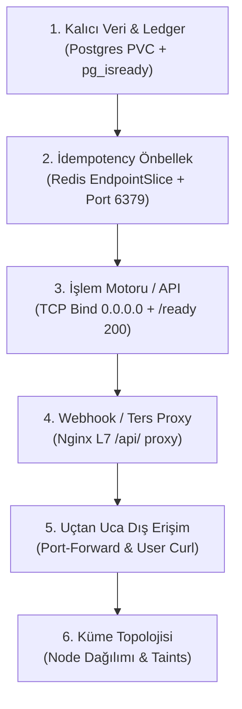

# ApexPay (k8-troubleshoot-3) — Post-Mortem & Kök Neden Analizi (RCA) Kılavuzu

Bu belge, ApexPay finansal mutabakat ve işlem platformunda meydana gelen 7 kritik arızanın Kubernetes denetim düzlemi (`kube-scheduler`, `kubelet`, `kube-proxy`, Linux kernel izinleri, VFS mount mekanizması ve ağ isim alanları) perspektifinden derinlemesine kök neden analizini, minimal düzeltme kodlarını ve kurumsal sektör tecrübelerini içermektedir.

---

## [INC-301] Ledger Veritabanı Pod'u Schedule Olamıyor — Pod Pending

### 1. Kök Neden Analizi (RCA)
1. `kube-scheduler` filtreleme (Filtering / Predicates) evresinde kümedeki 3 node'u inceler:
   * **Node-1 (`10.0.10.122`) & Node-2 (`10.0.10.208`):** Bu node'lar `tier=web` etiketine sahiptir.
   * **Node-3 (`10.0.10.78`):** Bu node `tier=database` etiketine ve `workload=database:NoSchedule` taint'ine sahiptir.
2. `ledger-db` StatefulSet manifestosunda toleration doğru tanımlanmıştır (`key: workload, value: database, effect: NoSchedule`).
3. Ancak pod şablonundaki `nodeAffinity` kuralı incelendiğinde:
   ```yaml
   nodeAffinity:
     requiredDuringSchedulingIgnoredDuringExecution:
       nodeSelectorTerms:
         - matchExpressions:
             - key: tier
               operator: In
               values:
                 - db
   ```
   Scheduler, `tier` etiketinin `"db"` değerine sahip olduğu bir node aramaktadır.
4. Kümedeki Node-3'ün gerçek etiketi ise `tier=database`'dir! Node-1 ve Node-2 ise `tier=web`'dir.
5. Sonuç olarak 3 node'un 3'ü de affinite kuralını karşılayamadığı için elenir:
   ```text
   0/3 nodes are available: 1 node(s) had untolerated taint {workload: database}, 2 node(s) didn't match Pod's node affinity/selector.
   ```
6. Pod `Pending` kalır; `oci-bv` (WaitForFirstConsumer) depolama sınıfı pod atanmadığı için diski oluşturamaz.

### 2. Çözüm (Fix)
`manifests/20-database.yaml` içindeki `nodeAffinity` değer kümesi kümedeki etiketle (`database`) eşleştirilmelidir:

```diff
--- a/manifests/20-database.yaml
+++ b/manifests/20-database.yaml
@@ -37,7 +37,7 @@ spec:
                   - key: tier
                     operator: In
                     values:
-                      - db
+                      - database
       securityContext:
```

*Uygulama Adımı:*
```bash
kubectl apply -f manifests/20-database.yaml
kubectl delete pod ledger-db-0 -n apex-prod
```

### 3. Sektör Deneyimi & Kalıcı Önlem
* **Etiket Kısaltması Tuzağı:** Ekipler arası geçişlerde `tier=db` vs `tier=database` veya `env=prd` vs `env=production` uyumsuzlukları sık yaşanır.
* **Kalıcı Önlem:** Katı affinite kurallarında tek bir değer yerine genişletilebilir listeler (`values: ["database", "db"]`) kullanılabilir veya küme etiketleri OPA Gatekeeper ile standartlaştırılmalıdır.

---

## [INC-302] Ledger Veritabanı Başlatılamıyor — Non-Root Disk İzin Hatası (Permission Denied)

### 1. Kök Neden Analizi (RCA)
1. Kurumsal güvenlik standartları gereği PostgreSQL konteyneri `root` olmayan bir kullanıcı ile çalıştırılmaktadır:
   ```yaml
   securityContext:
     runAsUser: 999
     runAsGroup: 999
   ```
2. OCI CSI eklentisi kalıcı blok diski (`ext4`) oluşturur ve Linux çekirdeği seviyesinde node'a bağlar.
3. Linux dosya sistemi montajlarında (VFS), `fsGroup` belirtilmediğinde bir blok disk varsayılan olarak `root:root (0755)` izinleriyle mount edilir.
4. Konteyner UID 999 (`postgres`) olarak çalıştığında, kök dizini `root` kullanıcısına ait olan bir dosya sisteminde yeni klasör oluşturamaz veya `initdb` yapamaz:
   ```text
   mkdir: can't create directory '/var/lib/postgresql/data/data': Permission denied
   initdb: could not access directory "/var/lib/postgresql/data/data": Permission denied
   ```
5. Konteyner 1 hata koduyla kapanır ve `CrashLoopBackOff` döngüsüne girer.

### 2. Çözüm (Fix)
`manifests/20-database.yaml` dosyasında `pod.spec.securityContext` altına `fsGroup: 999` eklenmelidir:

```diff
--- a/manifests/20-database.yaml
+++ b/manifests/20-database.yaml
@@ -40,6 +40,7 @@ spec:
       securityContext:
         runAsUser: 999
         runAsGroup: 999
+        fsGroup: 999
       containers:
```

*Uygulama Adımı:*
```bash
kubectl apply -f manifests/20-database.yaml
kubectl delete pod ledger-db-0 -n apex-prod
```

### 3. Sektör Deneyimi & Kalıcı Önlem
* **fsGroup Mekanizması:** `fsGroup` tanımlandığında Kubelet, birimi pod'a bağlarken tüm dosyaların grup sahipliğini otomatik olarak bu GID'ye (999) çeker ve `g+rwx` izinlerini uygular. Böylece `root` yetkisine veya ayrı bir `initContainer (chown)` kullanımına gerek kalmadan güvenli depolama sağlanır. CIS Kubernetes Benchmark uyumluluğunda altın standarttır.

---

## [INC-303] Ödeme API Pod'ları Schedule Edilemiyor — Kaynak Talebi Düğüm Sınırını Aşıyor

### 1. Kök Neden Analizi (RCA)
1. `manifests/40-api.yaml` dosyasında `payment-api` pod'ları için şu CPU isteği tanımlanmıştır:
   ```yaml
   resources:
     requests:
       cpu: "4"
   ```
2. Kümedeki worker node'lar `VM.Standard.E3.Flex` mimarisinde 2 çekirdekli (vCPU) sunuculardır.
3. Kubelet, sistem bileşenleri ve OS daemons için ayrılan pay düşüldükten sonra her bir worker node'un tahsis edilebilir (Allocatable) CPU kapasitesi yaklaşık **1830m (1.83 çekirdek)** seviyesindedir.
4. `kube-scheduler` filtreleme aşamasında pod'un 4000m (4 CPU) istediğini, ancak boş bir node'un en fazla 1830m verebileceğini tespit eder.
5. Hiçbir node bu kaynağı karşılayamadığı için iki replika da `Pending` kalır:
   ```text
   0/3 nodes are available: 1 node(s) had untolerated taint {workload: database}, 2 Insufficient cpu.
   ```

### 2. Çözüm (Fix)
`manifests/40-api.yaml` dosyasındaki `requests.cpu` ve `limits.cpu` değerleri küme node kapasitesine uygun gerçekçi seviyelere çekilmelidir:

```diff
--- a/manifests/40-api.yaml
+++ b/manifests/40-api.yaml
@@ -28,9 +28,9 @@ spec:
           envFrom:
             - configMapRef:
                 name: api-config
           resources:
             requests:
-              cpu: "4"
+              cpu: "100m"
               memory: "128Mi"
             limits:
-              cpu: "4"
+              cpu: "500m"
               memory: "256Mi"
```

### 3. Sektör Deneyimi & Kalıcı Önlem
* **Over-Requesting Tehlikesi:** Geliştiricilerin test ortamından prodüksiyona manifest taşırken yüksek request değerleri unutması, kümede boş RAM ve CPU olmasına rağmen pod'ların schedule olamamasına (kaynak parçalanması / starvation) yol açar. Kubernetes'te LimitRange nesneleri kurularak kontrolsüz yüksek istekler namespace bazında sınırlandırılmalıdır.

---

## [INC-304] Ödeme API Konteyneri Açılırken Çöküyor — Uygulama Giriş Dosyası Bulunamadı

### 1. Kök Neden Analizi (RCA)
1. `manifests/40-api.yaml` pod şablonunda iki ayrı ConfigMap volume olarak bağlanmıştır:
   ```yaml
   volumeMounts:
     - name: code-volume
       mountPath: /app/server.py
       subPath: server.py
     - name: settings-volume
       mountPath: /app
   ```
2. Linux dosya sistemi (VFS) montaj mantığı gereği:
   Bir dizin üzerine (`/app`) doğrudan bir volume (`settings-volume`) bağlandığında, o dizinin altındaki tüm mevcut dosyalar perdelenir (maskelenir).
3. Sonuç olarak `/app` dizini yalnızca `settings-volume` içindeki `settings.json` dosyasını içerir hale gelir; `server.py` dosyası tamamen görünmez olur.
4. Konteyner `["python3", "-u", "/app/server.py"]` komutunu çalıştırmayı denediğinde dosya bulunamaz:
   ```text
   python3: can't open file '/app/server.py': [Errno 2] No such file or directory
   ```
5. Konteyner 2 çıkış koduyla anında çöker ve `CrashLoopBackOff`'a düşer.

### 2. Çözüm (Fix)
`settings-volume` mount noktası ya `subPath` ile tekil dosya olarak bağlanmalı ya da `/app/config/settings.json` gibi bağımsız bir alt dizine alınmalıdır:

```diff
--- a/manifests/40-api.yaml
+++ b/manifests/40-api.yaml
@@ -52,3 +52,4 @@ spec:
             - name: settings-volume
-              mountPath: /app
+              mountPath: /app/settings.json
+              subPath: settings.json
```

### 3. Sektör Deneyimi & Kalıcı Önlem
* **Volume Mount Gölgelemesi (Overlaying):** Bir ConfigMap veya Secret'ı var olan bir uygulama dizinine bağlarken `subPath` kullanılmazsa, imajın içerisindeki kodlar veya binary'ler ezilir. Tekil konfigürasyon dosyalarında daima `subPath` tercih edilmeli veya konfigürasyonlar `/etc/app/` gibi izole yollara mount edilmelidir.

---

## [INC-305] Ödeme API Pod'ları Sürekli Öldürülüyor — Liveness Probe Zaman Aşımı

### 1. Kök Neden Analizi (RCA)
1. `payment-api` uygulamasının `/healthz` endpoint'i, finansal işlem motorunun iç durum kontrollerini simüle etmek için 1.2 saniye beklemektedir (`time.sleep(1.2)`).
2. Manifestoda tanımlanan `livenessProbe`:
   ```yaml
   livenessProbe:
     httpGet:
       path: /healthz
       port: 8080
     periodSeconds: 10
     timeoutSeconds: 1
     failureThreshold: 2
   ```
3. Kubelet, HTTP isteğini başlattığında Go HTTP istemcisi için `timeoutSeconds: 1` süresi biter bitmez isteği iptal eder (`context deadline exceeded`).
4. Arka arkaya 2 kez zaman aşımı yaşandığında (`failureThreshold: 2`), Kubelet uygulamanın kilitlendiğine (deadlock) karar verir ve pod'a `SIGKILL` gönderir.
5. Bu durum her 20-30 saniyede bir konteynerin yeniden başlatılmasına yol açar.

### 2. Çözüm (Fix)
`manifests/40-api.yaml` dosyasındaki `timeoutSeconds` değeri yanıt süresini karşılayacak şekilde (örn. 3 sn) artırılmalıdır:

```diff
--- a/manifests/40-api.yaml
+++ b/manifests/40-api.yaml
@@ -38,5 +38,5 @@ spec:
           livenessProbe:
             httpGet:
               path: /healthz
               port: 8080
             periodSeconds: 10
-            timeoutSeconds: 1
+            timeoutSeconds: 3
             failureThreshold: 2
```

### 3. Sektör Deneyimi & Kalıcı Önlem
* **Probe Death Spiral (Ölüm Sarmalı):** Yüksek yük altındaki mikroservislerde CPU kısılması (throttling) veya GC duraklamaları nedeniyle yanıt süreleri 1 saniyenin üzerine çıkabilir. Çok dar `timeoutSeconds: 1` verildiğinde pod aslında çalışırken Kubelet tarafından haksız yere öldürülür. Sağlık kontrollerinde `timeoutSeconds` için en az 3-5 saniyelik güvenli marj bırakılmalıdır.

---

## [INC-306] Önbellek Servisine Ulaşılamıyor — Named Port Çözümleme Hatası

### 1. Kök Neden Analizi (RCA)
1. `transaction-cache` Redis servisi tanımı:
   ```yaml
   ports:
     - port: 6379
       targetPort: redis-port
       name: redis
   ```
2. Redis Deployment şablonundaki konteyner portu:
   ```yaml
   ports:
     - containerPort: 6379
       name: redis
   ```
3. Kubernetes ağ mimarisinde bir Service'te `targetPort` string (Named Port) olarak verildiğinde, EndpointSlice Controller hedef pod'un `ports[].name` alanında tam olarak bu string'i arar.
4. Serviste `redis-port` aranırken pod'da `redis` tanımlı olduğu için port eşleşmesi yapılamaz.
5. EndpointSlice içindeki port haritalaması eksik kalır; diğer pod'lar `transaction-cache:6379` servisine bağlandığında paketler yönlendirilemez.

### 2. Çözüm (Fix)
`manifests/30-cache.yaml` Service tanımındaki `targetPort` doğrudan `6379` veya pod'daki isimle (`redis`) eşleştirilmelidir:

```diff
--- a/manifests/30-cache.yaml
+++ b/manifests/30-cache.yaml
@@ -42,5 +42,5 @@ spec:
   type: ClusterIP
   ports:
     - port: 6379
-      targetPort: redis-port
+      targetPort: 6379
       name: redis
```

### 3. Sektör Deneyimi & Kalıcı Önlem
* **Named Port Ayrışması:** Sayısal portlar (`targetPort: 6379`) yazım hatalarına karşı daha az kırılgandır. Named port kullanılacaksa Helm veya Kustomize şablonlarında tek bir `values.yaml` değişkeninden türetilmeli, elle manuel farklı isimler verilmemelidir.

---

## [INC-307] Gateway API'ye Bağlanamıyor — 502 Bad Gateway & Localhost İzolasyonu

### 1. Kök Neden Analizi (RCA)
1. `payment-api` uygulamasının konfigürasyonunda (`manifests/10-config.yaml`):
   ```yaml
   BIND_HOST: "127.0.0.1"
   ```
2. Python TCP sunucusu socket'ini `127.0.0.1:8080` adresine bağlar (bind).
3. Linux ağ isim alanları (Network Namespaces) yapısında:
   * `127.0.0.1` yalnızca pod'un kendi yerel Loopback (`lo`) arayüzüne bağlıdır.
   * Küme içindeki diğer pod'lardan (örneğin Gateway'den) gelen paketler ise pod'un sanal ethernet arayüzüne (`eth0` / `10.0.10.x`) ulaşır.
4. Linux çekirdeği `eth0` üzerinden gelen port 8080 paketlerini inceler; bu IP üzerinde hiçbir işlem dinlemede olmadığı için TCP RST döner (`Connection refused`).
5. Bu nedenle `payment-api` pod'u kendi içinden `curl 127.0.0.1:8080` ile çalışırken, Gateway veya Service üzerinden gelen tüm istekler HTTP 502 Bad Gateway ile düşer.

### 2. Çözüm (Fix)
`manifests/10-config.yaml` içindeki `BIND_HOST` değeri `0.0.0.0` (tüm ağ arayüzlerini dinle) olarak değiştirilmelidir:

```diff
--- a/manifests/10-config.yaml
+++ b/manifests/10-config.yaml
@@ -29,3 +29,3 @@ data:
   REDIS_PORT: "6379"
-  BIND_HOST: "127.0.0.1"
+  BIND_HOST: "0.0.0.0"
   PORT: "8080"
```

*Uygulama Adımı:*
```bash
kubectl apply -f manifests/10-config.yaml
kubectl rollout restart deploy/payment-api -n apex-prod
```

### 3. Sektör Deneyimi & Kalıcı Önlem
* **0.0.0.0 vs 127.0.0.1:** Flask, FastAPI, Node.js veya Django gibi geliştirme çatılarında varsayılan dinleme adresi güvenlik amacıyla `127.0.0.1` gelir. Bir uygulama Docker/Kubernetes konteynerine paketlenirken dinleme adresi açıkça `0.0.0.0` yapılmazsa, dışarıdan gelen hiçbir konteyner trafiği içeri giremez.

---

## 🌐 FİNAL: Üretim Standardında Finansal Gateway Sağlık Kontrol Metodolojisi

Finansal veya e-ticaret tabanlı bir mikroservis kümesini canlıya alırken izlenmesi gereken sistematik SRE denetim sırası:



### Katman Katman Ne Doğrulanır?
1. **Veritabanı Katmanı (Stateful):**
   * Disk sağlıklı bağlandı mı (`Bound`)?
   * Dosya izinleri (`fsGroup`) doğru mu?
   * Veritabanı istemci kabul ediyor mu (`pg_isready`)?
2. **Önbellek & Servis Keşfi (Cache & Service Discovery):**
   * Servis port tanımları ile pod portları eşleşti mi?
   * `kubectl get endpointslices` üzerinde hazır IP ve port var mı?
3. **Backend İşlem Motoru (Business Logic & Readiness):**
   * Uygulama tüm arayüzleri dinliyor mu (`0.0.0.0`)?
   * `/ready` endpoint'i veritabanı ve önbellek bağlantılarını doğruluyor mu?
4. **Ters Proxy & Yönlendirme (L7 Proxy):**
   * Gateway `/api/` çağrılarını arkadaki backend'e 502 almadan aktarabiliyor mu?
5. **Kullanıcı Perspektifi (Blackbox Testing):**
   * Dışarıdan yapılan gerçek bir HTTP çağrısı HTTP 200 ve geçerli JSON mutabakat kaydı döndürüyor mu?
6. **Altyapı Topolojisi (Infrastructure):**
   * Hassas veritabanı iş yükü sadece atanmış ve tainted node üzerinde mi?
   * Web ve API pod'ları diğer worker node'lara homojen dağılmış mı?
