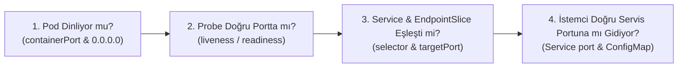

# PulseMed (k8-troubleshoot-4) — Post-Mortem & Kök Neden Analizi (RCA) Kılavuzu

Bu belge, PulseMed hasta telemetri platformunda yaşanan 7 zincirleme arızanın Kubernetes denetim ve veri düzlemi (`kube-scheduler`, `EndpointSlice controller`, `kube-proxy`, `kubelet`, `CoreDNS`) perspektifinden derinlemesine kök neden analizini, minimal düzeltme (diff) kodlarını ve kurumsal sektör deneyimlerini içermektedir.

---

## [INC-401] Hasta Telemetri Veritabanı Ayağa Kalkmıyor — Pod Pending

### 1. Kök Neden Analizi (RCA)
1. `vitals-db-0` pod'unda `nodeSelector: tier: database` tanımlanmıştır; bu kural Node-1 ve Node-2'yi (`tier=web`) filtreler.
2. Geriye kalan tek uygun aday **Node-3 (`10.0.10.78`)** üzerinde `workload=database:NoSchedule` taint'i bulunmaktadır.
3. Pod manifestosundaki toleration bloğu incelendiğinde:
   ```yaml
   tolerations:
     - key: "role"
       operator: "Equal"
       value: "database"
       effect: "NoSchedule"
   ```
   Taint anahtarı `workload` iken toleration'da `key: "role"` yazılmıştır!
4. `kube-scheduler` taint eşleşmesinde `key`, `value` ve `effect` alanlarının üçünün de uyuşmasını şart koşar. Anahtar uyuşmadığı için Node-3 de reddedilir (`1 node(s) had untolerated taint {workload: database}`).
5. Pod `Pending` kalır; `oci-bv` (WaitForFirstConsumer) depolama sınıfı pod bir node'a atanmadığı için diski bağlayamaz.

### 2. Çözüm (Fix)
`manifests/20-database.yaml` içindeki toleration `key` alanı `workload` olarak düzeltilmelidir:

```diff
--- a/manifests/20-database.yaml
+++ b/manifests/20-database.yaml
@@ -36,7 +36,7 @@ spec:
       nodeSelector:
         tier: database
       tolerations:
-        - key: "role"
+        - key: "workload"
           operator: "Equal"
           value: "database"
           effect: "NoSchedule"
```

*Uygulama Adımı:*
```bash
kubectl apply -f manifests/20-database.yaml
kubectl delete pod vitals-db-0 -n pulse-prod
```

### 3. Sektör Deneyimi & Kalıcı Önlem
* **Teşhis İpucu:** Bir pod `Pending` kaldığında ilk komut daima `kubectl describe pod <pod-name>` ve ardından `kubectl get nodes -o custom-columns=NAME:.metadata.name,TAINTS:.spec.taints` olmalıdır. Scheduler mesajındaki `{workload: database}` ifadesi doğrudan eksik anahtar-değer çiftini söyler.

---

## [INC-402] Veritabanı Çalışıyor Ama Servis Üzerinden Erişilemiyor — DNS NXDOMAIN & Boş Endpoint

### 1. Kök Neden Analizi (RCA)
1. `vitals-db` Headless Service (`clusterIP: None`) tanımındaki `selector` incelendiğinde:
   ```yaml
   selector:
     app.kubernetes.io/name: postgres-db
   ```
2. Oysa `vitals-db` StatefulSet pod'larının gerçek etiketi:
   ```yaml
   labels:
     app.kubernetes.io/name: vitals-db
   ```
3. `EndpointSlice Controller`, Service `selector` alanı ile pod etiketlerini eşleştiremediği için servisin arkasında hiçbir aktif pod kaydı oluşturmaz (`Endpoints: <none>`).
4. Headless servislerde (`clusterIP: None`), `CoreDNS` yalnızca servisin arkasında hazır bir Endpoint varsa DNS `A` kaydı üretir. Endpoint boş olduğu için `vitals-db.pulse-prod.svc.cluster.local` sorguları `NXDOMAIN` ile başarısız olur.

### 2. Çözüm (Fix)
`manifests/20-database.yaml` içindeki Service `selector` etiketi pod etiketiyle (`vitals-db`) eşleştirilmelidir:

```diff
--- a/manifests/20-database.yaml
+++ b/manifests/20-database.yaml
@@ -13,4 +13,4 @@ spec:
       targetPort: 5432
       name: postgresql
   selector:
-    app.kubernetes.io/name: postgres-db
+    app.kubernetes.io/name: vitals-db
```

### 3. Sektör Deneyimi & Kalıcı Önlem
* **Headless Service vs ClusterIP DNS Farkı:** Normal bir `ClusterIP` servisinde arkada hiç pod olmasa bile sanal IP atandığı için DNS çözülür (ancak bağlantı reddedilir). `Headless Service` (`clusterIP: None`) ise sanal IP'ye sahip değildir; DNS doğrudan pod IP'lerini döner. Bu yüzden selector hatası Headless serviste doğrudan **DNS NXDOMAIN** hatası olarak patlar!

---

## [INC-403] Önbellek (Redis) Servisi Bağlantıyı Reddediyor — Connection Refused

### 1. Kök Neden Analizi (RCA)
1. `session-store` (Redis) konteyneri varsayılan `6379` portunu dinlemektedir (`containerPort: 6379`).
2. `manifests/30-cache.yaml` içindeki Service tanımı incelendiğinde:
   ```yaml
   ports:
     - port: 6379
       targetPort: 6380
   ```
3. `kube-proxy`, servisin `port: 6379` adresine gelen paketleri yakalar ve `targetPort: 6380` kuralı gereği pod'un `6380` portuna DNAT (Destination NAT) yapar.
4. Redis pod'unda `6380` portunu dinleyen hiçbir süreç olmadığı için Linux çekirdeği anında `TCP RST` (`Connection refused`) döner.

### 2. Çözüm (Fix)
`manifests/30-cache.yaml` içindeki Service `targetPort` değeri `6379` yapılmalıdır:

```diff
--- a/manifests/30-cache.yaml
+++ b/manifests/30-cache.yaml
@@ -42,5 +42,5 @@ spec:
   type: ClusterIP
   ports:
     - port: 6379
-      targetPort: 6380
+      targetPort: 6379
       name: redis
```

### 3. Sektör Deneyimi & Kalıcı Önlem
* **Port Zinciri Doğrulaması:** Bir servise `Connection refused` alınıyorsa `kubectl get endpointslices -l kubernetes.io/service-name=<svc>` çıktısındaki port numarası ile `kubectl get pod <pod> -o jsonpath='{.spec.containers[*].ports}'` çıktısı karşılaştırılmalıdır.

---

## [INC-404] Telemetry API Pod'ları Sürekli Yeniden Başlıyor — CrashLoopBackOff

### 1. Kök Neden Analizi (RCA)
1. `telemetry-api` uygulaması `PORT=8080` ortam değişkeniyle `0.0.0.0:8080` portunu dinlemektedir.
2. Ancak `manifests/40-api.yaml` içindeki `livenessProbe` ve `readinessProbe` tanımları `port: 8000` adresini yoklamaktadır:
   ```yaml
   livenessProbe:
     httpGet:
       path: /healthz
       port: 8000
   ```
3. Kubelet `8000` portuna bağlanmaya çalıştığında `connection refused` alır.
4. `livenessProbe` 3 kez üst üste başarısız olduğunda (`failureThreshold: 3`), Kubelet konteynerin bozulduğuna karar verir ve konteyneri öldürüp yeniden başlatır (`CrashLoopBackOff`).

### 2. Çözüm (Fix)
`manifests/40-api.yaml` dosyasındaki her iki probe'un portu `8080` olarak düzeltilmelidir:

```diff
--- a/manifests/40-api.yaml
+++ b/manifests/40-api.yaml
@@ -34,12 +34,12 @@ spec:
           livenessProbe:
             httpGet:
               path: /healthz
-              port: 8000
+              port: 8080
             initialDelaySeconds: 3
             periodSeconds: 5
             failureThreshold: 3
           readinessProbe:
             httpGet:
               path: /ready
-              port: 8000
+              port: 8080
             initialDelaySeconds: 2
```

### 3. Sektör Deneyimi & Kalıcı Önlem
* **Named Port ile Probe Güvenliği:** Konteyner portuna `name: http` verip probe içinde `port: http` yazmak, sayısal port değişikliklerinde probe'ların bozulmasını engeller.

---

## [INC-405] Telemetry API Çökmüyor Ama Hazır Değil (0/1 NotReady) — Bağımlılık Port Hatası

### 1. Kök Neden Analizi (RCA)
1. Probe portları `8080`'e çekildikten sonra `livenessProbe` (`/healthz`) HTTP 200 alır ve pod artık yeniden başlamaz.
2. Ancak `readinessProbe` (`/ready`) HTTP 503 almaya devam eder ve pod `0/1 NotReady` kalır.
3. Pod içine girip `/ready` çıktısı kontrol edildiğinde:
   ```json
   {
     "status": "not_ready",
     "vitals_db": "unreachable (vitals-db.pulse-prod.svc.cluster.local:5433)",
     "session_store": "connected (session-store.pulse-prod.svc.cluster.local:6379)"
   }
   ```
4. `manifests/10-config.yaml` içindeki `api-config` ConfigMap'inde `DB_PORT: "5433"` olarak yanlış tanımlanmıştır (PostgreSQL `5432` dinlemektedir).

### 2. Çözüm (Fix)
`manifests/10-config.yaml` içindeki `DB_PORT` değeri `"5432"` yapılmalı ve API pod'ları yeniden başlatılmalıdır:

```diff
--- a/manifests/10-config.yaml
+++ b/manifests/10-config.yaml
@@ -22,5 +22,5 @@ metadata:
 data:
   DB_HOST: "vitals-db.pulse-prod.svc.cluster.local"
-  DB_PORT: "5433"
+  DB_PORT: "5432"
   DB_NAME: "pulse_vitals"
```

*Uygulama Adımı:*
```bash
kubectl apply -f manifests/10-config.yaml
kubectl rollout restart deploy/telemetry-api -n pulse-prod
```

### 3. Sektör Deneyimi & Kalıcı Önlem
* **ConfigMap Güncellemesi ve Env Davranışı:** Bir ConfigMap güncellendiğinde, onu `env` veya `envFrom` ile kullanan çalışan pod'ların ortam değişkenleri **otomatik güncellenmez** (Linux'ta bir sürecin environment tablosu süreç başlarken oluşturulur). ConfigMap değişikliğinin yansıması için `kubectl rollout restart` şarttır.

---

## [INC-406] Portal Proxy 502 Bad Gateway Veriyor — Servis Portu ve Proxy Uyuşmazlığı

### 1. Kök Neden Analizi (RCA)
1. `manifests/40-api.yaml` içindeki `telemetry-api` Service tanımı incelendiğinde:
   ```yaml
   ports:
     - port: 80
       targetPort: 8080
   ```
   Yani servis küme içinde **port 80** üzerinden yayın yapmakta ve gelen trafiği pod'un `8080` portuna aktarmaktadır.
2. Ancak `manifests/10-config.yaml` içindeki Nginx konfigürasyonunda (`portal-nginx`):
   ```nginx
   location /api/ {
       proxy_pass http://telemetry-api:8080/;
   }
   ```
   Nginx, `telemetry-api` servisinin `8080` portuna bağlanmaya çalışmaktadır!
3. Servisin ClusterIP'si üzerinde `8080` portu açık olmadığı için bağlantı reddedilir ve Nginx istemciye `502 Bad Gateway` döner.

### 2. Çözüm (Fix)
İki geçerli çözüm vardır:
* **Yöntem A (Önerilen - `manifests/40-api.yaml` Service portunu `8080` yapmak):**
  ```diff
  --- a/manifests/40-api.yaml
  +++ b/manifests/40-api.yaml
  @@ -66,5 +66,5 @@ metadata:
   spec:
     type: ClusterIP
     ports:
  -    - port: 80
  +    - port: 8080
         targetPort: 8080
         name: http
  ```
* **Yöntem B (`manifests/10-config.yaml` içinde `proxy_pass http://telemetry-api:80/;` yapmak ve `portal-proxy`'yi restart etmek).**

### 3. Sektör Deneyimi & Kalıcı Önlem
* **`port` vs `targetPort` vs `containerPort` Üçgeni:**
  * `containerPort`: Pod içindeki uygulamanın dinlediği port (örn. `8080`).
  * `targetPort`: Servisin paketi pod üzerinde göndereceği port (`containerPort` ile aynı olmalıdır).
  * `port`: Küme içindeki diğer pod'ların (Nginx vb.) servise bağlanırken kullanacağı porttur!

---

## [INC-407] Portal Proxy Yüksek Erişilebilirlik Uyarısı — 3. Replika Pending

### 1. Kök Neden Analizi (RCA)
1. `portal-proxy` Deployment'ı `replicas: 3` ve `nodeSelector: tier: web` ile yapılandırılmıştır.
2. Kümede `tier=web` etiketine sahip yalnızca **2 adet worker node** (`10.0.10.122` ve `10.0.10.208`) bulunmaktadır.
3. Manifestoda `requiredDuringSchedulingIgnoredDuringExecution` (zorunlu) podAntiAffinity tanımlı olduğu için scheduler aynı node üzerine ikinci bir `portal-proxy` pod'u koyamaz ve 3. replika `Pending` kalır.

### 2. Çözüm (Fix)
`manifests/50-portal.yaml` içinde anti-affinity kuralı `preferredDuringSchedulingIgnoredDuringExecution` yapılmalıdır (veya `replicas: 2`'ye çekilebilir):

```diff
--- a/manifests/50-portal.yaml
+++ b/manifests/50-portal.yaml
@@ -21,10 +21,12 @@ spec:
       nodeSelector:
         tier: web
       affinity:
         podAntiAffinity:
-          requiredDuringSchedulingIgnoredDuringExecution:
-            - labelSelector:
-                matchLabels:
-                  app.kubernetes.io/name: portal-proxy
-              topologyKey: "kubernetes.io/hostname"
+          preferredDuringSchedulingIgnoredDuringExecution:
+            - weight: 100
+              podAffinityTerm:
+                labelSelector:
+                  matchLabels:
+                    app.kubernetes.io/name: portal-proxy
+                topologyKey: "kubernetes.io/hostname"
       containers:
```

---

## 🌐 FİNAL: Servis, Port ve Uygulama Kontrolleri İçin Standart SRE Rehberi

Bir mikroservis sisteminde "Neden erişemiyorum?" sorusunu çözerken her katmanda şu 4 soruyu sorup doğrulamalısın:



1. **Pod Kendi İçinde Dinliyor mu?**
   * Pod loglarına bak veya `kubectl exec <pod> -- wget -qO- http://localhost:<containerPort>/healthz` çalıştır.
2. **Kubelet Probe'ları Doğru Port ve Yola mı Vuruyor?**
   * `kubectl describe pod <pod>` altındaki `Events` tablosunda `Unhealthy` uyarısı var mı? Probe portu ile uygulamanın dinlediği port aynı mı?
3. **Service Paketi Pod'a İletebiliyor mu (`selector` & `targetPort`)?**
   * `kubectl get endpointslices -l kubernetes.io/service-name=<svc>` çıktısında pod IP'si var mı? Yoksa `selector` yanlıştır.
   * Çıktıdaki port numarası, konteynerin dinlediği portla aynı mı? Değilse `targetPort` yanlıştır.
4. **Çağıran Uygulama (Nginx / API) Servisin Hangi Portuna Gidiyor (`port`)?**
   * `kubectl get svc <svc>` çıktısındaki `PORT(S)` kolonunda yazan port ile çağıran uygulamanın ConfigMap'inde (`DB_PORT`, `proxy_pass` vb.) yazan port birebir aynı mı?
