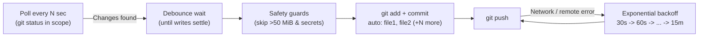

# Git Auto-Sync (`scripts/`)

A lightweight, dependency-free, **cross-platform** background daemon that watches any Git repository (or a specific folder inside one) and automatically stages, commits, and pushes your changes.

Works out of the box on **Linux**, **macOS**, and **Windows (Git Bash / MSYS2 / WSL)** — and automatically starts in the background whenever your computer boots or you log in.

| File | Purpose |
| --- | --- |
| [`git-auto-sync.sh`](git-auto-sync.sh) | Main daemon and cross-platform service installer |
| [`git-auto-sync.env`](git-auto-sync.env) | Configuration file where you set the folder path to watch (`AUTO_SYNC_REPO_PATH`) and tune behavior |

---

## 1. Quick Start (3 Steps on Any OS)

### Step 1 — Set the path you want to watch

Open [`scripts/git-auto-sync.env`](git-auto-sync.env) and set `AUTO_SYNC_REPO_PATH` to your repository (or subfolder) path:

```ini
# Linux example:
AUTO_SYNC_REPO_PATH="/home/ysf/k8sfundamentals"

# macOS example:
# AUTO_SYNC_REPO_PATH="/Users/yourname/projects/my-repo"

# Windows (Git Bash) example — both C:/... and C:\... work:
# AUTO_SYNC_REPO_PATH="C:/Users/yourname/projects/my-repo"

# Relative path (watches the repo that contains scripts/):
# AUTO_SYNC_REPO_PATH=".."
```

### Step 2 — Install & enable auto-start on boot/login

Run `install` once from your terminal (or Git Bash on Windows):

```bash
chmod +x scripts/git-auto-sync.sh
./scripts/git-auto-sync.sh install
```

> [!TIP]
> You can also pass the path directly to `install` and it will update `git-auto-sync.env` for you automatically:
> ```bash
> ./scripts/git-auto-sync.sh install /path/to/your/repo
> ```

### Step 3 — Verify status

```bash
./scripts/git-auto-sync.sh status
```

That's it! The daemon is now running in the background and will start automatically every time your computer turns on.

---

## 2. How Auto-Start Works Across Operating Systems

`./scripts/git-auto-sync.sh install` automatically detects your operating system and registers a native startup service:

| Operating System | Auto-Start Mechanism Created by `install` | Behavior on Boot / Login |
| --- | --- | --- |
| **Linux (systemd)** | `~/.config/systemd/user/<service>.service` + `loginctl enable-linger` | Starts automatically on boot/login; systemd restarts it within 5s if it ever crashes |
| **Linux (no systemd / WSL)** | `crontab` `@reboot` entry + `~/.config/autostart/<service>.desktop` | Starts automatically in the background when the session/WSL starts |
| **macOS** | `~/Library/LaunchAgents/com.git-auto-sync.<service>.plist` (`RunAtLoad` + `KeepAlive`) | Starts automatically at macOS login; `launchd` keeps it alive at all times |
| **Windows (Git Bash / MSYS2)** | `%APPDATA%\Microsoft\Windows\Start Menu\Programs\Startup\<service>.vbs` | Launches `git-auto-sync.sh` silently at Windows login with no console window popup |

To remove the auto-start service on any OS:

```bash
./scripts/git-auto-sync.sh uninstall
```

---

## 3. Architecture & Workflow



1. **Scoped Detection:** Checks `git status` every `AUTO_SYNC_POLL_INTERVAL` seconds inside `AUTO_SYNC_REPO_PATH` (respecting `.gitignore`).
2. **True Debounce:** Waits until modified files stop changing size/timestamp for `AUTO_SYNC_DEBOUNCE_WAIT` seconds so half-saved files are never committed mid-write (capped at `AUTO_SYNC_MAX_DEBOUNCE` seconds).
3. **Safety Guards:** Automatically excludes oversized binaries (e.g. `.terraform/` providers) and sensitive files (`.env`, `*.tfstate`, private keys) **before** staging so they never enter `.git/objects`.
4. **Pause on Manual Git Operations:** Automatically pauses if a `rebase`, `merge`, `cherry-pick`, `bisect`, or `index.lock` is active, or if `HEAD` is detached, and resumes once finished.
5. **Resilient Push:** Uses non-interactive mode (`GIT_TERMINAL_PROMPT=0`), enforces a timeout (`AUTO_SYNC_PUSH_TIMEOUT`), and retries failed pushes with exponential backoff.

---

## 4. CLI Commands

| Command | Description |
| --- | --- |
| `./scripts/git-auto-sync.sh install [path]` | Register native OS auto-start service and start the daemon immediately |
| `./scripts/git-auto-sync.sh uninstall` | Stop the daemon and remove the OS auto-start service |
| `./scripts/git-auto-sync.sh start` | Start the daemon in the background |
| `./scripts/git-auto-sync.sh stop` | Stop the running daemon |
| `./scripts/git-auto-sync.sh restart` | Restart the daemon (run this after editing `git-auto-sync.env`) |
| `./scripts/git-auto-sync.sh status` | Show OS mode, watched path, unpushed commit count, skipped files, and recent logs |
| `./scripts/git-auto-sync.sh logs` | Stream the log file live (`tail -f`) |
| `./scripts/git-auto-sync.sh run` | Run the daemon loop in the foreground |

---

## 5. Configuration Reference (`scripts/git-auto-sync.env`)

All settings live in [`scripts/git-auto-sync.env`](git-auto-sync.env). After changing a value, run `./scripts/git-auto-sync.sh restart`.

| Variable | Default | Description |
| --- | --- | --- |
| `AUTO_SYNC_REPO_PATH` | `/home/ysf/k8sfundamentals` | Path to the git repository (or subfolder inside a repo) to watch. Supports Linux, macOS, Windows (`C:/...` or `C:\...`), `~`, and relative paths (`..`). |
| `AUTO_SYNC_REMOTE` | `""` (`all` -> `origin`) | Remote name to push to. When empty, uses `all` if configured, otherwise `origin`. |
| `AUTO_SYNC_SERVICE_NAME` | `git-auto-sync` | Service identifier. Set a unique name per config if you watch multiple repositories. |
| `AUTO_SYNC_POLL_INTERVAL` | `3` | Seconds between working-tree checks. |
| `AUTO_SYNC_DEBOUNCE_WAIT` | `5` | Seconds files must stay quiet before committing. |
| `AUTO_SYNC_MAX_DEBOUNCE` | `60` | Maximum seconds to wait if files keep changing continuously. |
| `AUTO_SYNC_MAX_FILE_SIZE_MB` | `50` | Maximum allowed file size in MiB (`0` disables the limit). |
| `AUTO_SYNC_SENSITIVE_PATTERNS` | `*.tfstate *.tfstate.* *.tfvars .env .env.* *.pem *.key *.p12 *.pfx id_rsa* id_ecdsa* id_ed25519* kubeconfig *.kubeconfig credentials.json` | Space-separated filename globs that are never auto-committed (`""` disables). Template files ending in `.example`, `.sample`, `.template`, or `.dist` are always allowed. |
| `AUTO_SYNC_RETRY_BASE` | `30` | Initial retry delay in seconds after a failed push. |
| `AUTO_SYNC_RETRY_MAX` | `900` | Maximum retry delay in seconds (15 minutes). |
| `AUTO_SYNC_PUSH_TIMEOUT` | `120` | Seconds before aborting a hanging `git push`. |
| `AUTO_SYNC_LOG_MAX_KB` | `1024` | Maximum log size in KiB before automatic in-place trimming. |

> [!NOTE]
> **Watching multiple repositories:** Copy `git-auto-sync.env` to another file (e.g. `my-other-repo.env`), set a different `AUTO_SYNC_REPO_PATH` and `AUTO_SYNC_SERVICE_NAME="git-auto-sync-other"`, and run:
> ```bash
> AUTO_SYNC_CONFIG=/path/to/my-other-repo.env ./scripts/git-auto-sync.sh install
> ```

---

## 6. Prerequisite for Passwordless Background Push

Because the daemon runs unattended in the background, `git push` must not ask for a username or password interactively:

- **SSH URLs (`git@github.com:...`):** Make sure your SSH key is loaded in your OS ssh-agent (or has no passphrase) and is added to GitHub/GitLab.
- **HTTPS URLs (`https://github.com/...`):** Configure Git Credential Manager (`git config --global credential.helper manager` on Windows/macOS, or `store`/`libsecret` on Linux) and run `git push` once manually so your token is saved.
