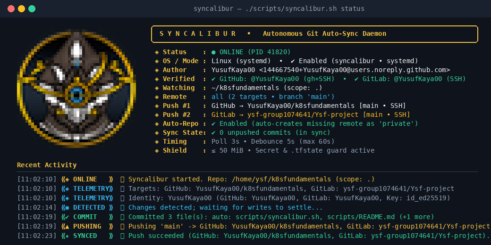
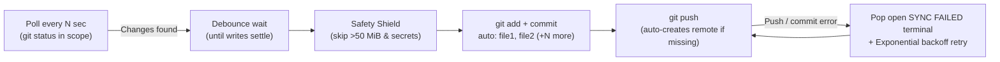

<div align="center">


# S Y N C A L I B U R

**Autonomous Cross-Platform Git Auto-Sync Daemon**

*Zero-friction background Git synchronization across Linux, macOS, and Windows — featuring live TrueColor terminal telemetry, multi-remote & identity auto-detection, automatic remote repository creation, pre-staging secret/size guards, and proactive failure terminal alerts.*

[](#3-how-auto-start-works-across-operating-systems)
[](#)
[](#4-automatic-remote-repository-creation--identity-detection)
[](#5-built-in-safety-shield--proactive-failure-alerts)

</div>

---

## ◈ Highlights

- **◈ TrueColor PNG Emblem & Live Dashboard:** Renders the Syncalibur emblem directly inside your terminal (`status`, `logs`, `alert`, `install`, `run`) alongside a real-time telemetry panel and color-coded activity badges.
- **🎯 Multi-Remote & Authorized Identity Detection:** Automatically inspects your Git configuration, SSH keys, and CLI credentials (`gh`, `glab`, tokens, SSH handshakes) to display every push destination (e.g. **GitHub** + **GitLab** dual-push) and your verified provider accounts (`@username`).
- **✦ Zero-Friction Bootstrap & Auto-Remote Creation:**
  - Works out of the box when cloned by any user (`SYNCALIBUR_REPO_PATH=".."` with automatic fallback if a custom path does not exist on a new machine).
  - If the watched folder is not a Git repository yet, Syncalibur initializes it automatically (`git init -b main`).
  - If the remote repository does not exist yet on **GitHub** or **GitLab** and your machine is authorized, Syncalibur creates the remote repository automatically and pushes.
- **🚨 Proactive "Sync Failed" Terminal Popup & Desktop Notification:** If a background commit or push fails, Syncalibur automatically pops open a dedicated terminal window (`gnome-terminal`, `konsole`, `xfce4-terminal`, `kitty`, `alacritty`, macOS `Terminal.app`, Windows Git Bash) displaying a styled **SYNC FAILED — DIAGNOSTIC ALERT** screen with the exact error, root-cause hint, and one-line recovery commands (throttled via cooldown so retries never spam windows).
- **🌍 Native Cross-Platform Auto-Start:** Registers a native background service (`systemd` / `cron` on Linux, `launchd` `LaunchAgents` on macOS, hidden Startup VBS launcher on Windows Git Bash) so it starts silently on every boot/login.
- **🛡️ Pre-Staging Safety Shield:** Blocks oversized binaries (`> 50 MiB`, e.g. `.terraform/` providers) and sensitive secret files (`*.tfstate`, `.env`, `*.pem`, `*.key`, `id_rsa*`, `kubeconfig`) **before** `git add` so they never pollute `.git/objects` or break remote pushes.

---

## 🖥️ Terminal UI & Telemetry Preview

<div align="center">
  
</div>

Running `./scripts/syncalibur.sh status` or `./scripts/syncalibur.sh logs` renders the TrueColor Syncalibur emblem alongside your detected push targets and verified accounts:

```text
  ╭──────────────────────────────────────────────────────────────────────╮
  │   S Y N C A L I B U R   •   Autonomous Git Auto-Sync Daemon          │
  ╰──────────────────────────────────────────────────────────────────────╯
    ◈ Status    : ● ONLINE (PID 41820)
    ◈ OS / Mode : Linux (systemd)  •  ✔ Enabled (syncalibur • systemd)
    ◈ Author    : YusufKaya00 <155685097+YusufKaya00@users.noreply.github.com> (ysf@k8s)
    ◈ Verified  : ✔ GitHub: @YusufKaya00 (gh+SSH)  •  ✔ GitLab: @YusufKaya00 (SSH)
    ◈ Watching  : ~/k8sfundamentals (scope: .)
    ◈ Config    : ~/k8sfundamentals/scripts/syncalibur.env
    ◈ Remote    : all (2 target(s) • branch 'main')
    ◈ Push #1   : GitHub → YusufKaya00/k8sfundamentals [main • SSH]
    ◈ Push #2   : GitLab → ysf-group1074641/Ysf-project [main • SSH]
    ◈ Auto-Repo : ✔ Enabled (auto-creates missing remote as 'private') • Alert Popup ON
    ◈ Sync State: ✔ 0 unpushed commits (in sync)
    ◈ Timing    : Poll 3s • Debounce 5s (max 60s)
    ◈ Shield    : ≤ 50 MiB • Secret & .tfstate guard active
    ──────────────────────────────────────────────────────────────────────
    Commands  : status | logs | alert | restart | stop | install | uninstall

  Recent Activity
  ────────────────────────────────────────────────────────────────────────────────────────
  [11:05:12] ⟪◈ ONLINE   ⟫ 🚀 Syncalibur started. Repo: /home/ysf/k8sfundamentals (scope: .)
  [11:05:12] ⟪◈ TELEMETRY⟫ 🎯 Targets: GitHub: YusufKaya00/k8sfundamentals, GitLab: ysf-group1074641/Ysf-project
  [11:05:18] ⟪◉ DETECTED ⟫ 📝 Changes detected; waiting for writes to settle...
  [11:05:23] ⟪✔ COMMIT   ⟫ ✅ Committed 2 file(s): auto: scripts/syncalibur.sh, scripts/README.md (11:05:23)
  [11:05:23] ⟪▲ PUSHING  ⟫ 📤 Pushing 'main' -> GitHub: YusufKaya00/k8sfundamentals, GitLab: ysf-group1074641/Ysf-project...
  [11:05:27] ⟪★ SYNCED   ⟫ 🎉 Push succeeded (GitHub: YusufKaya00/k8sfundamentals, GitLab: ysf-group1074641/Ysf-project).
```

---

## 🚀 1. Quick Start (Works Immediately After Clone)

### Option A — Watch the current repository (Zero config)

By default, [`scripts/syncalibur.env`](syncalibur.env) sets `SYNCALIBUR_REPO_PATH=".."`, which watches the repository containing `scripts/` on any machine:

```bash
chmod +x scripts/syncalibur.sh
./scripts/syncalibur.sh install
```

### Option B — Watch any custom directory or repository

Pass the target folder directly to `install` (or set `SYNCALIBUR_REPO_PATH` in `scripts/syncalibur.env`):

```bash
./scripts/syncalibur.sh install /path/to/your/project
```

- If `/path/to/your/project` is not a Git repository yet, Syncalibur runs `git init -b main` automatically.
- If no remote repository exists yet, Syncalibur creates it under your authenticated GitHub/GitLab account on the first push.

### Inspect status, live logs, or failure alerts

```bash
# Render the Syncalibur emblem, detected push targets, verified accounts & recent logs
./scripts/syncalibur.sh status

# Stream live colorized telemetry
./scripts/syncalibur.sh logs

# Preview the "SYNC FAILED" diagnostic alert screen
./scripts/syncalibur.sh alert --test
```

---

## 📦 2. Repository Structure

```text
scripts/
├── syncalibur.sh               # Main daemon, TUI dashboard, auto-repo & alert engine
├── syncalibur.env              # Configuration file (portable defaults for public use)
├── assets/
│   ├── syncalibur-logo.png     # Official Syncalibur emblem (512x512 RGBA)
│   ├── syncalibur-logo.ansi    # Pre-rendered TrueColor ANSI half-block terminal emblem
│   └── syncalibur-terminal.png # High-DPI preview of the terminal dashboard
└── README.md                   # Documentation
```

---

## 🌍 3. How Auto-Start Works Across Operating Systems

`./scripts/syncalibur.sh install` automatically detects your operating system and registers a native startup service:

| Operating System | Auto-Start Mechanism Created by `install` | Behavior on Boot / Login |
| --- | --- | --- |
| **Linux (systemd)** | `~/.config/systemd/user/syncalibur.service` + `loginctl enable-linger` | Starts automatically on boot/login; systemd restarts it within 5s if it ever crashes |
| **Linux (no systemd / WSL)** | `crontab` `@reboot` entry + `~/.config/autostart/syncalibur.desktop` | Starts automatically in the background when the session/WSL starts |
| **macOS** | `~/Library/LaunchAgents/com.syncalibur.syncalibur.plist` (`RunAtLoad` + `KeepAlive`) | Starts automatically at macOS login; `launchd` keeps it alive at all times |
| **Windows (Git Bash / MSYS2)** | `%APPDATA%\Microsoft\Windows\Start Menu\Programs\Startup\syncalibur.vbs` | Launches `syncalibur.sh` silently at Windows login with no console window popup |

> [!NOTE]
> **Watching Multiple Repositories:** You do not need to configure service names manually. For the default `syncalibur.env`, the service is named `syncalibur`. If you use a second config file (e.g. `SYNCALIBUR_CONFIG=~/work.env ./scripts/syncalibur.sh install`), Syncalibur automatically names that service `syncalibur-work`.

---

## ✦ 4. Automatic Remote Repository Creation & Identity Detection

When Syncalibur starts or pushes:

1. **Identity & Provider Probing (`probe_provider_auth`):**
   - **GitHub:** Checks `gh auth status`, `GH_TOKEN` / `GITHUB_TOKEN`, or `ssh -T git@github.com`.
   - **GitLab:** Checks `glab auth status`, `GITLAB_TOKEN`, or `ssh -T git@gitlab.com`.
   - Results are cached in `.git/syncalibur.auth` (10-minute TTL) so `./scripts/syncalibur.sh status` stays instantaneous.
2. **Multi-Target Push Detection (`parse_remote_url`):**
   - Reads all push URLs from `git remote get-url --push --all <remote>` and lists each destination (`GitHub`, `GitLab`, `Bitbucket`, `Azure DevOps`) in the dashboard and push logs.
3. **Automatic Remote Provisioning (`auto_create_or_bind_remote`):**
   - If the local repository has no `origin` remote or the remote returns `Repository not found`, Syncalibur automatically creates the repository (default visibility: `private`, configurable via `SYNCALIBUR_REPO_VISIBILITY`) using `gh repo create`, `glab repo create`, REST API tokens, or GitLab's native SSH push-to-create.

---

## 🛡️ 5. Built-in Safety Shield & Proactive Failure Alerts



### Pre-Staging Safety Guards

| Guard | Default Rule | Protected Examples |
| --- | --- | --- |
| **File Size Limit** | Skips files `> 50 MiB` (`SYNCALIBUR_MAX_FILE_SIZE_MB`) | `.terraform/providers/...`, VM images, archives, dumps |
| **Sensitive Pattern Shield** | `*.tfstate` `*.tfstate.*` `*.tfvars` `.env` `.env.*` `*.pem` `*.key` `*.p12` `*.pfx` `id_rsa*` `id_ecdsa*` `id_ed25519*` `kubeconfig` `*.kubeconfig` `credentials.json` | Terraform state, `.env` secrets, SSH/TLS private keys, cloud credentials |

### Automatic "Sync Failed" Terminal Popup

When running in the background (`systemd`, `launchd`, `cron`, or Windows Startup) and a commit or push fails:
- Syncalibur writes a structured diagnostic report to `.git/syncalibur.failure`.
- Sends an OS desktop notification (`notify-send`, macOS Notification Center, or Windows alert).
- Automatically opens a visible terminal window running `./scripts/syncalibur.sh alert --wait`, showing the Syncalibur emblem, the exact Git error, a tailored fix recommendation, and one-key log streaming.
- Enforces `SYNCALIBUR_ALERT_COOLDOWN=600` (10 minutes) so background retries never spam multiple terminal windows, and automatically clears the alert state as soon as a subsequent push succeeds.

---

## ⚙️ 6. Configuration Reference (`scripts/syncalibur.env`)

All settings live in [`scripts/syncalibur.env`](syncalibur.env). After editing a value, apply it with `./scripts/syncalibur.sh restart`.

| Variable | Default | Description |
| --- | --- | --- |
| `SYNCALIBUR_REPO_PATH` | `".."` | Path to the directory / Git repo to watch. Supports Linux, macOS, Windows (`C:/...` or `C:\...`), `~`, and relative paths (`..`). Falls back safely to the containing repo if a path is missing on another machine. |
| `SYNCALIBUR_AUTO_CREATE_REMOTE` | `"true"` | Automatically initialize Git (`git init`) and create missing remote repositories on GitHub/GitLab when authorized. |
| `SYNCALIBUR_REPO_VISIBILITY` | `"private"` | Visibility when auto-creating a new remote repository (`"private"` or `"public"`). |
| `SYNCALIBUR_ALERT_TERMINAL` | `"true"` | Automatically pop open a diagnostic terminal window & desktop notification if a background sync fails. |
| `SYNCALIBUR_ALERT_COOLDOWN` | `600` | Minimum seconds between automatic failure popup windows. |
| `SYNCALIBUR_REMOTE` | `""` (`all` -> `origin`) | Remote name to push to. When empty, uses `all` if configured, otherwise `origin`. |
| `SYNCALIBUR_POLL_INTERVAL` | `3` | Seconds between working-tree checks. |
| `SYNCALIBUR_DEBOUNCE_WAIT` | `5` | Seconds files must stay untouched before committing. |
| `SYNCALIBUR_MAX_DEBOUNCE` | `60` | Maximum seconds to wait if files keep changing continuously. |
| `SYNCALIBUR_MAX_FILE_SIZE_MB` | `50` | Maximum allowed file size in MiB (`0` disables the limit). |
| `SYNCALIBUR_SENSITIVE_PATTERNS` | *(see above)* | Space-separated filename globs that are never auto-committed (`""` disables). |
| `SYNCALIBUR_RETRY_BASE` | `30` | Initial retry delay in seconds after a failed push. |
| `SYNCALIBUR_RETRY_MAX` | `900` | Maximum retry delay in seconds (15 minutes). |
| `SYNCALIBUR_PUSH_TIMEOUT` | `120` | Seconds before aborting a hanging `git push`. |
| `SYNCALIBUR_LOG_MAX_KB` | `1024` | Maximum log size in KiB before automatic in-place trimming. |

---

## 🧭 7. CLI Commands

| Command | Description |
| --- | --- |
| `./scripts/syncalibur.sh install [path]` | Register native OS auto-start service and start Syncalibur immediately |
| `./scripts/syncalibur.sh uninstall` | Stop Syncalibur and remove the OS auto-start service |
| `./scripts/syncalibur.sh start` | Start Syncalibur in the background |
| `./scripts/syncalibur.sh stop` | Stop the running daemon |
| `./scripts/syncalibur.sh restart` | Clear active alerts and restart Syncalibur (run after editing `syncalibur.env`) |
| `./scripts/syncalibur.sh status` | Render the Syncalibur emblem, live dashboard, detected remotes, and recent logs |
| `./scripts/syncalibur.sh logs` | Render the Syncalibur emblem and stream live colorized telemetry (`tail -f`) |
| `./scripts/syncalibur.sh alert [--test]` | Show the "Sync Failed" diagnostic report (or preview it with `--test`) |
| `./scripts/syncalibur.sh run` | Run the daemon in the foreground with the live terminal UI |
