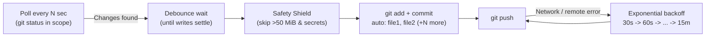

<div align="center">


# ⚔️ S Y N C A L I B U R

**Autonomous Cross-Platform Git Auto-Sync Daemon**

*Set your repository path once. Syncalibur watches, guards, commits, and pushes your work in the background — across Linux, macOS, and Windows.*

[](#3-how-auto-start-works-across-operating-systems)
[](#)
[-34D399?style=for-the-badge)](#)
[](#4-built-in-safety-shield)

</div>

---

## ✨ Highlights

- **⚔️ Rich Terminal Dashboard & Emblem:** Renders the TrueColor Syncalibur emblem right in your terminal (`status`, `logs`, `install`, `run`) alongside a live telemetry panel and badge-formatted logs.
- **🌍 True Cross-Platform Auto-Start:** Automatically registers a native OS background service (`systemd` / `cron` on Linux, `launchd` `LaunchAgents` on macOS, hidden Startup launcher on Windows Git Bash) so it starts silently every time your computer boots.
- **🛡️ Pre-Staging Safety Shield:** Blocks oversized binaries (`> 50 MiB`, e.g. `.terraform/` providers) and sensitive secret files (`*.tfstate`, `.env`, `*.pem`, `*.key`, `id_rsa*`, `kubeconfig`) **before** `git add` so they never pollute `.git/objects` or break remote pushes.
- **⏱️ Smart Write Debouncing:** Waits until modified files stop changing size/mtime before committing, preventing half-written saves from being committed.
- **🤝 Git-Operation Aware:** Automatically pauses while you are running an interactive `rebase`, `merge`, `cherry-pick`, `bisect`, or when `HEAD` is detached, and resumes seamlessly when finished.
- **🔁 Resilient Exponential Backoff:** Enforces push timeouts (`120s`) and retries failed pushes automatically (`30s -> 60s -> ... -> 15m`) when offline.

---

## 🖥️ Terminal UI Preview

Running `./scripts/syncalibur.sh status` or `./scripts/syncalibur.sh logs` displays the full-color Syncalibur emblem next to your live repository telemetry:

```text
          ▄▄████████▄▄            ╭──────────────────────────────────────────────────────────╮
       ▄██▀▀   ██   ▀▀██▄         │  ⚔️  S Y N C A L I B U R   •   Autonomous Git Sync       │
     ▄█▀     ▄████▄     ▀█▄       ╰──────────────────────────────────────────────────────────╯
    ██      ██▀██▀██      ██        ◈ Status    : ● ONLINE (PID 38685)
   ██      ███ ██ ███      ██       ◈ OS / Mode : Linux (systemd)
  ██   ▄▄▀███▄▄▄▄▄▄███▀▄▄   ██      ◈ Autostart : ✔ Enabled (syncalibur • systemd)
 ◄███▀▀    ▀█▄████▄█▀    ▀▀███►     ◈ Config    : ~/k8sfundamentals/scripts/syncalibur.env
  ██▄▄     ████▀▀████     ▄▄██      ◈ Watching  : ~/k8sfundamentals
  ██ ▀▀██▄▄████▄▄████▄▄██▀▀ ██      ◈ Scope     : .
   ██   ▀▀███▀████▀███▀▀   ██       ◈ Target    : all/main
    ██     ▀█▄▀██▀▄█▀     ██        ◈ Sync State: 0 commits (in sync)
     ▀█▄   ◄█►████◄█►   ▄█▀         ◈ Timing    : Poll 3s • Debounce 5s (max 60s)
       ▀██▄▄ ▀████▀ ▄▄██▀           ◈ Shield    : ≤ 50 MiB • Secret guard active
          ▀▀████████▀▀              ◈ Log File  : ~/k8sfundamentals/.git/syncalibur.log
             ▀████▀                 ──────────────────────────────────────────────────────────
               ▀▀                   Commands  : status | logs | restart | stop | install

  Recent Activity
  ──────────────────────────────────────────────────────────────────────────────
  [10:49:46] ⟪⚔️  ONLINE  ⟫ ⚔️  Syncalibur started. Repo: /home/ysf/k8sfundamentals (scope: .) | Remote: all
  [10:49:46] ⟪◉ DETECTED ⟫ 📝 Changes detected; waiting for writes to settle...
  [10:49:51] ⟪✔ COMMIT   ⟫ ✅ Committed 3 file(s): auto: scripts/README.md, scripts/syncalibur.env (+1 more)
  [10:49:51] ⟪▲ PUSHING  ⟫ 📤 Pushing to 'all' (main)...
  [10:49:56] ⟪★ SYNCED   ⟫ 🎉 Push succeeded.
```

---

## 🚀 1. Quick Start (3 Steps on Any OS)

### Step 1 — Set the directory path to watch

Open [`scripts/syncalibur.env`](syncalibur.env) and set `SYNCALIBUR_REPO_PATH` to the Git repository (or specific subfolder) you want to watch:

```ini
# Linux example:
SYNCALIBUR_REPO_PATH="/home/ysf/k8sfundamentals"

# macOS example:
# SYNCALIBUR_REPO_PATH="/Users/yourname/projects/my-repo"

# Windows (Git Bash) example — both C:/... and C:\... work:
# SYNCALIBUR_REPO_PATH="C:/Users/yourname/projects/my-repo"

# Relative path (watches the repository containing scripts/):
# SYNCALIBUR_REPO_PATH=".."
```

### Step 2 — Install & enable auto-start on boot/login

Run `install` once from your terminal (or Git Bash on Windows):

```bash
chmod +x scripts/syncalibur.sh
./scripts/syncalibur.sh install
```

> [!TIP]
> You can also pass the path directly to `install` and Syncalibur will write it into `syncalibur.env` automatically:
> ```bash
> ./scripts/syncalibur.sh install /path/to/your/repo
> ```

### Step 3 — Watch live logs or check status

```bash
# View emblem + live dashboard + recent activity
./scripts/syncalibur.sh status

# Stream live colorized telemetry with the Syncalibur emblem
./scripts/syncalibur.sh logs
```

---

## 📦 2. Repository Structure

```text
scripts/
├── syncalibur.sh               # Main daemon, TUI dashboard & cross-platform installer
├── syncalibur.env              # Configuration file (set SYNCALIBUR_REPO_PATH here)
├── assets/
│   ├── syncalibur-logo.png     # Official Syncalibur emblem (512x512 RGBA)
│   └── syncalibur-logo.ansi    # Pre-rendered TrueColor ANSI half-block terminal emblem
└── README.md                   # Documentation
```

---

## 🌍 3. How Auto-Start Works Across Operating Systems

`./scripts/syncalibur.sh install` automatically detects your operating system and registers a native startup service:

| Operating System | Auto-Start Mechanism Created by `install` | Behavior on Boot / Login |
| --- | --- | --- |
| **Linux (systemd)** | `~/.config/systemd/user/<service>.service` + `loginctl enable-linger` | Starts automatically on boot/login; systemd restarts it within 5s if it ever crashes |
| **Linux (no systemd / WSL)** | `crontab` `@reboot` entry + `~/.config/autostart/<service>.desktop` | Starts automatically in the background when the session/WSL starts |
| **macOS** | `~/Library/LaunchAgents/com.syncalibur.<service>.plist` (`RunAtLoad` + `KeepAlive`) | Starts automatically at macOS login; `launchd` keeps it alive at all times |
| **Windows (Git Bash / MSYS2)** | `%APPDATA%\Microsoft\Windows\Start Menu\Programs\Startup\<service>.vbs` | Launches `syncalibur.sh` silently at Windows login with no console window popup |

To remove the auto-start service on any OS:

```bash
./scripts/syncalibur.sh uninstall
```

---

## 🛡️ 4. Built-in Safety Shield



Because Syncalibur stages changes automatically, it enforces two pre-staging guards so large binaries or credentials are never accidentally committed:

| Guard | Default Rule | Protected Examples |
| --- | --- | --- |
| **File Size Limit** | Skips files `> 50 MiB` (`SYNCALIBUR_MAX_FILE_SIZE_MB`) | `.terraform/providers/...`, VM images, archives, dumps |
| **Sensitive Pattern Shield** | `*.tfstate` `*.tfstate.*` `*.tfvars` `.env` `.env.*` `*.pem` `*.key` `*.p12` `*.pfx` `id_rsa*` `id_ecdsa*` `id_ed25519*` `kubeconfig` `*.kubeconfig` `credentials.json` | Terraform state, `.env` secrets, SSH/TLS private keys, cloud credentials |

- Template files ending in `.example`, `.sample`, `.template`, or `.dist` (such as `.env.example`) are always allowed.
- Blocked files are excluded **before** `git add`, so they never enter `.git/objects` and never block `git push`.

---

## ⚙️ 5. Configuration Reference (`scripts/syncalibur.env`)

All settings live in [`scripts/syncalibur.env`](syncalibur.env). After editing a value, apply it with `./scripts/syncalibur.sh restart`.

| Variable | Default | Description |
| --- | --- | --- |
| `SYNCALIBUR_REPO_PATH` | `/home/ysf/k8sfundamentals` | Path to the git repository (or subfolder inside a repo) to watch. Supports Linux, macOS, Windows (`C:/...` or `C:\...`), `~`, and relative paths (`..`). |
| `SYNCALIBUR_REMOTE` | `""` (`all` -> `origin`) | Remote name to push to. When empty, uses `all` if configured, otherwise `origin`. |
| `SYNCALIBUR_SERVICE_NAME` | `syncalibur` | Service identifier. Set a unique name per config if you watch multiple repositories. |
| `SYNCALIBUR_POLL_INTERVAL` | `3` | Seconds between working-tree checks. |
| `SYNCALIBUR_DEBOUNCE_WAIT` | `5` | Seconds files must stay quiet before committing. |
| `SYNCALIBUR_MAX_DEBOUNCE` | `60` | Maximum seconds to wait if files keep changing continuously. |
| `SYNCALIBUR_MAX_FILE_SIZE_MB` | `50` | Maximum allowed file size in MiB (`0` disables the limit). |
| `SYNCALIBUR_SENSITIVE_PATTERNS` | *(see above)* | Space-separated filename globs that are never auto-committed (`""` disables). |
| `SYNCALIBUR_RETRY_BASE` | `30` | Initial retry delay in seconds after a failed push. |
| `SYNCALIBUR_RETRY_MAX` | `900` | Maximum retry delay in seconds (15 minutes). |
| `SYNCALIBUR_PUSH_TIMEOUT` | `120` | Seconds before aborting a hanging `git push`. |
| `SYNCALIBUR_LOG_MAX_KB` | `1024` | Maximum log size in KiB before automatic in-place trimming. |

---

## 🧭 6. CLI Commands

| Command | Description |
| --- | --- |
| `./scripts/syncalibur.sh install [path]` | Register native OS auto-start service and start Syncalibur immediately |
| `./scripts/syncalibur.sh uninstall` | Stop Syncalibur and remove the OS auto-start service |
| `./scripts/syncalibur.sh start` | Start Syncalibur in the background |
| `./scripts/syncalibur.sh stop` | Stop the running daemon |
| `./scripts/syncalibur.sh restart` | Restart Syncalibur (run this after editing `syncalibur.env`) |
| `./scripts/syncalibur.sh status` | Render the Syncalibur emblem, live dashboard, skipped files, and recent logs |
| `./scripts/syncalibur.sh logs` | Render the Syncalibur emblem and stream live colorized telemetry (`tail -f`) |
| `./scripts/syncalibur.sh run` | Run the daemon in the foreground with the live terminal UI |
