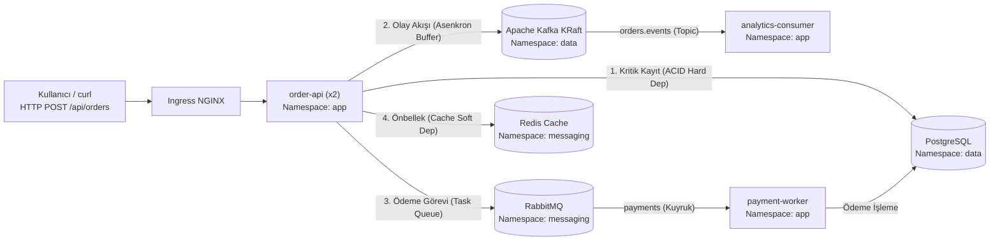
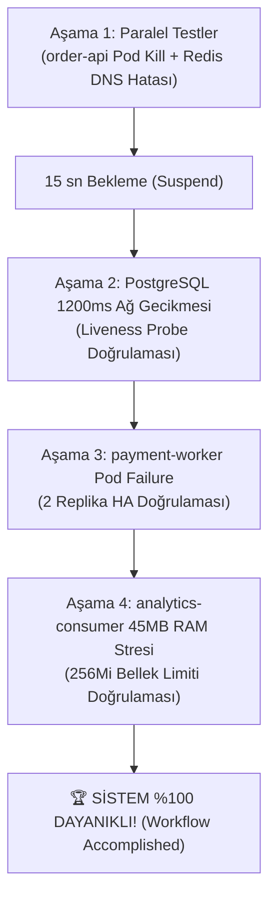

# 🚨 SRE Incident & Chaos Engineering Lab 1: Dağıtık Sistem Dayanıklılık & Kök Neden Analizi (RCA)

> 📟 **SRE VAKA BİLDİRİMİ (INCIDENT SCENARIO):**  
> *"Şirketimizin mikroservis tabanlı sipariş platformu (FastAPI + PostgreSQL + Redis + Apache Kafka + RabbitMQ) üzerinde rastgele anlarda kullanıcılar `502 Bad Gateway` alıyor, ödeme kuyrukları şişiyor ve bazı worker pod'ları döngüsel çöküşe (`CrashLoopBackOff / OOMKilled`) giriyor. Yazılım ekibi 'Birim testlerimiz yeşil, kodda hata yok' diyor.*  
> *Kıdemli SRE ve Kaos Mühendisi (Chaos Engineer) olarak göreviniz: **Chaos Mesh** kullanarak sisteme kontrollü arızalar enjekte etmek, sistemin hangi durumlarda dayandığını (Kontrol Testleri) ve hangi gizli yapılandırma hatalarında patladığını (Troubleshooting Testleri) ortaya çıkarmak, kök neden analizi (RCA) yapmak ve Helm ile kalıcı olarak onarmaktır."*

---

## 📑 İçindekiler

1. [Mimarinin Anatomisi & "Hangi Sisteme Neden Kaos Testi Yapılır?" (SRE Karar Matrisi)](#1-mimarinin-anatomisi--hangi-sisteme-neden-kaos-testi-yapılır-sre-karar-matrisi)
2. [Erişim Adresleri & Hızlı Başlangıç (Tek Komutla Kurulum)](#2-erişim-adresleri--hızlı-başlangıç-tek-komutla-kurulum)
3. [Chaos Mesh Web Arayüzü (Tarayıcı) Kullanım Kılavuzu & Terimler Sözlüğü](#3-chaos-mesh-web-arayüzü-tarayıcı-kullanım-kılavuzu--terimler-sözlüğü)
4. [BÖLÜM A: 🟢 Kontrol Testleri (Sistemin Patlamadığı, Dayanıklılık Doğrulama Senaryoları)](#4-bölüm-a--kontrol-testleri-sistemin-patlamadığı-dayanıklılık-doğrulama-senaryoları)
   - [Görev 1: Kubernetes `order-api` Pod Kill & Yük Dengeleme Kontrolü](#görev-1-kubernetes-order-api-pod-kill--yük-dengeleme-kontrolü)
   - [Görev 2: Redis DNS Kesintisi & Cache Bypass (Graceful Degradation) Kontrolü](#görev-2-redis-dns-kesintisi--cache-bypass-graceful-degradation-kontrolü)
   - [Görev 3: Apache Kafka Ağ Gecikmesi (300ms) & Consumer Lag Kontrolü](#görev-3-apache-kafka-ağ-gecikmesi-300ms--consumer-lag-kontrolü)
5. [BÖLÜM B: 🔴 Troubleshooting Testleri (Patlayan Yerleri Teşhis Et ve Helm ile Çöz!)](#5-bölüm-b--troubleshooting-testleri-patlayan-yerleri-teşhis-et-ve-helm-ile-çöz)
   - [Görev 4 (PATLAR #1): PostgreSQL Yavaşlamasında Yanlış Liveness Probe Yüzünden API Çöküşü](#görev-4-patlar-1-postgresql-yavaşlamasında-yanlış-liveness-probe-yüzünden-api-çöküşü)
   - [Görev 5 (PATLAR #2): Tek Replika Worker Arızasında RabbitMQ Kuyruk Yığılması (`consumers: 0`)](#görev-5-patlar-2-tek-replika-worker-arızasında-rabbitmq-kuyruk-yığılması-consumers-0)
   - [Görev 6 (PATLAR #3): Dar Bellek Sınırı (`OOMKilled`) ve Kafka Lag Patlaması](#görev-6-patlar-3-dar-bellek-sınırı-oomkilled-ve-kafka-lag-patlaması)
6. [BÖLÜM C: 🏆 Final Chaos Mesh Workflow (Tüm Düzeltmeler Sonrası Otomatik Doğrulama)](#6-bölüm-c--final-chaos-mesh-workflow-tüm-düzeltmeler-sonrası-otomatik-doğrulama)
7. [BÖLÜM D: Kullandığımız Sistemlerin Genel Kullanım & Teşhis El Kitabı (Cheat Sheet)](#7-bölüm-d-kullandığımız-sistemlerin-genel-kullanım--teşhis-el-kitabı-cheat-sheet)
8. [Lab Sıfırlama ve Hızlı Çözüm Komutları](#8-lab-sıfırlama-ve-hızlı-çözüm-komutları)

---

## 1. Mimarinin Anatomisi & "Hangi Sisteme Neden Kaos Testi Yapılır?" (SRE Karar Matrisi)

Aşağıdaki mimari, modern mikroservis ekosistemlerinde en sık karşılaşılan 5 temel altyapı desenini içerir:



### 1.1. Bağımlılık Ayrımı: Kritik (Hard) vs. Esnek (Soft)
Bir SRE'nin kaos testi tasarlarken bildiği ilk altın kural:
- **Kritik Bağımlılık (Hard Dependency - PostgreSQL):** Veritabanı olmadan sipariş tamamlanamaz. Bu bileşen yavaşladığında veya kesildiğinde sistem **podlarını öldürmemeli**, kontrollü bir hata (`503 Service Unavailable`) dönmeli ve veritabanı düzeldiğinde **kendi kendine iyileşmelidir (Self-Healing)**.
- **Esnek Bağımlılık (Soft Dependency - Redis, Kafka, RabbitMQ):** Önbellek veya mesajlaşma çöktüğünde ana API **asla çökmemelidir!** Önbellek devre dışı kalıp doğrudan veritabanına düşmeli (**Graceful Degradation**); kuyruklar ise ağ koptuğunda mesajları tamponlamalıdır.

### 1.2. Hangi Sisteme Hangi Kaos Testi Neden Yapılır? (Karar Matrisi)

| Sistemde Ne Var? | Rolü | Hangi Kaos Testi Yapılır? (Chaos Mesh Türü) | Neden Bu Test Seçilir? | Neye Bakmalıyım? (Kontrol Metriği) |
| :--- | :--- | :--- | :--- | :--- |
| **Stateless API** (`order-api`) | Kullanıcı Giriş Kapısı | `Pod Fault -> Pod Kill` (`Mode: One`) | Podlardan biri aniden öldüğünde (`SIGKILL`) trafik yaşayan diğer kopyaya kesintisiz akıyor mu? | • `kubectl get pods -n app`<br>• `kubectl get endpoints order-api`<br>• `HTTP 201` başarı oranı |
| **Önbellek (Cache)** (`redis-master`) | Yan Bağımlılık (Hızlandırma) | `DNS Fault -> Error` veya `Network Partition` | Cache DNS çözülemediğinde API 500'e mi düşüyor yoksa veritabanından okumaya devam mı ediyor? | • `/api/status` içinde `redis: DOWN`<br>• Yanıtta `"status": "degraded"` ama HTTP kodu `201` |
| **Olay Akışı (Streaming)** (`kafka`) | Asenkron Tampon & Analitik | `Network Attack -> Delay (300ms)` | Broker yavaşladığında sipariş API'si kilitleniyor mu? Olaylar kalıcı saklanıyor mu? | • `kafka-consumer-groups.sh`<br>• `LAG` metriği |
| **Ana Veritabanı** (`postgresql`) | Kritik Kayıt Sistemi (ACID) | `Network Attack -> Delay (1200ms)` veya `IO Latency` | **En Kritik Test:** DB yavaşladığında yanlış yapılandırılmış bir Liveness Probe API'yi kaskad öldürüyor mu? | • `kubectl describe pod` (`Last State`)<br>• Pod `RESTARTS` sayısı artmamalı! |
| **Görev Kuyruğu (Task Queue)** (`rabbitmq`) | Asenkron İş Dağıtımı | `Pod Fault -> Pod Failure` (Worker üzerinde) | Tek bir worker podu arızalandığında kuyruk tamamen duruyor mu yoksa yedek replika devam ediyor mu? | • `rabbitmqctl list_queues`<br>• `consumers >= 1` olmalı<br>• `messages_ready` yığılmamalı |
| **Arka Plan Tüketicileri** (`workers`) | Veri İşleme & Senkronizasyon | `Stress Test -> Memory / CPU` | Bellek yükü geldiğinde pod `OOMKilled (137)` döngüsüne girip kuyruğu kilitliyor mu? | • `kubectl top pods -n app`<br>• `describe pod` (`Reason: OOMKilled`)<br>• `Kafka LAG` artışı |

---

## 2. Erişim Adresleri & Hızlı Başlangıç (Sıfırdan Terraform + Ansible Kurulumu)

### 2.1. Adım 0A: Sıfırdan Azure Altyapısını ve RKE2 + Kafka/RabbitMQ/Chaos Mesh Yığınını Kurun
Eğer Azure üzerinde sanal makineleriniz henüz kurulu değilse, bu dizindeki **Terraform** ve **Ansible** otomasyonunu kullanarak 3 sunuculu (`vm-master`, `vm-worker-data`, `vm-worker-app`) RKE2 kümesini, **PostgreSQL + Apache Kafka (KRaft) + Cassandra + RabbitMQ + Redis + Prometheus/Grafana + Chaos Mesh** servislerini ve **Troubleshoot Lab uygulamasını** tek seferde ayağa kaldırın:

```bash
# 1) Azure üzerinde 3 VM, VNet, NSG ve NAT Gateway'i oluştur (otomatik olarak ansible/hosts.ini ve scripts/.lab-env üretir)
cd /home/ysf/k8sfundamentals/troubleshoot/chaos-troubleshooting-1/terraform
terraform init
terraform apply -auto-approve

# 2) Ansible ile RKE2 Kümesini, Kafka/RabbitMQ/Postgres/Redis/Cassandra, Grafana, Chaos Mesh ve Lab Uygulamasını kur
cd ../ansible
ansible-playbook -i hosts.ini site.yml
```

> [!NOTE]
> `vm-master` üzerinde terminal kasmasını önlemek için ağır Rancher ve ArgoCD bileşenleri bu labda **kurulmaz**. Tüm kaos deneyleri doğrudan hızlı **Chaos Mesh Web UI**, **Grafana**, **RabbitMQ UI** ve **Helm CLI** üzerinden gerçekleştirilir.

### 2.2. Adım 0B: Lab Ortamını "Troubleshoot Modunda" Sıfırlama & Sağlık Kontrolü
Kümeniz kurulduktan sonra (veya istediğiniz her an lab'ı başa sarmak için) ana dizinde şu komutları çalıştırın:

```bash
cd /home/ysf/k8sfundamentals/troubleshoot/chaos-troubleshooting-1

# 1) Lab'ı 3 kasıtlı yapılandırma hatasıyla birlikte başlat (veya sıfırla)
./scripts/setup-lab.sh

# 2) Tüm katmanların (K8s, API, RabbitMQ, Kafka, Postgres, Redis) başlangıç sağlığını tek komutla gör
./scripts/check-system.sh
```

### 2.3. Web Arayüzleri ve Kimlik Bilgileri
`terraform apply` veya `ansible-playbook` sonunda ekrana basılan `<MASTER_IP>` ve `<APP_IP>` adresleriyle aşağıdaki panellere erişebilirsiniz:

| Servis | Adres (URL) | Kullanıcı Adı / Şifre | Ne İçin Kullanacağız? |
| :--- | :--- | :--- | :--- |
| **Chaos Mesh Dashboard** | `http://chaos.<MASTER_IP>.nip.io` | *(Şifresiz)* | Tüm kaos deneylerini ve workflow akışlarını tarayıcıdan başlatmak/izlemek için |
| **Grafana Dashboard** | `http://grafana.<MASTER_IP>.nip.io` | `admin` / `AdminPassword2026!` | Canlı metrikleri, gecikmeleri, p99 grafiklerini ve alarmları izlemek için |
| **RabbitMQ Management UI** | `http://rabbitmq.<APP_IP>.nip.io` | `resilience` / `AdminPassword2026!` | `payments` ve `payments.dlq` kuyruklarını, consumer sayılarını canlı görmek için |
| **Sipariş API Durumu** | `http://app.<APP_IP>.nip.io/api/status` | *(Açık API)* | 5 bağımlılığın (`postgres`, `kafka`, `rabbitmq`, `redis`, `cassandra`) anlık durumunu görmek için |

> [!TIP]
> `./scripts/check-system.sh` betiği bir SRE'nin kriz anında baktığı 6 kritik katmanı tek seferde sorgular ve ekrana basar (`terraform apply` sonrasında IP adreslerini `scripts/.lab-env` dosyasından otomatik okur). Her deney öncesinde ve sonrasında bu betiği çalıştırarak sistemin nabzını tutabilirsiniz!

---

## 3. Chaos Mesh Web Arayüzü (Tarayıcı) Kullanım Kılavuzu & Terimler Sözlüğü

Tarayıcınızda **`http://chaos.9.205.90.183.nip.io`** adresini açtığınızda göreceğiniz alanların ne anlama geldiği aşağıda özetlenmiştir:

| Alan / Menü | Ne Anlama Gelir? | Neyi Seçmeliyim / Ne Yazmalıyım? |
| :--- | :--- | :--- |
| **Experiments -> + New Experiment** | Yeni bir kaos deneyi oluşturma butonu. | Tıklayınca hedef arıza türü seçim ekranı gelir. |
| **Choose Target** | Sisteme verilecek arıza sınıfı. | • `Pod Fault` (Pod Kill / Pod Failure)<br>• `Network Attack` (Delay / Partition / Loss)<br>• `DNS Fault` (Error / Random)<br>• `Stress Test` (Memory / CPU) |
| **Namespace Selectors** | Arızanın uygulanacağı Kubernetes çalışma alanı. | Uygulama için **`app`**, veri tabanı için **`data`**, mesajlaşma için **`messaging`**. |
| **Label Selectors** | Arızanın hedef alacağı podların etiketi (Key: Value). | Örn: `app.kubernetes.io/component: order-api` veya `app.kubernetes.io/name: postgresql`. |
| **Mode** | Hedef etiketli podların kaç tanesine uygulanacağı. | • **`One`:** Yalnızca rastgele **1 podu** bozar (Kapasitenin bir kısmı korunur).<br>• **`All`:** Eşleşen **bütün podları** bozar. |
| **Patterns (DNS Fault'ta)** | Kesintiye uğratılacak alan adı (FQDN). | **ÇOK ÖNEMLİ:** Adı yazdıktan sonra mutlaka **ENTER** tuşuna basmalısınız! (Örn: `redis-master.messaging.svc.cluster.local`). Kutu içinde chip/etiket olarak görünmelidir. |
| **Duration** | Deneyin kaç dakika süreceği. | `2m` (2 dakika), `3m` (3 dakika) veya `60s` (60 saniye). Süre bitince arıza otomatik kalkar. |
| **Workflows** | Birden çok deneyi sırayla veya paralel çalıştıran otomatik akış menüsü. | Final testinde tek tıkla tüm sistemi test etmek için kullanılır. |

---

## 4. BÖLÜM A: 🟢 Kontrol Testleri (Sistemin Patlamadığı, Dayanıklılık Doğrulama Senaryoları)

Bu bölümdeki 3 deneyde **sistemde hiçbir şey patlamamalıdır**. Amacımız Chaos Mesh arayüzünü kullanmayı öğrenmek ve kaos sırasında sağlıklı bir sistemin nasıl tepki verdiğini kontrol komutlarıyla doğrulamaktır.

---

### Görev 1: Kubernetes `order-api` Pod Kill & Yük Dengeleme Kontrolü

- **Hipotez:** `order-api` 2 replika olarak çalıştığı ve önünde Kubernetes Service / Ingress NGINX bulunduğu için pod'lardan biri aniden (`SIGKILL`, `gracePeriod: 0`) öldürüldüğünde kullanıcılar **kesinti yaşamaz** ve yeni pod saniyeler içinde ayağa kalkar.

#### 1) 🖱️ Chaos Mesh Web UI Adımları:
1. Tarayıcıdan **`http://chaos.9.205.90.183.nip.io`** adresini açın.
2. Sol menüden **Experiments** -> **+ New Experiment** butonuna tıklayın.
3. **Choose Target:**
   - **Kubernetes** -> **Pod Fault** -> **Pod Kill** seçin.
   - **Grace Period:** `0` yazın.
   - Sağ alttan **Submit** tıklayın.
4. **Scope (Hedef Seçimi):**
   - **Namespace Selectors:** `app` seçin.
   - **Label Selectors:** `app.kubernetes.io/component: order-api` seçin.
   - **Mode:** `One` seçin *(Çok Önemli: `All` seçilirse tüm podlar ölür, `One` ile 2 kopyadan 1'ini öldürüyoruz)*.
5. **Metadata & Run:**
   - **Name:** `exp01-kontrol-pod-kill`
   - **Submit** butonuna basarak deneyi başlatın!

#### 2) 🔍 Neye Bakmalıyım? (Kontroller):
```bash
# Kontrol 1: Podlardan birinin öldüğünü ve hemen yeni podun başladığını gör
ssh ysf@9.205.90.183 "kubectl get pods -n app -l app.kubernetes.io/component=order-api -o wide"

# Kontrol 2: Sipariş gönder — HTTP 201 Created döndüğünü (kesinti olmadığını) doğrula!
curl -i -X POST "http://app.9.205.90.176.nip.io/api/orders" \
  -H "Content-Type: application/json" \
  -d '{"customer_id":"test-01","product_id":"sku-1","quantity":1,"amount":50.0}'
```
- **Sonuç:** 🟢 **PATLAMADI!** Tek pod ölse bile Kubernetes Service trafiği yaşayan diğer pod'a yönlendirdi ve ReplicaSet anında yeni pod oluşturdu.
- *(Deney bittikten sonra Chaos Mesh UI'da deneyi **Archive** butonuna basarak temizleyin).*

---

### Görev 2: Redis DNS Kesintisi & Cache Bypass (Graceful Degradation) Kontrolü

- **Hipotez:** Redis bizim önbellek (Cache) katmanımızdır. Redis çökerse veya DNS çözümlenemezse sipariş sistemi durmamalı; önbelleği atlayıp (bypass) doğrudan PostgreSQL'e yazarak çalışmaya devam etmelidir (**Graceful Degradation**).

#### 1) 🖱️ Chaos Mesh Web UI Adımları:
1. **Experiments** -> **+ New Experiment** tıklayın.
2. **Choose Target:**
   - **Kubernetes** -> **DNS Fault** -> **Error** seçin.
   - **Patterns:** `redis-master.messaging.svc.cluster.local` yazıp **ENTER** tuşuna basın! *(Kutu içinde etiket/chip olarak görünmelidir)*.
   - **Submit** tıklayın.
3. **Scope (Hedef Seçimi):**
   - **Namespace Selectors:** `app`
   - **Label Selectors:** `app.kubernetes.io/component: order-api` *(DNS sorgusunu yapan taraf `order-api` olduğu için hedef `order-api` podlarıdır!)*.
   - **Mode:** `All`
4. **Metadata & Run:**
   - **Name:** `exp02-kontrol-redis-dns`
   - **Duration:** `2m`
   - **Submit** ile başlatın!

#### 2) 🔍 Neye Bakmalıyım? (Kontroller):
```bash
# Kontrol 1: API durumuna bak -> redis: DOWN olduğunu ama diğerlerinin UP olduğunu gör
curl -s "http://app.9.205.90.176.nip.io/api/status" | jq .

# Kontrol 2: Sipariş gönder -> HTTP 201 Created ve "status": "degraded" döndüğünü gör!
curl -s -X POST "http://app.9.205.90.176.nip.io/api/orders" \
  -H "Content-Type: application/json" \
  -d '{"customer_id":"test-redis","product_id":"sku-2","quantity":1,"amount":75.0}' | jq .
```
- **Sonuç:** 🟢 **PATLAMADI!** Yanıtta `"status": "degraded"` ve `"redis": {"status": "DEGRADED"}` yazar ancak HTTP kodu **`201 Created`**'dır ve sipariş PostgreSQL'e başarıyla kaydedilmiştir!
- *(Deney sonunda Chaos Mesh UI'dan deneyi **Archive** edin).*

---

### Görev 3: Apache Kafka Ağ Gecikmesi (300ms) & Consumer Lag Kontrolü

- **Hipotez:** Kafka broker'da ağ gecikmesi yaşandığında olaylar kaybolmaz; consumer gecikmeyi tamponlar ve `kafka-consumer-groups.sh` ile izlenebilir.

#### 1) 🖱️ Chaos Mesh Web UI Adımları:
1. **Experiments** -> **+ New Experiment** tıklayın.
2. **Choose Target:**
   - **Kubernetes** -> **Network Attack** -> **Delay** seçin.
   - **Latency:** `300ms`
   - **Jitter:** `50ms`
   - **Direction:** `to`
   - **Submit** tıklayın.
3. **Scope (Hedef Seçimi):**
   - **Namespace Selectors:** `data`
   - **Label Selectors:** `app.kubernetes.io/name: kafka`
   - **Mode:** `All`
4. **Metadata & Run:**
   - **Name:** `exp03-kontrol-kafka-delay`
   - **Duration:** `2m`
   - **Submit** ile başlatın!

#### 2) 🔍 Neye Bakmalıyım? (Kontroller):
```bash
# Kontrol 1: /api/status çıktısında kafka latency_ms değerinin ~300ms+ seviyesine çıktığını gör
curl -s "http://app.9.205.90.176.nip.io/api/status" | jq '.dependencies.kafka'

# Kontrol 2: Kafka Consumer Group ve LAG durumunu kontrol et (LAG: 0 kalmalıdır)
./scripts/check-system.sh
```
- **Sonuç:** 🟢 **PATLAMADI!** Gecikme 300ms artsa bile Kafka ve `analytics-consumer` mesajları kayıpsız işlemeye devam eder.
- *(Deney sonunda Chaos Mesh UI'dan deneyi **Archive** edin).*

---

## 5. BÖLÜM B: 🔴 Troubleshooting Testleri (Patlayan Yerleri Teşhis Et ve Helm ile Çöz!)

Şimdi gerçek **Troubleshooting** bölümüne geçiyoruz! Bu 3 deneyde Chaos Mesh üzerinden hatayı verdiğinizde **sistem gerçekten patlayacak**. Her deneyde:
1. Chaos Mesh UI'dan deneyi başlatıp patlamayı göreceğiz,
2. Teşhis komutlarıyla **neden patladığını** bulacağız,
3. `helm-chart/values.yaml` dosyasındaki hatayı düzeltip `helm upgrade` ile çözeceğiz!

---

### Görev 4 (PATLAR #1): PostgreSQL Yavaşlamasında Yanlış Liveness Probe Yüzünden API Çöküşü

- **Senaryo:** Veritabanı (`PostgreSQL`) yoğunluktan dolayı 1.2 saniye (`1200ms`) yavaşlıyor. Normalde API biraz yavaş yanıt vermeli ama **asla ölmemelidir**. Bakalım bizim sistemimizde ne olacak?

#### 1) 🖱️ Chaos Mesh Web UI Adımları:
1. **Experiments** -> **+ New Experiment** tıklayın.
2. **Choose Target:**
   - **Kubernetes** -> **Network Attack** -> **Delay** seçin.
   - **Latency:** `1200ms`
   - **Jitter:** `50ms`
   - **Direction:** `to`
   - **Submit** tıklayın.
3. **Scope (Hedef Seçimi):**
   - **Namespace Selectors:** `data`
   - **Label Selectors:** `app.kubernetes.io/name: postgresql`
   - **Mode:** `All`
4. **Metadata & Run:**
   - **Name:** `exp04-troubleshoot-postgres-delay`
   - **Duration:** `3m`
   - **Submit** ile başlatın!

#### 2) 🔍 Neye Bakmalıyım? (Semptom ve Teşhis):
Deneyi başlattıktan **15-20 saniye sonra** şu komutları çalıştırın:

```bash
# 1) Podların durumuna bak -> order-api podlarının 0/1 Running olduğunu ve RESTARTS sayısının arttığını gör!
ssh ysf@9.205.90.183 "kubectl get pods -n app"

# 2) API'ye istek at -> 502 Bad Gateway / 503 Service Unavailable hatası aldığını gör!
curl -i "http://app.9.205.90.176.nip.io/api/status"

# 3) KÖK NEDENİ BUL: Events listesine bak!
ssh ysf@9.205.90.183 "kubectl get events -n app --sort-by='.metadata.creationTimestamp' | tail -n 15"
```

**Ne Göreceksiniz? (Teşhis Çıktısı):**
```text
Warning Unhealthy pod/order-api-... Liveness probe failed: Get "http://.../readyz": context deadline exceeded (Client.Timeout exceeded)
Normal  Killing   pod/order-api-... Container order-api failed liveness probe, will be restarted
```

**💡 Kök Neden Analizi (RCA):**  
`helm-chart/values.yaml` dosyasında `order-api` için **`livenessProbe.path: "/readyz"`** ve **`timeoutSeconds: 1`** yapılmış!  
- `/readyz` uç noktası PostgreSQL'e bağlanır.
- PostgreSQL 1.2 saniye yavaşladığında Kubelet 1 saniyede yanıt alamayınca *"Uygulama çöktü!"* sanıp sağlam olan her iki `order-api` podunu da öldürüp yeniden başlatır (Cascading Restart)!
- **Kural:** `livenessProbe` asla dış veritabanına bakmamalıdır; sadece sürecin hayatta olduğunu (`/healthz`) kontrol etmelidir!

#### 3) 🛠️ Nasıl Çözerim? (Kalıcı Onarım & Doğrulama):
1. Önce Chaos Mesh UI'dan `exp04-troubleshoot-postgres-delay` deneyini **Archive** edin.
2. [`helm-chart/values.yaml`](./helm-chart/values.yaml) dosyasındaki `apiProbes.livenessProbe` bölümünü açın ve düzeltin:
   ```yaml
   apiProbes:
     livenessProbe:
       path: "/healthz"          # ✅ /readyz yerine /healthz (DB'ye bakmaz, sadece süreci kontrol eder!)
       initialDelaySeconds: 10
       periodSeconds: 10
       timeoutSeconds: 3         # ✅ 1s yerine 3s
       failureThreshold: 3       # ✅ 2 yerine 3
   ```
3. Değişikliği Helm ile canlı kümeye uygulayın:
   ```bash
   scp helm-chart/values.yaml ysf@9.205.90.183:~/chaos-troubleshooting-1/helm-chart/values.yaml
   ssh ysf@9.205.90.183 "helm upgrade resiliencestream ~/chaos-troubleshooting-1/helm-chart -n app -f ~/chaos-troubleshooting-1/helm-chart/values.yaml"
   ```
4. Şimdi Chaos Mesh UI'dan aynı deneyi (`1200ms` PostgreSQL gecikmesi) tekrar başlatın: **`order-api` podlarının bir kez bile restart etmediğini (`RESTARTS: 0`) göreceksiniz!**

---

### Görev 5 (PATLAR #2): Tek Replika Worker Arızasında RabbitMQ Kuyruk Yığılması (`consumers: 0`)

- **Senaryo:** Sipariş alındığında ödeme görevleri **RabbitMQ** üzerindeki `payments` kuyruğuna atılır ve `payment-worker` tarafından işlenir. Eğer `payment-worker` podu arızalanırsa ne olur?

#### 1) 🖱️ Chaos Mesh Web UI Adımları:
1. **Experiments** -> **+ New Experiment** tıklayın.
2. **Choose Target:**
   - **Kubernetes** -> **Pod Fault** -> **Pod Failure** seçin *(Pod Kill'den farkı: Pod silinmez, bozuk/erişilemez halde tutulur)*.
   - **Submit** tıklayın.
3. **Scope (Hedef Seçimi):**
   - **Namespace Selectors:** `app`
   - **Label Selectors:** `app.kubernetes.io/component: payment-worker`
   - **Mode:** `One` (1 adet podu boz).
4. **Metadata & Run:**
   - **Name:** `exp05-troubleshoot-payment-worker`
   - **Duration:** `3m`
   - **Submit** ile başlatın!

#### 2) 🔍 Neye Bakmalıyım? (Semptom ve Teşhis):
Deney çalışırken arka arkaya 5 adet sipariş gönderin ve RabbitMQ kuyruğuna bakın:

```bash
# 1) 5 adet sipariş gönder (API 201 Created döner çünkü mesajı RabbitMQ'ya bırakır)
for i in {1..5}; do
  curl -s -o /dev/null -w "Siparis $i -> HTTP %{http_code}\n" -X POST "http://app.9.205.90.176.nip.io/api/orders" \
    -H "Content-Type: application/json" \
    -d "{\"customer_id\":\"cust-$i\",\"product_id\":\"sku-1\",\"quantity\":1,\"amount\":100.0}"
done

# 2) KÖK NEDENİ BUL: RabbitMQ kuyruklarını ve consumer sayısını kontrol et!
ssh ysf@9.205.90.183 "kubectl exec -n messaging rabbitmq-0 -- rabbitmqctl -q list_queues name messages_ready messages_unacknowledged consumers"
```

**Ne Göreceksiniz? (Teşhis Çıktısı):**
```text
payments        5       0       0
payments.dlq    0       0       0
```
- **`consumers: 0`** oldu ve gönderdiğimiz 5 ödeme **`messages_ready: 5`** olarak kuyrukta asılı kaldı! Hiçbir ödeme PostgreSQL `payments` tablosuna işlenmiyor!
- **💡 Kök Neden Analizi (RCA):** `helm-chart/values.yaml` içinde `workers.paymentWorker.replicaCount: 1` (Tek Kopya / Single Point of Failure) bırakılmış! Tek pod arızalandığında kuyruğu okuyan kimse kalmıyor.

#### 3) 🛠️ Nasıl Çözerim? (Kalıcı Onarım & Doğrulama):
1. Chaos Mesh UI'dan `exp05-troubleshoot-payment-worker` deneyini **Archive** edin.
2. [`helm-chart/values.yaml`](./helm-chart/values.yaml) içinde `paymentWorker.replicaCount` değerini `2` yapın:
   ```yaml
   workers:
     analyticsConsumer:
       enabled: true
       replicaCount: 1
     paymentWorker:
       enabled: true
       replicaCount: 2          # ✅ 1 yerine 2 replika (Yüksek Erişilebilirlik - HA)
   ```
3. Helm ile güncelleyin:
   ```bash
   scp helm-chart/values.yaml ysf@9.205.90.183:~/chaos-troubleshooting-1/helm-chart/values.yaml
   ssh ysf@9.205.90.183 "helm upgrade resiliencestream ~/chaos-troubleshooting-1/helm-chart -n app -f ~/chaos-troubleshooting-1/helm-chart/values.yaml"
   ```
4. Şimdi aynı `Pod Failure (Mode: One)` deneyini tekrar başlatıp sipariş gönderdiğinizde: Podlardan 1'i arızalı olsa bile **2. `payment-worker` podu kuyruğu anında eritecek (`consumers: 1`, `messages_ready: 0`)!**

---

### Görev 6 (PATLAR #3): Dar Bellek Sınırı (`OOMKilled`) ve Kafka Lag Patlaması

- **Senaryo:** Kafka'daki `orders.events` mesajlarını okuyup analitik veritabanına yazan `analytics-consumer` poduna büyük bir mesaj/bellek yükü (`45MB`) geldiğinde ne olur?

#### 1) 🖱️ Chaos Mesh Web UI Adımları:
1. **Experiments** -> **+ New Experiment** tıklayın.
2. **Choose Target:**
   - **Kubernetes** -> **Stress Test** seçin.
   - **Memory Workers:** `1`
   - **Memory Size:** `45MB` *(CPU alanlarını boş bırakın)*.
   - **Submit** tıklayın.
3. **Scope (Hedef Seçimi):**
   - **Namespace Selectors:** `app`
   - **Label Selectors:** `app.kubernetes.io/component: analytics-consumer`
   - **Mode:** `One`
4. **Metadata & Run:**
   - **Name:** `exp06-troubleshoot-analytics-oom`
   - **Duration:** `2m`
   - **Submit** ile başlatın!

#### 2) 🔍 Neye Bakmalıyım? (Semptom ve Teşhis):
Deneyi başlattıktan 10 saniye sonra birkaç sipariş gönderin ve hem pod durumuna hem de **Kafka Lag** değerine bakın:

```bash
# 1) 5 adet sipariş gönder (Kafka'ya 5 yeni event girsin)
for i in {1..5}; do
  curl -s -o /dev/null -X POST "http://app.9.205.90.176.nip.io/api/orders" \
    -H "Content-Type: application/json" \
    -d "{\"customer_id\":\"kafka-$i\",\"product_id\":\"sku-9\",\"quantity\":1,\"amount\":45.0}"
done

# 2) Pod durumuna ve neden öldüğüne (Last State) bak!
ssh ysf@9.205.90.183 "kubectl get pods -n app -l app.kubernetes.io/component=analytics-consumer"
ssh ysf@9.205.90.183 "kubectl describe pod -n app -l app.kubernetes.io/component=analytics-consumer | grep -A 10 'Last State:'"

# 3) Kafka Consumer Group LAG değerine bak!
./scripts/check-system.sh
```

**Ne Göreceksiniz? (Teşhis Çıktısı):**
- `kubectl describe pod` çıktısında: **`Reason: OOMKilled` (`Exit Code: 137`)** göreceksiniz!
- Kafka çıktısında ise **`LAG`** değerinin `0`'dan yukarı çıktığını göreceksiniz!
- **💡 Kök Neden Analizi (RCA):** `helm-chart/values.yaml` içinde `analyticsResources.limits.memory: 80Mi` olarak çok düşük bırakılmış! Python + Kafka/Cassandra sürücüsü zaten ~55MB RAM kullanırken 45MB ek yük geldiğinde `80Mi` sınırını aşıp Linux Kernel OOM Killer tarafından öldürülüyor.

#### 3) 🛠️ Nasıl Çözerim? (Kalıcı Onarım & Doğrulama):
1. Chaos Mesh UI'dan `exp06-troubleshoot-analytics-oom` deneyini **Archive** edin.
2. [`helm-chart/values.yaml`](./helm-chart/values.yaml) içinde `analyticsResources.limits.memory` değerini `256Mi` yapın:
   ```yaml
   analyticsResources:
     requests:
       cpu: 25m
       memory: 64Mi
     limits:
       cpu: 200m
       memory: 256Mi            # ✅ 80Mi yerine 256Mi (OOMKilled önlendi!)
   ```
3. Helm ile güncelleyin (veya tüm 3 hatanın düzeltilmiş hali için `./scripts/setup-lab.sh --fixed` komutunu çalıştırın!):
   ```bash
   ./scripts/setup-lab.sh --fixed
   ```
4. Şimdi aynı `45MB` Memory Stress deneyini tekrar çalıştırdığınızda `analytics-consumer` **hiçbir şekilde `OOMKilled` olmayacak** ve Kafka `LAG` değeri `0` olarak kalacaktır!

---

## 6. BÖLÜM C: 🏆 Final Chaos Mesh Workflow (Tüm Düzeltmeler Sonrası Otomatik Doğrulama)

Deney 4, 5 ve 6'daki 3 hatayı da çözdükten sonra, sistemimizin artık uçtan uca kurşun geçirmez olduğunu kanıtlamak için **Chaos Mesh Workflow** çalıştıracağız!



### Workflow'u Başlatma ve UI'dan Canlı İzleme:

```bash
# 1) Final doğrulama workflow'unu başlat:
ssh ysf@9.205.90.183 "kubectl apply -f ~/chaos-troubleshooting-1/chaos-workflows/07-final-dogrulama-workflow.yaml"
```

1. Tarayıcıdan **`http://chaos.9.205.90.183.nip.io`** adresine gidin.
2. Sol menüden **Workflows** sekmesine tıklayın ve **`final-sistem-dogrulama-workflow`** üzerine basın.
3. Ekrandaki görsel akış şemasında (DAG) her aşamanın sırayla çalışıp **Yeşil Tik (✔ Accomplished)** aldığını canlı izleyin!
4. Workflow çalışırken ayrı bir terminalde `./scripts/check-system.sh` komutunu çalıştırarak hiçbir podun çökmediğini, RabbitMQ kuyruğunun ve Kafka Lag'in `0` kaldığını doğrulayın!

---

## 7. BÖLÜM D: Kullandığımız Sistemlerin Genel Kullanım & Teşhis El Kitabı (Cheat Sheet)

### 7.1. Kubernetes Teşhis Notları
```bash
# 1) Podların durumunu, çalıştığı Node'u ve Restart sayısını gör
kubectl get pods -n app -o wide

# 2) Podun en son NEDEN öldüğünü (Last State, Exit Code, OOMKilled) gör
kubectl describe pod -n app <POD_ADI> | grep -A 12 "Last State:"

# 3) Podun aldığı son uyarı ve hata olaylarını (Liveness/Readiness/Scheduling) gör
kubectl get events -n app --sort-by='.metadata.creationTimestamp' | tail -n 15

# 4) Servisin aktif olarak trafik yönlendirdiği pod IP'lerini gör (<none> ise kesinti vardır!)
kubectl get endpoints -n app order-api

# 5) Canlı CPU ve RAM tüketimini izle
kubectl top pods -n app
```

### 7.2. Apache Kafka (KRaft) Teşhis Notları
```bash
# 1) En Kritik Kontrol: Consumer Group ve LAG (Geride Kalma) Analizi
# LAG = LOG-END-OFFSET (Üretilen son mesaj) - CURRENT-OFFSET (Okunan son mesaj)
kubectl exec -n app deploy/order-api -- python3 -c '
from kafka import KafkaAdminClient, KafkaConsumer, TopicPartition
c = KafkaConsumer(bootstrap_servers="kafka.data.svc.cluster.local:9092")
tp = TopicPartition("orders.events", 0)
end = c.end_offsets([tp])[tp]
a = KafkaAdminClient(bootstrap_servers="kafka.data.svc.cluster.local:9092")
offs = a.list_consumer_group_offsets("analytics-consumer")
cur = offs.get(tp).offset if tp in offs else 0
print(f"CURRENT-OFFSET: {cur} | LOG-END-OFFSET: {end} | LAG: {max(0, end - cur)}")
'

# 2) Topic Listesini ve Partition Yapısını Gör
kubectl exec -n data kafka-controller-0 -- env KAFKA_HEAP_OPTS="-Xmx64m -Xms32m" /opt/bitnami/kafka/bin/kafka-topics.sh --bootstrap-server localhost:9092 --list
```

### 7.3. RabbitMQ Teşhis Notları
```bash
# 1) En Kritik Kontrol: Bekleyen Mesajlar (messages_ready) ve Aktif Tüketici (consumers) Sayısı
kubectl exec -n messaging rabbitmq-0 -- rabbitmqctl -q list_queues name messages_ready messages_unacknowledged consumers

# Yorumlama Kuralı:
# - consumers: 0 ise -> KRİTİK HATA! Kuyruğu okuyan worker kalmamıştır.
# - messages_ready artıyorsa -> Worker yetişemiyor veya kilitlenmiştir.
# - payments.dlq > 0 ise -> 3 kez denenip başarısız olan zehirli mesajlar vardır.
```

### 7.4. PostgreSQL Teşhis Notları
```bash
# 1) Toplam Sipariş ve Ödeme Sayısını Gör
kubectl exec -n data postgres-postgresql-0 -- env PGPASSWORD='AdminPassword2026!' psql -U resilience -d resilience -c "SELECT count(*) FROM orders; SELECT count(*) FROM payments;"

# 2) Aktif Bağlantıları ve Yavaş Sorguları Gör (pg_stat_activity)
kubectl exec -n data postgres-postgresql-0 -- env PGPASSWORD='AdminPassword2026!' psql -U resilience -d resilience -c "SELECT pid, state, query FROM pg_stat_activity WHERE datname='resilience';"
```

### 7.5. Redis Teşhis Notları
```bash
# 1) Redis Sağlık Kontrolü (PONG dönmeli)
kubectl exec -n messaging redis-master-0 -- redis-cli -a 'AdminPassword2026!' --no-auth-warning PING

# 2) Toplam Önbellek Anahtar Sayısı
kubectl exec -n messaging redis-master-0 -- redis-cli -a 'AdminPassword2026!' --no-auth-warning DBSIZE
```

---

## 8. Lab Sıfırlama ve Hızlı Çözüm Komutları

| Yapmak İstediğiniz İşlem | Çalıştırılacak Komut |
| :--- | :--- |
| **Lab'ı Sıfırlama (3 Hatalı Başlangıç Modu):** | `./scripts/setup-lab.sh` |
| **Tüm Sorunları Otomatik Çözme (Fixed Mod):** | `./scripts/setup-lab.sh --fixed` |
| **Sistem Röntgeni (Tüm Katmanları Sorgulama):** | `./scripts/check-system.sh` |
| **Aktif Kaos Deneylerini Anında Durdurma:** | `ssh ysf@<MASTER_IP> "kubectl delete podchaos,networkchaos,dnschaos,stresschaos,iochaos,workflow --all -n chaos-mesh"` |
| **Lab Sonu Azure Kaynaklarını Tamamen Silme:** | `cd terraform && terraform destroy -auto-approve` |
