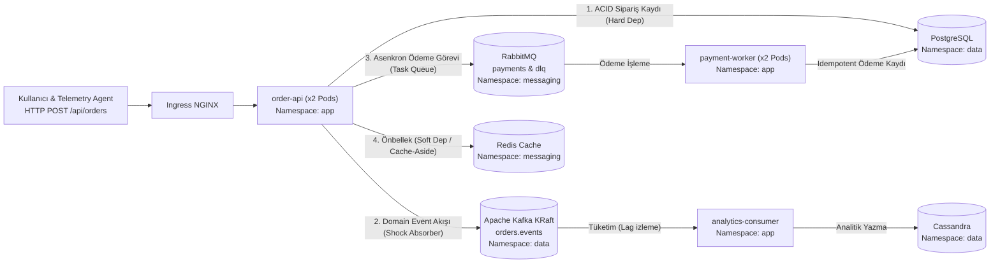

# 🔥 Kubernetes Chaos Engineering & Distributed Systems Troubleshooting Lab 3 (Production-Grade & Zero-Flapping)

Bu laboratuvar, **ResilienceStream** çok katmanlı dağıtık sipariş ve ödeme mimarisi üzerinde **Chaos Mesh**, **Prometheus** ve **Grafana** kullanarak gerçek dünya üretim (Production) arızalarını simüle etmek, gözlemlemek ve kök neden analizi (Root Cause Analysis - RCA) yaparak sistemi dayanıklı hale getirmek için tasarlanmıştır.

> [!IMPORTANT]
> **Lab 3'ün Temel Felsefesi: "Barış Zamanında Kusursuz & Kararlı, Kaos Anında Eğitici & Sarsıcı"**
> 1. **%100 Kararlı Başlangıç (Pristine Baseline):** Önceki lablardaki dar CPU/RAM sınırları, başlangıçta açık gelen yapay hatalar veya hatalı topic tanımları tamamen temizlenmiştir. Lab ilk kurulduğunda tüm podlar (`order-api`, `analytics-consumer`, `payment-worker`, `telemetry-agent`) **1/1 Running, 0 Restarts, yeşil probelar**, 0 Kafka Lag ve 0 DLQ ile başlar. Helm kurulumu hiçbir zaman `context deadline exceeded` hatasına düşmez!
> 2. **Sıfır Kopya & Gerçek SRE Deneyimi:** `values.yaml` içinde hiçbir `# HATA` veya çözüm ipucu bulunmaz. Tıpkı gerçek bir şirket altyapısında olduğu gibi semptomları Grafana panellerinden ve `kubectl` çıktılarından yakalayacaksınız.
> 3. **Kesintisiz Canlı Telemetri (`telemetry-agent`):** Yerleşik telemetri ajanı her 2.5 saniyede bir sipariş (`POST /api/orders`) üretir; doğrudan Kafka broker'ı (`end_offsets` vs `committed_offsets`) ve RabbitMQ kuyruklarını sorgular. Grafikler asla `NaN` veya `No Data` göstermez.

---

## 🧭 1. Mimaride Neyi, Neden Kullanıyoruz? (SRE Karar Matrisi)



| Katman / Teknoloji | Sistemdeki Görevi & Nasıl Çalışmalı? | Hangi Durumda Hangi Kaos Testini Yaparız? | Grafana ve CLI'da Neyi İzleriz? |
| :--- | :--- | :--- | :--- |
| **`order-api`** *(FastAPI, 2+ Pod)* | Gelen sipariş isteklerini karşılar, veritabanına ve kuyruklara dağıtır. **Stateless** olmalı, `PodDisruptionBudget` (`minAvailable: 1`) ile korunmalı ve **Sıfır Kesinti (Zero-Downtime)** ile güncellenebilmelidir. | **1. Ağ Paket Kaybı (`NetworkChaos -> loss`):** Bozuk switch/NIC altında TCP retransmission davranışını test etmek için.<br>**2. Rolling Update Kesintisi (`PodChaos -> pod-kill`):** Pod kapanırken in-flight isteklerin düşüp düşmediğini test etmek için. | **Grafana (`01. SLO Overview & Golden Signals`):** `HTTP Latency Quantiles (p50 / p95 / p99)`, `HTTP Error Ratio (%)`, `HTTP Request Rate by Status (RPS)`.<br>**CLI:** `kubectl get pods -n app` |
| **PostgreSQL** *(StatefulSet, `data` ns)* | Sipariş ve ödemelerin tutulduğu birincil **ACID (Hard Dependency)** veritabanı. Ağ gecikmesi yaşandığında API hemen 500 vermemeli; bağlantı zaman aşımı (`DEP_TIMEOUT_SECONDS`) toleranslı olmalıdır. | **Ağ Gecikmesi (`NetworkChaos -> delay`):** 1000ms gecikme altında 4 TCP/Auth round-trip'inin API'yi kilitleyip kilitlemediğini görmek için. | **Grafana (`01. SLO Overview & Golden Signals`):** `Dependency Health Status (1=UP, 0=DOWN)` (postgres), `HTTP Request Rate by Status (RPS)`.<br>**CLI:** `./scripts/check-system.sh` |
| **Redis** *(StatefulSet, `messaging` ns)* | Son sipariş özetlerini tutan **In-Memory Cache (Soft Dependency)** katmanı. Tamamen koptuğunda sistem **Circuit Breaker / Graceful Degradation** ile sipariş almaya (`HTTP 200`) devam etmelidir. | **Ağ Bölünmesi (`NetworkChaos -> partition`):** Redis koptuğunda API'nin 500 hatası vermeden önbelleği pas geçip geçemediğini doğrulamak için. | **Grafana (`01. SLO Overview & Golden Signals`):** `Dependency Health Status` (redis -> 0/DOWN) iken `Overall API Availability (%100)` ve `HTTP Error Ratio (%0)` kalması.<br>**CLI:** `curl -s http://app.<APP_IP>.nip.io/api/status \| jq` |
| **RabbitMQ & `payment-worker`** *(AMQP, `messaging` & `app` ns)* | Ödeme görevlerini asenkron yürüten **Task Queue** katmanı. Tek pod ölürse kuyruk durmamalı (`replicaCount: 2`); kalıcı gateway hatalarında zehirli mesajlar kontrollü retry sonrası **`payments.dlq`**'ya ayrılmalıdır. | **1. Pod Arızası (`PodChaos -> pod-failure`):** Bir worker çöktüğünde diğer worker'ın kuyruğu kesintisiz tüketmeye devam ettiğini doğrulamak için.<br>**2. Gateway Kesintisi:** Hatalı ödemelerin DLQ'ya kontrollü yönlendirilmesini izlemek için. | **Grafana (`02. Messaging, Kafka Lag & RabbitMQ DLQ`):** `RabbitMQ Active Consumers & Queue Status`, `RabbitMQ Queue Depth (payments vs payments.dlq) & Active Consumers`.<br>**CLI:** `rabbitmqctl list_queues` |
| **Apache Kafka & `analytics-consumer` & Cassandra** *(Event Streaming)* | Olayları (`orders.events`) diskte saklar ve Cassandra'ya yazar. Kafka, Cassandra yavaşladığında API'yi koruyan bir **şok emici tampon** görevi görür. Tüketici pod bellek baskısında `OOMKilled` olmamalıdır. | **1. Cassandra Gecikmesi (`NetworkChaos -> delay`):** Veritabanı yavaşladığında API'nin etkilenmediğini ve Kafka lag'in geçici tamponlandığını görmek için.<br>**2. Bellek Stresi (`StressChaos -> memory`):** Ani veri yığınlarında podun `OOMKilled (Exit Code 137)` olup olmadığını test etmek için. | **Grafana (`02. Messaging, Kafka Lag & RabbitMQ DLQ`):** `Kafka Consumer Lag (orders.events)`, `Kafka Offsets (Produced vs Consumed)`.<br>**CLI:** `./scripts/check-system.sh` |

---

## 🛠️ 2. Hızlı Başlangıç & Lab Ortamını Başlatma

Ortamınızı sıfırdan **%100 kararlı ve hatasız başlangıç durumunda** ayağa kaldırmak için:

```bash
# Lab 3 dizinine geçin:
cd /home/ysf/k8sfundamentals/troubleshoot/chaos-troubleshooting-3

# Ortamı başlatın / sıfırlayın:
./scripts/setup-lab.sh
```

Kurulum bittiğinde sistemin ilk sağlık taramasını yapın:
```bash
./scripts/check-system.sh
```
> [!NOTE]
> Çıktıda tüm podların `1/1 Running`, `Restarts: 0`, RabbitMQ `payments.dlq: 0`, Kafka `LAG: 0` ve API durumunun `overall_health: healthy` olduğunu teyit edin. Artık güvenle kaos testlerine başlayabilirsiniz!

---

## 📊 3. Grafana Canlı İzleme Panelleri

Tarayıcınızdan **`http://grafana.<MASTER_IP>.nip.io`** (`admin` / `AdminPassword2026!`) adresine gidin ve sol menüden **Dashboards -> ResilienceStream** altındaki 3 paneli yan yana açın:
1. **`ResilienceStream - 01. SLO Overview & Golden Signals`:** `Overall API Availability (SLO >= 99%)`, `HTTP Error Ratio (%)`, `HTTP Latency Quantiles (p50 / p95 / p99)`, `HTTP Request Rate by Status (RPS)`, `Dependency Health Status (1=UP, 0=DOWN)`.
2. **`ResilienceStream - 02. Messaging, Kafka Lag & RabbitMQ DLQ`:** `Kafka Consumer Lag (orders.events)`, `Kafka Offsets (Produced vs Consumed)`, `RabbitMQ Queue Depth (payments vs payments.dlq) & Active Consumers`, `Payment Worker Processed Totals`.
3. **`ResilienceStream - 03. Chaos Game Day & Self-Healing`:** `Circuit Breaker State`, `Application Pod Restarts`, `Memory Working Set (App Pods)`, `CPU Usage & Throttling Ratio (%)`.

---

## 🟢 BÖLÜM A: KONTROL DENEYLERİ (Sistem Dayanıklı Kalmalı)

Bu 3 deneyde sistemin barış zamanındaki sağlam mimarisini test edeceğiz. Hiçbir pod çökmemeli ve HTTP 500 üretilmemelidir.

---

### 🧪 Deney 1: `order-api` Ağ Paket Kaybı (%15 Loss — TCP Dayanıklılığı)
- **Neden Yapılır?** Bulut ortamlarında NIC veya sanal switch paket kayıpları yaşadığında mikroservisimizin HTTP 500 vermeden, sadece TCP yeniden iletim (retransmit) gecikmesiyle (`p95/p99`) çalıştığını doğrulamak için.
- **Chaos Mesh UI Adımları:**
  1. **Experiments** -> **+ New Experiment** -> `Network Attack` -> **`Loss`**.
  2. **Loss:** `15`, **Correlation:** `25`, **Direction:** `to`.
  3. **Scope:** Namespace `app`, Label Selectors `app.kubernetes.io/component: order-api`, Mode `All`.
  4. **Name:** `kontrol-01-api-packet-loss`, **Duration:** `2m` girip **Submit** edin.  
  *(CLI alternatifi: `kubectl apply -f chaos-workflows/01-kontrol-api-packet-loss.yaml`)*
- **Nasıl Kontrol Edilir?**
  - **Grafana (`01. SLO Overview & Golden Signals`):** `HTTP Latency Quantiles (p50 / p95 / p99)` grafiğinde `p99` gecikmesinin hafif yükseldiğini, ancak `HTTP Error Ratio (%)` panelinin **`%0`** ve `Overall API Availability (SLO >= 99%)` panelinin **`%100`** kaldığını doğrulayın. Deneyi **Archive** edin.

---

### 🧪 Deney 2: Redis Tam Ağ Bölünmesi (Network Partition — Circuit Breaker)
- **Neden Yapılır?** Önbellek (Cache) katmanı hız içindir; Redis tamamen koptuğunda ana sipariş akışı durmamalı, sistem **Graceful Degradation** moduna geçip sipariş almaya devam etmelidir.
- **Chaos Mesh UI Adımları:**
  1. **Experiments** -> **+ New Experiment** -> `Network Attack` -> **`Partition`**.
  2. **Direction:** `both`.
  3. **Target:** Namespace `messaging`, Label Selectors `app.kubernetes.io/name: redis`, Mode `All`.
  4. **Scope:** Namespace `app`, Label Selectors `app.kubernetes.io/component: order-api`, Mode `All`.
  5. **Name:** `kontrol-02-redis-partition`, **Duration:** `2m` girip **Submit** edin.  
  *(CLI alternatifi: `kubectl apply -f chaos-workflows/02-kontrol-redis-partition.yaml`)*
- **Nasıl Kontrol Edilir?**
  - **Grafana (`01. SLO Overview & Golden Signals`):** `Dependency Health Status (1=UP, 0=DOWN)` panelinde `redis` kutusunun kırmızı (`0 / DOWN`) olduğunu, ancak `Overall API Availability` panelinin **%100** ve `HTTP Error Ratio (%)` panelinin **%0** kaldığını görün. Deneyi **Archive** edin.

---

### 🧪 Deney 3: Cassandra 400ms Gecikmesi & Kafka Şok Emici Tamponlama
- **Neden Yapılır?** Analitik veritabanı yavaşladığında, Event-Driven mimaride `order-api` olayı Kafka'ya bırakıp hemen döndüğü için API yanıt süresi hiç etkilenmez. Yavaşlama sadece Kafka consumer lag olarak birikir ve deney bittiğinde erir.
- **Chaos Mesh UI Adımları:**
  1. **Experiments** -> **+ New Experiment** -> `Network Attack` -> **`Delay`**.
  2. **Latency:** `400ms`, **Jitter:** `50ms`, **Direction:** `to`.
  3. **Scope:** Namespace `data`, Label Selectors `app.kubernetes.io/name: cassandra`, Mode `All`.
  4. **Name:** `kontrol-03-cassandra-backpressure`, **Duration:** `2m` girip **Submit** edin.  
  *(CLI alternatifi: `kubectl apply -f chaos-workflows/03-kontrol-cassandra-backpressure.yaml`)*
- **Nasıl Kontrol Edilir?**
  - **Grafana:** `01. SLO Overview & Golden Signals` panelinde HTTP Latency Quantiles sabit kalırken, `02. Messaging, Kafka Lag & RabbitMQ DLQ` panelinde `Kafka Consumer Lag (orders.events)` grafiğinin hafifçe yükseldiğini ve deney sonlandırıldığında 0'a indiğini doğrulayın. Deneyi **Archive** edin.

---

## 🔴 BÖLÜM B: TROUBLESHOOTING DENEYLERİ (Gerçek Arızalar & Kök Neden Analizi)

Bu bölümde, sistem kaos stresine maruz kaldığında ortaya çıkan gizli mimari zafiyetleri teşhis edecek ve Helm ile kalıcı olarak onaracaksınız.

---

### 🚨 Deney 4 (Troubleshoot #1): PostgreSQL 1000ms Gecikmesi Altında Çöken API & Zaman Aşımı Kırılganlığı

#### 1. Ne Zaman / Neden Bu Testi Yaparız?
İlişkisel veritabanlarında yoğun disk I/O veya ağ gecikmesi yaşandığında, uygulama katmanındaki `DEP_TIMEOUT_SECONDS` ve Kubernetes probe ayarları yeterli toleransa sahip değilse API podları `500 Internal Server Error` üretmeye başlar veya Kubernetes podları `Unready` yaparak trafik dışı bırakır.

#### 2. Deneyi Başlatma
1. **Experiments** -> **+ New Experiment** -> `Network Attack` -> **`Delay`**.
2. **Latency:** `1000ms`, **Jitter:** `100ms`, **Direction:** `to`.
3. **Scope:** Namespace `data`, Label Selectors `app.kubernetes.io/name: postgresql`, Mode `All`.
4. **Name:** `troubleshoot-04-postgres-delay-pool`, **Duration:** `3m` girip **Submit** edin.  
*(CLI alternatifi: `kubectl apply -f chaos-workflows/04-troubleshoot-postgres-delay-pool.yaml`)*

#### 3. Gözlem ve Teşhis Rehberi
- **Grafana (`SLO Overview`):**
  - `Dependency Health Status` panelinde postgres `DOWN` oluyor mu?
  - `HTTP Request Rate by Status` panelinde kırmızı `500/503` hataları patlıyor mu?
- **Terminal:**
  ```bash
  ./scripts/check-system.sh
  kubectl logs -n app -l app.kubernetes.io/component=order-api --tail=30
  ```
- **Araştırma Sorusu:**
  PostgreSQL'e her yeni bağlantı açılırken 4 round-trip (TCP + Auth + SCRAM + Sorgu) gittiğini hatırlayın. 1000ms ağ gecikmesinde toplam sorgu süresi en az 4 saniyeye çıkar! `values.yaml` içindeki `DEP_TIMEOUT_SECONDS` ve `apiProbes.readinessProbe.timeoutSeconds` değerleri bu süreye dayanabilecek seviyede midir?

---

### 🚨 Deney 5 (Troubleshoot #2): Payment Gateway Arızası & DLQ İzolasyonu & Pod Failover

#### 1. Ne Zaman / Neden Bu Testi Yaparız?
Dış ödeme ağ geçitleri (Stripe, Iyzico vb.) çöktüğünde worker'ların nasıl davrandığını doğrulamak için yapılır. Yanlış yapılandırılmış retry kuralları mesajların hemen DLQ kuyruğuna düşmesine veya tek bir worker podu öldüğünde tüm ödeme akışının durmasına sebep olur.

#### 2. Deneyi Başlatma
1. `payment-worker` podlarından birini öldürmek için PodChaos uygulayın:
   `kubectl apply -f chaos-workflows/05-troubleshoot-payment-gateway-dlq.yaml`
2. Ödeme gateway'inde yapay %85 hata simülasyonu başlatın:
   ```bash
   ./scripts/trigger-scenario.sh --gateway-decline 0.85
   ```

#### 3. Gözlem ve Teşhis Rehberi
- **Grafana (`Messaging & Queues`):**
  - Pod öldüğünde aktif consumer sayısı 0'a mı düşüyor yoksa 1 pod tüketmeye devam ediyor mu?
  - Gateway hataları geldiğinde mesajlar kaç denemeden sonra `payments.dlq` kuyruğuna düşüyor?
- **Terminal:**
  ```bash
  rabbitmqctl -q list_queues name messages_ready consumers
  kubectl logs -n app -l app.kubernetes.io/component=payment-worker --tail=20
  ```
- İşiniz bittiğinde gateway'i normale döndürün:
  ```bash
  ./scripts/trigger-scenario.sh --gateway-heal
  ```

---

### 🚨 Deney 6 (Troubleshoot #3): Sıfır Kesinti (Zero-Downtime) Dağıtım Kusuru — Rolling Update Sırasında Paket Kaybı!

#### 1. Ne Zaman / Neden Bu Testi Yaparız?
Kubernetes'te yeni bir versiyon dağıtırken (`RollingUpdate`) kullanıcıların hiçbir istekte `502 Bad Gateway` veya `Connection Refused` almaması gerekir. Ancak podlar hemen öldüğünde NGINX Ingress endpoint'i listeden silene kadar geçen 2-3 saniyede paketler düşer!

#### 2. Deneyi Başlatma
Canlı sipariş trafiği kesintisiz akarken (`telemetry-agent` devredeyken), `order-api` için bir rolling update tetikleyin:
```bash
kubectl rollout restart deployment order-api -n app
```

#### 3. Gözlem ve Teşhis Rehberi
- **Grafana (`SLO Overview`):**
  - Podlar yeniden başlarken `HTTP Request Rate by Status` panelinde anlık kırmızı `502 / 503` pikleri görüyor musunuz?
- **Kök Neden:**
  Linux çekirdeği pod konteynerine `SIGTERM` gönderdiğinde, FastAPI süreci hemen sonlanır. Fakat NGINX Ingress Controller'ın etcd'den endpoint silme bildirimini alması 2 ila 4 saniye sürer! Bu aralıkta NGINX ölü podun IP'sine trafik göndermeye devam eder!
- **Düzeltme Yolu:**
  Konteynere `preStop` hook ekleyerek podun ölmeden önce 5 saniye beklemesini sağlamak:
  ```yaml
  lifecycle:
    preStop:
      exec:
        command: ["/bin/sleep", "5"]
  terminationGracePeriodSeconds: 30
  ```

---

### 🚨 Deney 7 (Troubleshoot #4): Analitik Worker Bellek Yığılması (`StressChaos` & `OOMKilled`)

#### 1. Ne Zaman / Neden Bu Testi Yaparız?
Streaming worker podları ani mesaj patlamalarında bellek limitlerine çarparsa Linux OOM-Killer tarafından `Exit Code 137` ile öldürülür. Pod döngüsel çöküşe girdikçe Kafka lag patlar!

#### 2. Deneyi Başlatma
1. `analytics-consumer` üzerine 200MB bellek stresi uygulayın:
   ```bash
   kubectl apply -f chaos-workflows/07-troubleshoot-consumer-memory-oom.yaml
   ```
2. Durumu gözlemleyin:
   ```bash
   kubectl get pods -n app -w
   ```

#### 3. Gözlem ve Teşhis Rehberi
- **Grafana (`Chaos Game Day`):**
  - `Application Pod Restarts` grafiğinde `analytics-consumer` podunun restart sayısı artıyor mu?
  - `kubectl describe pod -n app -l app.kubernetes.io/component=analytics-consumer` çıktısında `Last State: Terminated (Reason: OOMKilled, Exit Code: 137)` görüyor musunuz?
- **Grafana (`Messaging & Queues`):**
  - Pod sürekli çöktüğü için `Kafka Consumer Lag (orders.events)` çizgisi nasıl tırmanıyor?

---

<details>
<summary><b>🛠️ TÜM TROUBLESHOOTING SENARYOLARININ KÖK NEDEN ANALİZİ & ÇÖZÜMLERİ (Tıklayın)</b></summary>

### 🛠️ Deney 4 Çözümü (Postgres Gecikmesi & Zaman Aşımı)
- **Kök Neden:** `DEP_TIMEOUT_SECONDS` 3.0s olarak ayarlandığında, 1000ms gecikme yaşayan Postgres'in 4 TCP/Auth turu 4.0s sürdüğü için API timeout'a düşer.
- **Düzeltme (`values.yaml`):**
  ```yaml
  apiProbes:
    readinessProbe:
      timeoutSeconds: 5
  env:
    DEP_TIMEOUT_SECONDS: "5.0"
  ```

### 🛠️ Deney 5 Çözümü (Payment Worker HA & DLQ)
- **Kök Neden:** Worker podlarından biri çöktüğünde diğerinin tüketimi devralabilmesi için `replicaCount: 2` olmalıdır. DLQ patlamasını önlemek için `RABBITMQ_MAX_RETRIES: "3"` olmalıdır.
- **Düzeltme (`values.yaml`):**
  ```yaml
  workers:
    paymentWorker:
      replicaCount: 2
  env:
    RABBITMQ_MAX_RETRIES: "3"
    PAYMENT_FAILURE_RATE: "0.0"
  ```

### 🛠️ Deney 6 Çözümü (Zero-Downtime Rolling Update & preStop Hook)
- **Kök Neden:** Pod sonlanırken NGINX Ingress endpoint tablosu güncellenene kadar geçen sürede gelen isteklerin karşılanabilmesi için bir `preStop` hook gereklidir.
- **Düzeltme (`values.yaml`):**
  ```yaml
  lifecycle:
    preStop:
      exec:
        command: ["/bin/sleep", "5"]
  terminationGracePeriodSeconds: 30
  ```

### 🛠️ Deney 7 Çözümü (Analitik Bellek Sınırı & OOMKilled)
- **Kök Neden:** `analyticsResources.limits.memory` 256Mi iken 200MB ekstra stres uygulandığında konteyner sınırı aşar ve öldürülür.
- **Düzeltme (`values.yaml`):**
  ```yaml
  analyticsResources:
    limits:
      cpu: 250m
      memory: 384Mi
  ```

### 🎯 Tek Seferde Güçlendirilmiş (Hardened) Konfigürasyona Geçiş:
Tüm bu düzeltmeleri tek komutla uygulamak için:
```bash
./scripts/setup-lab.sh --hardened
```

</details>

---

## 🏆 4. BÖLÜM C: FİNAL CHAOS MESH GAME DAY WORKFLOW

Tüm düzeltmeleri yaptıktan sonra (veya `--hardened` modunda), sistemin tüm bu 6 büyük arızaya art arda otomatik olarak dayanabildiğini tek bir Chaos Mesh Workflow ile kanıtlayabilirsiniz:

```bash
kubectl apply -f chaos-workflows/08-final-game-day-workflow.yaml
```

Chaos Mesh Dashboard (`http://chaos-mesh.<MASTER_IP>.nip.io`) üzerinden **Workflows** menüsüne gidin ve adım adım tüm kaos testlerinin başarıyla geçtiğini, Grafana'da ise sistemin 100% SLO ile ayakta kaldığını canlı olarak izleyin!
