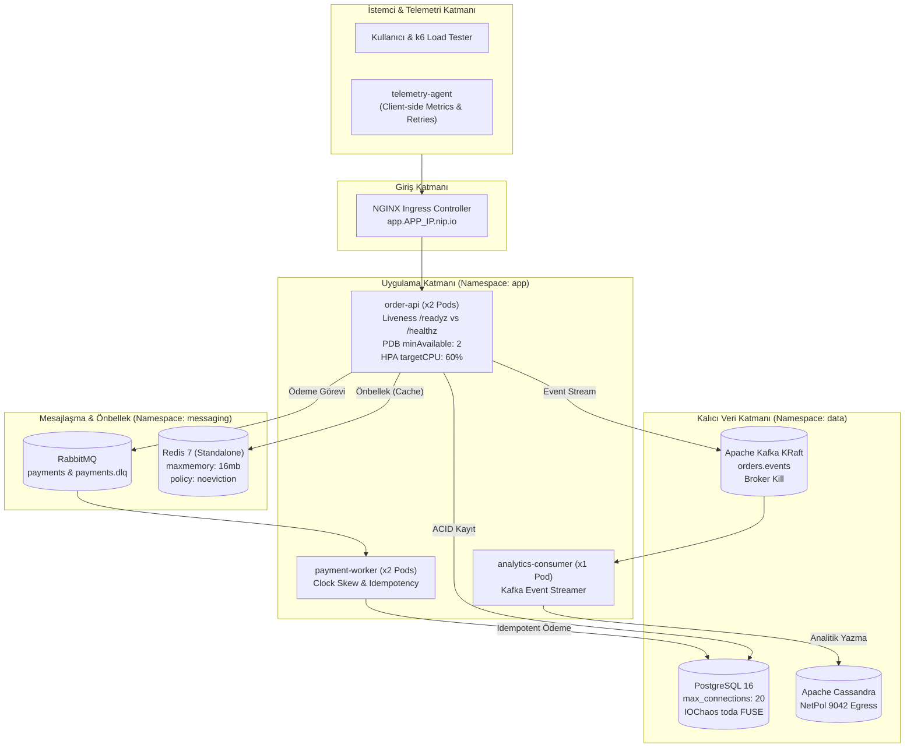

# 🔥 Kubernetes Chaos Engineering & DevOps Game Day Lab 4 (Advanced Failure Modes & 14 Scenarios)

Bu laboratuvar, **ResilienceStream** kurumsal dağıtık mikroservis mimarisi üzerinde **Chaos Mesh**, **Prometheus**, **Grafana** ve **Argo CD** kullanarak modern DevOps ve SRE ekiplerinin üretimde (Production) karşılaştığı en sinsi, zincirleme ve gizli arıza modlarını simüle etmek, teşhis etmek ve kalıcı olarak iyileştirmek için tasarlanmıştır.

> [!IMPORTANT]
> **Lab 4'ün Temel Felsefesi: "Pristine Baseline, Gerçekçi DevOps Hata Modları ve Sıfır Yanıltıcı Çöküş"**
> 1. **%100 Kararlı Başlangıç (Pristine Baseline):** Sistem ayağa kalktığında gizli hatalar asla kendiliğinden patlamaz. Kurulumda tüm podlar `1/1 Running`, `0 restart`, Kafka lag `0`, RabbitMQ DLQ `0` ve API `%100 Availability` ile başlar. Hatalar **yalnızca kaos veya yük testi enjekte edildiğinde** açığa çıkar!
> 2. **Lab 3'ten Farklı 14 Yeni Senaryo:** Lab 3'te test edilen standart ağ kopmaları yerine; disk I/O gecikmesi, NTP saat kayması (clock skew), L7 HTTP abort, Liveness kaskad çöküşü, PostgreSQL bağlantı havuzu tükenmesi, PDB tahliye kilitlenmesi (drain deadlock), HPA CPU requests eksikliği, Redis noeviction bellek taşması, Retry Storm (yeniden deneme fırtınası), NetworkPolicy sessiz düşüşü ve Secret rotasyon desenkronizasyonu test edilir.
> 3. **Google SRE Standartları:** Multi-Window Multi-Burn-Rate (1h/5m ve 6h/30m) alarm kuralları, Chaos Mesh `StatusCheck` ile otomatik blast-radius kontrolü ve `docs/postmortem-template.md` ile blameless postmortem kültürü içerir.

---

## 🧭 1. Mimari ve SRE Karar Matrisi



### SRE Teknoloji ve Arıza Matrisi

| Bileşen | Sistemdeki Rolü | Lab 4'e Özgü Kaos & Arıza Tipi | İzlenecek Grafana Paneli & Metrik |
|:---|:---|:---|:---|
| **PostgreSQL** | Sipariş ve ödemelerin ACID birincil veritabanı. | **A1:** `IOChaos` 200ms disk gecikmesi<br>**T2:** Concurrency ile `max_connections: 20` aşımı | `PostgreSQL Active Connections vs Limit (Max: 20)`<br>`HTTP Latency Quantiles (p50 / p95 / p99)` |
| **`payment-worker`** | Asenkron ödemeleri işleyen worker. | **A2:** `TimeChaos` +10m NTP saat kayması (clock skew) | `RabbitMQ Active Consumers & Queue Status`<br>`Dependency Health Status` |
| **Kafka (KRaft)** | ZooKeeper'sız olay akış motoru. | **A3:** `PodChaos` `pod-kill` broker restart | `Kafka Consumer Lag & Asynchronous Pipeline Health`<br>`Order Graceful Degradation` |
| **`order-api`** | Müşteri siparişlerini karşılayan FastAPI servisi. | **A4:** `HTTPChaos` /api/status abort %30<br>**T1:** Liveness Probe kaskad çöküşü<br>**T4:** HPA CPU requests eksikliği | `04. DevOps Failure Modes & Game Day` -> `HPA Autoscaling Status`<br>`Client-Side vs Server-Side 5xx Error Rates` |
| **Redis** | Sipariş önbelleği ve durum katmanı. | **T5:** 16MB dolumu ve `noeviction` OOM hatası | `Redis Memory Used vs Hard Maxmemory (16MB Limit)` |
| **İstemci / k6** | Sentetik trafik ve yük test motoru. | **T6:** 3s gecikme altında 5 kez retry fırtınası | `Client Request Rate & Retry Storm Multiplier (Req/s)` |
| **NetworkPolicy** | Zero-Trust küme içi ağ güvenlik kuralı. | **T7:** Cassandra (9042) ve CoreDNS (53) sessiz düşüşü | `Kafka Consumer Lag & Asynchronous Pipeline Health` |
| **K8s Secret** | Veritabanı ve broker şifreleri. | **T8:** Secret güncellemesi sonrası pod rollout olmaması | `Application Pod Restarts (Spike in 5m & CrashLoops)` |
| **CoreDNS** | Küme içi DNS çözümleme motoru. | **T9:** `ndots: 5` kaynaklı DNS sorgu patlaması | `Client Observed 5xx / Connection Timeout` |

---

## 🛠️ 2. Hızlı Başlangıç

### Ortamı Başlatma ve Sıfırlama
```bash
cd /home/ysf/k8sfundamentals/troubleshoot/chaos-troubleshooting-4

# Lab ortamını başlatın:
./scripts/setup-lab.sh

# Pristine Baseline doğrulamasını çalıştırın (Tüm podlar 1/1 Running, 0 restart olmalıdır):
./scripts/check-system.sh --strict
```

### Dashboard ve PromQL Doğrulaması
Tüm Grafana panellerinin ve PromQL sorgularının hatasız olduğunu doğrulamak için:
```bash
./scripts/verify-dashboards.sh
```

---

## 📊 3. Grafana Dashboard Haritası

Grafana arayüzüne `http://grafana.<MASTER_IP>.nip.io` adresinden erişebilirsiniz (Kullanıcı: `admin`, Şifre: `AdminPassword2026!`).

1. **`04. DevOps Failure Modes & Game Day` (`observability/dashboards/04-devops-gameday.json`):**
   - *PostgreSQL Active Connections vs Limit (Max: 20)*
   - *Redis Memory Used vs Hard Maxmemory (16MB Limit)*
   - *HPA Autoscaling Status (Desired vs Current Replicas)*
   - *Client-Side vs Server-Side 5xx Error Rates (RPS)*
   - *Client Request Rate & Retry Storm Multiplier (Req/s)*
   - *Kafka Consumer Lag & Asynchronous Pipeline Health*
   - *Application Pod Restarts (Spike in 5m & CrashLoops)*
   - *Multi-Window SLO Burn Rate (1h Window vs 6h Window)*
2. **`01. SLO Overview & Golden Signals`:**
   - *HTTP Error Ratio (%)*
   - *Overall API Availability (SLO >= 99%)*
   - *HTTP Latency Quantiles (p50 / p95 / p99)*
3. **`02. Messaging, Kafka Lag & RabbitMQ DLQ`:**
   - *Kafka Consumer Lag (orders.events)*
   - *RabbitMQ Queue Depth (payments vs payments.dlq)*
4. **`03. Chaos Game Day & Self-Healing`:**
   - *Circuit Breaker State (0=CLOSED, 1=HALF-OPEN, 2=OPEN)*
   - *Order Graceful Degradation (success / degraded / failed)*

---

## 🔬 4. Deneyler ve Çözüm Rehberi

---

### 🟢 BÖLÜM A: KONTROL DENEYLERİ (Sistem Dayanmalı)

#### Deney A1 — PostgreSQL Data Volume Disk Gecikmesi (`IOChaos`)
- **Hipotez:** Veritabanı diski 200ms gecikse bile `order-api` siparişleri kabul etmeye devam eder; HTTP p99 gecikmesi yükselir ancak 5xx hata üretilmez ve readiness düşmez.
- **Gerçek Dünya:** Bulut sağlayıcısında (AWS EBS, Azure Managed Disk) IOPS kotasının dolması veya noisy-neighbor disk çekişmesi.
- **Tetikleme:**
  ```bash
  ./scripts/trigger-scenario.sh 1 apply
  ```
- **Gözlem:**
  - Grafana Panel: `HTTP Latency Quantiles (p50 / p95 / p99)` -> p99 süresi 50ms'den ~250ms'ye çıkar.
  - Grafana Panel: `HTTP Error Ratio (%)` -> %0 kalır.
- **Temizleme:**
  ```bash
  ./scripts/trigger-scenario.sh 1 delete
  ```

---

#### Deney A2 — Ödeme İşleyicide Saat Kayması (`TimeChaos`)
- **Hipotez:** `payment-worker` podunun saati 10 dakika ileri kaysa bile PostgreSQL'deki `ON CONFLICT (order_id)` idempotency koruması sayesinde mükerrer çekim yapılmaz.
- **Gerçek Dünya:** Sunucu BIOS/NTP daemon desync arızası veya VM hypervisor canlı geçişi (live migration) sonrası saat atlaması.
- **Tetikleme:**
  ```bash
  ./scripts/trigger-scenario.sh 2 apply
  ```
- **Gözlem:**
  - Grafana Panel: `RabbitMQ Queue Depth` -> payments kuyruğu düzenli işlenmeye devam eder.
  - Veritabanı: `SELECT count(*), count(DISTINCT order_id) FROM payments;` sayıları birebir eşittir.
- **Temizleme:**
  ```bash
  ./scripts/trigger-scenario.sh 2 delete
  ```

---

#### Deney A3 — Kafka KRaft Broker Restartı (`PodChaos`)
- **Hipotez:** Tek broker/controller olan `kafka-controller-0` podu aniden öldürüldüğünde, `order-api` çökmez; siparişleri veritabanına yazar ve Kafka yeniden başlayana kadar `degraded` modda 201 Created döner. Broker açıldığında lag hızla erir.
- **Gerçek Dünya:** Spot VM geri alımı veya donanım arızası.
- **Tetikleme:**
  ```bash
  ./scripts/trigger-scenario.sh 3 apply
  ```
- **Gözlem:**
  - Grafana Panel: `Order Graceful Degradation` -> `degraded` siparişler geçici olarak görünür, 5xx hatası oluşmaz.
  - Kubelet: `kubectl get pods -n data -l app.kubernetes.io/name=kafka` podun ayağa kalktığını doğrular.
- **Temizleme:**
  ```bash
  ./scripts/trigger-scenario.sh 3 delete
  ```

---

#### Deney A4 — L7 HTTP Abort `/api/status` Endpointinde (`HTTPChaos`)
- **Hipotez:** `/api/status` endpointine gelen isteklerin %30'u yapay 500 hatası alsa bile ana sipariş akışı (`POST /api/orders`) ve checkout işlemleri etkilenmez.
- **Gerçek Dünya:** Metrik/sağlık sorgulama katmanında reverse proxy veya sidecar gateway arızası.
- **Tetikleme:**
  ```bash
  ./scripts/trigger-scenario.sh 4 apply
  ```
- **Gözlem:**
  - `curl -s http://app.<APP_IP>.nip.io/api/status` -> Rastgele 500 döner.
  - `curl -s -X POST http://app.<APP_IP>.nip.io/api/orders -H "Content-Type: application/json" -d '{"customer_id":"c1","items":[{"item_id":"i1","quantity":1,"price":10}],"total_amount":10}'` -> 201 Created döner!
- **Temizleme:**
  ```bash
  ./scripts/trigger-scenario.sh 4 delete
  ```

---

### 🔴 BÖLÜM B: TROUBLESHOOT DENEYLERİ (Gizli DevOps Zafiyetleri)

---

#### Deney T1 — Liveness Probe Kaskad Çöküşü (Cascading Failure)
- **Tetikleme:**
  ```bash
  ./scripts/trigger-scenario.sh 5 apply
  ```
- **Belirti:** PostgreSQL'e uygulanan 1500ms gecikme sonrası tüm `order-api` podları ardışık olarak yeniden başlar (`Restarts` artar) ve `CrashLoopBackOff` durumuna düşer. NGINX Ingress `502 Bad Gateway` üretmeye başlar!
- **Araştırma Sorusu:** Basit bir veritabanı yavaşlığı neden tüm uygulama konteynerlerinin Kubelet tarafından öldürülmesine yol açtı?
<details>
<summary>🔍 Çözüm ve Kök Neden Analizi (Tıkla)</summary>

**Kök Neden:**
`helm-chart/values.yaml` içinde `apiProbes.livenessProbe.path` sehven `"/readyz"` olarak yapılandırılmıştır. `/readyz` uç noktası PostgreSQL bağlantısını doğrulamaktadır. Ağ gecikmesi probe zaman aşımını (timeout: 3s) aştığında Kubelet podun kilitlendiğini düşünerek SIGKILL gönderir. Bu klasik bir **Liveness ≠ Readiness** kaskad çöküşüdür!

**Çözüm:**
Liveness probe asla harici bağımlılıklara bakmamalı, sadece process'in hayatta olup olmadığını denetlemelidir (`/healthz`).
`helm-chart/values.yaml` dosyasında güncelleyin:
```yaml
apiProbes:
  livenessProbe:
    path: "/healthz" # /readyz yerine /healthz!
```
Güncelleştirmeyi uygulayın:
```bash
helm upgrade resiliencestream ./helm-chart -n app -f ./helm-chart/values.yaml
```
</details>

---

#### Deney T2 — PostgreSQL Bağlantı Havuzu Tükenmesi (`max_connections`)
- **Tetikleme:**
  ```bash
  ./scripts/trigger-scenario.sh 6 apply
  # veya k6 stres testi:
  ./scripts/load-test.sh concurrency
  ```
- **Belirti:** Yük altındayken siparişler `HTTP 500 / 503` ile patlar. Loglarda `FATAL: sorry, too many clients already` hatası görülür.
- **Araştırma Sorusu:** `order-api` kaç adet veritabanı bağlantısı açıyor ve PostgreSQL'in kapasitesi buna neden yetmiyor?
<details>
<summary>🔍 Çözüm ve Kök Neden Analizi (Tıkla)</summary>

**Kök Neden:**
PostgreSQL `max_connections: 20` sınırına sahiptir. `order-api` ise bağlantı havuzu (connection pool / PgBouncer) kullanmadan her HTTP isteğinde yeni bağlantı açmaya çalışmaktadır. 40 eşzamanlı istek veritabanı sınırını aşmaktadır (`pods × pool_size > max_connections`).

**Çözüm:**
1. Veritabanı sınırını ihtiyaca göre genişletin (`helm-values/postgres-values.yaml` -> `max_connections = 100`).
2. Uygulama tarafında SQLAlchemy/asyncpg bağlantı havuzu boyutunu (`pool_size=5, max_overflow=5`) sınırlandırın.
</details>

---

#### Deney T3 — PodDisruptionBudget (PDB) Düğüm Boşaltma Kilitlenmesi (Drain Deadlock)
- **Tetikleme:**
  ```bash
  kubectl drain vm-worker-app --ignore-daemonsets --delete-emptydir-data --dry-run=client
  ```
- **Belirti:** Kubernetes tahliye komutu süresiz olarak kilitlenir: `Cannot evict pod as it would violate the pod's disruption budget`. Bakım penceresi kilitlenir.
- **Araştırma Sorusu:** `order-api` 2 replikaya sahipken neden tek bir pod bile tahliye edilemiyor?
<details>
<summary>🔍 Çözüm ve Kök Neden Analizi (Tıkla)</summary>

**Kök Neden:**
`values.yaml` içinde `replicaCount: 2` iken `pdb.minAvailable: 2` tanımlanmıştır. Bu durumda `allowedDisruptions = 0` olur. Kubernetes hiçbir podun durdurulmasına izin vermez!

**Çözüm:**
`helm-chart/values.yaml` dosyasında PDB'yi güncelleyin:
```yaml
pdb:
  enabled: true
  minAvailable: 1 # 2 replika varken en az 1 tanesi ayakta kalsın (1 tanesi tahliye edilebilir)
```
Dağıtın:
```bash
helm upgrade resiliencestream ./helm-chart -n app -f ./helm-chart/values.yaml
```
</details>

---

#### Deney T4 — HPA CPU Requests Eksikliği Nedeniyle Ölçeklememe
- **Tetikleme:**
  ```bash
  ./scripts/trigger-scenario.sh 8 apply
  ```
- **Belirti:** `order-api` podları %100 CPU tüketir, yanıt süreleri saniyelere fırlar. Ancak HPA asla replika sayısını artırmaz (`kubectl get hpa -n app` çıktısında `TARGETS: <unknown>/60%` görünür).
- **Araştırma Sorusu:** Metrics-server çalışmasına rağmen HPA neden CPU yüzdesini hesaplayamıyor?
<details>
<summary>🔍 Çözüm ve Kök Neden Analizi (Tıkla)</summary>

**Kök Neden:**
HPA, CPU kullanım yüzdesini `kullanılan_cpu / istenen_cpu (request)` formülüyle hesaplar. `values.yaml` dosyasında `resources.requests` altında `cpu` tanımlanmamıştır (sadece `memory: 128Mi` vardır). İstek (request) tanımlanmadığında payda sıfır/tanımsız olur ve HPA `<unknown>` hatasına düşer!

**Çözüm:**
`helm-chart/values.yaml` içinde `resources.requests.cpu: 50m` ekleyin:
```yaml
resources:
  requests:
    cpu: 50m
    memory: 128Mi
```
Helm upgrade sonrası `kubectl get hpa -n app` çıktısının `%` değerini hesapladığını ve podların 4 replikaya ölçeklendiğini doğrulayın!
</details>

---

#### Deney T5 — Redis Bellek Taşması ve `noeviction` Çöküşü
- **Tetikleme:**
  ```bash
  ./scripts/trigger-scenario.sh 9 apply
  ```
- **Belirti:** Redis belleği 16MB sınırına ulaşır. Ardından loglarda `(error) OOM command not allowed when used memory > 'maxmemory'` patlar ve tüm siparişler `degraded` durumuna düşer.
- **Araştırma Sorusu:** Redis bir önbellek (cache) olarak kullanılıyorsa bellek dolduğunda neden eski verileri silip yenilere yer açmıyor?
<details>
<summary>🔍 Çözüm ve Kök Neden Analizi (Tıkla)</summary>

**Kök Neden:**
Redis `maxmemory-policy: noeviction` ile başlatılmıştır. `noeviction` politikası, bellek dolduğunda yeni yazmaları reddeder (Veritabanı gibi davranır). Oysa önbellek katmanlarında `allkeys-lru` veya `volatile-lru` kullanılmalıdır!

**Çözüm:**
`helm-values/redis-values.yaml` dosyasında politikayı `allkeys-lru` yapın:
```yaml
master:
  configuration: |
    maxmemory 64mb
    maxmemory-policy allkeys-lru
```
</details>

---

#### Deney T6 — İstemci Yeniden Deneme Fırtınası (Retry Storm)
- **Tetikleme:**
  ```bash
  ./scripts/trigger-scenario.sh 10 apply
  ./scripts/load-test.sh retry-storm
  ```
- **Belirti:** `/api/orders` endpointine 3s gecikme geldiğinde, gelen istek sayısı anında 4 katına katlanır (`Total Outbound Requests/s: 150+`). Kubelet ve Ingress soketleri kilitlenir.
- **Araştırma Sorusu:** İstemci neden normal trafiğin 4 katı yük üretiyor?
<details>
<summary>🔍 Çözüm ve Kök Neden Analizi (Tıkla)</summary>

**Kök Neden:**
İstemci tarafında (k6 ve telemetri) `timeout: 2s` iken sunucu gecikmesi 3s'dir. İstemci her zaman aşımında **üstel geri çekilme (exponential backoff) ve rastgele gecikme (jitter)** olmadan anında 5 kez tekrar denemektedir. Bu durum sunucuyu tamamen boğan bir **Retry Storm** yaratır.

**Çözüm:**
İstemciye Exponential Backoff ve Circuit Breaker ekleyin. Retry bütçesini sınırlandırın (`max_retries: 2`, `backoff: 200ms * 2^attempt + jitter`).
</details>

---

#### Deney T7 — NetworkPolicy ile Cassandra ve DNS Sessiz Düşüşü
- **Tetikleme:**
  ```bash
  ./scripts/trigger-scenario.sh 11 apply
  ```
- **Belirti:** Güvenlik ekibi "Zero Trust Hardening" uyguladıktan sonra `order-api` yeşil görünür (HTTP 201), ancak Grafana'da Kafka lag (`analytics-consumer`) durmaksızın yükselir ve Cassandra yazma hataları tırmanır.
- **Araştırma Sorusu:** API sağlıklı çalışırken asenkron pipeline neden durdu?
<details>
<summary>🔍 Çözüm ve Kök Neden Analizi (Tıkla)</summary>

**Kök Neden:**
`11-troubleshoot-networkpolicy-silent-drop.yaml` manifestosu PostgreSQL (5432), Kafka (9092) ve RabbitMQ (5672) egress portlarına izin verirken, Cassandra portunu (9042) ve CoreDNS portunu (53 UDP/TCP) engellemiştir! `analytics-consumer` Cassandra'ya bağlanamadığı için Kafka mesajlarını işleyemez (Sessiz Veri Tıkanması!).

**Çözüm:**
NetworkPolicy'ye Cassandra (9042) ve CoreDNS (53) egress kurallarını ekleyin veya `helm-chart/values-hardened.yaml` içindeki `networkPolicy.allowCassandra: true` ve `networkPolicy.allowDNS: true` ayarlarını açın.
</details>

---

#### Deney T8 — Secret Rotasyon Desenkronizasyonu (Desync)
- **Tetikleme:**
  ```bash
  ./scripts/rotate-secret.sh rotate
  ```
- **Belirti:** Secret güncellenir ancak `order-api` podlarının yaşı (AGE) değişmez. Bir pod öldürüldüğünde yeni gelen pod `ACCESS_REFUSED` alır ve kümede Split-Brain kimlik doğrulama arızası başlar.
- **Araştırma Sorusu:** Secret güncellendiğinde Pod neden otomatik yeniden başlamadı?
<details>
<summary>🔍 Çözüm ve Kök Neden Analizi (Tıkla)</summary>

**Kök Neden:**
Kubernetes ortam değişkenleri (`envFrom: secretRef`) sadece pod ayağa kalkarken okunur. Pod template'i değişmediği sürece Deployment yeni bir ReplicaSet ve RollingUpdate tetiklemez.

**Çözüm:**
`helm-chart/values.yaml` içinde `credentials.rolloutOnChange: true` yapılmalıdır. Bu sayede `templates/deployment.yaml` içindeki şu annotation devreye girer:
```yaml
annotations:
  checksum/secret: {{ include (print $.Template.BasePath "/secret.yaml") . | sha256sum }}
```
Secret değiştiğinde checksum değişir ve Kubernetes otomatik RollingUpdate başlatır!
</details>

---

#### Deney T9 — `ndots: 5` Kaynaklı CoreDNS Sorgu Patlaması
- **Tetikleme:**
  ```bash
  ./scripts/trigger-scenario.sh 13 apply
  ```
- **Belirti:** Kısa servis adları (`kafka`, `postgres-postgresql`) kullanılırken DNS sorgu gecikmesi patlar ve rastgele bağlantı zaman aşımları yaşanır.
- **Araştırma Sorusu:** Kubernetes varsayılan `ndots: 5` ayarı neden 5 kat fazla DNS sorgusu üretir?
<details>
<summary>🔍 Çözüm ve Kök Neden Analizi (Tıkla)</summary>

**Kök Neden:**
Linux resolver, alan adında `ndots` (varsayılan 5) değerinden az nokta varsa, önce `/etc/resolv.conf` içindeki arama yollarını (`search app.svc.cluster.local svc.cluster.local cluster.local`) tek tek dener. `kafka` sorgusu 4 başarısız NXDOMAIN sorgusundan sonra ancak çözülür.

**Çözüm:**
1. Servis bağlantılarında her zaman Tam Nitelikli Alan Adı (FQDN) kullanın (`kafka.data.svc.cluster.local`).
2. Pod tanımına `dnsConfig: options: [{name: ndots, value: "2"}]` ekleyin.
</details>

---

### 🤖 BÖLÜM C: GAMEDAY ORKESTRASYONU & SRE PRATİKLERİ

#### Deney C1 — Multi-Window Multi-Burn-Rate Alarmları
Google SRE kitabında tanımlanan çok pencereli hata bütçesi tüketim alarmları:
- **1 Saatlik Pencere (14.4x Burn Rate):** 1 saatte bütçenin %2'sini tüketir -> Pager / Critical alarmı ateşlenir.
- **6 Saatlik Pencere (6.0x Burn Rate):** 6 saatte bütçenin %5'ini tüketir -> Ticket / Warning alarmı ateşlenir.

Kaos deneyi sırasında Alertmanager (`http://alertmanager.<MASTER_IP>.nip.io`) veya Prometheus Alerts sekmesinden alarmların `Firing` durumuna geçtiğini gözlemleyin.

---

#### Deney C2 — Otomatik GameDay Workflow ve Blast-Radius Kontrolü (`StatusCheck`)
- **Tetikleme:**
  ```bash
  ./scripts/trigger-scenario.sh 14 apply
  ```
- **İşleyiş:**
  Chaos Mesh Workflow sırasıyla A1 (Postgres IO), A3 (Kafka Kill) ve A4 (HTTP Abort) deneylerini seri olarak çalıştırır.
  Her adım arasında yer alan `StatusCheck`, `/readyz` ve `/api/status` uç noktalarını denetler. Eğer hata oranı veya sağlık kriteri bozulursa workflow **kendi kendini derhal durdurur ve geri alır (Self-Abort / Blast-Radius Protection)!**

---

## 📝 5. Blameless Postmortem (Olay Raporu)

Bir arıza başarıyla çözüldüğünde `docs/postmortem-template.md` şablonunu kullanarak kendi olay inceleme raporunuzu hazırlayın:
- Olay özeti ve TTR (Time to Recovery)
- Zaman çizelgesi (Timeline)
- 5 Whys Kök Neden Analizi
- Önleyici aksiyon maddeleri (Action Items)

---

## 🧹 6. Temizlik ve Ortamı Sıfırlama

Tüm aktif kaos deneylerini ve test podlarını temizlemek için:
```bash
./scripts/trigger-scenario.sh --clean-chaos
./scripts/check-system.sh --strict
```
