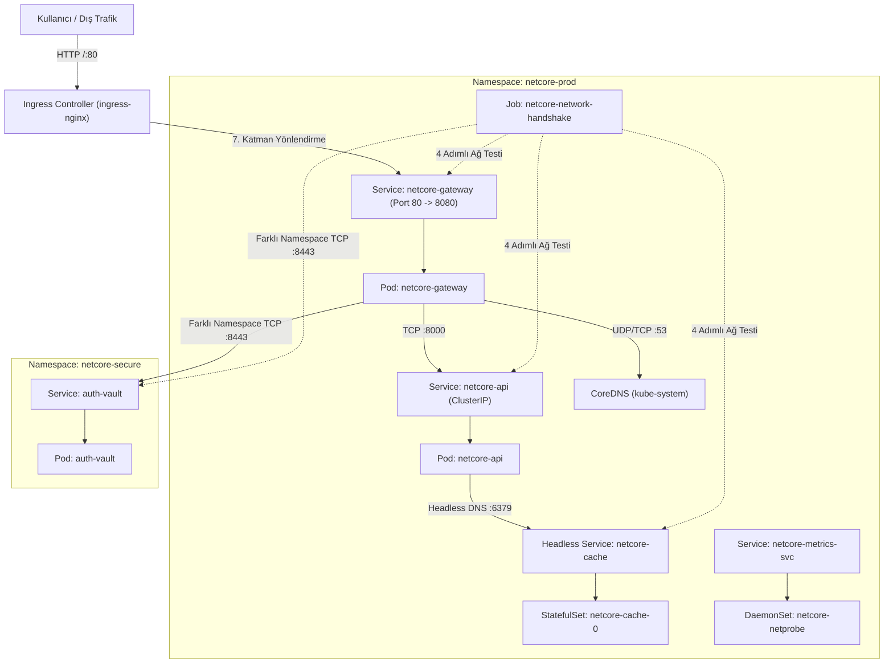

# INCIDENT #9105 — NetCore v5.0 Kubernetes Networking Mesh Outage / Ağ Kesintisi

[🇹🇷 Türkçe Dokümantasyon (Nereden Başlamalıyım & Adım Adım Teşhis Rehberi)](#-türkçe-dokümantasyon) | [🇬🇧 English Documentation](#-english-documentation)

---

# 🇹🇷 Türkçe Dokümantasyon

## Olay Özeti (Incident Report): NetCore v5.0 Mikroservis Ağ Çöküşü
Saat 09:15'te altyapı ekibi, yüksek performanslı ağ ve güvenlik platformu olan **NetCore v5.0** sürümünü devreye aldı. Platform; Ingress Gateway üzerinden müşteri trafiğini alıp iç API'ye (`netcore-api`), izole bir güvenlik namespace'indeki kimlik doğrulama kasasına (`auth-vault`), dağıtık StatefulSet önbelleğe (`netcore-cache`) ve düğüm düzeyindeki telemetri ajanlarına (`netcore-netprobe`) yönlendirecek şekilde tasarlandı.

Dağıtımın hemen ardından sistemde tam bir kesinti yaşandı:
* Dış dünyadan Ingress üzerinden gelen istekler `404 Not Found` veya `502 / 503` alıyor.
* Gateway podu (`netcore-gateway`) CoreDNS çözümlemesi yapamıyor (`i/o timeout`) ve kimlik doğrulama kasasına (`auth-vault`) erişemiyor.
* Çekirdek API (`netcore-api`) podu `Running` görünmesine rağmen diğer podlardan gelen bağlantıları anında reddediyor (`Connection refused`) veya yanıt vermiyor.
* Dağıtık önbellek podu (`netcore-cache-0`) headless DNS ile bulunamıyor (`bad address`).
* Otomatik ağ doğrulama Job'ı (`netcore-network-handshake`) sürekli hata verip çöküyor (`CrashLoopBackOff` / `Error`).
* Düğüm telemetri ajanları (`netcore-netprobe`) hiçbir sunucuya yerleşemiyor (`DESIRED: 0`) veya yerleşse bile `CreateContainerError` / `Read-only file system` hatası veriyor.

---

## Ağ Mimarisi ve Paket Akış Diyagramı



---

## 🗺️ 1. Dosya Haritası: Hangi YAML Dosyası Neyi Yönetiyor?

`helm/netcore/` altında 10 farklı şablon dosyası ve 1 adet `values.yaml` var. Hepsine aynı anda bakmak yerine aşağıdaki tabloyu **El Kitabı** olarak kullan:

| Dosya Yolu | İçindeki Kubernetes Objeleri | Ne İşe Yarar? |
| :--- | :--- | :--- |
| **`helm/netcore/values.yaml`** | Merkezi Helm Değişkenleri | Portlar, protokoller (`UDP/TCP`), bind adresi (`127.0.0.1`), `serviceName`, `ingress.className` ve `daemonset.nodeSelector` gibi **birçok temel ayarın değiştirildiği ana dosya**. |
| **`templates/00-namespaces.yaml`** | `Namespace/netcore-prod`, `Namespace/netcore-secure` | İki namespace'i ve NetworkPolicy'lerin kullandığı `kubernetes.io/metadata.name` etiketlerini oluşturur *(Bu dosyada hata yoktur)*. |
| **`templates/01-config-and-secrets.yaml`** | `ConfigMap/netcore-gateway-conf`, `netcore-api-conf`, `auth-vault-conf` | Gateway'in Nginx `proxy_pass` ayarlarını (`http://netcore-api:8000` ve `http://auth-vault:8443`) ve API/Vault Python kodlarını tutar. |
| **`templates/02-cache-statefulset.yaml`** | `Service/netcore-cache` (Headless) & `StatefulSet/netcore-cache` | Redis önbelleğini ve onun sabit DNS kaydını (`netcore-cache-0.netcore-cache`) üretir. |
| **`templates/03-vault-deployment.yaml`** | `Service/auth-vault` & `Deployment/auth-vault` | `netcore-secure` namespace'inde `8443` portundan çalışan güvenlik kasası *(Bu dosyada hata yoktur)*. |
| **`templates/04-api-deployment.yaml`** | `Service/netcore-api` & `Deployment/netcore-api` | `8000` portunda çalışan çekirdek API. `values.yaml` içindeki `api.bindHost` ve `api.serviceProtocol` değerlerini kullanır. |
| **`templates/05-gateway-deployment.yaml`** | `Service/netcore-gateway` & `Deployment/netcore-gateway` | Dış dünyadan gelen trafiği karşılayan Nginx Gateway. `values.yaml` içindeki `gateway.namedPort` ve `gateway.externalTrafficPolicy` değerlerini kullanır. |
| **`templates/06-network-policies.yaml`** | `gateway-egress-policy`, `vault-isolation-policy`, `cache-isolation-policy` | Hangi podun hangi poda/porta gidebileceğini kısıtlayan güvenlik duvarı (Firewall) kuralları. |
| **`templates/07-ingress.yaml`** | `Ingress/netcore-ingress` | Dış HTTP isteklerini (`/api/v1/network/status`) `netcore-gateway` servisine yönlendirir. |
| **`templates/08-telemetry-daemonset.yaml`** | `Service/netcore-metrics-svc` & `DaemonSet/netcore-netprobe` | Her sunucuda (Node) 1 adet çalışıp `/var/log/netprobe.log` dosyasına durum yazan ajan. |
| **`templates/09-batch-sync-job.yaml`** | `Job/netcore-network-handshake` | **Senin Pusulan!** Sırasıyla `[1/4] Cache`, `[2/4] API`, `[3/4] Auth Vault` ve `[4/4] Gateway` bağlantısını test eden doğrulama Job'ı *(Bu dosyada hata yoktur, sistemin test aracıdır)*. |

---

## 🧭 2. Nereden Başlamalıyım? (Adım Adım Teşhis Sırası)

Çok fazla YAML olduğunda rastgele dosya açmak yerine, kümedeki **`netcore-network-handshake` Job'ının loglarını** ve **`kubectl get` / `describe` çıktılarını** takip ederek **içeriden dışarıya (Bottom-Up)** doğru ilerle.

Önce genel tabloyu görmek için şu 3 komutu çalıştır:
```bash
kubectl get pods,svc,ep,ds,sts,job,ingress -n netcore-prod -o wide
kubectl get pods,svc,ep,netpol -n netcore-secure -o wide
kubectl logs -n netcore-prod job/netcore-network-handshake
```

---

### 🔍 AŞAMA 1: `kubectl get ds` ve `kubectl get ep` ile İlk Bakışta Görünen Hatalar

#### İpucu 1 — DaemonSet Neden `0` Görünüyor ve Başlayınca Neden Çöküyor? (`08-telemetry-daemonset.yaml` & `values.yaml`)
1. **Ne Görüyorsun?**
   ```bash
   kubectl get ds -n netcore-prod
   kubectl describe ds netcore-netprobe -n netcore-prod
   kubectl get ep netcore-metrics-svc -n netcore-prod
   ```
   - `DESIRED: 0, CURRENT: 0, READY: 0` görüyorsun ve `netcore-metrics-svc` karşısında `ENDPOINTS: <none>` yazıyor!
2. **Nasıl Yorumlamalısın?**
   - Bir DaemonSet'in `DESIRED: 0` olması, `spec.template.spec.nodeSelector` içindeki etiketin kümedeki hiçbir Node üzerinde bulunmadığı anlamına gelir (`kubectl get nodes --show-labels` ile kontrol edebilirsin).
   - Ayrıca `Service/netcore-metrics-svc` (`08-telemetry-daemonset.yaml` satır 8-10) hangi pod etiketlerini (`selector`) arıyor, DaemonSet podlarının (`template.metadata.labels`) gerçek etiketleri ne?
   - **Dikkat (İkinci Katman):** `nodeSelector`'ı kaldırdıktan sonra podlar oluşacak ama `CrashLoopBackOff` / `Error` verecek! Hemen `kubectl logs -n netcore-prod -l app=netcore-netprobe` komutunu çalıştır: `can't create /var/log/netprobe.log: Read-only file system` hatasını göreceksin. `08-telemetry-daemonset.yaml` içindeki `volumeMounts` bölümüne bak!

#### İpucu 2 — `netcore-gateway` Servisinin Endpoint'i Neden `<none>`? (`05-gateway-deployment.yaml` & `values.yaml`)
1. **Ne Görüyorsun?**
   ```bash
   kubectl get ep netcore-gateway -n netcore-prod
   kubectl describe svc netcore-gateway -n netcore-prod
   ```
   - `netcore-gateway` podu `1/1 Running` olmasına rağmen, `Service/netcore-gateway` altında `Endpoints: <none>` yazıyor (eğer henüz düzeltmediysen) ve `External Traffic Policy: Local` görünüyor!
2. **Nasıl Yorumlamalısın?**
   - Pod `Running` ve `Ready` olduğu halde Service `Endpoints: <none>` diyorsa ya Service `selector` etiketleri yanlıştır ya da Service `targetPort` alanında yazan **isimlendirilmiş port (`namedPort`)** ile Deployment içindeki `containerPort.name` uyuşmuyordur!
   - Ayrıca çok düğümlü (Multi-Node) bir kümede `replicas: 1` olan bir serviste `externalTrafficPolicy: Local` kullanılırsa, diğer düğümlere gelen paketler düşürülür. Bunu `values.yaml` içinden neye çevirmelisin?

---

### 🔍 AŞAMA 2: `netcore-network-handshake` Job Loglarını Takip Ederek 4 Adımı Çözme

Job (`09-batch-sync-job.yaml`) sırasıyla 4 ağ testi yapar. Her bir adımı çözdükten sonra Job'ı yeniden tetikleyip bir sonraki adıma geçebilirsin:
```bash
helm upgrade --install netcore ./helm/netcore && \
kubectl delete job netcore-network-handshake -n netcore-prod --ignore-not-found && \
helm upgrade --install netcore ./helm/netcore
```

---

#### 🛑 Job Adım `[1/4]` Hatası: `nc: bad address 'netcore-cache-0.netcore-cache'` (`02-cache-statefulset.yaml` & `values.yaml`)
1. **Ne Görüyorsun?**
   ```bash
   kubectl logs -n netcore-prod job/netcore-network-handshake
   # Çıktı:
   # ==> [1/4] Verifying StatefulSet Redis Headless DNS & Port...
   # nc: bad address 'netcore-cache-0.netcore-cache'
   ```
2. **Nasıl Yorumlamalısın?**
   - `bad address` bir **DNS çözülememe (NXDOMAIN)** hatasıdır.
   - StatefulSet podlarının `<pod-adı>.<headless-servis-adı>` olarak DNS kaydı alabilmesi için, `StatefulSet` içindeki `spec.serviceName` alanı ile `Headless Service` (`clusterIP: None`) objesinin `metadata.name` alanı **birebir aynı** olmak zorundadır.
   - `02-cache-statefulset.yaml` ve `values.yaml` (`cache.serviceName`) dosyalarına bak: Servisin adı ne, StatefulSet'in `serviceName` alanına ne yazılmış?

---

#### 🛑 Job Adım `[2/4]` Hatası: `wget: can't connect to remote host: Connection refused` veya `Operation timed out` (`04-api-deployment.yaml` & `values.yaml`)
1. **Ne Görüyorsun?**
   ```bash
   # ==> [2/4] Verifying Core API TCP Connectivity...
   # wget: can't connect to remote host (10.x.x.x): Connection refused (veya timed out)
   ```
2. **Nasıl Yorumlamalısın?**
   - `netcore-api` podu `Running` görünüyor ama `http://netcore-api:8000/healthz` adresine gidilemiyor!
   - `04-api-deployment.yaml` ve `values.yaml` (`api:` bölümü) içine bak:
     1. **Soket Bağlama (`bindHost`):** Uygulama `127.0.0.1` adresini dinlerse yalnızca kendi içinden (`localhost`) gelen istekleri kabul eder, dışarıdan (`eth0`) gelen tüm paketleri `Connection refused` ile reddeder. Kümeye açık olması için ne dinlemelidir? *(Not: Eğer probe'larda `host: "127.0.0.1"` varsa onu da kontrol et).*
     2. **4. Katman Protokolü (`serviceProtocol`):** HTTP trafiği `TCP` üzerinden çalışır. `Service/netcore-api` hangi protokolle (`UDP` mi `TCP` mi) tanımlanmış?

---

#### 🛑 Job Adım `[3/4]` Hatası: `wget: download timed out` (`auth-vault:8443` Erişimi — `06-network-policies.yaml` & `values.yaml`)
1. **Ne Görüyorsun?**
   ```bash
   # ==> [3/4] Verifying Cross-Namespace Auth Vault MTLS Endpoint...
   # wget: download timed out
   ```
2. **Nasıl Yorumlamalısın?**
   - `Connection refused` yerine **`timed out`** alıyorsan, paketler yolda bir **NetworkPolicy (Firewall)** tarafından sessizce düşürülüyor (`DROP`) demektir!
   - Hemen `netcore-secure` namespace'indeki NetworkPolicy'yi incele:
     ```bash
     kubectl describe netpol vault-isolation-policy -n netcore-secure
     ```
   - `06-network-policies.yaml` içindeki `vault-isolation-policy` ve `values.yaml` (`vault.networkPolicyPort`) dosyalarına bak:
     1. **Port Hatası:** `auth-vault` podu `8443` portunu dinliyor ama NetworkPolicy hangi porta (`vault.networkPolicyPort: 9443`) izin veriyor?
     2. **Seçici (Selector) Hatası:** `vault-isolation-policy` içindeki `podSelector` hangi etiketi (`role: api-gateway`) arıyor? Oysa `netcore-gateway` podunda (`05-gateway-deployment.yaml`) ve `netcore-network-handshake` Job podunda (`09-batch-sync-job.yaml`) böyle bir etiket var mı? `netcore-prod` namespace'inden gelen hem Gateway (`tier: gateway`) hem de Handshake Job (`tier: batch`) podlarının `auth-vault`'a erişebilmesi için `from:` kuralını nasıl düzenlemelisin?

---

### 🔍 AŞAMA 3: Gateway'den API ve Vault'a Proxy Geçişi ve Dış Ingress Testi

Job `1/1 Completed` olduktan sonra sıra dışarıdan **Ingress** üzerinden `/api/v1/network/status` ve `/auth/verify` uç noktalarını test etmeye gelir!

#### 🛑 Hata A — Gateway İçinden DNS Çözülememesi (`504 Gateway Timeout` / `lookup ... i/o timeout`)
1. **Nasıl Teşhis Edersin?**
   Gateway podunun içinden API'ye veya DNS'e ulaşmayı dene:
   ```bash
   kubectl exec -n netcore-prod deploy/netcore-gateway -- wget -qO- -T 3 http://netcore-api:8000/network/status
   kubectl logs -n netcore-prod deploy/netcore-gateway --tail=20
   ```
   - Nginx loglarında `resolver ... timed out` veya `wget: bad address 'netcore-api:8000'` göreceksin!
2. **Nasıl Yorumlamalısın?**
   - Neden Job podu DNS çözebilirken `netcore-gateway` podu hiçbir DNS adını çözemiyor?
   - Çünkü `06-network-policies.yaml` içindeki **`gateway-egress-policy`** sadece `tier: gateway` podlarını kısıtlıyor (`policyTypes: ["Egress"]`)!
   - `gateway-egress-policy` içindeki `egress:` kurallarına bak: Port `8000` ve `8443`'e çıkış izni verilmiş ama **CoreDNS'in çalıştığı `53` numaralı `UDP` ve `TCP` portlarına** çıkış izni unutulmuş!

#### 🛑 Hata B — Gateway'den Farklı Namespace'teki `auth-vault` Servisine Kısa İsimle Gitme (`01-config-and-secrets.yaml`)
1. **Nasıl Teşhis Edersin?**
   `01-config-and-secrets.yaml` içindeki `ConfigMap/netcore-gateway-conf` (satır 33-37) bölümüne bak:
   ```nginx
   location /auth/verify {
       proxy_pass http://auth-vault:8443/vault/verify;
   }
   ```
2. **Nasıl Yorumlamalısın?**
   - `netcore-gateway` podu **`netcore-prod`** namespace'indedir. `auth-vault` ise **`netcore-secure`** namespace'indedir!
   - Farklı bir namespace'teki servise sadece kısa adıyla (`http://auth-vault:8443`) gidersen Kubernetes onu `netcore-prod` içinde arar ve bulamaz. Tam FQDN adresini (`http://auth-vault.netcore-secure.svc.cluster.local:8443/vault/verify`) yazmalısın *(ve Nginx'in ConfigMap değişikliğini alması için `kubectl rollout restart deploy/netcore-gateway -n netcore-prod` yapmalısın)*.

#### 🛑 Hata C — Dış Ingress `404 Not Found` Hatası (`07-ingress.yaml` & `values.yaml`)
1. **Nasıl Teşhis Edersin?**
   ```bash
   kubectl get ingress -n netcore-prod
   kubectl describe ingress netcore-ingress -n netcore-prod
   ```
2. **Nasıl Yorumlamalısın?**
   - `Ingress Class: edge-nginx` yazıyor! Kümedeki Ingress Controller ise `nginx` sınıfını dinliyor (`kubectl get ingressclass` ile görebilirsin). `values.yaml` içinde `ingress.className: nginx` yapmalısın.
   - Ayrıca `07-ingress.yaml` dosyasında kullanıcı `/api/v1/network/status` adresine istek atıyor (`values.yaml` -> `ingress.path: /api/v1/network/status`), fakat `01-config-and-secrets.yaml` içindeki Gateway Nginx'i **`/network/status`** yolunu dinliyor!
   - Ya `values.yaml` içindeki `ingress.path` değerini `/network/status` yapmalısın ya da `07-ingress.yaml` içine rewrite kuralı eklemelisin.

---

## Hızlı Başlangıç ve Lab Kurulumu

### 1. (İsteğe Bağlı) Terraform ile AKS Kümesi Kurulumu
```bash
cd terraform
terraform init
terraform apply -auto-approve
$(terraform output -raw kubeconfig_command)
cd ../
```

### 2. Bozuk NetCore v5.0 Ortamını Ayağa Kaldır
```bash
chmod +x setup.sh cleanup.sh
./setup.sh
```

Veya doğrudan Helm ile dağıt / güncelle:
```bash
helm upgrade --install netcore ./helm/netcore
```

---

## Kabul Kriterleri ve Doğrulama Adımları

Tüm ağ hatalarını düzelttikten sonra aşağıdaki kontrollerin eksiksiz geçmesi gerekir:

### 1. İş Yükleri ve Endpoint Sağlığı
```bash
kubectl get pods,svc,ep,sts,ds,jobs,ingress,netpol -n netcore-prod -o wide
kubectl get pods,svc,ep,netpol -n netcore-secure -o wide
```
* **Endpoints:** `netcore-gateway`, `netcore-api`, `auth-vault`, `netcore-cache` ve `netcore-metrics-svc` servislerinin arkasında geçerli Pod IP'leri olmalıdır (`<none>` kalmamalıdır).
* **DaemonSet:** `netcore-netprobe` tüm düğümlerde `1/1 Running` olmalıdır (`DESIRED == READY`).
* **StatefulSet:** `netcore-cache-0` podu `1/1 Running` olmalı ve `netcore-cache-0.netcore-cache` DNS adıyla çözülebilmelidir.
* **Doğrulama Job'ı:** `netcore-network-handshake` tamamlanmış olmalıdır (`1/1 Completed`).

### 2. Gateway ve Ingress HTTP Trafik Testi
```bash
# Küme içinden Gateway üzerinden uçtan uca API + Cache ve Auth Vault testi:
kubectl exec -n netcore-prod deploy/netcore-gateway -- wget -qO- http://127.0.0.1:8080/network/status
kubectl exec -n netcore-prod deploy/netcore-gateway -- wget -qO- http://127.0.0.1:8080/auth/verify
```
**Beklenen Çıktı:** `"status": "ONLINE", "stateful_cache": "CONNECTED"` ve `"vault": "active", "handshake": "VERIFIED"`.

### 3. Lab Sonu Temizlik
```bash
./cleanup.sh
```

---

## SRE Ağ Mülakat Notları ve Çekirdek Kavramları

<details>
<summary><b>🧠 SRE Mülakat Soruları ve Linux Çekirdek Ağ Mantığı (Genişletmek için tıkla)</b></summary>

1. **Uygulama `127.0.0.1` adresine bağlandığında Kubernetes'te neden erişilemez?**
   * Konteynerler kendi ağ isim alanlarına (`network namespace`) sahiptir. `127.0.0.1`, yalnızca yerel `lo` (loopback) arabirimine atanır.
   * Dışarıdan veya Service üzerinden gelen paketler konteynerin sanal ethernet arabirimine (`eth0`) gelir.
   * Linux çekirdeği, `eth0` üzerinden gelen ve `127.0.0.1`'i hedefleyen paketleri hemen bir `TCP RST` paketiyle reddeder (`Connection refused`). Kümeye açık servislerin `0.0.0.0` dinlemesi şarttır.

2. **`externalTrafficPolicy: Local` çok düğümlü kümelerde neden paket düşürür?**
   * Varsayılan `Cluster` politikasında kube-proxy, gelen trafiği düğümler arasında yönlendirir (ek sekme ve SNAT pahasına).
   * `Local` politikasında ise istemcinin gerçek IP'sini korumak ve ek sekmeden kaçınmak için paket sadece o düğümdeki yerel podlara verilir. Eğer paketi alan düğümde ilgili podun bir replikası yoksa paket diğer düğümlere yönlendirilmez, doğrudan düşürülür (blackhole).

3. **Kubernetes NetworkPolicy'de `from` altındaki tire (`-`) işaretinin önemi nedir?**
   * İki ayrı tire kullanıldığında kural **VEYA (OR)** mantığıyla çalışır:
     ```yaml
     from:
     - namespaceSelector: { ... }
     - podSelector: { ... }
     ```
     Bu, seçilen namespace'teki HERHANGİ bir poddan VEYA mevcut namespace'teki seçilen etiketli poddan trafiğe izin verir.
   * "Sadece o namespace'teki şu pod" kuralını (**VE / AND**) tanımlamak için iki seçici tek bir tire altında toplanmalıdır:
     ```yaml
     from:
     - namespaceSelector: { ... }
       podSelector: { ... }
     ```

4. **Egress NetworkPolicy eklendiğinde podlar neden DNS zaman aşımına düşer?**
   * Bir pod için `policyTypes: ["Egress"]` tanımlandığı anda CNI dışarı çıkan tüm trafiği varsayılan olarak engeller.
   * Podlar alan adlarını çözmek için CoreDNS servisinin 53 numaralı UDP ve TCP portuna gider. Eğer Egress kuralında 53 portuna açıkça izin verilmemişse DNS paketleri düşürülür ve istekler `i/o timeout` bekler.

5. **Headless Service ile ClusterIP Service arasındaki DNS farkı nedir?**
   * Standart Service sanal bir ClusterIP alır; CoreDNS bu IP'yi dönen tek bir A kaydı verir.
   * Headless Service (`clusterIP: None`) ise doğrudan arkasındaki Pod IP'lerini döner. StatefulSet ile kullanıldığında her pod için `<pod-adi>.<serviceName>.<namespace>.svc.cluster.local` formatında sabit SRV ve A kayıtları üretir. Bunun çalışması için StatefulSet'in `serviceName` alanı ile Headless Service adının birebir aynı olması zorunludur.

</details>

---

## Çözüm Anahtarı

<details>
<summary><b>🔑 Çözüm Anahtarı ve Hata Listesi (Genişletmek için tıkla)</b></summary>

Ayrıntılı kök neden analizi ve Linux ağ açıklamaları için [SOLUTION.md](file:///home/ysf/k8sfundamentals/troubleshoot/k8-troubleshoot-21/SOLUTION.md) dosyasına bakabilirsiniz:

1. **`helm/netcore/values.yaml` Düzeltmeleri:**
   - `gateway.namedPort`: `http-gateway` -> `gateway-http`
   - `gateway.externalTrafficPolicy`: `Local` -> `Cluster`
   - `api.bindHost`: `"127.0.0.1"` -> `"0.0.0.0"`
   - `api.serviceProtocol`: `UDP` -> `TCP`
   - `vault.networkPolicyPort`: `9443` -> `8443`
   - `cache.serviceName`: `netcore-cache-headless` -> `netcore-cache`
   - `ingress.className`: `edge-nginx` -> `nginx`
2. **`helm/netcore/templates/01-config-and-secrets.yaml`:**
   - `netcore-gateway-conf` içinde `proxy_pass http://auth-vault:8443/vault/verify;` satırını `proxy_pass http://auth-vault.netcore-secure.svc.cluster.local:8443/vault/verify;` yap.
3. **`helm/netcore/templates/06-network-policies.yaml`:**
   - `gateway-egress-policy` altına CoreDNS için `UDP 53` ve `TCP 53` egress izni ekle.
   - `vault-isolation-policy` içinde `namespaceSelector` (`netcore-prod`) kuralını düzenle (veya `podSelector` etiketini gerçek pod etiketleriyle eşleştir) ve portun `8443` olduğundan emin ol.
4. **`helm/netcore/templates/07-ingress.yaml`:**
   - `metadata.annotations` altına `nginx.ingress.kubernetes.io/rewrite-target: /network/status` ekle (veya `values.yaml` içinde `ingress.path: /network/status` yap).
5. **`helm/netcore/templates/08-telemetry-daemonset.yaml`:**
   - `Service/netcore-metrics-svc` içindeki `selector.tier: metrics-agent` değerini `tier: telemetry` yap.
   - `DaemonSet/netcore-netprobe` içindeki `nodeSelector` bloğunu kaldır ve `volumeMounts` içindeki `readOnly: true` satırını `readOnly: false` yap.

</details>

---
---

# 🇬🇧 English Documentation

## Incident Report: NetCore v5.0 Microservices Mesh Failure
At 09:15 UTC, the infrastructure platform team deployed **NetCore v5.0**, a high-performance Kubernetes networking and security mesh. The platform connects customer traffic through an Edge Ingress gateway to an internal API, a secure authentication vault located in an isolated security namespace, a distributed stateful cache, and node-level telemetry probes.

Immediately post-deployment, critical alerts triggered:
* External users receive `404 Not Found`, `502 Bad Gateway`, or `504 Gateway Timeout`.
* The API Gateway reports DNS resolution timeouts and cannot reach the Authentication Vault.
* Core API refuses connections despite reporting `Running`.
* Clustered caching peer discovery fails completely (`bad address`).
* Automated network handshake verification Job (`netcore-network-handshake`) crashes repeatedly.
* Node telemetry agents (`netcore-netprobe`) are not running on any worker nodes (`DESIRED: 0`).

---

## Step-by-Step Diagnostic Roadmap (Where to Start?)

Instead of opening all 10 YAML files at once, follow the **`netcore-network-handshake` Job logs** and `kubectl get / describe` outputs bottom-up:

1. **Check Global Status & Handshake Job Logs:**
   ```bash
   kubectl get pods,svc,ep,ds,sts,job,ingress -n netcore-prod -o wide
   kubectl get pods,svc,ep,netpol -n netcore-secure -o wide
   kubectl logs -n netcore-prod job/netcore-network-handshake
   ```
2. **Fix DaemonSet & Endpoints (`08-telemetry-daemonset.yaml`, `05-gateway-deployment.yaml`, `values.yaml`):**
   - Inspect why `DaemonSet/netcore-netprobe` has `DESIRED: 0` (`nodeSelector`), why `Service/netcore-metrics-svc` has `ENDPOINTS: <none>` (`selector.tier`), and why the container fails to write `/var/log/netprobe.log` (`readOnly: true`).
   - Inspect why `Service/netcore-gateway` has `ENDPOINTS: <none>` (`gateway.namedPort`) and why `externalTrafficPolicy: Local` drops cross-node traffic.
3. **Follow the 4 Steps of `Job/netcore-network-handshake`:**
   - **Step `[1/4]` (`nc: bad address 'netcore-cache-0.netcore-cache'`):** Check `cache.serviceName` in `values.yaml` vs `Service/netcore-cache` in `02-cache-statefulset.yaml`.
   - **Step `[2/4]` (`http://netcore-api:8000/healthz`):** Check `api.bindHost` (`127.0.0.1` vs `0.0.0.0`), probe `host`, and `api.serviceProtocol` (`UDP` vs `TCP`) in `values.yaml` and `04-api-deployment.yaml`.
   - **Step `[3/4]` (`http://auth-vault.netcore-secure.svc.cluster.local:8443/healthz`):** Check `vault.networkPolicyPort` (`9443` vs `8443`) and `from` selector rules in `06-network-policies.yaml` (`vault-isolation-policy`).
   - **Step `[4/4]` (`http://netcore-gateway:80/healthz`):** Verify `Service/netcore-gateway` endpoints and traffic policy.
4. **Fix Gateway Proxy, CoreDNS Egress & Ingress (`06-network-policies.yaml`, `01-config-and-secrets.yaml`, `07-ingress.yaml`):**
   - Allow UDP/TCP port `53` in `gateway-egress-policy` so `netcore-gateway` can resolve DNS via CoreDNS.
   - Update `http://auth-vault:8443` in `01-config-and-secrets.yaml` (`netcore-gateway-conf`) to use the cross-namespace FQDN `http://auth-vault.netcore-secure.svc.cluster.local:8443`.
   - Update `ingress.className` to `nginx` and align the Ingress path/rewrite with `/network/status`.
