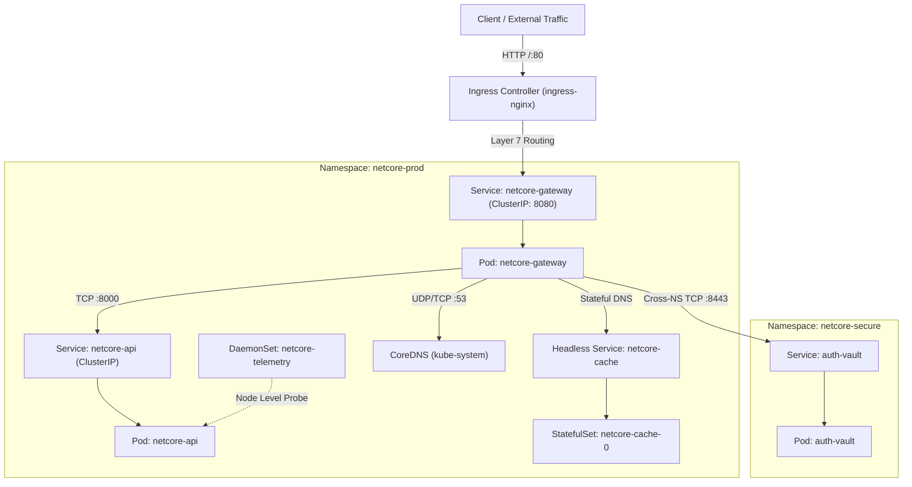
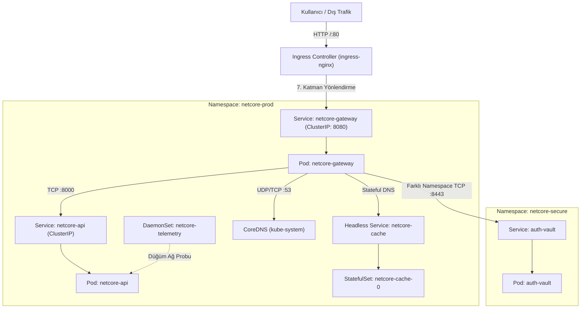

# INCIDENT #9105 — NetCore v5.0 Kubernetes Networking Mesh Outage / Ağ Kesintisi

[🇬🇧 English Documentation](#-english-documentation) | [🇹🇷 Türkçe Dokümantasyon](#-türkçe-dokümantasyon)

---

# 🇬🇧 English Documentation

## Incident Report: NetCore v5.0 Microservices Mesh Failure
At 09:15 UTC, the infrastructure platform team deployed **NetCore v5.0**, a high-performance Kubernetes networking and security mesh. The platform connects customer traffic through an Edge Ingress gateway to an internal API, a secure authentication vault located in an isolated security namespace, a distributed stateful cache, and node-level telemetry probes.

Immediately post-deployment, critical alerts triggered:
* External users receive `502 Bad Gateway` and `504 Gateway Timeout`.
* The API Gateway reports DNS resolution timeouts and cannot reach the Authentication Vault.
* Core API refuses connections despite reporting `Running`.
* Clustered caching peer discovery fails completely.
* Automated network handshake verification Job (`netcore-network-handshake`) crashes repeatedly.
* Node telemetry agents are not running on any worker nodes.

Your mission as the on-call SRE is to diagnose the networking layers (Layer 3/4/7, CoreDNS, iptables/kube-proxy, NetworkPolicies, CNI) and restore 100% operational connectivity.

---

## Architecture & Network Packet Flow



---

## Quickstart & Environment Setup

### 1. (Optional) Provision Cloud Cluster via Terraform (AKS)
```bash
cd terraform
terraform init
terraform apply -auto-approve
$(terraform output -raw kubeconfig_command)
cd ../
```

### 2. Deploy the Broken NetCore Platform
```bash
# Make scripts executable and deploy
chmod +x setup.sh cleanup.sh
./setup.sh
```

Or deploy manually via Helm:
```bash
helm upgrade --install netcore ./helm/netcore
```

---

## Acceptance Criteria & Verification

Once you have resolved all networking defects, the following checks must pass:

### 1. Workload & Endpoint Health
Run the status check across both namespaces:
```bash
kubectl get pods,svc,ep,sts,ds,jobs,ingress,netpol -n netcore-prod -o wide
kubectl get pods,svc,ep,netpol -n netcore-secure -o wide
```
* **Endpoints:** `netcore-gateway`, `netcore-api`, `auth-vault`, and `netcore-telemetry` must all have valid endpoints (`ENDPOINTS` is NOT `<none>`).
* **DaemonSet:** `netcore-telemetry` must be scheduled and ready on all nodes (`DESIRED == READY`).
* **StatefulSet:** `netcore-cache-0` must be `1/1 Running` and resolvable via headless DNS.
* **Handshake Job:** `netcore-network-handshake` must succeed (`1/1 Completed`).

### 2. Ingress & HTTP Connectivity Test
```bash
export INGRESS_IP=$(kubectl get svc -n ingress-nginx ingress-nginx-controller -o jsonpath='{.status.loadBalancer.ingress[0].ip}' 2>/dev/null || echo "127.0.0.1")

# Test Ingress gateway endpoint
curl -i http://${INGRESS_IP}/api/v1/network/status
```
**Expected Output:** `HTTP/1.1 200 OK` with JSON payload confirming `status: healthy` and `network: fully-connected`.

### 3. Cleanup
```bash
./cleanup.sh
```

---

## SRE Networking Guide & Interview Concepts

<details>
<summary><b>🧠 SRE Networking Interview & Linux Kernel Mechanics (Click to expand)</b></summary>

1. **Why does binding to `127.0.0.1` fail inside a Kubernetes container?**
   * Linux containers have isolated network namespaces. The IP `127.0.0.1` is attached exclusively to the `lo` (loopback) interface.
   * Incoming traffic from Kubernetes Services or other pods enters through the virtual ethernet device (`eth0`).
   * When a socket listens only on `127.0.0.1`, the Linux kernel drops or rejects (`TCP RST`) packets arriving on `eth0` with `Connection refused`. Network services intended to receive cluster traffic must listen on `0.0.0.0` (all interfaces).

2. **How does `externalTrafficPolicy: Local` cause dropped packets in multi-node clusters?**
   * By default (`externalTrafficPolicy: Cluster`), `kube-proxy` load-balances incoming external traffic across all pods cluster-wide, even if it requires an extra network hop across nodes (via SNAT).
   * With `externalTrafficPolicy: Local`, kube-proxy will **only** route traffic to pods on the node that received the external packet, in order to preserve the original client IP. If a node does not host any pod replica for that service, kube-proxy drops the packet instead of forwarding it to another node.

3. **What is the difference between list items (`-`) in Kubernetes NetworkPolicy `from` selectors?**
   * Two separate list items under `from:` evaluate as an **OR** condition:
     ```yaml
     from:
     - namespaceSelector: { ... }
     - podSelector: { ... }
     ```
     This allows traffic from ANY pod in the selected namespace, OR from any matching pod in the CURRENT namespace.
   * To specify an **AND** condition (e.g. only matching pods within a specific namespace), both selectors must be defined in the SAME list item under a single dash:
     ```yaml
     from:
     - namespaceSelector: { ... }
       podSelector: { ... }
     ```

4. **Why do pods time out resolving DNS when Egress NetworkPolicies are introduced?**
   * When an Egress `NetworkPolicy` is applied, the CNI installs a default DROP rule on outgoing traffic.
   * Pods query the CoreDNS service IP on UDP/TCP port 53. If port 53 is not explicitly whitelisted in the egress rule, DNS queries hang and time out after 30 seconds (`dial udp ... i/o timeout`).

5. **How does Headless Service DNS differ from standard ClusterIP Services?**
   * A standard Service has a virtual ClusterIP; CoreDNS returns an `A` record pointing to the ClusterIP.
   * A Headless Service (`clusterIP: None`) returns `A` records pointing directly to the Pod IPs.
   * For StatefulSets, CoreDNS also generates deterministic SRV and A records in the format `<pod-name>.<serviceName>.<namespace>.svc.cluster.local`. This requires the StatefulSet's `serviceName` to strictly match the Headless Service's `metadata.name`.

</details>

---

## Solution Key

<details>
<summary><b>🔑 Complete Solution Key & Root Causes (Click to expand)</b></summary>

Refer to [SOLUTION.md](file:///home/ysf/k8sfundamentals/troubleshoot/k8-troubleshoot-21/SOLUTION.md) for an in-depth SRE post-mortem. Summary of fixes:

1. **Ingress:** In `helm/netcore/templates/07-ingress.yaml`, set `ingressClassName: nginx` and add rewrite annotation `nginx.ingress.kubernetes.io/rewrite-target: /`.
2. **Named Port:** In `helm/netcore/templates/05-gateway-deployment.yaml`, change `targetPort: http-gateway` to `gateway-http` (or `8080`).
3. **CoreDNS Egress:** In `helm/netcore/templates/06-network-policies.yaml`, add port 53 (UDP/TCP) egress permission to `gateway-egress-policy`.
4. **Cross-Namespace FQDN:** In `helm/netcore/templates/01-config-and-secrets.yaml`, update `GATEWAY_VAULT_ADDR` to `http://auth-vault.netcore-secure.svc.cluster.local:8443`.
5. **NetworkPolicy AND Syntax & Port:** In `helm/netcore/templates/06-network-policies.yaml`, merge `namespaceSelector` and `podSelector` under a single list item in `vault-isolation-policy`, and correct port from `9443` to `8443`.
6. **Loopback Bind:** In `helm/netcore/templates/04-api-deployment.yaml`, change `BIND_HOST` from `127.0.0.1` to `0.0.0.0`.
7. **Service Protocol:** In `helm/netcore/templates/04-api-deployment.yaml`, change `Service/netcore-api` port `protocol: UDP` to `TCP`.
8. **Headless Service Drift:** In `helm/netcore/templates/02-cache-statefulset.yaml`, change `serviceName: netcore-cache-headless` to `netcore-cache`.
9. **Traffic Policy:** In `helm/netcore/templates/05-gateway-deployment.yaml`, change `externalTrafficPolicy: Local` to `Cluster`.
10. **DaemonSet NodeSelector & Service Selector:** In `helm/netcore/templates/08-telemetry-daemonset.yaml`, remove non-existent `nodeSelector` and align `Service/netcore-telemetry` selector to `role: packet-probe`.

</details>

---
---

# 🇹🇷 Türkçe Dokümantasyon

## Olay Özeti (Incident Report): NetCore v5.0 Mikroservis Ağ Çöküşü
Saat 09:15'te altyapı ekibi, yüksek performanslı ağ ve güvenlik platformu olan **NetCore v5.0** sürümünü devreye aldı. Platform; Ingress Gateway üzerinden müşteri trafiğini alıp iç API'ye, izole bir güvenlik namespace'indeki kimlik doğrulama kasasına (`auth-vault`), dağıtık StatefulSet önbelleğe (`netcore-cache`) ve düğüm düzeyindeki telemetri ajanlarına (`netcore-telemetry`) yönlendirecek şekilde tasarlandı.

Dağıtımın hemen ardından sistemde tam bir kesinti yaşandı:
* Dış dünyadan Ingress üzerinden gelen istekler `502 Bad Gateway` ve `504 Gateway Timeout` alıyor.
* Gateway podu CoreDNS çözümlemesi yapamıyor ve kimlik doğrulama kasasına erişemiyor.
* Çekirdek API (`netcore-api`) podu `Running` görünmesine rağmen bağlantıları anında reddediyor (`Connection refused`).
* Dağıtık önbellek podları headless DNS ile birbirini bulamıyor.
* Otomatik ağ doğrulama Job'ı (`netcore-network-handshake`) sürekli hata verip çöküyor.
* Düğüm telemetri ajanları hiçbir sunucuya yerleşemiyor (`DESIRED: 0`).

Bir Kıdemli SRE olarak göreviniz; OSI 3, 4 ve 7. katmanları, CoreDNS mimarisini, iptables/kube-proxy kurallarını, NetworkPolicy izolasyonlarını ve CNI davranışlarını inceleyerek bu 10 kritik ağ hatasını çözmektir.

---

## Ağ Mimarisi ve Paket Akış Diyagramı



---

## Hızlı Başlangıç ve Lab Kurulumu

### 1. (İsteğe Bağlı) Terraform ile AKS Kümesi Kurulumu
```bash
cd terraform
terraform init
terraform apply -auto-approve
$(terraform output -raw kubeconfig_command)
cd ../
```

### 2. Bozuk NetCore v5.0 Ortamını Ayağa Kaldır
```bash
# Betikleri çalıştırılabilir yap ve başlat
chmod +x setup.sh cleanup.sh
./setup.sh
```

Veya doğrudan Helm ile dağıt:
```bash
helm upgrade --install netcore ./helm/netcore
```

---

## Kabul Kriterleri ve Doğrulama Adımları

Tüm ağ hatalarını düzelttikten sonra aşağıdaki kontrollerin eksiksiz geçmesi gerekir:

### 1. İş Yükleri ve Endpoint Sağlığı
İki namespace'teki tüm kaynakları listeleyin:
```bash
kubectl get pods,svc,ep,sts,ds,jobs,ingress,netpol -n netcore-prod -o wide
kubectl get pods,svc,ep,netpol -n netcore-secure -o wide
```
* **Endpoints:** `netcore-gateway`, `netcore-api`, `auth-vault` ve `netcore-telemetry` servislerinin arkasında geçerli IP'ler olmalıdır (`<none>` kalmamalıdır).
* **DaemonSet:** `netcore-telemetry` tüm düğümlerde `Running` olmalıdır (`DESIRED == READY`).
* **StatefulSet:** `netcore-cache-0` podu `1/1 Running` olmalı ve headless DNS ile çözülebilmelidir.
* **Doğrulama Job'ı:** `netcore-network-handshake` tamamlanmış olmalıdır (`1/1 Completed`).

### 2. Ingress ve HTTP Trafik Testi
```bash
export INGRESS_IP=$(kubectl get svc -n ingress-nginx ingress-nginx-controller -o jsonpath='{.status.loadBalancer.ingress[0].ip}' 2>/dev/null || echo "127.0.0.1")

# Ağ durum uç noktasını test et
curl -i http://${INGRESS_IP}/api/v1/network/status
```
**Beklenen Çıktı:** `HTTP/1.1 200 OK` ve `status: healthy`, `network: fully-connected` yanıtı.

### 3. Lab Sonu Temizlik
```bash
./cleanup.sh
```

---

## SRE Ağ Mülakat Notları ve Çekirdek Kavramları

<details>
<summary><b>🧠 SRE Mülakat Soruları ve Linux Çekirdek Ağ Mantığı (Genişletmek için tıkla)</b></summary>

1. **Uygulama `127.0.0.1` adresine bağlandığında Kubernetes'te neden erişilemez?**
   * Konteynerler kendi ağ isim alanlarına (`network namespace`) sahiptir. `127.0.0.1`, yalnızca yerel `lo` (loopback) arabirimine atanır.
   * Dışarıdan veya Service üzerinden gelen paketler konteynerin sanal ethernet arabirimine (`eth0`) gelir.
   * Linux çekirdeği, `eth0` üzerinden gelen ve `127.0.0.1`'i hedefleyen paketleri hemen bir `TCP RST` paketiyle reddeder (`Connection refused`). Kümeye açık servislerin `0.0.0.0` dinlemesi şarttır.

2. **`externalTrafficPolicy: Local` çok düğümlü kümelerde neden paket düşürür?**
   * Varsayılan `Cluster` politikasında kube-proxy, gelen trafiği düğümler arasında yönlendirir (ek sekme ve SNAT pahasına).
   * `Local` politikasında ise istemcinin gerçek IP'sini korumak ve ek sekmeden kaçınmak için paket sadece o düğümdeki yerel podlara verilir. Eğer paketi alan düğümde ilgili podun bir replikası yoksa paket diğer düğümlere yönlendirilmez, doğrudan düşürülür (blackhole).

3. **Kubernetes NetworkPolicy'de `from` altındaki tire (`-`) işaretinin önemi nedir?**
   * İki ayrı tire kullanıldığında kural **VEYA (OR)** mantığıyla çalışır:
     ```yaml
     from:
     - namespaceSelector: { ... }
     - podSelector: { ... }
     ```
     Bu, seçilen namespace'teki HERHANGİ bir poddan VEYA mevcut namespace'teki seçilen etiketli poddan trafiğe izin verir.
   * "Sadece o namespace'teki şu pod" kuralını (**VE / AND**) tanımlamak için iki seçici tek bir tire altında toplanmalıdır:
     ```yaml
     from:
     - namespaceSelector: { ... }
       podSelector: { ... }
     ```

4. **Egress NetworkPolicy eklendiğinde podlar neden DNS zaman aşımına düşer?**
   * Bir pod için `policyTypes: ["Egress"]` tanımlandığı anda CNI dışarı çıkan tüm trafiği varsayılan olarak engeller.
   * Podlar alan adlarını çözmek için CoreDNS servisinin 53 numaralı UDP ve TCP portuna gider. Eğer Egress kuralında 53 portuna açıkça izin verilmemişse DNS paketleri düşürülür ve istekler 30 saniye `i/o timeout` bekler.

5. **Headless Service ile ClusterIP Service arasındaki DNS farkı nedir?**
   * Standart Service sanal bir ClusterIP alır; CoreDNS bu IP'yi dönen tek bir A kaydı verir.
   * Headless Service (`clusterIP: None`) ise doğrudan arkasındaki Pod IP'lerini döner. StatefulSet ile kullanıldığında her pod için `<pod-adi>.<serviceName>.<namespace>.svc.cluster.local` formatında sabit SRV ve A kayıtları üretir. Bunun çalışması için StatefulSet'in `serviceName` alanı ile Headless Service adının birebir aynı olması zorunludur.

</details>

---

## Çözüm Anahtarı

<details>
<summary><b>🔑 Çözüm Anahtarı ve Hata Listesi (Genişletmek için tıkla)</b></summary>

Ayrıntılı kök neden analizi ve Linux ağ açıklamaları için [SOLUTION.md](file:///home/ysf/k8sfundamentals/troubleshoot/k8-troubleshoot-21/SOLUTION.md) dosyasına bakabilirsiniz:

1. **Ingress:** `helm/netcore/templates/07-ingress.yaml` içinde `ingressClassName: nginx` yap ve `nginx.ingress.kubernetes.io/rewrite-target: /` annotation'ını ekle.
2. **Named Port:** `helm/netcore/templates/05-gateway-deployment.yaml` içinde `targetPort: http-gateway` değerini `gateway-http` (veya `8080`) olarak düzelt.
3. **CoreDNS Egress:** `helm/netcore/templates/06-network-policies.yaml` dosyasında `gateway-egress-policy` altına port 53 UDP/TCP çıkış kuralı ekle.
4. **Namespace FQDN:** `helm/netcore/templates/01-config-and-secrets.yaml` içinde `GATEWAY_VAULT_ADDR` değerini `http://auth-vault.netcore-secure.svc.cluster.local:8443` yap.
5. **NetworkPolicy AND Sözdizimi & Port:** `helm/netcore/templates/06-network-policies.yaml` içinde `vault-isolation-policy` seçicilerini tek tire altında topla ve portu `8443` yap.
6. **Localhost Bind:** `helm/netcore/templates/04-api-deployment.yaml` içinde `BIND_HOST` değerini `0.0.0.0` yap.
7. **Protokol:** `helm/netcore/templates/04-api-deployment.yaml` içinde `Service/netcore-api` port tanımındaki `protocol: UDP` değerini `TCP` yap.
8. **Headless Service:** `helm/netcore/templates/02-cache-statefulset.yaml` içinde `serviceName: netcore-cache-headless` değerini `netcore-cache` yap.
9. **Traffic Policy:** `helm/netcore/templates/05-gateway-deployment.yaml` içinde `externalTrafficPolicy: Local` değerini `Cluster` yap.
10. **DaemonSet:** `helm/netcore/templates/08-telemetry-daemonset.yaml` içinde olmayan `nodeSelector`'ı kaldır ve `Service/netcore-telemetry` seçicisini pod etiketleriyle (`role: packet-probe`) eşitle.

</details>
