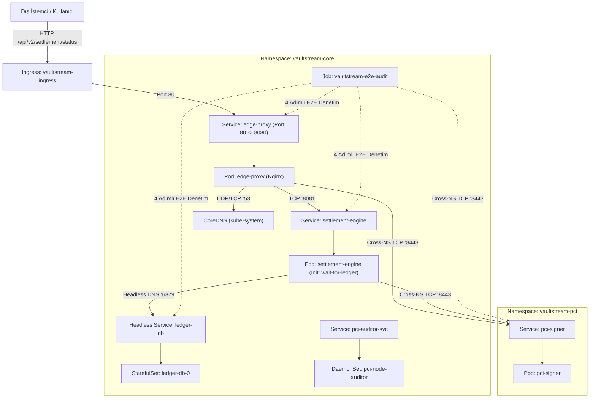

# INCIDENT #9210 — VaultStream v6.0 Zero-Trust Payment Settlement & PCI-DSS Mesh Outage

[🇹🇷 Türkçe Dokümantasyon (Nereden Başlamalıyım & Adım Adım Teşhis Rehberi)](#-türkçe-dokümantasyon) | [🇬🇧 English Documentation](#-english-documentation)

---

# 🇹🇷 Türkçe Dokümantasyon

> [!IMPORTANT]
> **Sıfır Kopya (Zero-Spoiler) Kuralı:**
> Bu laboratuvarda **ne YAML dosyalarının içinde ne de bu README.md dosyasında çözümler veya cevaplar yer almaz!**
> Burada yalnızca mimari haritası, hangi dosyada hangi objelerin bulunduğu ve `kubectl get / describe / logs` çıktılarını okurken **nasıl düşünmen gerektiği (yönlendirme rehberi)** verilmiştir. Tüm çözümler yalnızca [SOLUTION.md](file:///home/ysf/k8sfundamentals/troubleshoot/k8-troubleshoot-22/SOLUTION.md) dosyasındadır.

---

## Olay Özeti (Incident Report): VaultStream v6.0 Ödeme Mutabakat ve PCI Ağ Çöküşü
Finansal teknoloji ekibi, PCI-DSS uyumlu yeni nesil ödeme mutabakat platformu **VaultStream v6.0** sürümünü `vaultstream-core` ve `vaultstream-pci` namespace'lerine dağıttı. Sistem 5 ana bileşenden oluşmaktadır:
1. **`edge-proxy` (`vaultstream-core`):** Dış Ingress trafiğini karşılayan ve iç servislere yönlendiren Nginx L7 Ters Proxy.
2. **`settlement-engine` (`vaultstream-core`):** Ödeme mutabakat işlemlerini yürüten, başlangıçta `wait-for-ledger` InitContainer'ı ile veritabanını bekleyen ve HSM imzalama anahtarını (`vaultstream-hsm-secret`) kullanan çekirdek servis.
3. **`ledger-db` (`vaultstream-core`):** İşlem defterini tutan **StatefulSet** + **Headless Service** tabanlı Redis veritabanı.
4. **`pci-signer` (`vaultstream-pci`):** İzole güvenlik namespace'inde (`8443` portunda) çalışan kriptografik HSM imzalama servisi.
5. **`pci-node-auditor` (`vaultstream-core`):** Kümedeki tüm sunucularda (Node) çalışması gereken FIPS uyumluluk denetim **DaemonSet**'i.

Dağıtım sonrası tüm sistem kilitlendi:
* `settlement-engine` podları `Init:0/1` aşamasında asılı kaldı; InitContainer'ı geçse bile `CreateContainerConfigError` ve ardından `CrashLoopBackOff` (Liveness Probe) hatalarına düşüyor.
* `pci-node-auditor` DaemonSet'i hiçbir düğüme yerleşemiyor (`DESIRED: 0`), yerleştiğinde ise `OOMKilled` (`Exit Code 137`) oluyor ve servisi endpoint almıyor.
* `edge-proxy` servisinin arkasında hiçbir aktif Endpoint (`<none>`) oluşmuyor ve pod içinden dışarıya DNS/HTTP istekleri çıkmıyor.
* Uçtan uca denetim Job'ı (`vaultstream-e2e-audit`) her adımda ağ ve erişim hatalarıyla çöküyor.

---

## Ağ Mimarisi ve Paket Akış Diyagramı



---

## 🗺️ 1. Dosya Haritası: Hangi YAML Dosyası Neyi Yönetiyor?

`helm/vaultstream/` altında 10 şablon dosyası ve `values.yaml` bulunur. Dosyalar arasında kaybolmamak için önce bu tabloyu incele:

| Dosya Yolu | İçindeki Kubernetes Objeleri | Ne İşe Yarar & Neye Bakmalısın? |
| :--- | :--- | :--- |
| **`helm/vaultstream/values.yaml`** | Merkezi Helm Parametreleri | Portlar, hedef port isimleri, Secret anahtar adı, StatefulSet `serviceName`, NetworkPolicy portları, Ingress sınıfı ve DaemonSet bellek/etiket ayarlarının tutulduğu ana dosya. |
| **`templates/00-namespaces.yaml`** | `Namespace/vaultstream-core`, `Namespace/vaultstream-pci` | İki namespace'i oluşturur *(Bu dosyada hata yoktur)*. |
| **`templates/01-config-and-secrets.yaml`** | `Secret/vaultstream-hsm-secret`, `ConfigMap/edge-proxy-conf`, `settlement-engine-conf`, `pci-signer-conf` | Secret anahtarlarını, `edge-proxy` Nginx yönlendirme (`proxy_pass`) kurallarını ve Python sunucu kodlarını barındırır. |
| **`templates/02-ledger-statefulset.yaml`** | `Service/ledger-db` (Headless) & `StatefulSet/ledger-db` | Redis tabanlı işlem defterini ve onun Headless DNS kimliğini (`ledger-db-0.ledger-db`) yönetir. |
| **`templates/03-pci-signer-deployment.yaml`** | `Service/pci-signer` & `Deployment/pci-signer` | `vaultstream-pci` namespace'inde `8443` portunda çalışan HSM imzalama servisi *(Bu dosyada hata yoktur)*. |
| **`templates/04-settlement-engine.yaml`** | `Service/settlement-engine` & `Deployment/settlement-engine` | InitContainer (`wait-for-ledger`), Secret referansı, ConfigMap volume mount ve Liveness/Readiness probe ayarlarını içerir. |
| **`templates/05-edge-proxy.yaml`** | `Service/edge-proxy` & `Deployment/edge-proxy` | Dış trafiği karşılayan Nginx proxy servisi ve pod şablonu. |
| **`templates/06-network-policies.yaml`** | `ledger-db-isolation`, `pci-signer-isolation`, `edge-proxy-egress` | Hangi podun hangi veritabanına, servise veya DNS'e erişebileceğini belirleyen Zero-Trust güvenlik duvarı kuralları. |
| **`templates/07-ingress.yaml`** | `Ingress/vaultstream-ingress` | Dış HTTP trafiğini `edge-proxy` servisine yönlendiren Ingress tanımı. |
| **`templates/08-auditor-daemonset.yaml`** | `Service/pci-auditor-svc` & `DaemonSet/pci-node-auditor` | Her düğümde çalışması gereken FIPS uyumluluk ajanı ve metrik servisi. |
| **`templates/09-e2e-verification-job.yaml`** | `Job/vaultstream-e2e-audit` | **Senin Pusulan!** Sistemin 4 katmanını sırasıyla test eden doğrulama Job'ı *(Bu dosyada hata yoktur)*. |

---

## 🧭 2. Nereden Başlamalıyım? (Adım Adım Teşhis Rehberi)

Çok sayıda YAML dosyası olduğunda hepsini birden açmak yerine aşağıdaki **4 Aşamalı Teşhis Sırasını** takip et. Her aşamada verdiğimiz `kubectl` komutlarını çalıştır ve çıktıyı sorgula!

### Hazırlık: Ortamı Başlat ve Genel Tabloyu Gör
```bash
chmod +x setup.sh cleanup.sh
./setup.sh
```
Ardından pusulan olan doğrulama Job'ının loglarına ve pod durumlarına bak:
```bash
kubectl get pods,svc,ep,ds,sts,job,ingress -n vaultstream-core -o wide
kubectl get pods,svc,ep,netpol -n vaultstream-pci -o wide
kubectl logs -n vaultstream-core job/vaultstream-e2e-audit
```

---

### 🔍 AŞAMA 1: `DaemonSet/pci-node-auditor` Neden Çalışmıyor? (`08-auditor-daemonset.yaml` & `values.yaml`)

1. **Çalıştıracağın Teşhis Komutları:**
   ```bash
   kubectl get ds pci-node-auditor -n vaultstream-core
   kubectl describe ds pci-node-auditor -n vaultstream-core
   kubectl get ep pci-auditor-svc -n vaultstream-core
   ```
2. **Kendine Sorman Gereken Sorular (Üç Katmanlı Zincir!):**
   - **Katman 1 (`DESIRED: 0`):** DaemonSet neden kümedeki hiçbir sunucuya (Node) pod yerleştirmeye çalışmıyor? `08-auditor-daemonset.yaml` ve `values.yaml` içindeki `nodeSelector` tanımına bak (`kubectl get nodes --show-labels` ile sunucuların gerçek etiketlerini kontrol et).
   - **Katman 2 (`OOMKilled` / `CrashLoopBackOff`):** `nodeSelector` engelini kaldırdıktan sonra podlar oluşacak ama hemen çöküp yeniden başlayacak! `kubectl describe pod -n vaultstream-core -l app=pci-node-auditor` komutunu çalıştır ve **`Last State: Terminated (Reason: OOMKilled, Exit Code: 137)`** çıktısına bak! Konteynerin içindeki Python kodu kaç MB bellek (`bytearray`) ayırıyor, `values.yaml` içinde `auditor.memoryLimit` kaç MB verilmiş?
   - **Katman 3 (`ENDPOINTS: <none>`):** Podlar `1/1 Running` olduktan sonra bile `kubectl get ep pci-auditor-svc -n vaultstream-core` çıktısı neden `<none>` gösteriyor? `Service/pci-auditor-svc` içindeki `selector` etiketleriyle DaemonSet podlarının etiketlerini karşılaştır!

---

### 🔍 AŞAMA 2: `settlement-engine` Podları Neden Başlamıyor? (`02`, `06`, `04` ve `values.yaml`)

`kubectl get pods -n vaultstream-core` çıktısında `settlement-engine` podlarının önce **`Init:0/1`** durumunda takılı kaldığını göreceksin. Bu podda arka arkaya gizlenmiş bir arıza zinciri vardır:

#### Adım 2.1 — `Init:0/1` (`wait-for-ledger` Neden Bekliyor?)
1. **Teşhis Komutu:**
   ```bash
   kubectl logs -n vaultstream-core -l app=settlement-engine -c wait-for-ledger
   ```
   *(Aynı hatayı `kubectl logs -n vaultstream-core job/vaultstream-e2e-audit` içindeki **`[1/4]`** adımında da göreceksin!)*
2. **Nasıl Düşünmelisin?**
   - InitContainer `nc -z -w 2 ledger-db-0.ledger-db 6379` komutunu çalıştırıyor.
   - **Kontrol 1 (Headless DNS):** `02-ledger-statefulset.yaml` ve `values.yaml` (`ledger.serviceName`) dosyalarına bak. Headless Service'in adı (`metadata.name`) ne, StatefulSet'in `spec.serviceName` alanına ne yazılmış? İkisi aynı değilse CoreDNS `ledger-db-0.ledger-db` kaydını oluşturur mu?
   - **Kontrol 2 (NetworkPolicy):** DNS ismini düzelttikten sonra hala `nc` zaman aşımına düşüyorsa, `06-network-policies.yaml` içindeki **`ledger-db-isolation`** kuralına bak! Bu kural `tier: database` poduna (`6379` portuna) sadece hangi etiketli (`podSelector`) podların erişmesine izin veriyor? Oysa `settlement-engine` podunun (`tier: engine`) ve `vaultstream-e2e-audit` Job podunun (`tier: audit-job`) gerçek etiketleri ne?

#### Adım 2.2 — `CreateContainerConfigError` ve `CrashLoopBackOff` (`04-settlement-engine.yaml` & `values.yaml`)
InitContainer `0/1 Completed` olup geçtikten sonra ana konteyner (`engine`) sırasıyla 2 farklı hata verecek! Her seferinde `kubectl describe pod -n vaultstream-core -l app=settlement-engine` komutunu çalıştırıp `Events:` bölümünü oku:
1. **`Error: secret "vaultstream-hsm-secret" / key "..." not found` (`CreateContainerConfigError`):**
   - `04-settlement-engine.yaml` (`env.valueFrom.secretKeyRef`) ve `values.yaml` (`engine.secretKeyName`) hangi anahtar adını arıyor? `01-config-and-secrets.yaml` içindeki `Secret/vaultstream-hsm-secret` içinde anahtarın gerçek adı ne?
2. **Pod `Running` Oluyor Ama Birkaç Saniye Sonra `Restart` Atıyor (`Unhealthy: Liveness probe failed: connection refused`):**
   - `kubectl logs -n vaultstream-core -l app=settlement-engine -c engine` ve `kubectl describe pod` çıktısına bak.
   - Python uygulaması hangi portta (`values.yaml` -> `engine.port`) çalışıyor, ancak `livenessProbe` ve `readinessProbe` hangi portu (`values.yaml` -> `engine.probePort`) kontrol ediyor?

---

### 🔍 AŞAMA 3: `vaultstream-e2e-audit` Job'ının `[3/4]` ve `[4/4]` Adımlarını Çözme

Şimdi değişikliklerini uygula ve doğrulama Job'ını yeniden başlatıp loglarını oku:
```bash
helm upgrade --install vaultstream ./helm/vaultstream && \
kubectl delete job vaultstream-e2e-audit -n vaultstream-core --ignore-not-found && \
helm upgrade --install vaultstream ./helm/vaultstream && \
sleep 4 && kubectl logs -n vaultstream-core job/vaultstream-e2e-audit
```
`[1/4]` ve `[2/4]` adımlarının **`[OK]`** ile geçtiğini göreceksin! Şimdi `[3/4]` adımında takılacak:

#### Adım 3.1 — Job Adım `[3/4]`: `pci-signer.vaultstream-pci.svc.cluster.local:8443` Zaman Aşımı (`06-network-policies.yaml` & `values.yaml`)
1. **Teşhis Komutu:**
   ```bash
   kubectl describe netpol pci-signer-isolation -n vaultstream-pci
   ```
2. **Nasıl Düşünmelisin?**
   - `vaultstream-core` namespace'indeki podlar (`settlement-engine`, `edge-proxy` ve `vaultstream-e2e-audit`), `vaultstream-pci` namespace'indeki `pci-signer` servisine (`8443` portuna) gitmeye çalışıyor.
   - `06-network-policies.yaml` içindeki **`pci-signer-isolation`** politikasına ve `values.yaml` (`signer.networkPolicyPort`) değerine bak:
     1. `pci-signer` podu hangi portu dinliyor, NetworkPolicy hangi porta izin veriyor?
     2. `from:` altındaki `namespaceSelector` ve `podSelector` nasıl yazılmış? `vaultstream-core` namespace'inden gelen `settlement-engine`, `edge-proxy` ve `vaultstream-e2e-audit` podlarının tamamının geçebilmesi için bu kural nasıl olmalı?

#### Adım 3.2 — Job Adım `[4/4]`: `edge-proxy` Servis ve Egress/DNS Hataları (`05`, `06`, `01` ve `values.yaml`)
Job `[4/4]` adımında `http://edge-proxy:80/settlement/status` ve `http://edge-proxy:80/pci/verify` adreslerini test eder. Burada 3 noktayı kontrol etmelisin:
1. **`Service/edge-proxy` Endpoint Kontrolü (`05-edge-proxy.yaml` & `values.yaml`):**
   ```bash
   kubectl get ep edge-proxy -n vaultstream-core
   kubectl describe svc edge-proxy -n vaultstream-core
   ```
   - Neden `ENDPOINTS: <none>` görünüyor? `values.yaml` içindeki `proxy.selectorTier` ve `proxy.targetPortName` değerlerini `05-edge-proxy.yaml` içindeki Deployment pod etiketleri (`tier: proxy`) ve containerPort adı (`proxy-http`) ile karşılaştır!
2. **`edge-proxy` Podunun Dışarı Çıkış (CoreDNS Egress) Kontrolü (`06-network-policies.yaml`):**
   - `edge-proxy` podu içinden `settlement-engine` veya `pci-signer` adresini çözmeye çalıştığında neden `timed out` alıyor?
   - `06-network-policies.yaml` içindeki **`edge-proxy-egress`** politikasına bak: `policyTypes: ["Egress"]` aktifken podun CoreDNS'e (`UDP/TCP 53`) soru sormasına izin verilmiş mi?
3. **`edge-proxy` Nginx ConfigMap Yönlendirmesi (`01-config-and-secrets.yaml`):**
   - `01-config-and-secrets.yaml` içindeki `ConfigMap/edge-proxy-conf` içinde `/pci/verify` bloğuna bak:
     `proxy_pass http://pci-signer:8443/pci/verify;`
   - `edge-proxy` podu `vaultstream-core` içinde, `pci-signer` ise **`vaultstream-pci`** namespace'inde! Farklı bir namespace'teki servise kısa adla (`http://pci-signer:8443`) gidilebilir mi, yoksa tam FQDN mi yazılmalı? *(ConfigMap'i güncelledikten sonra Nginx podunun yeni ayarı okuması için `kubectl rollout restart deploy/edge-proxy -n vaultstream-core` yapmayı unutma!)*

---

### 🔍 AŞAMA 4: Dış Ingress Erişimi (`07-ingress.yaml` & `values.yaml`)

Job `1/1 Completed` olduktan sonra son olarak dış Ingress tanımını kontrol et:
```bash
kubectl get ingress -n vaultstream-core
kubectl describe ingress vaultstream-ingress -n vaultstream-core
```
- `values.yaml` içinde `ingress.className` ne olarak tanımlanmış (`kubectl get ingressclass` ile kümedeki gerçek IngressClass adına bak)?
- `values.yaml` içindeki `ingress.path` (`/api/v2/settlement/status`) ile `edge-proxy` Nginx'inin beklediği `/settlement/status` yolu birbiriyle uyumlu mu (veya `07-ingress.yaml` içinde rewrite annotation var mı)?

---

## Kabul Kriterleri ve Doğrulama Adımları

Tüm hataları teşhis edip çözdüğünde aşağıdaki kontrollerin tamamı başarılı olmalıdır:

```bash
# 1. Tüm podlar Running/Completed ve tüm servislerin ENDPOINTS sütunu dolu olmalı:
kubectl get pods,svc,ep,sts,ds,jobs,ingress -n vaultstream-core -o wide
kubectl get pods,svc,ep,netpol -n vaultstream-pci -o wide

# 2. Doğrulama Job'ı 4 adımın tamamını [OK] ile geçip "1/1 Completed" olmalı:
kubectl logs -n vaultstream-core job/vaultstream-e2e-audit

# 3. Edge Proxy üzerinden her iki uç nokta da HTTP 200 ve CONNECTED/VALID dönmeli:
kubectl exec -n vaultstream-core deploy/edge-proxy -- wget -qO- http://127.0.0.1:8080/settlement/status
kubectl exec -n vaultstream-core deploy/edge-proxy -- wget -qO- http://127.0.0.1:8080/pci/verify
```

> [!TIP]
> Tüm teşhislerini bitirdikten veya takıldığın bir adımı kontrol etmek istediğinde detaylı kök neden analizini ve çözümleri [SOLUTION.md](file:///home/ysf/k8sfundamentals/troubleshoot/k8-troubleshoot-22/SOLUTION.md) dosyasında bulabilirsin.

---
---

# 🇬🇧 English Documentation

> [!IMPORTANT]
> **Zero-Spoiler Policy:**
> Neither the Helm YAML files nor this `README.md` contain the answers or fixes! This document provides the architecture map, file index, and a step-by-step diagnostic guide explaining how to interpret `kubectl get / describe / logs` outputs. All root causes and solutions are located exclusively in [SOLUTION.md](file:///home/ysf/k8sfundamentals/troubleshoot/k8-troubleshoot-22/SOLUTION.md).

## Incident Summary: VaultStream v6.0 Zero-Trust Settlement Outage
The platform engineering team deployed **VaultStream v6.0** across two isolated namespaces (`vaultstream-core` and `vaultstream-pci`). Immediately after deployment, all settlement pipelines failed:
* `pci-node-auditor` DaemonSet schedules `0` pods (`DESIRED: 0`), crashes with `OOMKilled` (`Exit Code 137`) once scheduled, and its Service has `<none>` endpoints.
* `settlement-engine` pods hang in `Init:0/1` (`wait-for-ledger`), then fail with `CreateContainerConfigError`, and subsequently crash-loop due to Liveness Probe failures.
* `edge-proxy` Service has `<none>` endpoints, cannot resolve internal DNS due to Egress `NetworkPolicy` restrictions, and fails cross-namespace routing to `pci-signer`.
* `vaultstream-e2e-audit` Job fails across its 4 verification stages.

Follow the 4-Stage Diagnostic Guide in the Turkish section above (or inspect `kubectl logs -n vaultstream-core job/vaultstream-e2e-audit` step by step) and check [SOLUTION.md](file:///home/ysf/k8sfundamentals/troubleshoot/k8-troubleshoot-22/SOLUTION.md) only when you are ready to verify your fixes.
