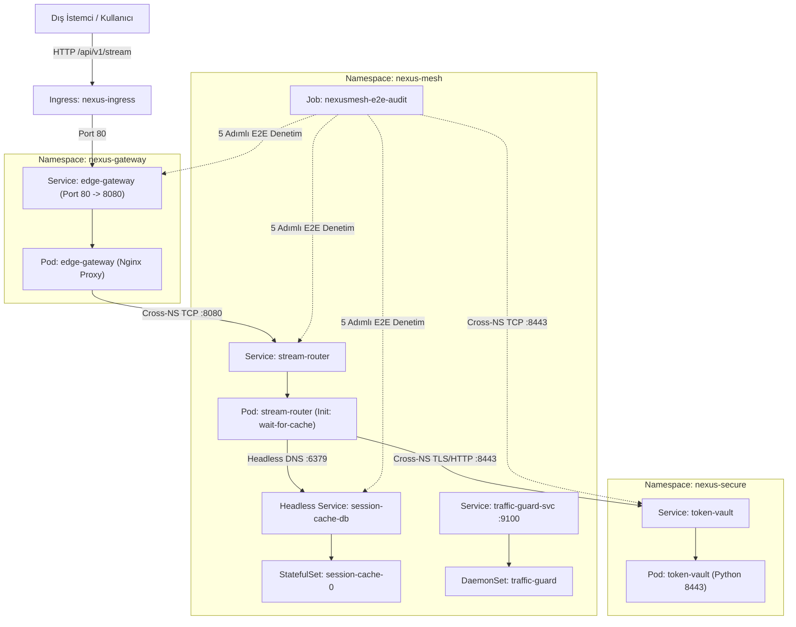

# INCIDENT #9540 — NexusMesh v4.2 Zero-Trust Edge Gateway & Distributed Service Mesh Outage

[🇹🇷 Türkçe Dokümantasyon (Nereden Başlamalıyım & Adım Adım Teşhis Rehberi)](#-türkçe-dokümantasyon) | [🇬🇧 English Documentation](#-english-documentation)

---

# 🇹🇷 Türkçe Dokümantasyon

> [!IMPORTANT]
> **Sıfır Kopya (Zero-Spoiler) Kuralı:**
> Bu laboratuvarda **ne YAML dosyalarının içinde ne de bu README.md dosyasında hazır cevaplar veya çözümler yer almaz!**
> Burada mimari haritası, hangi dosyada hangi Kubernetes objelerinin bulunduğu ve `kubectl get / describe / logs` çıktılarını incelerken **nasıl bir SRE gibi düşünmen gerektiği (teşhis metodolojisi)** verilmiştir. Tüm çözümler ve kök neden analizleri [SOLUTION.md](file:///home/ysf/k8sfundamentals/troubleshoot/k8-troubleshoot-23/SOLUTION.md) dosyasındadır.

---

## Olay Özeti (Incident Report): NexusMesh v4.2 Ağ ve Servis Ağı Çöküşü

Bulut platform ve ağ ekibi, çok kiracılı (multi-tenant) ve Sıfır Güven (Zero-Trust) mimarisine sahip **NexusMesh v4.2** API Gateway ve Servis Ağı altyapısını `nexus-gateway`, `nexus-mesh` ve `nexus-secure` isim alanlarına dağıttı. Sistem 5 ana bileşenden oluşmaktadır:

1. **`edge-gateway` (`nexus-gateway`):** Dış Ingress trafiğini karşılayan ve iç servis ağına (`nexus-mesh`) yönlendiren Nginx L7 Ters Proxy.
2. **`stream-router` (`nexus-mesh`):** Yüksek hacimli veri akışlarını yöneten, başlamadan önce `wait-for-cache` InitContainer'ı ile bellek içi önbelleği bekleyen ve kimlik doğrulama için güvenli alana (`nexus-secure`) bağlanan çekirdek mikroservis.
3. **`session-cache` (`nexus-mesh`):** Oturum durumlarını tutan **StatefulSet** ve **Headless Service** (`session-cache-db`) tabanlı Redis kümesi.
4. **`token-vault` (`nexus-secure`):** `8443` portunda çalışan, kriptografik token ve kimlik doğrulama sağlayan izole güvenlik servisi.
5. **`traffic-guard` (`nexus-mesh`):** Kümedeki tüm sunucularda (Node) çalışarak ağ gecikmesini ve paket düşmelerini izleyen **DaemonSet**.

Dağıtımın hemen ardından üretim ortamında tüm trafik kilitlendi:
* `traffic-guard` DaemonSet'i hiçbir düğüme yerleşemiyor (`DESIRED: 0`).
* `stream-router` podları `Init:0/1` (`wait-for-cache`) aşamasında süresiz asılı kalıyor; InitContainer geçilse bile `CrashLoopBackOff` döngüsüne giriyor.
* `stream-router` servisinin arkasında hiçbir aktif Endpoint (`<none>`) oluşmuyor.
* `edge-gateway` dışarıdan gelen isteklere `502 Bad Gateway` veya `504 Gateway Timeout` döndürüyor.
* `token-vault` podu çalışır görünmesine rağmen gelen tüm bağlantılar `Connection Refused` ile anında reddediliyor.
* Uçtan uca doğrulama Job'ı (`nexusmesh-e2e-audit`) 1. adımdan itibaren ağ ve DNS hatalarıyla çöküyor.

---

## Ağ Mimarisi ve Paket Akış Diyagramı



---

## 🗺️ 1. Dosya Haritası: Hangi YAML Dosyası Neyi Yönetiyor?

`helm/nexusmesh/` altında 10 şablon dosyası ve `values.yaml` bulunur:

| Dosya Yolu | Kubernetes Objeleri | İnceleme ve Odak Noktaları |
| :--- | :--- | :--- |
| **`helm/nexusmesh/values.yaml`** | Merkezi Helm Parametreleri | Servis hedef port adları, Headless Service `serviceName`, liveness port/path değerleri, Ingress sınıfı ve DaemonSet düğüm seçici ayarları. |
| **`templates/00-namespaces.yaml`** | `Namespace/nexus-gateway`, `nexus-mesh`, `nexus-secure` | İsim alanlarını oluşturur *(Bu dosyada hata yoktur)*. |
| **`templates/01-config-and-secrets.yaml`** | `ConfigMap/edge-gateway-conf`, `stream-router-code`, `token-vault-code`, `Secret` | Nginx ters proxy yönlendirme kuralları, upstream adresleri, soket dinleme IP adresleri ve servis kodları. |
| **`templates/02-session-cache-statefulset.yaml`** | `Service/session-cache-db` (Headless) & `StatefulSet/session-cache` | Redis tabanlı oturum önbelleği ve Headless DNS kimliği (`session-cache-0.session-cache-db`). |
| **`templates/03-token-vault-deployment.yaml`** | `Service/token-vault` & `Deployment/token-vault` | `nexus-secure` içinde `8443` portunda çalışan token servisinin servis ve pod tanımları. |
| **`templates/04-stream-router.yaml`** | `Service/stream-router` & `Deployment/stream-router` | InitContainer (`wait-for-cache`), port adlandırması ve Liveness/Readiness probe ayarları. |
| **`templates/05-edge-gateway.yaml`** | `Service/edge-gateway` & `Deployment/edge-gateway` | Dış trafiği karşılayan Nginx proxy servis ve pod şablonu. |
| **`templates/06-network-policies.yaml`** | `session-cache-isolation`, `stream-router-egress`, `token-vault-isolation` | Zero-Trust ağ izolasyonu, DNS egress çıkışı ve cross-namespace port izinleri. |
| **`templates/07-ingress.yaml`** | `Ingress/nexus-ingress` | Dış HTTP trafiğini `edge-gateway` servisine yönlendiren Ingress tanımı. |
| **`templates/08-traffic-guard-daemonset.yaml`** | `Service/traffic-guard-svc` & `DaemonSet/traffic-guard` | Düğümlerde çalışması gereken telemetri ajanı ve metrik servisi. |
| **`templates/09-e2e-verification-job.yaml`** | `Job/nexusmesh-e2e-audit` | **Senin Pusulan!** Sistemin 5 katmanını sırasıyla test eden denetim Job'ı *(Bu dosyada hata yoktur)*. |

---

## 🧭 2. Nereden Başlamalıyım? (4 Aşamalı Teşhis Rehberi)

### Hazırlık: Ortamı Başlat ve Pusulanı Dinle
```bash
chmod +x setup.sh cleanup.sh
./setup.sh
```

Ardından doğrulama Job'ının loglarını ve podların genel durumunu izle:
```bash
kubectl get pods,svc,ep,sts,ds,ingress -n nexus-gateway -o wide
kubectl get pods,svc,ep,sts,ds,ingress -n nexus-mesh -o wide
kubectl get pods,svc,ep,sts,ds,ingress -n nexus-secure -o wide

# Pusula Job loglarını incele:
kubectl logs -n nexus-mesh job/nexusmesh-e2e-audit -f
```

---

### AŞAMA 1: DaemonSet Planlama ve Headless Veritabanı Keşfi

Bu aşamada altyapı ajanının düğümlere yerleşmesini ve Redis StatefulSet'inin Headless DNS üzerinden bulunabilmesini sağla.

1. **DaemonSet Planlamasını İncele:**
   ```bash
   kubectl get ds -n nexus-mesh
   kubectl describe ds traffic-guard -n nexus-mesh
   ```
   *Soru:* `DESIRED: 0` görünüyorsa, DaemonSet'in `nodeSelector` veya `tolerations` ayarlarında kümedeki düğümlerle uyuşmayan ne var?

2. **Headless DNS ve StatefulSet İsim Eşleşmesi:**
   ```bash
   kubectl get sts,svc -n nexus-mesh
   kubectl describe sts session-cache -n nexus-mesh | grep "Service Name"
   ```
   *Soru:* StatefulSet'in `serviceName` alanı ile tanımlanan Headless Service adı (`session-cache-db`) birebir aynı mı? CoreDNS bir StatefulSet poduna A/SRV kaydı açmak için neye ihtiyaç duyar?

---

### AŞAMA 2: `stream-router` Pod Başlatma, Probe ve Servis Endpointleri

Bu aşamada çekirdek servisin InitContainer aşamasını geçmesini, Kubelet probe'larından başarıyla geçip Endpoint havuzuna girmesini sağla.

1. **InitContainer Takılması:**
   ```bash
   kubectl logs -n nexus-mesh deploy/stream-router -c wait-for-cache
   ```
   *Soru:* InitContainer hangi adrese bağlanmaya çalışıyor? Aşama 1'deki Headless Service ismi düzeltildiğinde bağlantı kurulabiliyor mu?

2. **Liveness Probe ve Restart Döngüsü (`CrashLoopBackOff`):**
   ```bash
   kubectl describe pod -n nexus-mesh -l app=stream-router
   ```
   *Soru:* Events altında `Liveness probe failed` hatası var mı? Uygulama pod içindeki Python kodunda hangi portta dinliyor (`server.py`), probe hangi portu ve yolu kontrol ediyor?

3. **Service Endpoint Kaybı (`ENDPOINTS: <none>`):**
   ```bash
   kubectl get ep stream-router -n nexus-mesh
   kubectl describe svc stream-router -n nexus-mesh
   ```
   *Soru:* Pod `Running 1/1` olduğu halde Service neden Endpoint almıyor? `targetPort` sayı mı yoksa string bir port ismi mi? Deployment içindeki containerPort adı ile Service `targetPort` adı birebir örtüşüyor mu?

---

### AŞAMA 3: Sıfır Güven (Zero-Trust) Ağ Politikaları ve CoreDNS Egress

Bu aşamada podların ağ seviyesinde birbirleriyle ve CoreDNS ile konuşmasını sağla.

1. **`stream-router` DNS Çözümleme ve Egress:**
   ```bash
   kubectl exec -n nexus-mesh deploy/stream-router -c router -- nslookup kubernetes.default.svc.cluster.local
   kubectl describe netpol stream-router-egress -n nexus-mesh
   ```
   *Soru:* Pod dışarıya DNS sorgusu atabiliyor mu? NetworkPolicy egress kuralları arasında CoreDNS (`53/UDP` ve `53/TCP`) izni var mı?

2. **`session-cache` İzolasyon Politikası:**
   ```bash
   kubectl describe netpol session-cache-isolation -n nexus-mesh
   ```
   *Soru:* Redis'e sadece hangi etiketlere sahip podların girmesine izin verilmiş? `stream-router` podunun gerçek etiketi ne?

3. **`token-vault` Localhost Tuzağı ve Port Uyuşmazlığı:**
   ```bash
   kubectl get pods -n nexus-secure
   kubectl describe netpol token-vault-isolation -n nexus-secure
   kubectl describe pod -n nexus-secure -l app=token-vault
   ```
   *Soru:* `token-vault` podu içindeki Python sunucusu `0.0.0.0` yerine `127.0.0.1` (localhost) adresine bağlanmış olabilir mi? `127.0.0.1` üzerinde dinleyen bir servise Kubernetes ClusterIP üzerinden neden erişilemez?
   *Soru:* `token-vault-isolation` NetworkPolicy'si `8443` yerine hangi portu bekliyor?

---

### AŞAMA 4: Ingress Controller ve Edge Proxy Çapraz İsim Alanı Yönlendirmesi

Bu aşamada dış dünyadan gelen isteğin Ingress -> Edge Gateway -> Stream Router akışını tamamla.

1. **Edge Gateway Nginx Upstream Çözümlemesi:**
   ```bash
   kubectl logs -n nexus-gateway deploy/edge-gateway
   ```
   *Soru:* Nginx hata günlüğünde `[error] ... stream-router could not be resolved` yazıyor mu? `nexus-gateway` isim alanındaki bir pod, `nexus-mesh` isim alanındaki bir servise kısa adla (`stream-router`) erişebilir mi, yoksa Tam Nitelikli Alan Adı (FQDN) mı gerekir?

2. **Ingress Sınıfı ve Yol Eşleşmesi:**
   ```bash
   kubectl describe ingress nexus-ingress -n nexus-gateway
   ```
   *Soru:* Kümede hangi Ingress Controller yüklü (`kubectl get ingressclass`)? Manifestodaki `ingressClassName` bunu karşılıyor mu?

---

## ✅ Doğrulama (Success Criteria)

Tüm düzeltmeleri tamamladığında doğrulama Job'ını yeniden tetikle:

```bash
kubectl delete job nexusmesh-e2e-audit -n nexus-mesh --ignore-not-found
helm upgrade --install nexusmesh ./helm/nexusmesh

# Pusula loglarını canlı izle:
kubectl logs -n nexus-mesh job/nexusmesh-e2e-audit -f
```

Tüm adımlar `[PASS]` aldığında ve ekranda **`🎉 ALL 5 AUDIT CHECKS PASSED!`** mesajını gördüğünde incident başarıyla çözülmüştür!

---

# 🇬🇧 English Documentation

## Incident Summary: NexusMesh v4.2 Zero-Trust Edge Gateway Outage
The platform networking team rolled out **NexusMesh v4.2** across three namespaces: `nexus-gateway`, `nexus-mesh`, and `nexus-secure`.
Following the deployment, all traffic failed end-to-end:
- `traffic-guard` DaemonSet is not scheduled (`DESIRED: 0`).
- `stream-router` pods are stuck in `Init:0/1` or enter `CrashLoopBackOff`.
- `stream-router` service has empty endpoints (`ENDPOINTS: <none>`).
- Cross-namespace requests to `token-vault` return `Connection Refused` or time out.
- `edge-gateway` returns `502 Bad Gateway`.
- E2E audit job (`nexusmesh-e2e-audit`) fails at Stage 1.

Follow the 4 triage phases above using `setup.sh`, inspect with `kubectl`, and refer to `SOLUTION.md` for complete post-mortem solutions.
